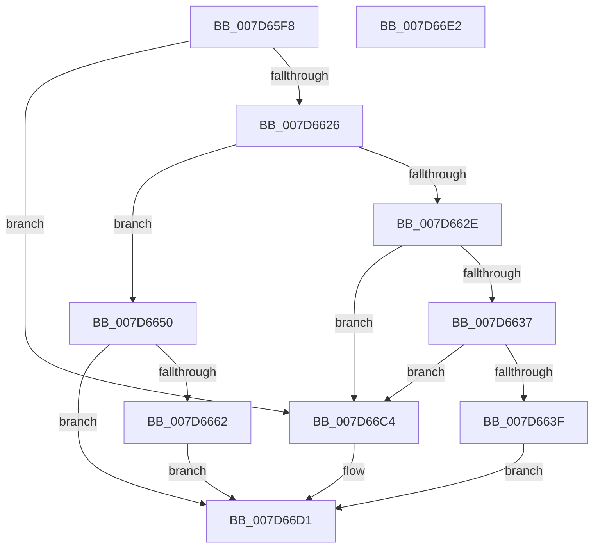

# ExpWnfGetPermanentDataStoreHandleByScopeId

- RVA: `0x007D65F8`–`0x007D66E3` (길이 `235` bytes)
- VA: `0x00000001407D65F8`
- 실행 섹션: `PAGE`
- PDB 이름 있음: `예`; PDB Function 태그: `아니요`
- unwind 정보 RVA: `0x000B6310`
- 디코드: `59`개 명령, `235/235` bytes 표시
- 미해석 바이트: `0` (있으면 어셈블리에 `.byte`로 보존)

> 이 문서는 커널 이미지의 기계어와 PDB 기호를 분석해 생성했습니다. 4번과 5번은 함수 원형과 자료형을 바이너리 사용 방식에서 추정한 C 해석이며 원본 소스 복구 결과는 아닙니다.

## 1. Dependencies

- 직접 호출 지점: **4**; 고유 호출 대상: **4**
- 직접 호출자로 확인된 함수: **2**
- RIP 상대 이미지 참조: **1**

### Outgoing calls
- `0x007D6646` → [ExpWnfGetPermanentPerUserDataStoreHandle](../A7/ExpWnfGetPermanentPerUserDataStoreHandle_function_00A7A35C.md) (function, `0x00A7A35C`)
- `0x007D6659` → [ExpWnfGetNameStoreRegistryRoot](../8B/ExpWnfGetNameStoreRegistryRoot_function_008BDB00.md) (function, `0x008BDB00`)
- `0x007D666D` → [RtlInitUnicodeString](../../text/42/RtlInitUnicodeString_function_0042A780.md) (function, `0x0042A780`)
- `0x007D66B6` → [ZwCreateKey](../../text/6A/ZwCreateKey_function_006AD470.md) (function, `0x006AD470`)

### Direct callers
- [ExpWnfEnumeratePermanentDataStoreHandles](ExpWnfEnumeratePermanentDataStoreHandles_function_007D65AC.md) at `0x007D65E7`
- [sub_00B49AA2](../B4/Unknown_function_00B49AA2.md) at `0x00B49B11`

### Static image references
- `0x007D6662` → RVA `0x00AFD610` (` ?? ::NNGAKEGL::`string'`; read)

## 2. Other-region calls and transfers

- 다른 실행 섹션으로 향하는 call: **2**
  - `0x007D666D` → [RtlInitUnicodeString](../../text/42/RtlInitUnicodeString_function_0042A780.md) (`PAGE` → `.text`)
  - `0x007D66B6` → [ZwCreateKey](../../text/6A/ZwCreateKey_function_006AD470.md) (`PAGE` → `.text`)
- 별도 외부 분기/꼬리 이동을 확인하지 못했습니다.

## 3. Assembly (complete function range)

```asm
007D65F8  48 89 5C 24 08                  mov qword ptr [rsp + 8], rbx
007D65FD  55                              push rbp
007D65FE  48 8D 6C 24 C1                  lea rbp, [rsp - 0x3f]
007D6603  48 81 EC 90 00 00 00            sub rsp, 0x90
007D660A  33 DB                           xor ebx, ebx
007D660C  0F 57 C0                        xorps xmm0, xmm0
007D660F  89 5D 0B                        mov dword ptr [rbp + 0xb], ebx
007D6612  89 5D 23                        mov dword ptr [rbp + 0x23], ebx
007D6615  0F 11 45 F7                     movups xmmword ptr [rbp - 9], xmm0
007D6619  48 89 5D EF                     mov qword ptr [rbp - 0x11], rbx
007D661D  39 5D 6F                        cmp dword ptr [rbp + 0x6f], ebx
007D6620  0F 85 9E 00 00 00               jne 0x1407d66c4
007D6626  F7 C1 FB FF FF FF               test ecx, 0xfffffffb
007D662C  74 22                           je 0x1407d6650
007D662E  83 F9 02                        cmp ecx, 2
007D6631  0F 85 8D 00 00 00               jne 0x1407d66c4
007D6637  85 D2                           test edx, edx
007D6639  0F 85 85 00 00 00               jne 0x1407d66c4
007D663F  48 8B 55 7F                     mov rdx, qword ptr [rbp + 0x7f]
007D6643  49 8B C8                        mov rcx, r8
007D6646  E8 11 3D 2A 00                  call 0x140a7a35c
007D664B  E9 81 00 00 00                  jmp 0x1407d66d1
007D6650  48 8D 55 EF                     lea rdx, [rbp - 0x11]
007D6654  B9 01 00 00 00                  mov ecx, 1
007D6659  E8 A2 74 0E 00                  call 0x1408bdb00
007D665E  85 C0                           test eax, eax
007D6660  78 6F                           js 0x1407d66d1
007D6662  48 8D 15 A7 6F 32 00            lea rdx, [rip + 0x326fa7]
007D6669  48 8D 4D F7                     lea rcx, [rbp - 9]
007D666D  E8 0E 41 C5 FF                  call 0x14042a780
007D6672  48 8B 45 EF                     mov rax, qword ptr [rbp - 0x11]
007D6676  4C 8D 45 07                     lea r8, [rbp + 7]
007D667A  48 8B 4D 7F                     mov rcx, qword ptr [rbp + 0x7f]
007D667E  0F 57 C0                        xorps xmm0, xmm0
007D6681  48 89 45 0F                     mov qword ptr [rbp + 0xf], rax
007D6685  45 33 C9                        xor r9d, r9d
007D6688  48 8D 45 F7                     lea rax, [rbp - 9]
007D668C  48 89 5C 24 30                  mov qword ptr [rsp + 0x30], rbx
007D6691  89 5C 24 28                     mov dword ptr [rsp + 0x28], ebx
007D6695  BA 3F 00 0F 00                  mov edx, 0xf003f
007D669A  48 89 45 17                     mov qword ptr [rbp + 0x17], rax
007D669E  C7 45 07 30 00 00 00            mov dword ptr [rbp + 7], 0x30
007D66A5  C7 45 1F 40 02 00 00            mov dword ptr [rbp + 0x1f], 0x240
007D66AC  F3 0F 7F 45 27                  movdqu xmmword ptr [rbp + 0x27], xmm0
007D66B1  48 89 5C 24 20                  mov qword ptr [rsp + 0x20], rbx
007D66B6  E8 B5 6D ED FF                  call 0x1406ad470
007D66BB  85 C0                           test eax, eax
007D66BD  0F 48 D8                        cmovs ebx, eax
007D66C0  8B C3                           mov eax, ebx
007D66C2  EB 0D                           jmp 0x1407d66d1
007D66C4  F7 5D 77                        neg dword ptr [rbp + 0x77]
007D66C7  1B C0                           sbb eax, eax
007D66C9  83 E0 CE                        and eax, 0xffffffce
007D66CC  05 34 00 00 C0                  add eax, 0xc0000034
007D66D1  48 8B 9C 24 A0 00 00 00         mov rbx, qword ptr [rsp + 0xa0]
007D66D9  48 81 C4 90 00 00 00            add rsp, 0x90
007D66E0  5D                              pop rbp
007D66E1  C3                              ret
007D66E2  CC                              int3
```

## 4. C-style interpretation (structured pseudocode)

```c
__int64 __fastcall ExpWnfGetPermanentDataStoreHandleByScopeId(int a1, int a2, __int64 a3, int a4, unsigned int a5, unsigned int a6, __int64 a7)
{
    __int64 result;
    __int64 v_rbx;
    __int64 v_rsp;
    unsigned __int64 v_stack_m20;
    unsigned int v_stack_m24;
    unsigned int v_stack_m28;
    unsigned __int64 v_stack_m30;
    unsigned __int64 v_stack_m38;
    unsigned int v_stack_m3C;
    unsigned __int64 v_stack_m40;
    unsigned __int64 v_stack_m47;
    unsigned __int64 v_stack_m50;
    unsigned __int64 v_stack_m58;
    unsigned __int64 v_stack_m68;
    unsigned int v_stack_m70;
    unsigned __int64 v_stack_m78;
    unsigned __int64 v_stack_p8;

    v_stack_p8 = v_rbx;
    v_rsp = (v_rsp) - (144);
    v_rbx = 0;
    v_stack_m3C = 0;
    v_stack_m24 = 0;
    v_stack_m50 = v_xmm0;
    v_stack_m58 = 0;
    if (a5 != 0) goto loc_007D66C4;
    if (((a1) & (0xFFFFFFFBULL)) == 0) goto loc_007D6650;
    if (a1 != 2) goto loc_007D66C4;
    if (a2 != 0) goto loc_007D66C4;
    result = ExpWnfGetPermanentPerUserDataStoreHandle(a3, a7, a3, a4);
    goto loc_007D66D1;
loc_007D6650:
    result = ExpWnfGetNameStoreRegistryRoot(1, v_stack_m58, a3, a4);
    if (sign_flag) goto loc_007D66D1;
    result = RtlInitUnicodeString(v_stack_m50, v_rip + 3305383, a3, a4);
    v_stack_m38 = v_stack_m58;
    a4 = 0;
    v_stack_m68 = 0;
    v_stack_m70 = 0;
    v_stack_m30 = v_stack_m50;
    v_stack_m40 = 48;
    v_stack_m28 = 576;
    v_stack_m20 = v_xmm0;
    v_stack_m78 = 0;
    result = ZwCreateKey(a7, (unsigned int)(0xF003FULL), v_stack_m40, a4);
    if (sign_flag) { v_rbx = (unsigned int)(result); }
    goto loc_007D66D1;
loc_007D66C4:
    result = (unsigned int)(((unsigned int)((unsigned int)(v_rbx))) & (0xFFFFFFCEULL));
    result = (unsigned int)((result) + (0xC0000034ULL));
loc_007D66D1:
    v_rsp = (v_rsp) + (144);
    return result;
}
```

## 5. (Beta) C Style

```c
int64_t ExpWnfGetPermanentDataStoreHandleByScopeId(int32_t Arg1, int32_t Arg2, int64_t Arg3, int32_t Arg4, uint32_t Arg5, uint32_t Arg6, int64_t Arg7)
{
    int64_t result;
    int64_t local_rbx;
    int64_t local_rsp;
    uint64_t v_stack_m20;
    uint32_t v_stack_m24;
    uint32_t v_stack_m28;
    uint64_t v_stack_m30;
    uint64_t v_stack_m38;
    uint32_t v_stack_m3C;
    uint64_t v_stack_m40;
    uint64_t v_stack_m47;
    uint64_t v_stack_m50;
    uint64_t v_stack_m58;
    uint64_t v_stack_m68;
    uint32_t v_stack_m70;
    uint64_t v_stack_m78;
    uint64_t v_stack_p8;

    v_stack_p8 = local_rbx;
    local_rsp = (local_rsp) - (144);
    local_rbx = 0;
    v_stack_m3C = 0;
    v_stack_m24 = 0;
    v_stack_m50 = v_xmm0;
    v_stack_m58 = 0;
    if (Arg5 != 0) goto loc_007D66C4;
    if (((Arg1) & (0xFFFFFFFBULL)) == 0) goto loc_007D6650;
    if (Arg1 != 2) goto loc_007D66C4;
    if (Arg2 != 0) goto loc_007D66C4;
    result = ExpWnfGetPermanentPerUserDataStoreHandle(Arg3, Arg7, Arg3, Arg4);
    goto loc_007D66D1;
loc_007D6650:
    result = ExpWnfGetNameStoreRegistryRoot(1, v_stack_m58, Arg3, Arg4);
    if (sign_flag) goto loc_007D66D1;
    result = RtlInitUnicodeString(v_stack_m50, v_rip + 3305383, Arg3, Arg4);
    v_stack_m38 = v_stack_m58;
    Arg4 = 0;
    v_stack_m68 = 0;
    v_stack_m70 = 0;
    v_stack_m30 = v_stack_m50;
    v_stack_m40 = 48;
    v_stack_m28 = 576;
    v_stack_m20 = v_xmm0;
    v_stack_m78 = 0;
    result = ZwCreateKey(Arg7, (uint32_t)(0xF003FULL), v_stack_m40, Arg4);
    if (sign_flag) { local_rbx = (uint32_t)(result); }
    goto loc_007D66D1;
loc_007D66C4:
    result = (uint32_t)(((uint32_t)((uint32_t)(local_rbx))) & (0xFFFFFFCEULL));
    result = (uint32_t)((result) + (0xC0000034ULL));
loc_007D66D1:
    local_rsp = (local_rsp) + (144);
    return result;
}
```

## 6. Execution-region graph

[열기: 2D/3D 그래프와 함수 탐색 컨트롤 패널](../../../control-panel.html?section=page&rva=0x007D65F8&view=graph)

- 2D 그래프는 위에서 아래로 흐르고, 3D 그래프는 빈 공간을 드래그해 회전합니다. Shift+드래그는 이동, 휠은 확대·축소, 함수 노드 선택은 대상 보고서 이동입니다.

### Static fallback


