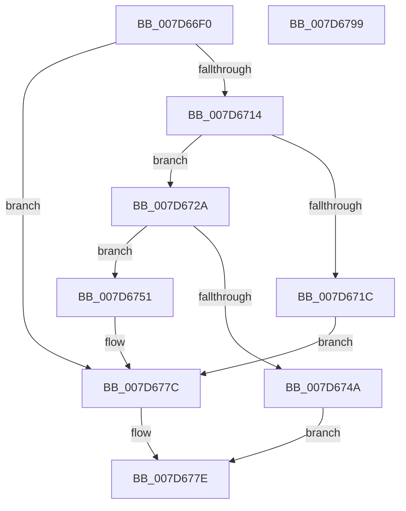

# ExpWnfPopulateStateDataRemoteCallback

- RVA: `0x007D66F0`–`0x007D679A` (길이 `170` bytes)
- VA: `0x00000001407D66F0`
- 실행 섹션: `PAGE`
- PDB 이름 있음: `예`; PDB Function 태그: `아니요`
- unwind 정보 RVA: `0x0005E6B4`
- 디코드: `47`개 명령, `170/170` bytes 표시
- 미해석 바이트: `0` (있으면 어셈블리에 `.byte`로 보존)

> 이 문서는 커널 이미지의 기계어와 PDB 기호를 분석해 생성했습니다. 4번과 5번은 함수 원형과 자료형을 바이너리 사용 방식에서 추정한 C 해석이며 원본 소스 복구 결과는 아닙니다.

## 1. Dependencies

- 직접 호출 지점: **2**; 고유 호출 대상: **2**
- 직접 호출자로 확인된 함수: **0**
- RIP 상대 이미지 참조: **0**

### Outgoing calls
- `0x007D673D` → [ExAllocatePool2](../../poolcode/B8/ExAllocatePool2_function_00B820F0.md) (function, `0x00B820F0`)
- `0x007D676D` → [memcpy](../../text/6C/memcpy_function_006C6840.md) (function, `0x006C6840`)

### Direct callers
- 이 함수 시작 RVA로 연결되는 직접 call은 확인되지 않았습니다. 간접 호출은 완전히 역산할 수 없습니다.

### Static image references
- 디코드된 RIP-relative 메모리 참조가 없습니다.

## 2. Other-region calls and transfers

- 다른 실행 섹션으로 향하는 call: **2**
  - `0x007D673D` → [ExAllocatePool2](../../poolcode/B8/ExAllocatePool2_function_00B820F0.md) (`PAGE` → `POOLCODE`)
  - `0x007D676D` → [memcpy](../../text/6C/memcpy_function_006C6840.md) (`PAGE` → `.text`)
- 별도 외부 분기/꼬리 이동을 확인하지 못했습니다.

## 3. Assembly (complete function range)

```asm
007D66F0  48 8B C4                        mov rax, rsp
007D66F3  48 89 58 08                     mov qword ptr [rax + 8], rbx
007D66F7  48 89 68 10                     mov qword ptr [rax + 0x10], rbp
007D66FB  48 89 70 18                     mov qword ptr [rax + 0x18], rsi
007D66FF  48 89 78 20                     mov qword ptr [rax + 0x20], rdi
007D6703  41 56                           push r14
007D6705  48 83 EC 20                     sub rsp, 0x20
007D6709  41 8B F1                        mov esi, r9d
007D670C  48 8B DA                        mov rbx, rdx
007D670F  45 85 C9                        test r9d, r9d
007D6712  74 68                           je 0x1407d677c
007D6714  8B 6C 24 58                     mov ebp, dword ptr [rsp + 0x58]
007D6718  85 ED                           test ebp, ebp
007D671A  75 0E                           jne 0x1407d672a
007D671C  48 C7 42 58 01 00 00 00         mov qword ptr [rdx + 0x58], 1
007D6724  44 89 4A 60                     mov dword ptr [rdx + 0x60], r9d
007D6728  EB 52                           jmp 0x1407d677c
007D672A  44 8B 72 38                     mov r14d, dword ptr [rdx + 0x38]
007D672E  B9 00 01 00 00                  mov ecx, 0x100
007D6733  41 B8 57 6E 66 20               mov r8d, 0x20666e57
007D6739  41 8D 56 10                     lea edx, [r14 + 0x10]
007D673D  E8 AE B9 3A 00                  call 0x140b820f0
007D6742  48 8B F8                        mov rdi, rax
007D6745  48 85 C0                        test rax, rax
007D6748  75 07                           jne 0x1407d6751
007D674A  B8 9A 00 00 C0                  mov eax, 0xc000009a
007D674F  EB 2D                           jmp 0x1407d677e
007D6751  48 8B 54 24 50                  mov rdx, qword ptr [rsp + 0x50]
007D6756  48 8D 48 10                     lea rcx, [rax + 0x10]
007D675A  C7 00 04 09 10 00               mov dword ptr [rax], 0x100904
007D6760  4C 8B C5                        mov r8, rbp
007D6763  44 89 70 04                     mov dword ptr [rax + 4], r14d
007D6767  89 68 08                        mov dword ptr [rax + 8], ebp
007D676A  89 70 0C                        mov dword ptr [rax + 0xc], esi
007D676D  E8 CE 00 EF FF                  call 0x1406c6840
007D6772  8B 47 0C                        mov eax, dword ptr [rdi + 0xc]
007D6775  89 43 60                        mov dword ptr [rbx + 0x60], eax
007D6778  48 89 7B 58                     mov qword ptr [rbx + 0x58], rdi
007D677C  33 C0                           xor eax, eax
007D677E  48 8B 5C 24 30                  mov rbx, qword ptr [rsp + 0x30]
007D6783  48 8B 6C 24 38                  mov rbp, qword ptr [rsp + 0x38]
007D6788  48 8B 74 24 40                  mov rsi, qword ptr [rsp + 0x40]
007D678D  48 8B 7C 24 48                  mov rdi, qword ptr [rsp + 0x48]
007D6792  48 83 C4 20                     add rsp, 0x20
007D6796  41 5E                           pop r14
007D6798  C3                              ret
007D6799  CC                              int3
```

## 4. C-style interpretation (structured pseudocode)

```c
__int64 __fastcall ExpWnfPopulateStateDataRemoteCallback(__int64 a1, __int64 a2, __int64 a3, int a4, __int64 a5, unsigned int a6)
{
    __int64 result;
    __int64 v_rsp;
    unsigned __int64 v_stack_p10;
    unsigned __int64 v_stack_p18;
    unsigned __int64 v_stack_p20;
    unsigned __int64 v_stack_p8;

    *(unsigned __int64 *)(v_rsp + 8) = v_rbx;
    *(unsigned __int64 *)(v_rsp + 16) = v_rbp;
    *(unsigned __int64 *)(v_rsp + 24) = v_rsi;
    *(unsigned __int64 *)(v_rsp + 32) = v_rdi;
    v_rsp = (v_rsp) - (32);
    if (a4 == 0) goto loc_007D677C;
    if ((unsigned int)((unsigned int)(a6)) != 0) goto loc_007D672A;
    *(unsigned __int64 *)(a2 + 88) = 1;
    *(unsigned int *)(a2 + 96) = a4;
    goto loc_007D677C;
loc_007D672A:
    result = ExAllocatePool2(256, (unsigned int)(*(unsigned int *)(a2 + 56)) + 16, (unsigned int)(0x20666E57ULL), a4);
    if (result != 0) goto loc_007D6751;
    goto loc_007D677E;
loc_007D6751:
    *(unsigned int *)((unsigned int)(0xC000009AULL)) = 0x100904ULL;
    *(unsigned int *)((unsigned int)(0xC000009AULL) + 4) = (unsigned int)((unsigned int)(*(unsigned int *)(a2 + 56)));
    *(unsigned int *)((unsigned int)(0xC000009AULL) + 8) = (unsigned int)((unsigned int)(a6));
    *(unsigned int *)((unsigned int)(0xC000009AULL) + 12) = (unsigned int)((unsigned int)(a4));
    result = memcpy((unsigned int)(0xC000009AULL) + 16, a5, (unsigned int)(a6), a4);
    *(unsigned int *)(a2 + 96) = (unsigned int)((unsigned int)(*(unsigned int *)(result + 12)));
    *(unsigned __int64 *)(a2 + 88) = result;
loc_007D677C:
    result = 0;
loc_007D677E:
    v_rsp = (v_rsp) + (32);
    return result;
}
```

## 5. (Beta) C Style

```c
int64_t ExpWnfPopulateStateDataRemoteCallback(int64_t Arg1, void *Arg2, int64_t Arg3, int32_t Arg4, int64_t Arg5, uint32_t Arg6)
{
    uint8_t *arg2 = (uint8_t *)Arg2;

    int64_t result;
    int64_t local_rsp;
    uint64_t v_stack_p10;
    uint64_t v_stack_p18;
    uint64_t v_stack_p20;
    uint64_t v_stack_p8;

    *(uint64_t *)(local_rsp + 0x8) = local_rbx;
    *(uint64_t *)(local_rsp + 0x10) = local_rbp;
    *(uint64_t *)(local_rsp + 0x18) = local_rsi;
    *(uint64_t *)(local_rsp + 0x20) = local_rdi;
    local_rsp = (local_rsp) - (32);
    if (Arg4 == 0) goto loc_007D677C;
    if ((uint32_t)((uint32_t)(Arg6)) != 0) goto loc_007D672A;
    *(uint64_t *)(arg2 + 0x58) = 1;
    *(uint32_t *)(arg2 + 0x60) = Arg4;
    goto loc_007D677C;
loc_007D672A:
    result = ExAllocatePool2(256, (uint32_t)(*(uint32_t *)(arg2 + 0x38)) + 16, (uint32_t)(0x20666E57ULL), Arg4);
    if (result != 0) goto loc_007D6751;
    goto loc_007D677E;
loc_007D6751:
    *(uint32_t *)((uint32_t)(0xC000009AULL)) = 0x100904ULL;
    *(uint32_t *)((uint32_t)(0xC000009AULL) + 0x4) = (uint32_t)((uint32_t)(*(uint32_t *)(arg2 + 0x38)));
    *(uint32_t *)((uint32_t)(0xC000009AULL) + 0x8) = (uint32_t)((uint32_t)(Arg6));
    *(uint32_t *)((uint32_t)(0xC000009AULL) + 0xC) = (uint32_t)((uint32_t)(Arg4));
    result = memcpy((uint32_t)(0xC000009AULL) + 16, Arg5, (uint32_t)(Arg6), Arg4);
    *(uint32_t *)(arg2 + 0x60) = (uint32_t)((uint32_t)(*(uint32_t *)(result + 0xC)));
    *(uint64_t *)(arg2 + 0x58) = result;
loc_007D677C:
    result = 0;
loc_007D677E:
    local_rsp = (local_rsp) + (32);
    return result;
}
```

### 관측된 메모리 오프셋

구조체 형식이 확인되지 않은 접근은 인자 기준의 오프셋으로만 기록했습니다.

| 기준 인자 | 오프셋 표현 | 폭 (bit) | 접근 |
|---|---:|---:|---|
| `Arg2` | `+ 0x38` | `32` | `R` |
| `Arg2` | `+ 0x58` | `64` | `W` |
| `Arg2` | `+ 0x60` | `32` | `W` |

## 6. Execution-region graph

[열기: 2D/3D 그래프와 함수 탐색 컨트롤 패널](../../../control-panel.html?section=page&rva=0x007D66F0&view=graph)

- 2D 그래프는 위에서 아래로 흐르고, 3D 그래프는 빈 공간을 드래그해 회전합니다. Shift+드래그는 이동, 휠은 확대·축소, 함수 노드 선택은 대상 보고서 이동입니다.

### Static fallback


