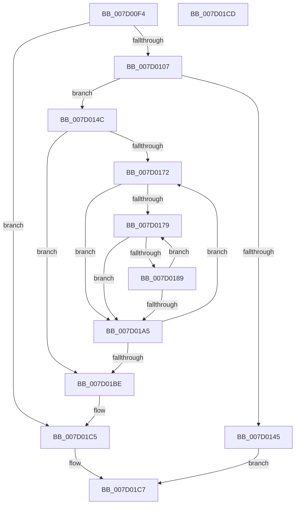

# ExpWorkQueueInitializeHealthMetricsMonitor

- RVA: `0x007D00F4`–`0x007D01CE` (길이 `218` bytes)
- VA: `0x00000001407D00F4`
- 실행 섹션: `PAGE`
- PDB 이름 있음: `예`; PDB Function 태그: `아니요`
- unwind 정보 RVA: `0x0005CF00`
- 디코드: `62`개 명령, `218/218` bytes 표시
- 미해석 바이트: `0` (있으면 어셈블리에 `.byte`로 보존)

> 이 문서는 커널 이미지의 기계어와 PDB 기호를 분석해 생성했습니다. 4번과 5번은 함수 원형과 자료형을 바이너리 사용 방식에서 추정한 C 해석이며 원본 소스 복구 결과는 아닙니다.

## 1. Dependencies

- 직접 호출 지점: **3**; 고유 호출 대상: **3**
- 직접 호출자로 확인된 함수: **1**
- RIP 상대 이미지 참조: **7**

### Outgoing calls
- `0x007D00FA` → [Feature_WorkQueueShardingWithinNodes__private_IsEnabledDeviceUsageNoInline](../../text/65/Feature_WorkQueueShardingWithinNodes__private_IsEnabledDeviceUsageNoInline_function_0065AA34.md) (function, `0x0065AA34`)
- `0x007D011E` → [KeInitializeTimer2](../../text/3A/KeInitializeTimer2_function_003A30B0.md) (function, `0x003A30B0`)
- `0x007D0138` → [ExAllocatePool2](../../poolcode/B8/ExAllocatePool2_function_00B820F0.md) (function, `0x00B820F0`)

### Direct callers
- [ExpWorkerInitialization](../../init/C5/ExpWorkerInitialization_function_00C539A4.md) at `0x00C53B5C`

### Static image references
- `0x007D010D` → RVA `0x0065A7F0` (`ExpWorkQueueHealthMetricsMonitorCallback`; read)
- `0x007D0117` → RVA `0x00EFA980` (`.data`; read)
- `0x007D0123` → RVA `0x00E0EBDC` (`.data`; read)
- `0x007D014C` → RVA `0x00E0EBE4` (`.data`; read)
- `0x007D015D` → RVA `0x00E0EBE0` (`.data`; read)
- `0x007D01B0` → RVA `0x00E0EBE8` (`.data`; read)
- `0x007D01BE` → RVA `0x00EFA910` (`.data`; write)

## 2. Other-region calls and transfers

- 다른 실행 섹션으로 향하는 call: **3**
  - `0x007D00FA` → [Feature_WorkQueueShardingWithinNodes__private_IsEnabledDeviceUsageNoInline](../../text/65/Feature_WorkQueueShardingWithinNodes__private_IsEnabledDeviceUsageNoInline_function_0065AA34.md) (`PAGE` → `.text`)
  - `0x007D011E` → [KeInitializeTimer2](../../text/3A/KeInitializeTimer2_function_003A30B0.md) (`PAGE` → `.text`)
  - `0x007D0138` → [ExAllocatePool2](../../poolcode/B8/ExAllocatePool2_function_00B820F0.md) (`PAGE` → `POOLCODE`)
- 별도 외부 분기/꼬리 이동을 확인하지 못했습니다.

## 3. Assembly (complete function range)

```asm
007D00F4  40 53                           push rbx
007D00F6  48 83 EC 20                     sub rsp, 0x20
007D00FA  E8 35 A9 E8 FF                  call 0x14065aa34
007D00FF  85 C0                           test eax, eax
007D0101  0F 84 BE 00 00 00               je 0x1407d01c5
007D0107  41 B9 08 00 00 00               mov r9d, 8
007D010D  48 8D 15 DC A6 E8 FF            lea rdx, [rip - 0x175924]
007D0114  45 33 C0                        xor r8d, r8d
007D0117  48 8D 0D 62 A8 72 00            lea rcx, [rip + 0x72a862]
007D011E  E8 8D 2F BD FF                  call 0x1403a30b0
007D0123  8B 15 B3 EA 63 00               mov edx, dword ptr [rip + 0x63eab3]
007D0129  B9 40 00 00 00                  mov ecx, 0x40
007D012E  48 C1 E2 03                     shl rdx, 3
007D0132  41 B8 45 78 57 6C               mov r8d, 0x6c577845
007D0138  E8 B3 1F 3B 00                  call 0x140b820f0
007D013D  4C 8B D0                        mov r10, rax
007D0140  48 85 C0                        test rax, rax
007D0143  75 07                           jne 0x1407d014c
007D0145  B8 9A 00 00 C0                  mov eax, 0xc000009a
007D014A  EB 7B                           jmp 0x1407d01c7
007D014C  8B 0D 92 EA 63 00               mov ecx, dword ptr [rip + 0x63ea92]
007D0152  33 D2                           xor edx, edx
007D0154  8B 05 82 EA 63 00               mov eax, dword ptr [rip + 0x63ea82]
007D015A  45 33 DB                        xor r11d, r11d
007D015D  44 8B 05 7C EA 63 00            mov r8d, dword ptr [rip + 0x63ea7c]
007D0164  FF C8                           dec eax
007D0166  03 C1                           add eax, ecx
007D0168  F7 F1                           div ecx
007D016A  33 D2                           xor edx, edx
007D016C  8B D8                           mov ebx, eax
007D016E  85 C0                           test eax, eax
007D0170  74 4C                           je 0x1407d01be
007D0172  45 33 C9                        xor r9d, r9d
007D0175  85 C9                           test ecx, ecx
007D0177  74 2C                           je 0x1407d01a5
007D0179  8B C2                           mov eax, edx
007D017B  0F AF C1                        imul eax, ecx
007D017E  41 03 C1                        add eax, r9d
007D0181  3B 05 55 EA 63 00               cmp eax, dword ptr [rip + 0x63ea55]
007D0187  73 1C                           jae 0x1407d01a5
007D0189  41 FF C1                        inc r9d
007D018C  41 8B C9                        mov ecx, r9d
007D018F  49 0F AF C8                     imul rcx, r8
007D0193  49 03 CB                        add rcx, r11
007D0196  49 89 0C C2                     mov qword ptr [r10 + rax*8], rcx
007D019A  8B 0D 44 EA 63 00               mov ecx, dword ptr [rip + 0x63ea44]
007D01A0  44 3B C9                        cmp r9d, ecx
007D01A3  72 D4                           jb 0x1407d0179
007D01A5  8B C1                           mov eax, ecx
007D01A7  FF C2                           inc edx
007D01A9  49 0F AF C0                     imul rax, r8
007D01AD  4C 03 D8                        add r11, rax
007D01B0  8B 05 32 EA 63 00               mov eax, dword ptr [rip + 0x63ea32]
007D01B6  4C 0F AF C0                     imul r8, rax
007D01BA  3B D3                           cmp edx, ebx
007D01BC  72 B4                           jb 0x1407d0172
007D01BE  4C 89 15 4B A7 72 00            mov qword ptr [rip + 0x72a74b], r10
007D01C5  33 C0                           xor eax, eax
007D01C7  48 83 C4 20                     add rsp, 0x20
007D01CB  5B                              pop rbx
007D01CC  C3                              ret
007D01CD  CC                              int3
```

## 4. C-style interpretation (structured pseudocode)

```c
__int64 __fastcall ExpWorkQueueInitializeHealthMetricsMonitor(__int64 a1, __int64 a2, int a3)
{
    __int64 result;
    __int64 v_r11;
    __int64 v_rsp;

    v_rsp = (v_rsp) - (32);
    result = Feature_WorkQueueShardingWithinNodes__private_IsEnabledDeviceUsageNoInline(a1, a2, a3, a4);
    if ((unsigned int)(result) == 0) goto loc_007D01C5;
    a3 = 0;
    result = KeInitializeTimer2(v_rip + 7514210, v_rip - 1530148, a3, 8);
    a2 = ((unsigned int)(*(unsigned int *)(v_rip + 6548147))) << (3);
    result = ExAllocatePool2(64, a2, (unsigned int)(0x6C577845ULL), 8);
    if (result != 0) goto loc_007D014C;
    goto loc_007D01C7;
loc_007D014C:
    a2 = 0;
    v_r11 = 0;
    result = (unsigned int)(((unsigned int)(*(unsigned int *)(v_rip + 6548098))) - 1);
    result = (unsigned int)((result) + ((unsigned int)((unsigned int)(*(unsigned int *)(v_rip + 6548114)))));
    a2 = 0;
    if ((unsigned int)(result) == 0) goto loc_007D01BE;
loc_007D0172:
    a4 = 0;
    if ((unsigned int)((unsigned int)(*(unsigned int *)(v_rip + 6548114))) == 0) goto loc_007D01A5;
loc_007D0179:
    result = (unsigned int)((0) * ((unsigned int)((unsigned int)(*(unsigned int *)(v_rip + 6548114)))));
    result = (unsigned int)((result) + (0));
    if (((unsigned int)(result)) >= (*(unsigned int *)(v_rip + 6548053))) goto loc_007D01A5;
    a4 = (unsigned int)((a4) + 1);
    a1 = ((unsigned int)((unsigned int)(a4))) * ((unsigned int)(*(unsigned int *)(v_rip + 6548092)));
    a1 = (a1) + (0);
    *(unsigned __int64 *)(result + result * 8) = a1;
    if (((unsigned int)(a4)) < ((unsigned int)((unsigned int)(*(unsigned int *)(v_rip + 6548036))))) goto loc_007D0179;
loc_007D01A5:
    a2 = (unsigned int)((a2) + 1);
    result = ((unsigned int)((unsigned int)((unsigned int)(*(unsigned int *)(v_rip + 6548036))))) * ((unsigned int)(*(unsigned int *)(v_rip + 6548092)));
    v_r11 = (v_r11) + (result);
    a3 = ((unsigned int)(*(unsigned int *)(v_rip + 6548092))) * ((unsigned int)(*(unsigned int *)(v_rip + 6548018)));
    if (((unsigned int)(a2)) < ((unsigned int)((unsigned int)((unsigned int)(result))))) goto loc_007D0172;
loc_007D01BE:
    *(unsigned __int64 *)(v_rip + 7513931) = result;
loc_007D01C5:
    result = 0;
loc_007D01C7:
    v_rsp = (v_rsp) + (32);
    return result;
}
```

## 5. (Beta) C Style

```c
int64_t ExpWorkQueueInitializeHealthMetricsMonitor(int64_t Arg1, int64_t Arg2, int32_t Arg3)
{
    int64_t result;
    int64_t local_r11;
    int64_t local_rsp;

    local_rsp = (local_rsp) - (32);
    result = Feature_WorkQueueShardingWithinNodes__private_IsEnabledDeviceUsageNoInline(Arg1, Arg2, Arg3, a4);
    if ((uint32_t)(result) == 0) goto loc_007D01C5;
    Arg3 = 0;
    result = KeInitializeTimer2(v_rip + 7514210, v_rip - 1530148, Arg3, 8);
    Arg2 = ((uint32_t)(*(uint32_t *)(v_rip + 0x63EAB3))) << (3);
    result = ExAllocatePool2(64, Arg2, (uint32_t)(0x6C577845ULL), 8);
    if (result != 0) goto loc_007D014C;
    goto loc_007D01C7;
loc_007D014C:
    Arg2 = 0;
    local_r11 = 0;
    result = (uint32_t)(((uint32_t)(*(uint32_t *)(v_rip + 0x63EA82))) - 1);
    result = (uint32_t)((result) + ((uint32_t)((uint32_t)(*(uint32_t *)(v_rip + 0x63EA92)))));
    Arg2 = 0;
    if ((uint32_t)(result) == 0) goto loc_007D01BE;
loc_007D0172:
    a4 = 0;
    if ((uint32_t)((uint32_t)(*(uint32_t *)(v_rip + 0x63EA92))) == 0) goto loc_007D01A5;
loc_007D0179:
    result = (uint32_t)((0) * ((uint32_t)((uint32_t)(*(uint32_t *)(v_rip + 0x63EA92)))));
    result = (uint32_t)((result) + (0));
    if (((uint32_t)(result)) >= (*(uint32_t *)(v_rip + 0x63EA55))) goto loc_007D01A5;
    a4 = (uint32_t)((a4) + 1);
    Arg1 = ((uint32_t)((uint32_t)(a4))) * ((uint32_t)(*(uint32_t *)(v_rip + 0x63EA7C)));
    Arg1 = (Arg1) + (0);
    *(uint64_t *)(result + result * 8) = Arg1;
    if (((uint32_t)(a4)) < ((uint32_t)((uint32_t)(*(uint32_t *)(v_rip + 0x63EA44))))) goto loc_007D0179;
loc_007D01A5:
    Arg2 = (uint32_t)((Arg2) + 1);
    result = ((uint32_t)((uint32_t)((uint32_t)(*(uint32_t *)(v_rip + 0x63EA44))))) * ((uint32_t)(*(uint32_t *)(v_rip + 0x63EA7C)));
    local_r11 = (local_r11) + (result);
    Arg3 = ((uint32_t)(*(uint32_t *)(v_rip + 0x63EA7C))) * ((uint32_t)(*(uint32_t *)(v_rip + 0x63EA32)));
    if (((uint32_t)(Arg2)) < ((uint32_t)((uint32_t)((uint32_t)(result))))) goto loc_007D0172;
loc_007D01BE:
    *(uint64_t *)(v_rip + 0x72A74B) = result;
loc_007D01C5:
    result = 0;
loc_007D01C7:
    local_rsp = (local_rsp) + (32);
    return result;
}
```

## 6. Execution-region graph

[열기: 2D/3D 그래프와 함수 탐색 컨트롤 패널](../../../control-panel.html?section=page&rva=0x007D00F4&view=graph)

- 2D 그래프는 위에서 아래로 흐르고, 3D 그래프는 빈 공간을 드래그해 회전합니다. Shift+드래그는 이동, 휠은 확대·축소, 함수 노드 선택은 대상 보고서 이동입니다.

### Static fallback


