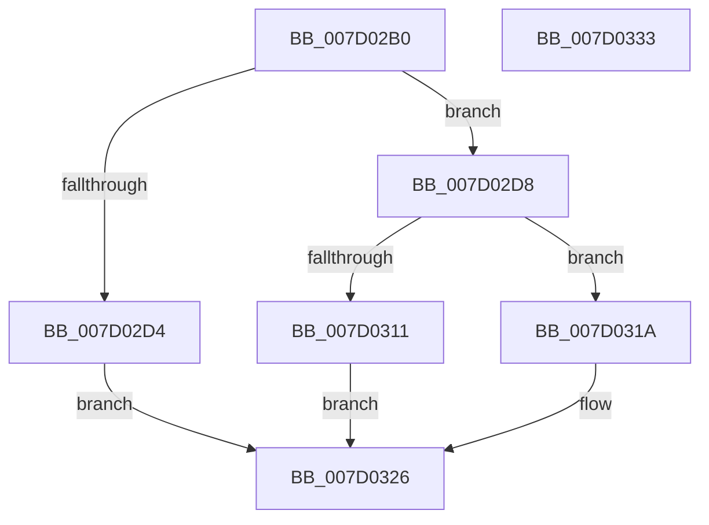

# ExpWorkQueueManagerStart

- RVA: `0x007D02B0`–`0x007D0334` (길이 `132` bytes)
- VA: `0x00000001407D02B0`
- 실행 섹션: `PAGE`
- PDB 이름 있음: `예`; PDB Function 태그: `아니요`
- unwind 정보 RVA: `0x000CA0D8`
- 디코드: `35`개 명령, `132/132` bytes 표시
- 미해석 바이트: `0` (있으면 어셈블리에 `.byte`로 보존)

> 이 문서는 커널 이미지의 기계어와 PDB 기호를 분석해 생성했습니다. 4번과 5번은 함수 원형과 자료형을 바이너리 사용 방식에서 추정한 C 해석이며 원본 소스 복구 결과는 아닙니다.

## 1. Dependencies

- 직접 호출 지점: **1**; 고유 호출 대상: **1**
- 직접 호출자로 확인된 함수: **2**
- RIP 상대 이미지 참조: **1**

### Outgoing calls
- `0x007D0306` → [ExpPartitionCreateSystemThread](../9E/ExpPartitionCreateSystemThread_function_009ECEA4.md) (function, `0x009ECEA4`)

### Direct callers
- [ExpNodeHotAddProcessorWorker](../7C/ExpNodeHotAddProcessorWorker_function_007CF820.md) at `0x007CF850`
- [ExpPartitionStart](../7C/ExpPartitionStart_function_007CFDCC.md) at `0x007CFE41`

### Static image references
- `0x007D02F5` → RVA `0x00AF6D60` (`ExpWorkQueueManagerThread`; read)

## 2. Other-region calls and transfers

- 다른 실행 섹션으로 향하는 call: **0**
- 별도 외부 분기/꼬리 이동을 확인하지 못했습니다.

## 3. Assembly (complete function range)

```asm
007D02B0  48 89 5C 24 10                  mov qword ptr [rsp + 0x10], rbx
007D02B5  57                              push rdi
007D02B6  48 83 EC 50                     sub rsp, 0x50
007D02BA  33 FF                           xor edi, edi
007D02BC  48 8B D9                        mov rbx, rcx
007D02BF  48 89 7C 24 60                  mov qword ptr [rsp + 0x60], rdi
007D02C4  33 C0                           xor eax, eax
007D02C6  8D 4F 01                        lea ecx, [rdi + 1]
007D02C9  F0 48 0F B1 8B 08 01 00 00      lock cmpxchg qword ptr [rbx + 0x108], rcx
007D02D2  74 04                           je 0x1407d02d8
007D02D4  8B CF                           mov ecx, edi
007D02D6  EB 4E                           jmp 0x1407d0326
007D02D8  48 8B 53 08                     mov rdx, qword ptr [rbx + 8]
007D02DC  48 8D 4C 24 60                  lea rcx, [rsp + 0x60]
007D02E1  48 89 4C 24 40                  mov qword ptr [rsp + 0x40], rcx
007D02E6  48 8D 83 14 01 00 00            lea rax, [rbx + 0x114]
007D02ED  48 8B 0B                        mov rcx, qword ptr [rbx]
007D02F0  48 89 44 24 38                  mov qword ptr [rsp + 0x38], rax
007D02F5  48 8D 05 64 6A 32 00            lea rax, [rip + 0x326a64]
007D02FC  48 89 5C 24 30                  mov qword ptr [rsp + 0x30], rbx
007D0301  48 89 44 24 28                  mov qword ptr [rsp + 0x28], rax
007D0306  E8 99 CB 21 00                  call 0x1409ecea4
007D030B  8B C8                           mov ecx, eax
007D030D  85 C0                           test eax, eax
007D030F  79 09                           jns 0x1407d031a
007D0311  48 87 BB 08 01 00 00            xchg qword ptr [rbx + 0x108], rdi
007D0318  EB 0C                           jmp 0x1407d0326
007D031A  48 8B 44 24 60                  mov rax, qword ptr [rsp + 0x60]
007D031F  48 87 83 08 01 00 00            xchg qword ptr [rbx + 0x108], rax
007D0326  48 8B 5C 24 68                  mov rbx, qword ptr [rsp + 0x68]
007D032B  8B C1                           mov eax, ecx
007D032D  48 83 C4 50                     add rsp, 0x50
007D0331  5F                              pop rdi
007D0332  C3                              ret
007D0333  CC                              int3
```

## 4. C-style interpretation (structured pseudocode)

```c
__int64 __fastcall ExpWorkQueueManagerStart(__int64 a1)
{
    __int64 result;
    __int64 v_rdi;
    __int64 v_rsp;
    unsigned __int64 v_stack_m18;
    unsigned __int64 v_stack_m20;
    unsigned __int64 v_stack_m28;
    unsigned __int64 v_stack_m30;
    unsigned __int64 v_stack_p10;
    unsigned __int64 v_stack_p8;

    v_stack_p10 = v_rbx;
    v_rsp = (v_rsp) - (80);
    v_rdi = 0;
    v_stack_p8 = 0;
    result = 0;
    if (condition_is_equal) goto loc_007D02D8;
    goto loc_007D0326;
loc_007D02D8:
    v_stack_m18 = v_stack_p8;
    v_stack_m20 = a1 + 276;
    v_stack_m28 = a1;
    v_stack_m30 = v_rip + 3304036;
    result = ExpPartitionCreateSystemThread(*(unsigned __int64 *)(a1), *(unsigned __int64 *)(a1 + 8), a3, a4);
    if (!sign_flag) goto loc_007D031A;
    goto loc_007D0326;
loc_007D031A:
loc_007D0326:
    v_rsp = (v_rsp) + (80);
    return (unsigned int)((unsigned int)((unsigned int)((unsigned int)(result))));
}
```

## 5. (Beta) C Style

```c
int64_t ExpWorkQueueManagerStart(void *Arg1)
{
    uint8_t *arg1 = (uint8_t *)Arg1;

    int64_t result;
    int64_t local_rdi;
    int64_t local_rsp;
    uint64_t v_stack_m18;
    uint64_t v_stack_m20;
    uint64_t v_stack_m28;
    uint64_t v_stack_m30;
    uint64_t v_stack_p10;
    uint64_t v_stack_p8;

    v_stack_p10 = local_rbx;
    local_rsp = (local_rsp) - (80);
    local_rdi = 0;
    v_stack_p8 = 0;
    result = 0;
    if (condition_is_equal) goto loc_007D02D8;
    goto loc_007D0326;
loc_007D02D8:
    v_stack_m18 = v_stack_p8;
    v_stack_m20 = Arg1 + 276;
    v_stack_m28 = Arg1;
    v_stack_m30 = v_rip + 3304036;
    result = ExpPartitionCreateSystemThread(*(uint64_t *)(arg1), *(uint64_t *)(arg1 + 0x8), a3, a4);
    if (!sign_flag) goto loc_007D031A;
    goto loc_007D0326;
loc_007D031A:
loc_007D0326:
    local_rsp = (local_rsp) + (80);
    return (uint32_t)((uint32_t)((uint32_t)((uint32_t)(result))));
}
```

### 관측된 메모리 오프셋

구조체 형식이 확인되지 않은 접근은 인자 기준의 오프셋으로만 기록했습니다.

| 기준 인자 | 오프셋 표현 | 폭 (bit) | 접근 |
|---|---:|---:|---|
| `Arg1` | `+ 0x0` | `64` | `R` |
| `Arg1` | `+ 0x8` | `64` | `R` |
| `Arg1` | `+ 0x108` | `64` | `R` |
| `Arg1` | `+ 0x108` | `64` | `R/W` |
| `Arg1` | `+ 0x114` | `64` | `R` |

## 6. Execution-region graph

[열기: 2D/3D 그래프와 함수 탐색 컨트롤 패널](../../../control-panel.html?section=page&rva=0x007D02B0&view=graph)

- 2D 그래프는 위에서 아래로 흐르고, 3D 그래프는 빈 공간을 드래그해 회전합니다. Shift+드래그는 이동, 휠은 확대·축소, 함수 노드 선택은 대상 보고서 이동입니다.

### Static fallback


