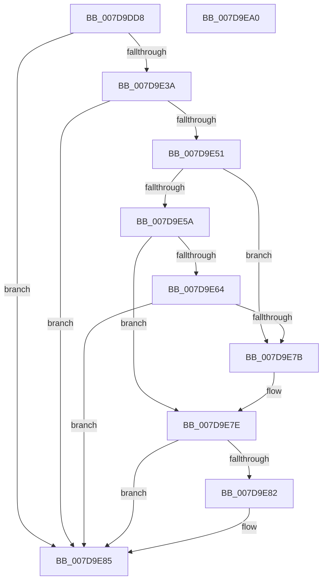

# KIsSideloadingEnabled

- RVA: `0x007D9DD8`–`0x007D9EA1` (길이 `201` bytes)
- VA: `0x00000001407D9DD8`
- 실행 섹션: `PAGE`
- PDB 이름 있음: `예`; PDB Function 태그: `아니요`
- unwind 정보 RVA: `0x000CC2F0`
- 디코드: `55`개 명령, `201/201` bytes 표시
- 미해석 바이트: `0` (있으면 어셈블리에 `.byte`로 보존)

> 이 문서는 커널 이미지의 기계어와 PDB 기호를 분석해 생성했습니다. 4번과 5번은 함수 원형과 자료형을 바이너리 사용 방식에서 추정한 C 해석이며 원본 소스 복구 결과는 아닙니다.

## 1. Dependencies

- 직접 호출 지점: **5**; 고유 호출 대상: **4**
- 직접 호출자로 확인된 함수: **1**
- RIP 상대 이미지 참조: **3**

### Outgoing calls
- `0x007D9E2F` → [KGetAppModelStateSeparatedRegKeyPath](../A6/KGetAppModelStateSeparatedRegKeyPath_function_00A690C0.md) (function, `0x00A690C0`)
- `0x007D9E46` → [KGetUnlockSetting](../A6/KGetUnlockSetting_function_00A691BC.md) (function, `0x00A691BC`)
- `0x007D9E51` → [CmIsStateSeparationEnabled](../../text/4A/CmIsStateSeparationEnabled_function_004A4754.md) (function, `0x004A4754`)
- `0x007D9E70` → [KGetUnlockSetting](../A6/KGetUnlockSetting_function_00A691BC.md) (function, `0x00A691BC`)
- `0x007D9E89` → [AppModelFreeUnicodeString](../../text/4B/AppModelFreeUnicodeString_function_004B5A04.md) (function, `0x004B5A04`)

### Direct callers
- [SepIsLockedDown](../79/SepIsLockedDown_function_0079BC28.md) at `0x0079BC4E`

### Static image references
- `0x007D9DFB` → RVA `0x0001AA10` (`.rdata`; read)
- `0x007D9E0A` → RVA `0x00039FC0` (`.rdata`; read)
- `0x007D9E15` → RVA `0x0001A9E8` (`.rdata`; read)

## 2. Other-region calls and transfers

- 다른 실행 섹션으로 향하는 call: **2**
  - `0x007D9E51` → [CmIsStateSeparationEnabled](../../text/4A/CmIsStateSeparationEnabled_function_004A4754.md) (`PAGE` → `.text`)
  - `0x007D9E89` → [AppModelFreeUnicodeString](../../text/4B/AppModelFreeUnicodeString_function_004B5A04.md) (`PAGE` → `.text`)
- 별도 외부 분기/꼬리 이동을 확인하지 못했습니다.

## 3. Assembly (complete function range)

```asm
007D9DD8  48 89 5C 24 18                  mov qword ptr [rsp + 0x18], rbx
007D9DDD  48 89 7C 24 20                  mov qword ptr [rsp + 0x20], rdi
007D9DE2  55                              push rbp
007D9DE3  48 8B EC                        mov rbp, rsp
007D9DE6  48 83 EC 50                     sub rsp, 0x50
007D9DEA  48 8B F9                        mov rdi, rcx
007D9DED  C6 01 00                        mov byte ptr [rcx], 0
007D9DF0  0F 57 C0                        xorps xmm0, xmm0
007D9DF3  48 C7 45 E0 74 00 76 00         mov qword ptr [rbp - 0x20], 0x760074
007D9DFB  48 8D 15 0E 0C 84 FF            lea rdx, [rip - 0x7bf3f2]
007D9E02  48 C7 45 D0 26 00 28 00         mov qword ptr [rbp - 0x30], 0x280026
007D9E0A  48 8D 05 AF 01 86 FF            lea rax, [rip - 0x79fe51]
007D9E11  48 89 55 E8                     mov qword ptr [rbp - 0x18], rdx
007D9E15  48 8D 0D CC 0B 84 FF            lea rcx, [rip - 0x7bf434]
007D9E1C  48 89 45 D8                     mov qword ptr [rbp - 0x28], rax
007D9E20  4C 8D 45 F0                     lea r8, [rbp - 0x10]
007D9E24  C7 45 10 FF FF 00 00            mov dword ptr [rbp + 0x10], 0xffff
007D9E2B  0F 11 45 F0                     movups xmmword ptr [rbp - 0x10], xmm0
007D9E2F  E8 8C F2 28 00                  call 0x140a690c0
007D9E34  8B D8                           mov ebx, eax
007D9E36  85 C0                           test eax, eax
007D9E38  78 4B                           js 0x1407d9e85
007D9E3A  4C 8D 45 10                     lea r8, [rbp + 0x10]
007D9E3E  48 8D 55 D0                     lea rdx, [rbp - 0x30]
007D9E42  48 8D 4D F0                     lea rcx, [rbp - 0x10]
007D9E46  E8 71 F3 28 00                  call 0x140a691bc
007D9E4B  8B D8                           mov ebx, eax
007D9E4D  85 C0                           test eax, eax
007D9E4F  78 34                           js 0x1407d9e85
007D9E51  E8 FE A8 CC FF                  call 0x1404a4754
007D9E56  84 C0                           test al, al
007D9E58  74 21                           je 0x1407d9e7b
007D9E5A  8B 45 10                        mov eax, dword ptr [rbp + 0x10]
007D9E5D  3D FF FF 00 00                  cmp eax, 0xffff
007D9E62  75 1A                           jne 0x1407d9e7e
007D9E64  4C 8D 45 10                     lea r8, [rbp + 0x10]
007D9E68  48 8D 55 D0                     lea rdx, [rbp - 0x30]
007D9E6C  48 8D 4D E0                     lea rcx, [rbp - 0x20]
007D9E70  E8 47 F3 28 00                  call 0x140a691bc
007D9E75  8B D8                           mov ebx, eax
007D9E77  85 C0                           test eax, eax
007D9E79  78 0A                           js 0x1407d9e85
007D9E7B  8B 45 10                        mov eax, dword ptr [rbp + 0x10]
007D9E7E  85 C0                           test eax, eax
007D9E80  74 03                           je 0x1407d9e85
007D9E82  C6 07 01                        mov byte ptr [rdi], 1
007D9E85  48 8D 4D F0                     lea rcx, [rbp - 0x10]
007D9E89  E8 76 BB CD FF                  call 0x1404b5a04
007D9E8E  48 8B 7C 24 78                  mov rdi, qword ptr [rsp + 0x78]
007D9E93  8B C3                           mov eax, ebx
007D9E95  48 8B 5C 24 70                  mov rbx, qword ptr [rsp + 0x70]
007D9E9A  48 83 C4 50                     add rsp, 0x50
007D9E9E  5D                              pop rbp
007D9E9F  C3                              ret
007D9EA0  CC                              int3
```

## 4. C-style interpretation (structured pseudocode)

```c
__int64 __fastcall KIsSideloadingEnabled(__int64 a1)
{
    __int64 result;
    __int64 v_rsp;
    unsigned __int64 v_stack_m18;
    unsigned __int64 v_stack_m20;
    unsigned __int64 v_stack_m28;
    unsigned __int64 v_stack_m30;
    unsigned __int64 v_stack_m38;
    unsigned __int64 v_stack_p18;
    unsigned __int64 v_stack_p20;
    unsigned int v_stack_p8;

    v_stack_p18 = v_rbx;
    v_stack_p20 = v_rdi;
    v_rsp = (v_rsp) - (80);
    *(unsigned __int8 *)(a1) = 0;
    v_stack_m28 = 0x760074ULL;
    v_stack_m38 = 0x280026ULL;
    v_stack_m20 = v_rip - 8123378;
    v_stack_m30 = v_rip - 7994961;
    v_stack_p8 = 0xFFFFULL;
    v_stack_m18 = v_xmm0;
    result = KGetAppModelStateSeparatedRegKeyPath(v_rip - 8123444, v_rip - 8123378, v_stack_m18, a4);
    if (sign_flag) goto loc_007D9E85;
    result = KGetUnlockSetting(v_stack_m18, v_stack_m38, v_stack_p8, a4);
    if (sign_flag) goto loc_007D9E85;
    result = CmIsStateSeparationEnabled(v_stack_m18, v_stack_m38, v_stack_p8, a4);
    if ((unsigned __int8)(result) == 0) goto loc_007D9E7B;
    if (((unsigned int)((unsigned int)(v_stack_p8))) != 0xFFFFULL) goto loc_007D9E7E;
    result = KGetUnlockSetting(v_stack_m28, v_stack_m38, v_stack_p8, a4);
    if (sign_flag) goto loc_007D9E85;
loc_007D9E7B:
loc_007D9E7E:
    if ((unsigned int)((unsigned int)(v_stack_p8)) != 0) {
        *(unsigned __int8 *)(a1) = 1;
    }
    result = AppModelFreeUnicodeString(v_stack_m18, v_stack_m38, v_stack_p8, a4);
    v_rsp = (v_rsp) + (80);
    return (unsigned int)((unsigned int)((unsigned int)((unsigned int)(result))));
}
```

## 5. (Beta) C Style

```c
int64_t KIsSideloadingEnabled(void *Arg1)
{
    uint8_t *arg1 = (uint8_t *)Arg1;

    int64_t result;
    int64_t local_rsp;
    uint64_t v_stack_m18;
    uint64_t v_stack_m20;
    uint64_t v_stack_m28;
    uint64_t v_stack_m30;
    uint64_t v_stack_m38;
    uint64_t v_stack_p18;
    uint64_t v_stack_p20;
    uint32_t v_stack_p8;

    v_stack_p18 = local_rbx;
    v_stack_p20 = local_rdi;
    local_rsp = (local_rsp) - (80);
    *(uint8_t *)(arg1) = 0;
    v_stack_m28 = 0x760074ULL;
    v_stack_m38 = 0x280026ULL;
    v_stack_m20 = v_rip - 8123378;
    v_stack_m30 = v_rip - 7994961;
    v_stack_p8 = 0xFFFFULL;
    v_stack_m18 = v_xmm0;
    result = KGetAppModelStateSeparatedRegKeyPath(v_rip - 8123444, v_rip - 8123378, v_stack_m18, a4);
    if (sign_flag) goto loc_007D9E85;
    result = KGetUnlockSetting(v_stack_m18, v_stack_m38, v_stack_p8, a4);
    if (sign_flag) goto loc_007D9E85;
    result = CmIsStateSeparationEnabled(v_stack_m18, v_stack_m38, v_stack_p8, a4);
    if ((uint8_t)(result) == 0) goto loc_007D9E7B;
    if (((uint32_t)((uint32_t)(v_stack_p8))) != 0xFFFFULL) goto loc_007D9E7E;
    result = KGetUnlockSetting(v_stack_m28, v_stack_m38, v_stack_p8, a4);
    if (sign_flag) goto loc_007D9E85;
loc_007D9E7B:
loc_007D9E7E:
    if ((uint32_t)((uint32_t)(v_stack_p8)) != 0) {
        *(uint8_t *)(arg1) = 1;
    }
    result = AppModelFreeUnicodeString(v_stack_m18, v_stack_m38, v_stack_p8, a4);
    local_rsp = (local_rsp) + (80);
    return (uint32_t)((uint32_t)((uint32_t)((uint32_t)(result))));
}
```

### 관측된 메모리 오프셋

구조체 형식이 확인되지 않은 접근은 인자 기준의 오프셋으로만 기록했습니다.

| 기준 인자 | 오프셋 표현 | 폭 (bit) | 접근 |
|---|---:|---:|---|
| `Arg1` | `+ 0x0` | `8` | `W` |

## 6. Execution-region graph

[열기: 2D/3D 그래프와 함수 탐색 컨트롤 패널](../../../control-panel.html?section=page&rva=0x007D9DD8&view=graph)

- 2D 그래프는 위에서 아래로 흐르고, 3D 그래프는 빈 공간을 드래그해 회전합니다. Shift+드래그는 이동, 휠은 확대·축소, 함수 노드 선택은 대상 보고서 이동입니다.

### Static fallback


