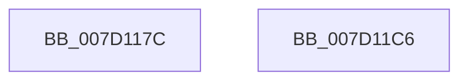

# KitpOpenRegKey

- RVA: `0x007D117C`–`0x007D11C7` (길이 `75` bytes)
- VA: `0x00000001407D117C`
- 실행 섹션: `PAGE`
- PDB 이름 있음: `예`; PDB Function 태그: `아니요`
- unwind 정보 RVA: `0x0005CC98`
- 디코드: `18`개 명령, `75/75` bytes 표시
- 미해석 바이트: `0` (있으면 어셈블리에 `.byte`로 보존)

> 이 문서는 커널 이미지의 기계어와 PDB 기호를 분석해 생성했습니다. 4번과 5번은 함수 원형과 자료형을 바이너리 사용 방식에서 추정한 C 해석이며 원본 소스 복구 결과는 아닙니다.

## 1. Dependencies

- 직접 호출 지점: **1**; 고유 호출 대상: **1**
- 직접 호출자로 확인된 함수: **1**
- RIP 상대 이미지 참조: **1**

### Outgoing calls
- `0x007D11BC` → [ZwOpenKey](../../text/6A/ZwOpenKey_function_006AD310.md) (function, `0x006AD310`)

### Direct callers
- [KitpInitAitSampleRate](../../init/C5/KitpInitAitSampleRate_function_00C53FC8.md) at `0x00C53FFE`

### Static image references
- `0x007D1194` → RVA `0x0000BDD0` (`.rdata`; read)

## 2. Other-region calls and transfers

- 다른 실행 섹션으로 향하는 call: **1**
  - `0x007D11BC` → [ZwOpenKey](../../text/6A/ZwOpenKey_function_006AD310.md) (`PAGE` → `.text`)
- 별도 외부 분기/꼬리 이동을 확인하지 못했습니다.

## 3. Assembly (complete function range)

```asm
007D117C  4C 8B DC                        mov r11, rsp
007D117F  48 83 EC 58                     sub rsp, 0x58
007D1183  33 C9                           xor ecx, ecx
007D1185  49 C7 43 C8 30 00 00 00         mov qword ptr [r11 - 0x38], 0x30
007D118D  49 89 4B D0                     mov qword ptr [r11 - 0x30], rcx
007D1191  49 8B C0                        mov rax, r8
007D1194  48 8D 0D 35 AC 83 FF            lea rcx, [rip - 0x7c53cb]
007D119B  49 C7 43 E0 40 02 00 00         mov qword ptr [r11 - 0x20], 0x240
007D11A3  49 89 4B D8                     mov qword ptr [r11 - 0x28], rcx
007D11A7  4D 8D 43 C8                     lea r8, [r11 - 0x38]
007D11AB  0F 57 C0                        xorps xmm0, xmm0
007D11AE  48 8B C8                        mov rcx, rax
007D11B1  BA 01 00 00 00                  mov edx, 1
007D11B6  F3 0F 7F 44 24 40               movdqu xmmword ptr [rsp + 0x40], xmm0
007D11BC  E8 4F C1 ED FF                  call 0x1406ad310
007D11C1  48 83 C4 58                     add rsp, 0x58
007D11C5  C3                              ret
007D11C6  CC                              int3
```

## 4. C-style interpretation (structured pseudocode)

```c
__int64 __fastcall KitpOpenRegKey(int a1, __int64 a2, __int64 a3)
{
    __int64 result;
    __int64 v_rsp;
    unsigned __int64 v_stack_m18;

    v_rsp = (v_rsp) - (88);
    a1 = 0;
    *(unsigned __int64 *)(v_rsp - 56) = 48;
    *(unsigned __int64 *)(v_rsp - 48) = 0;
    *(unsigned __int64 *)(v_rsp - 32) = 576;
    *(unsigned __int64 *)(v_rsp - 40) = v_rip - 8147915;
    v_stack_m18 = v_xmm0;
    result = ZwOpenKey(a3, 1, v_rsp - 56, a4);
    v_rsp = (v_rsp) + (88);
    return result;
}
```

## 5. (Beta) C Style

```c
int64_t KitpOpenRegKey(int32_t Arg1, int64_t Arg2, int64_t Arg3)
{
    int64_t result;
    int64_t local_rsp;
    uint64_t v_stack_m18;

    local_rsp = (local_rsp) - (88);
    Arg1 = 0;
    *(uint64_t *)(local_rsp - 0x38) = 48;
    *(uint64_t *)(local_rsp - 0x30) = 0;
    *(uint64_t *)(local_rsp - 0x20) = 576;
    *(uint64_t *)(local_rsp - 0x28) = v_rip - 8147915;
    v_stack_m18 = v_xmm0;
    result = ZwOpenKey(Arg3, 1, local_rsp - 56, a4);
    local_rsp = (local_rsp) + (88);
    return result;
}
```

## 6. Execution-region graph

[열기: 2D/3D 그래프와 함수 탐색 컨트롤 패널](../../../control-panel.html?section=page&rva=0x007D117C&view=graph)

- 2D 그래프는 위에서 아래로 흐르고, 3D 그래프는 빈 공간을 드래그해 회전합니다. Shift+드래그는 이동, 휠은 확대·축소, 함수 노드 선택은 대상 보고서 이동입니다.

### Static fallback


