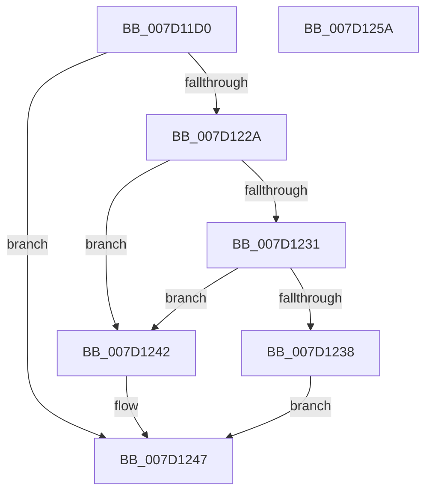

# KitpReadUlongFromKey

- RVA: `0x007D11D0`–`0x007D125B` (길이 `139` bytes)
- VA: `0x00000001407D11D0`
- 실행 섹션: `PAGE`
- PDB 이름 있음: `예`; PDB Function 태그: `아니요`
- unwind 정보 RVA: `0x0005F638`
- 디코드: `37`개 명령, `139/139` bytes 표시
- 미해석 바이트: `0` (있으면 어셈블리에 `.byte`로 보존)

> 이 문서는 커널 이미지의 기계어와 PDB 기호를 분석해 생성했습니다. 4번과 5번은 함수 원형과 자료형을 바이너리 사용 방식에서 추정한 C 해석이며 원본 소스 복구 결과는 아닙니다.

## 1. Dependencies

- 직접 호출 지점: **2**; 고유 호출 대상: **2**
- 직접 호출자로 확인된 함수: **1**
- RIP 상대 이미지 참조: **2**

### Outgoing calls
- `0x007D1221` → [ZwQueryValueKey](../../text/6A/ZwQueryValueKey_function_006AD3B0.md) (function, `0x006AD3B0`)
- `0x007D124F` → [_security_check_cookie](../../text/6A/_security_check_cookie_function_006AC640.md) (function, `0x006AC640`)

### Direct callers
- [KitpInitAitSampleRate](../../init/C5/KitpInitAitSampleRate_function_00C53FC8.md) at `0x00C54011`

### Static image references
- `0x007D11D6` → RVA `0x00E0A740` (`.data`; read)
- `0x007D11EF` → RVA `0x0000BDE0` (`.rdata`; read)

## 2. Other-region calls and transfers

- 다른 실행 섹션으로 향하는 call: **2**
  - `0x007D1221` → [ZwQueryValueKey](../../text/6A/ZwQueryValueKey_function_006AD3B0.md) (`PAGE` → `.text`)
  - `0x007D124F` → [_security_check_cookie](../../text/6A/_security_check_cookie_function_006AC640.md) (`PAGE` → `.text`)
- 별도 외부 분기/꼬리 이동을 확인하지 못했습니다.

## 3. Assembly (complete function range)

```asm
007D11D0  40 53                           push rbx
007D11D2  48 83 EC 60                     sub rsp, 0x60
007D11D6  48 8B 05 63 95 63 00            mov rax, qword ptr [rip + 0x639563]
007D11DD  48 33 C4                        xor rax, rsp
007D11E0  48 89 44 24 50                  mov qword ptr [rsp + 0x50], rax
007D11E5  33 C0                           xor eax, eax
007D11E7  4C 8D 4C 24 38                  lea r9, [rsp + 0x38]
007D11EC  41 21 00                        and dword ptr [r8], eax
007D11EF  48 8D 15 EA AB 83 FF            lea rdx, [rip - 0x7c5416]
007D11F6  21 44 24 30                     and dword ptr [rsp + 0x30], eax
007D11FA  49 8B D8                        mov rbx, r8
007D11FD  89 44 24 48                     mov dword ptr [rsp + 0x48], eax
007D1201  0F 57 C0                        xorps xmm0, xmm0
007D1204  48 8D 44 24 30                  lea rax, [rsp + 0x30]
007D1209  41 B8 02 00 00 00               mov r8d, 2
007D120F  48 89 44 24 28                  mov qword ptr [rsp + 0x28], rax
007D1214  C7 44 24 20 14 00 00 00         mov dword ptr [rsp + 0x20], 0x14
007D121C  0F 11 44 24 38                  movups xmmword ptr [rsp + 0x38], xmm0
007D1221  E8 8A C1 ED FF                  call 0x1406ad3b0
007D1226  85 C0                           test eax, eax
007D1228  78 1D                           js 0x1407d1247
007D122A  83 7C 24 3C 04                  cmp dword ptr [rsp + 0x3c], 4
007D122F  75 11                           jne 0x1407d1242
007D1231  83 7C 24 40 04                  cmp dword ptr [rsp + 0x40], 4
007D1236  75 0A                           jne 0x1407d1242
007D1238  8B 44 24 44                     mov eax, dword ptr [rsp + 0x44]
007D123C  89 03                           mov dword ptr [rbx], eax
007D123E  33 C0                           xor eax, eax
007D1240  EB 05                           jmp 0x1407d1247
007D1242  B8 24 00 00 C0                  mov eax, 0xc0000024
007D1247  48 8B 4C 24 50                  mov rcx, qword ptr [rsp + 0x50]
007D124C  48 33 CC                        xor rcx, rsp
007D124F  E8 EC B3 ED FF                  call 0x1406ac640
007D1254  48 83 C4 60                     add rsp, 0x60
007D1258  5B                              pop rbx
007D1259  C3                              ret
007D125A  CC                              int3
```

## 4. C-style interpretation (structured pseudocode)

```c
__int64 __fastcall KitpReadUlongFromKey(__int64 a1, __int64 a2, __int64 a3)
{
    __int64 result;
    __int64 v_rsp;
    unsigned __int64 v_stack_m18;
    unsigned int v_stack_m20;
    unsigned int v_stack_m24;
    unsigned int v_stack_m28;
    unsigned int v_stack_m2C;
    unsigned __int64 v_stack_m30;
    unsigned int v_stack_m38;
    unsigned __int64 v_stack_m40;
    unsigned int v_stack_m48;

    v_rsp = (v_rsp) - (96);
    result = (*(unsigned __int64 *)(v_rip + 6526307)) ^ (v_rsp);
    v_stack_m18 = result;
    result = 0;
    v_stack_m20 = 0;
    v_stack_m40 = v_stack_m38;
    v_stack_m48 = 20;
    v_stack_m30 = v_xmm0;
    result = ZwQueryValueKey(a1, v_rip - 8147990, 2, v_stack_m30);
    if (sign_flag) goto loc_007D1247;
    if (v_stack_m2C != 4) goto loc_007D1242;
    if (v_stack_m28 != 4) goto loc_007D1242;
    *(unsigned int *)(a3) = (unsigned int)((unsigned int)(v_stack_m24));
    result = 0;
    goto loc_007D1247;
loc_007D1242:
loc_007D1247:
    a1 = (v_stack_m18) ^ (v_rsp);
    result = _security_check_cookie(a1, v_rip - 8147990, 2, v_stack_m30);
    v_rsp = (v_rsp) + (96);
    return result;
}
```

## 5. (Beta) C Style

```c
int64_t KitpReadUlongFromKey(int64_t Arg1, int64_t Arg2, void *Arg3)
{
    uint8_t *arg3 = (uint8_t *)Arg3;

    int64_t result;
    int64_t local_rsp;
    uint64_t v_stack_m18;
    uint32_t v_stack_m20;
    uint32_t v_stack_m24;
    uint32_t v_stack_m28;
    uint32_t v_stack_m2C;
    uint64_t v_stack_m30;
    uint32_t v_stack_m38;
    uint64_t v_stack_m40;
    uint32_t v_stack_m48;

    local_rsp = (local_rsp) - (96);
    result = (*(uint64_t *)(v_rip + 0x639563)) ^ (local_rsp);
    v_stack_m18 = result;
    result = 0;
    v_stack_m20 = 0;
    v_stack_m40 = v_stack_m38;
    v_stack_m48 = 20;
    v_stack_m30 = v_xmm0;
    result = ZwQueryValueKey(Arg1, v_rip - 8147990, 2, v_stack_m30);
    if (sign_flag) goto loc_007D1247;
    if (v_stack_m2C != 4) goto loc_007D1242;
    if (v_stack_m28 != 4) goto loc_007D1242;
    *(uint32_t *)(arg3) = (uint32_t)((uint32_t)(v_stack_m24));
    result = 0;
    goto loc_007D1247;
loc_007D1242:
loc_007D1247:
    Arg1 = (v_stack_m18) ^ (local_rsp);
    result = _security_check_cookie(Arg1, v_rip - 8147990, 2, v_stack_m30);
    local_rsp = (local_rsp) + (96);
    return result;
}
```

### 관측된 메모리 오프셋

구조체 형식이 확인되지 않은 접근은 인자 기준의 오프셋으로만 기록했습니다.

| 기준 인자 | 오프셋 표현 | 폭 (bit) | 접근 |
|---|---:|---:|---|
| `Arg3` | `+ 0x0` | `32` | `R/W` |
| `Arg3` | `+ 0x0` | `32` | `W` |

## 6. Execution-region graph

[열기: 2D/3D 그래프와 함수 탐색 컨트롤 패널](../../../control-panel.html?section=page&rva=0x007D11D0&view=graph)

- 2D 그래프는 위에서 아래로 흐르고, 3D 그래프는 빈 공간을 드래그해 회전합니다. Shift+드래그는 이동, 휠은 확대·축소, 함수 노드 선택은 대상 보고서 이동입니다.

### Static fallback


