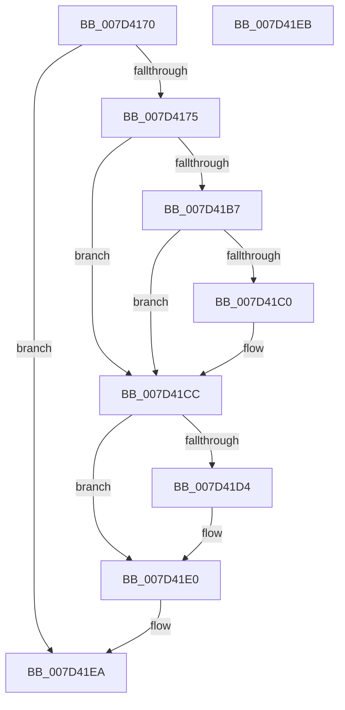

# MUIRegistrySystemRoutine

- RVA: `0x007D4170`–`0x007D41EC` (길이 `124` bytes)
- VA: `0x00000001407D4170`
- 실행 섹션: `PAGE`
- PDB 이름 있음: `예`; PDB Function 태그: `아니요`
- unwind 정보 RVA: `0x000D5A80`
- 디코드: `36`개 명령, `124/124` bytes 표시
- 미해석 바이트: `0` (있으면 어셈블리에 `.byte`로 보존)

> 이 문서는 커널 이미지의 기계어와 PDB 기호를 분석해 생성했습니다. 4번과 5번은 함수 원형과 자료형을 바이너리 사용 방식에서 추정한 C 해석이며 원본 소스 복구 결과는 아닙니다.

## 1. Dependencies

- 직접 호출 지점: **2**; 고유 호출 대상: **2**
- 직접 호출자로 확인된 함수: **0**
- RIP 상대 이미지 참조: **0**

### Outgoing calls
- `0x007D41AB` → [RtlpMuiRegCreateKernelRegistryInfo](../../text/6A/RtlpMuiRegCreateKernelRegistryInfo_function_006A908C.md) (function, `0x006A908C`)
- `0x007D41DB` → [KeSetEvent](../../text/33/KeSetEvent_function_0033F310.md) (function, `0x0033F310`)

### Direct callers
- 이 함수 시작 RVA로 연결되는 직접 call은 확인되지 않았습니다. 간접 호출은 완전히 역산할 수 없습니다.

### Static image references
- 디코드된 RIP-relative 메모리 참조가 없습니다.

## 2. Other-region calls and transfers

- 다른 실행 섹션으로 향하는 call: **2**
  - `0x007D41AB` → [RtlpMuiRegCreateKernelRegistryInfo](../../text/6A/RtlpMuiRegCreateKernelRegistryInfo_function_006A908C.md) (`PAGE` → `.text`)
  - `0x007D41DB` → [KeSetEvent](../../text/33/KeSetEvent_function_0033F310.md) (`PAGE` → `.text`)
- 별도 외부 분기/꼬리 이동을 확인하지 못했습니다.

## 3. Assembly (complete function range)

```asm
007D4170  48 85 C9                        test rcx, rcx
007D4173  74 75                           je 0x1407d41ea
007D4175  48 89 5C 24 08                  mov qword ptr [rsp + 8], rbx
007D417A  57                              push rdi
007D417B  48 83 EC 40                     sub rsp, 0x40
007D417F  48 8D 41 24                     lea rax, [rcx + 0x24]
007D4183  48 8B D9                        mov rbx, rcx
007D4186  48 89 44 24 30                  mov qword ptr [rsp + 0x30], rax
007D418B  4C 8D 49 1C                     lea r9, [rcx + 0x1c]
007D418F  8B 41 20                        mov eax, dword ptr [rcx + 0x20]
007D4192  4C 8D 41 14                     lea r8, [rcx + 0x14]
007D4196  89 44 24 28                     mov dword ptr [rsp + 0x28], eax
007D419A  48 8D 51 10                     lea rdx, [rcx + 0x10]
007D419E  4C 89 4C 24 20                  mov qword ptr [rsp + 0x20], r9
007D41A3  44 8B 49 18                     mov r9d, dword ptr [rcx + 0x18]
007D41A7  48 83 C1 08                     add rcx, 8
007D41AB  E8 DC 4E ED FF                  call 0x1406a908c
007D41B0  89 43 28                        mov dword ptr [rbx + 0x28], eax
007D41B3  85 C0                           test eax, eax
007D41B5  78 15                           js 0x1407d41cc
007D41B7  48 8B 4B 08                     mov rcx, qword ptr [rbx + 8]
007D41BB  48 85 C9                        test rcx, rcx
007D41BE  74 0C                           je 0x1407d41cc
007D41C0  A1 A4 03 00 00 80 F7 FF FF      movabs eax, dword ptr [0xfffff780000003a4]
007D41C9  89 41 0C                        mov dword ptr [rcx + 0xc], eax
007D41CC  48 8B 0B                        mov rcx, qword ptr [rbx]
007D41CF  48 85 C9                        test rcx, rcx
007D41D2  74 0C                           je 0x1407d41e0
007D41D4  45 33 C0                        xor r8d, r8d
007D41D7  41 8D 50 01                     lea edx, [r8 + 1]
007D41DB  E8 30 B1 B6 FF                  call 0x14033f310
007D41E0  48 8B 5C 24 50                  mov rbx, qword ptr [rsp + 0x50]
007D41E5  48 83 C4 40                     add rsp, 0x40
007D41E9  5F                              pop rdi
007D41EA  C3                              ret
007D41EB  CC                              int3
```

## 4. C-style interpretation (structured pseudocode)

```c
__int64 __fastcall MUIRegistrySystemRoutine(__int64 a1)
{
    __int64 result;
    __int64 v_rsp;
    unsigned __int64 v_stack_m18;
    unsigned int v_stack_m20;
    unsigned __int64 v_stack_m28;
    unsigned __int64 v_stack_p8;

    if (a1 == 0) goto loc_007D41EA;
    v_stack_p8 = v_rbx;
    v_rsp = (v_rsp) - (64);
    v_stack_m18 = a1 + 36;
    v_stack_m20 = (unsigned int)((unsigned int)(*(unsigned int *)(a1 + 32)));
    v_stack_m28 = a1 + 28;
    a1 = (a1) + (8);
    result = RtlpMuiRegCreateKernelRegistryInfo(a1, a1 + 16, a1 + 20, (unsigned int)(*(unsigned int *)(a1 + 24)));
    *(unsigned int *)(a1 + 40) = (unsigned int)(result);
    if (sign_flag) goto loc_007D41CC;
    if (*(unsigned __int64 *)(a1 + 8) != 0) {
        *(unsigned int *)(*(unsigned __int64 *)(a1 + 8) + 12) = (unsigned int)(result);
    }
    if (*(unsigned __int64 *)(a1) != 0) {
        a3 = 0;
        a2 = a3 + 1;
        result = KeSetEvent(*(unsigned __int64 *)(a1), a2, a3, (unsigned int)(*(unsigned int *)(a1 + 24)));
    }
    v_rsp = (v_rsp) + (64);
loc_007D41EA:
    return result;
}
```

## 5. (Beta) C Style

```c
int64_t MUIRegistrySystemRoutine(int64_t Arg1)
{
    int64_t result;
    int64_t local_rsp;
    uint64_t v_stack_m18;
    uint32_t v_stack_m20;
    uint64_t v_stack_m28;
    uint64_t v_stack_p8;

    if (Arg1 == 0) goto loc_007D41EA;
    v_stack_p8 = local_rbx;
    local_rsp = (local_rsp) - (64);
    v_stack_m18 = Arg1 + 36;
    v_stack_m20 = (uint32_t)((uint32_t)(*(uint32_t *)(Arg1 + 0x20)));
    v_stack_m28 = Arg1 + 28;
    Arg1 = (Arg1) + (8);
    result = RtlpMuiRegCreateKernelRegistryInfo(Arg1, Arg1 + 16, Arg1 + 20, (uint32_t)(*(uint32_t *)(Arg1 + 0x18)));
    *(uint32_t *)(Arg1 + 0x28) = (uint32_t)(result);
    if (sign_flag) goto loc_007D41CC;
    if (*(uint64_t *)(Arg1 + 0x8) != 0) {
        *(uint32_t *)(*(uint64_t *)(Arg1 + 0x8) + 0xC) = (uint32_t)(result);
    }
    if (*(uint64_t *)(Arg1) != 0) {
        a3 = 0;
        a2 = a3 + 1;
        result = KeSetEvent(*(uint64_t *)(Arg1), a2, a3, (uint32_t)(*(uint32_t *)(Arg1 + 0x18)));
    }
    local_rsp = (local_rsp) + (64);
loc_007D41EA:
    return result;
}
```

## 6. Execution-region graph

[열기: 2D/3D 그래프와 함수 탐색 컨트롤 패널](../../../control-panel.html?section=page&rva=0x007D4170&view=graph)

- 2D 그래프는 위에서 아래로 흐르고, 3D 그래프는 빈 공간을 드래그해 회전합니다. Shift+드래그는 이동, 휠은 확대·축소, 함수 노드 선택은 대상 보고서 이동입니다.

### Static fallback


