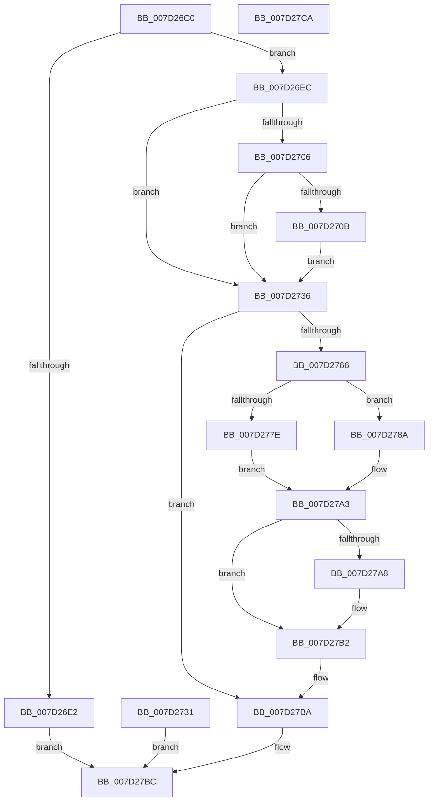

# NtAcquireCrossVmMutant

- RVA: `0x007D26C0`–`0x007D27CB` (길이 `267` bytes)
- VA: `0x00000001407D26C0`
- 실행 섹션: `PAGE`
- PDB 이름 있음: `예`; PDB Function 태그: `아니요`
- unwind 정보 RVA: `0x000D5A1C`
- 디코드: `69`개 명령, `267/267` bytes 표시
- 미해석 바이트: `0` (있으면 어셈블리에 `.byte`로 보존)

> 이 문서는 커널 이미지의 기계어와 PDB 기호를 분석해 생성했습니다. 4번과 5번은 함수 원형과 자료형을 바이너리 사용 방식에서 추정한 C 해석이며 원본 소스 복구 결과는 아닙니다.

## 1. Dependencies

- 직접 호출 지점: **5**; 고유 호출 대상: **5**
- 직접 호출자로 확인된 함수: **0**
- RIP 상대 이미지 참조: **1**

### Outgoing calls
- `0x007D275B` → [ObReferenceObjectByHandle](../86/ObReferenceObjectByHandle_function_00868DB0.md) (function, `0x00868DB0`)
- `0x007D2771` → [ExpGetExtensionHostForCrossVmObject](../70/ExpGetExtensionHostForCrossVmObject_function_007020E0.md) (function, `0x007020E0`)
- `0x007D279C` → [guard_dispatch_icall](../../text/6B/guard_dispatch_icall_function_006BAAD0.md) (function, `0x006BAAD0`)
- `0x007D27AD` → [ExReleaseExtensionTable](../../text/45/ExReleaseExtensionTable_function_00456DC0.md) (function, `0x00456DC0`)
- `0x007D27B5` → [ObfDereferenceObject](../../text/2F/ObfDereferenceObject_function_002F9350.md) (function, `0x002F9350`)

### Direct callers
- 이 함수 시작 RVA로 연결되는 직접 call은 확인되지 않았습니다. 간접 호출은 완전히 역산할 수 없습니다.

### Static image references
- `0x007D26D8` → RVA `0x00EFA128` (`.data`; read)

## 2. Other-region calls and transfers

- 다른 실행 섹션으로 향하는 call: **3**
  - `0x007D279C` → [guard_dispatch_icall](../../text/6B/guard_dispatch_icall_function_006BAAD0.md) (`PAGE` → `.text`)
  - `0x007D27AD` → [ExReleaseExtensionTable](../../text/45/ExReleaseExtensionTable_function_00456DC0.md) (`PAGE` → `.text`)
  - `0x007D27B5` → [ObfDereferenceObject](../../text/2F/ObfDereferenceObject_function_002F9350.md) (`PAGE` → `.text`)
- 별도 외부 분기/꼬리 이동을 확인하지 못했습니다.

## 3. Assembly (complete function range)

```asm
007D26C0  48 89 5C 24 08                  mov qword ptr [rsp + 8], rbx
007D26C5  48 89 54 24 10                  mov qword ptr [rsp + 0x10], rdx
007D26CA  56                              push rsi
007D26CB  57                              push rdi
007D26CC  41 56                           push r14
007D26CE  48 83 EC 40                     sub rsp, 0x40
007D26D2  48 83 64 24 78 00               and qword ptr [rsp + 0x78], 0
007D26D8  48 83 3D 48 7A 72 00 00         cmp qword ptr [rip + 0x727a48], 0
007D26E0  75 0A                           jne 0x1407d26ec
007D26E2  B8 24 00 00 C0                  mov eax, 0xc0000024
007D26E7  E9 D0 00 00 00                  jmp 0x1407d27bc
007D26EC  65 48 8B 04 25 88 01 00 00      mov rax, qword ptr gs:[0x188]
007D26F5  44 8A B0 32 02 00 00            mov r14b, byte ptr [rax + 0x232]
007D26FC  48 8B 5C 24 68                  mov rbx, qword ptr [rsp + 0x68]
007D2701  48 85 DB                        test rbx, rbx
007D2704  74 30                           je 0x1407d2736
007D2706  45 84 F6                        test r14b, r14b
007D2709  74 2B                           je 0x1407d2736
007D270B  48 B8 00 00 FF FF FF 7F 00 00   movabs rax, 0x7fffffff0000
007D2715  48 3B D8                        cmp rbx, rax
007D2718  48 0F 42 C3                     cmovb rax, rbx
007D271C  90                              nop
007D271D  48 8B 00                        mov rax, qword ptr [rax]
007D2720  48 89 44 24 78                  mov qword ptr [rsp + 0x78], rax
007D2725  48 8D 5C 24 78                  lea rbx, [rsp + 0x78]
007D272A  48 89 5C 24 68                  mov qword ptr [rsp + 0x68], rbx
007D272F  EB 05                           jmp 0x1407d2736
007D2731  E9 86 00 00 00                  jmp 0x1407d27bc
007D2736  4C 8B 05 EB 79 72 00            mov r8, qword ptr [rip + 0x7279eb]
007D273D  48 83 64 24 70 00               and qword ptr [rsp + 0x70], 0
007D2743  48 83 64 24 28 00               and qword ptr [rsp + 0x28], 0
007D2749  48 8D 44 24 70                  lea rax, [rsp + 0x70]
007D274E  48 89 44 24 20                  mov qword ptr [rsp + 0x20], rax
007D2753  45 8A CE                        mov r9b, r14b
007D2756  BA 00 00 10 00                  mov edx, 0x100000
007D275B  E8 50 66 09 00                  call 0x140868db0
007D2760  8B F8                           mov edi, eax
007D2762  85 C0                           test eax, eax
007D2764  78 54                           js 0x1407d27ba
007D2766  48 83 64 24 30 00               and qword ptr [rsp + 0x30], 0
007D276C  48 8D 54 24 30                  lea rdx, [rsp + 0x30]
007D2771  E8 6A F9 F2 FF                  call 0x1407020e0
007D2776  48 8B F0                        mov rsi, rax
007D2779  48 85 C0                        test rax, rax
007D277C  75 0C                           jne 0x1407d278a
007D277E  BF 02 00 00 C0                  mov edi, 0xc0000002
007D2783  48 8B 5C 24 70                  mov rbx, qword ptr [rsp + 0x70]
007D2788  EB 19                           jmp 0x1407d27a3
007D278A  48 8B 40 50                     mov rax, qword ptr [rax + 0x50]
007D278E  45 8A C6                        mov r8b, r14b
007D2791  48 8B D3                        mov rdx, rbx
007D2794  48 8B 5C 24 70                  mov rbx, qword ptr [rsp + 0x70]
007D2799  48 8B CB                        mov rcx, rbx
007D279C  E8 2F 83 EE FF                  call 0x1406baad0
007D27A1  8B F8                           mov edi, eax
007D27A3  48 85 F6                        test rsi, rsi
007D27A6  74 0A                           je 0x1407d27b2
007D27A8  48 8B 4C 24 30                  mov rcx, qword ptr [rsp + 0x30]
007D27AD  E8 0E 46 C8 FF                  call 0x140456dc0
007D27B2  48 8B CB                        mov rcx, rbx
007D27B5  E8 96 6B B2 FF                  call 0x1402f9350
007D27BA  8B C7                           mov eax, edi
007D27BC  48 8B 5C 24 60                  mov rbx, qword ptr [rsp + 0x60]
007D27C1  48 83 C4 40                     add rsp, 0x40
007D27C5  41 5E                           pop r14
007D27C7  5F                              pop rdi
007D27C8  5E                              pop rsi
007D27C9  C3                              ret
007D27CA  CC                              int3
```

## 4. C-style interpretation (structured pseudocode)

```c
__int64 __fastcall NtAcquireCrossVmMutant(__int64 a1, __int64 a2)
{
    __int64 result;
    __int64 v_rsp;
    unsigned __int64 v_stack_m28;
    unsigned __int64 v_stack_m30;
    unsigned __int64 v_stack_m38;
    unsigned __int64 v_stack_p10;
    unsigned __int64 v_stack_p18;
    unsigned __int64 v_stack_p20;
    unsigned __int64 v_stack_p8;

    v_stack_p8 = v_rbx;
    v_stack_p10 = a2;
    v_rsp = (v_rsp) - (64);
    if ((*(unsigned __int64 *)(v_rip + 7502408)) != 0) goto loc_007D26EC;
    goto loc_007D27BC;
loc_007D26EC:
    if (v_stack_p10 == 0) goto loc_007D2736;
    if ((unsigned __int8)(*(unsigned __int8 *)(*(unsigned __int64 *)(gs_base + (0 + 392)) + 562)) == 0) goto loc_007D2736;
    result = *(unsigned __int64 *)(gs_base + (0 + 392));
    if (v_stack_p10 < (*(unsigned __int64 *)(gs_base + (0 + 392)))) { result = v_stack_p10; }
    v_stack_p20 = *(unsigned __int64 *)(result);
    v_stack_p10 = v_stack_p20;
    goto loc_007D2736;
loc_007D2736:
    v_stack_m38 = v_stack_p18;
    result = ObReferenceObjectByHandle(a1, (unsigned int)(0x100000ULL), *(unsigned __int64 *)(v_rip + 7502315), (unsigned __int8)(*(unsigned __int8 *)(*(unsigned __int64 *)(gs_base + (0 + 392)) + 562)));
    if (sign_flag) goto loc_007D27BA;
    result = ExpGetExtensionHostForCrossVmObject(a1, v_stack_m28, *(unsigned __int64 *)(v_rip + 7502315), (unsigned __int8)(*(unsigned __int8 *)(*(unsigned __int64 *)(gs_base + (0 + 392)) + 562)));
    if (result != 0) goto loc_007D278A;
    goto loc_007D27A3;
loc_007D278A:
    result = guard_dispatch_icall(v_stack_p18, v_stack_p18, (unsigned __int8)(*(unsigned __int8 *)(*(unsigned __int64 *)(gs_base + (0 + 392)) + 562)), (unsigned __int8)(*(unsigned __int8 *)(*(unsigned __int64 *)(gs_base + (0 + 392)) + 562)));
loc_007D27A3:
    if (result != 0) {
        a1 = v_stack_m28;
        result = ExReleaseExtensionTable(a1, v_stack_p18, (unsigned __int8)(*(unsigned __int8 *)(*(unsigned __int64 *)(gs_base + (0 + 392)) + 562)), (unsigned __int8)(*(unsigned __int8 *)(*(unsigned __int64 *)(gs_base + (0 + 392)) + 562)));
    }
    result = ObfDereferenceObject(v_stack_p18, v_stack_p18, (unsigned __int8)(*(unsigned __int8 *)(*(unsigned __int64 *)(gs_base + (0 + 392)) + 562)), (unsigned __int8)(*(unsigned __int8 *)(*(unsigned __int64 *)(gs_base + (0 + 392)) + 562)));
loc_007D27BA:
loc_007D27BC:
    v_rsp = (v_rsp) + (64);
    return (unsigned int)((unsigned int)((unsigned int)((unsigned int)(result))));
}
```

## 5. (Beta) C Style

```c
int64_t NtAcquireCrossVmMutant(int64_t Arg1, int64_t Arg2)
{
    int64_t result;
    int64_t local_rsp;
    uint64_t v_stack_m28;
    uint64_t v_stack_m30;
    uint64_t v_stack_m38;
    uint64_t v_stack_p10;
    uint64_t v_stack_p18;
    uint64_t v_stack_p20;
    uint64_t v_stack_p8;

    v_stack_p8 = local_rbx;
    v_stack_p10 = Arg2;
    local_rsp = (local_rsp) - (64);
    if ((*(uint64_t *)(v_rip + 0x727A48)) != 0) goto loc_007D26EC;
    goto loc_007D27BC;
loc_007D26EC:
    if (v_stack_p10 == 0) goto loc_007D2736;
    if ((uint8_t)(*(uint8_t *)(*(uint64_t *)(gs_base + (0 + 0x188)) + 0x232)) == 0) goto loc_007D2736;
    result = *(uint64_t *)(gs_base + (0 + 0x188));
    if (v_stack_p10 < (*(uint64_t *)(gs_base + (0 + 0x188)))) { result = v_stack_p10; }
    v_stack_p20 = *(uint64_t *)(result);
    v_stack_p10 = v_stack_p20;
    goto loc_007D2736;
loc_007D2736:
    v_stack_m38 = v_stack_p18;
    result = ObReferenceObjectByHandle(Arg1, (uint32_t)(0x100000ULL), *(uint64_t *)(v_rip + 0x7279EB), (uint8_t)(*(uint8_t *)(*(uint64_t *)(gs_base + (0 + 0x188)) + 0x232)));
    if (sign_flag) goto loc_007D27BA;
    result = ExpGetExtensionHostForCrossVmObject(Arg1, v_stack_m28, *(uint64_t *)(v_rip + 0x7279EB), (uint8_t)(*(uint8_t *)(*(uint64_t *)(gs_base + (0 + 0x188)) + 0x232)));
    if (result != 0) goto loc_007D278A;
    goto loc_007D27A3;
loc_007D278A:
    result = guard_dispatch_icall(v_stack_p18, v_stack_p18, (uint8_t)(*(uint8_t *)(*(uint64_t *)(gs_base + (0 + 0x188)) + 0x232)), (uint8_t)(*(uint8_t *)(*(uint64_t *)(gs_base + (0 + 0x188)) + 0x232)));
loc_007D27A3:
    if (result != 0) {
        Arg1 = v_stack_m28;
        result = ExReleaseExtensionTable(Arg1, v_stack_p18, (uint8_t)(*(uint8_t *)(*(uint64_t *)(gs_base + (0 + 0x188)) + 0x232)), (uint8_t)(*(uint8_t *)(*(uint64_t *)(gs_base + (0 + 0x188)) + 0x232)));
    }
    result = ObfDereferenceObject(v_stack_p18, v_stack_p18, (uint8_t)(*(uint8_t *)(*(uint64_t *)(gs_base + (0 + 0x188)) + 0x232)), (uint8_t)(*(uint8_t *)(*(uint64_t *)(gs_base + (0 + 0x188)) + 0x232)));
loc_007D27BA:
loc_007D27BC:
    local_rsp = (local_rsp) + (64);
    return (uint32_t)((uint32_t)((uint32_t)((uint32_t)(result))));
}
```

## 6. Execution-region graph

[열기: 2D/3D 그래프와 함수 탐색 컨트롤 패널](../../../control-panel.html?section=page&rva=0x007D26C0&view=graph)

- 2D 그래프는 위에서 아래로 흐르고, 3D 그래프는 빈 공간을 드래그해 회전합니다. Shift+드래그는 이동, 휠은 확대·축소, 함수 노드 선택은 대상 보고서 이동입니다.

### Static fallback


