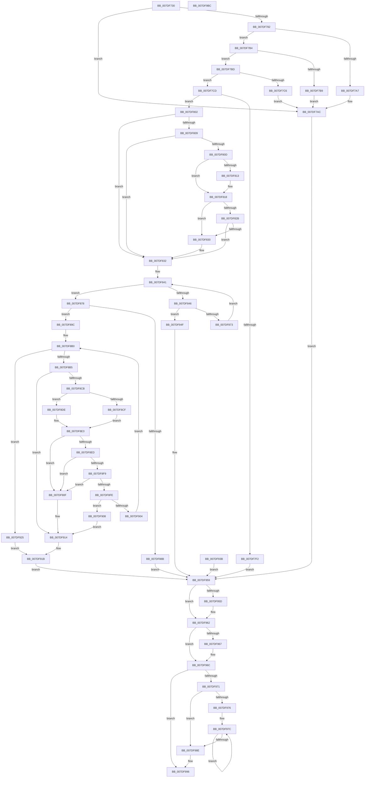

# NtCompactKeys

- RVA: `0x007DF730`–`0x007DF9BD` (길이 `653` bytes)
- VA: `0x00000001407DF730`
- 실행 섹션: `PAGE`
- PDB 이름 있음: `예`; PDB Function 태그: `아니요`
- unwind 정보 RVA: `0x000D681C`
- 디코드: `187`개 명령, `653/653` bytes 표시
- 미해석 바이트: `0` (있으면 어셈블리에 `.byte`로 보존)

> 이 문서는 커널 이미지의 기계어와 PDB 기호를 분석해 생성했습니다. 4번과 5번은 함수 원형과 자료형을 바이너리 사용 방식에서 추정한 C 해석이며 원본 소스 복구 결과는 아닙니다.

## 1. Dependencies

- 직접 호출 지점: **17**; 고유 호출 대상: **16**
- 직접 호출자로 확인된 함수: **0**
- RIP 상대 이미지 참조: **1**

### Outgoing calls
- `0x007DF772` → [CmpInitializeThreadInfo](../../text/3F/CmpInitializeThreadInfo_function_003FBE70.md) (function, `0x003FBE70`)
- `0x007DF777` → [CmCheckNoTxContext](../87/CmCheckNoTxContext_function_00876A80.md) (function, `0x00876A80`)
- `0x007DF79E` → [SeSinglePrivilegeCheck](../87/SeSinglePrivilegeCheck_function_00871E20.md) (function, `0x00871E20`)
- `0x007DF7E0` → [CmpAllocateTransientPoolWithQuota](../../text/46/CmpAllocateTransientPoolWithQuota_function_00461190.md) (function, `0x00461190`)
- `0x007DF813` → [ExRaiseDatatypeMisalignment](../89/ExRaiseDatatypeMisalignment_function_00899FD0.md) (function, `0x00899FD0`)
- `0x007DF83B` → [memcpy](../../text/6C/memcpy_function_006C6840.md) (function, `0x006C6840`)
- `0x007DF864` → [CmObReferenceObjectByHandle](../../pagecmrc/BC/CmObReferenceObjectByHandle_function_00BC9350.md) (function, `0x00BC9350`)
- `0x007DF878` → [CmpAcquireShutdownRundown](../../pagecmrc/BC/CmpAcquireShutdownRundown_function_00BC9400.md) (function, `0x00BC9400`)
- `0x007DF89C` → [CmpLockRegistryExclusive](../84/CmpLockRegistryExclusive_function_0084F9B4.md) (function, `0x0084F9B4`)
- `0x007DF8C0` → [CmpPerformKeyBodyDeletionCheck](../../pagecmrc/BC/CmpPerformKeyBodyDeletionCheck_function_00BC97D0.md) (function, `0x00BC97D0`)
- `0x007DF927` → [CmpUnlockRegistry](../../pagecmrc/BC/CmpUnlockRegistry_function_00BC9A84.md) (function, `0x00BC9A84`)
- `0x007DF931` → [CmpLogUnsupportedOperation](../9A/CmpLogUnsupportedOperation_function_009AEA40.md) (function, `0x009AEA40`)
- `0x007DF95D` → [CmpUnlockRegistry](../../pagecmrc/BC/CmpUnlockRegistry_function_00BC9A84.md) (function, `0x00BC9A84`)
- `0x007DF967` → [CmpReleaseShutdownRundown](../../pagecmrc/BC/CmpReleaseShutdownRundown_function_00BC9880.md) (function, `0x00BC9880`)
- `0x007DF97F` → [ObfDereferenceObject](../../text/2F/ObfDereferenceObject_function_002F9350.md) (function, `0x002F9350`)
- `0x007DF991` → [CmSiFreeMemory](../../text/47/CmSiFreeMemory_function_00475D80.md) (function, `0x00475D80`)
- `0x007DF99B` → [CmCleanupThreadInfo](../../text/41/CmCleanupThreadInfo_function_0041FD50.md) (function, `0x0041FD50`)

### Direct callers
- 이 함수 시작 RVA로 연결되는 직접 call은 확인되지 않았습니다. 간접 호출은 완전히 역산할 수 없습니다.

### Static image references
- `0x007DF797` → RVA `0x00FD9AC0` (`PAGEDATA`; read)

## 2. Other-region calls and transfers

- 다른 실행 섹션으로 향하는 call: **12**
  - `0x007DF772` → [CmpInitializeThreadInfo](../../text/3F/CmpInitializeThreadInfo_function_003FBE70.md) (`PAGE` → `.text`)
  - `0x007DF7E0` → [CmpAllocateTransientPoolWithQuota](../../text/46/CmpAllocateTransientPoolWithQuota_function_00461190.md) (`PAGE` → `.text`)
  - `0x007DF83B` → [memcpy](../../text/6C/memcpy_function_006C6840.md) (`PAGE` → `.text`)
  - `0x007DF864` → [CmObReferenceObjectByHandle](../../pagecmrc/BC/CmObReferenceObjectByHandle_function_00BC9350.md) (`PAGE` → `PAGECMRC`)
  - `0x007DF878` → [CmpAcquireShutdownRundown](../../pagecmrc/BC/CmpAcquireShutdownRundown_function_00BC9400.md) (`PAGE` → `PAGECMRC`)
  - `0x007DF8C0` → [CmpPerformKeyBodyDeletionCheck](../../pagecmrc/BC/CmpPerformKeyBodyDeletionCheck_function_00BC97D0.md) (`PAGE` → `PAGECMRC`)
  - `0x007DF927` → [CmpUnlockRegistry](../../pagecmrc/BC/CmpUnlockRegistry_function_00BC9A84.md) (`PAGE` → `PAGECMRC`)
  - `0x007DF95D` → [CmpUnlockRegistry](../../pagecmrc/BC/CmpUnlockRegistry_function_00BC9A84.md) (`PAGE` → `PAGECMRC`)
  - `0x007DF967` → [CmpReleaseShutdownRundown](../../pagecmrc/BC/CmpReleaseShutdownRundown_function_00BC9880.md) (`PAGE` → `PAGECMRC`)
  - `0x007DF97F` → [ObfDereferenceObject](../../text/2F/ObfDereferenceObject_function_002F9350.md) (`PAGE` → `.text`)
  - `0x007DF991` → [CmSiFreeMemory](../../text/47/CmSiFreeMemory_function_00475D80.md) (`PAGE` → `.text`)
  - `0x007DF99B` → [CmCleanupThreadInfo](../../text/41/CmCleanupThreadInfo_function_0041FD50.md) (`PAGE` → `.text`)
- 별도 외부 분기/꼬리 이동을 확인하지 못했습니다.

## 3. Assembly (complete function range)

```asm
007DF730  4C 8B DC                        mov r11, rsp
007DF733  49 89 5B 08                     mov qword ptr [r11 + 8], rbx
007DF737  49 89 73 10                     mov qword ptr [r11 + 0x10], rsi
007DF73B  57                              push rdi
007DF73C  41 54                           push r12
007DF73E  41 55                           push r13
007DF740  41 56                           push r14
007DF742  41 57                           push r15
007DF744  48 83 EC 60                     sub rsp, 0x60
007DF748  48 8B F2                        mov rsi, rdx
007DF74B  44 8B E1                        mov r12d, ecx
007DF74E  0F 57 C0                        xorps xmm0, xmm0
007DF751  33 C0                           xor eax, eax
007DF753  0F 11 44 24 48                  movups xmmword ptr [rsp + 0x48], xmm0
007DF758  49 89 43 D0                     mov qword ptr [r11 - 0x30], rax
007DF75C  33 FF                           xor edi, edi
007DF75E  44 8B F7                        mov r14d, edi
007DF761  44 8B FF                        mov r15d, edi
007DF764  88 84 24 A0 00 00 00            mov byte ptr [rsp + 0xa0], al
007DF76B  44 8A EF                        mov r13b, dil
007DF76E  49 8D 4B C0                     lea rcx, [r11 - 0x40]
007DF772  E8 F9 C6 C1 FF                  call 0x1403fbe70
007DF777  E8 04 73 09 00                  call 0x140876a80
007DF77C  8B D8                           mov ebx, eax
007DF77E  85 C0                           test eax, eax
007DF780  78 2A                           js 0x1407df7ac
007DF782  65 48 8B 04 25 88 01 00 00      mov rax, qword ptr gs:[0x188]
007DF78B  8A 80 32 02 00 00               mov al, byte ptr [rax + 0x232]
007DF791  88 44 24 30                     mov byte ptr [rsp + 0x30], al
007DF795  8A D0                           mov dl, al
007DF797  48 8B 0D 22 A3 7F 00            mov rcx, qword ptr [rip + 0x7fa322]
007DF79E  E8 7D 26 09 00                  call 0x140871e20
007DF7A3  84 C0                           test al, al
007DF7A5  75 0D                           jne 0x1407df7b4
007DF7A7  BB 61 00 00 C0                  mov ebx, 0xc0000061
007DF7AC  40 8A C7                        mov al, dil
007DF7AF  E9 A5 01 00 00                  jmp 0x1407df959
007DF7B4  45 85 E4                        test r12d, r12d
007DF7B7  75 04                           jne 0x1407df7bd
007DF7B9  8B DF                           mov ebx, edi
007DF7BB  EB EF                           jmp 0x1407df7ac
007DF7BD  41 81 FC FF FF FF 1F            cmp r12d, 0x1fffffff
007DF7C4  72 07                           jb 0x1407df7cd
007DF7C6  BB 0D 00 00 C0                  mov ebx, 0xc000000d
007DF7CB  EB DF                           jmp 0x1407df7ac
007DF7CD  42 8D 1C E5 00 00 00 00         lea ebx, [r12*8]
007DF7D5  44 8B EB                        mov r13d, ebx
007DF7D8  41 B8 43 4D 62 61               mov r8d, 0x61624d43
007DF7DE  8B D3                           mov edx, ebx
007DF7E0  E8 AB 19 C8 FF                  call 0x140461190
007DF7E5  4C 8B F0                        mov r14, rax
007DF7E8  48 89 44 24 40                  mov qword ptr [rsp + 0x40], rax
007DF7ED  48 85 C0                        test rax, rax
007DF7F0  75 10                           jne 0x1407df802
007DF7F2  BB 9A 00 00 C0                  mov ebx, 0xc000009a
007DF7F7  40 8A C7                        mov al, dil
007DF7FA  44 8A EF                        mov r13b, dil
007DF7FD  E9 57 01 00 00                  jmp 0x1407df959
007DF802  80 7C 24 30 01                  cmp byte ptr [rsp + 0x30], 1
007DF807  75 29                           jne 0x1407df832
007DF809  85 DB                           test ebx, ebx
007DF80B  74 25                           je 0x1407df832
007DF80D  40 F6 C6 03                     test sil, 3
007DF811  74 05                           je 0x1407df818
007DF813  E8 B8 A7 0B 00                  call 0x140899fd0
007DF818  48 8D 04 1E                     lea rax, [rsi + rbx]
007DF81C  48 B9 00 00 FF FF FF 7F 00 00   movabs rcx, 0x7fffffff0000
007DF826  48 3B C1                        cmp rax, rcx
007DF829  77 05                           ja 0x1407df830
007DF82B  48 3B C6                        cmp rax, rsi
007DF82E  73 02                           jae 0x1407df832
007DF830  8A 01                           mov al, byte ptr [rcx]
007DF832  4D 8B C5                        mov r8, r13
007DF835  48 8B D6                        mov rdx, rsi
007DF838  49 8B CE                        mov rcx, r14
007DF83B  E8 00 70 EE FF                  call 0x1406c6840
007DF840  90                              nop
007DF841  45 3B FC                        cmp r15d, r12d
007DF844  73 32                           jae 0x1407df878
007DF846  41 8B C7                        mov eax, r15d
007DF849  49 8D 0C C6                     lea rcx, [r14 + rax*8]
007DF84D  48 89 7C 24 28                  mov qword ptr [rsp + 0x28], rdi
007DF852  48 89 4C 24 20                  mov qword ptr [rsp + 0x20], rcx
007DF857  44 8A 4C 24 30                  mov r9b, byte ptr [rsp + 0x30]
007DF85C  BA 06 00 02 00                  mov edx, 0x20006
007DF861  48 8B 09                        mov rcx, qword ptr [rcx]
007DF864  E8 E7 9A 3E 00                  call 0x140bc9350
007DF869  8B D8                           mov ebx, eax
007DF86B  85 C0                           test eax, eax
007DF86D  0F 88 DC 00 00 00               js 0x1407df94f
007DF873  41 FF C7                        inc r15d
007DF876  EB C9                           jmp 0x1407df841
007DF878  E8 83 9B 3E 00                  call 0x140bc9400
007DF87D  44 8A E8                        mov r13b, al
007DF880  88 84 24 A8 00 00 00            mov byte ptr [rsp + 0xa8], al
007DF887  84 C0                           test al, al
007DF889  75 11                           jne 0x1407df89c
007DF88B  BB 89 01 00 C0                  mov ebx, 0xc0000189
007DF890  8A 84 24 A0 00 00 00            mov al, byte ptr [rsp + 0xa0]
007DF897  E9 BD 00 00 00                  jmp 0x1407df959
007DF89C  E8 13 01 07 00                  call 0x14084f9b4
007DF8A1  C6 84 24 A0 00 00 00 01         mov byte ptr [rsp + 0xa0], 1
007DF8A9  48 89 7C 24 38                  mov qword ptr [rsp + 0x38], rdi
007DF8AE  8B F7                           mov esi, edi
007DF8B0  41 3B F4                        cmp esi, r12d
007DF8B3  73 70                           jae 0x1407df925
007DF8B5  8B C6                           mov eax, esi
007DF8B7  4D 8B 2C C6                     mov r13, qword ptr [r14 + rax*8]
007DF8BB  33 D2                           xor edx, edx
007DF8BD  49 8B CD                        mov rcx, r13
007DF8C0  E8 0B 9F 3E 00                  call 0x140bc97d0
007DF8C5  8B D8                           mov ebx, eax
007DF8C7  85 C0                           test eax, eax
007DF8C9  78 49                           js 0x1407df914
007DF8CB  85 F6                           test esi, esi
007DF8CD  75 0F                           jne 0x1407df8de
007DF8CF  49 8B 45 08                     mov rax, qword ptr [r13 + 8]
007DF8D3  48 8B 50 20                     mov rdx, qword ptr [rax + 0x20]
007DF8D7  48 89 54 24 38                  mov qword ptr [rsp + 0x38], rdx
007DF8DC  EB 05                           jmp 0x1407df8e3
007DF8DE  48 8B 54 24 38                  mov rdx, qword ptr [rsp + 0x38]
007DF8E3  49 8B 45 08                     mov rax, qword ptr [r13 + 8]
007DF8E7  48 3B 50 20                     cmp rdx, qword ptr [rax + 0x20]
007DF8EB  75 22                           jne 0x1407df90f
007DF8ED  0F B7 88 BA 00 00 00            movzx ecx, word ptr [rax + 0xba]
007DF8F4  F6 C1 04                        test cl, 4
007DF8F7  75 16                           jne 0x1407df90f
007DF8F9  F6 C1 10                        test cl, 0x10
007DF8FC  75 11                           jne 0x1407df90f
007DF8FE  66 39 78 42                     cmp word ptr [rax + 0x42], di
007DF902  75 04                           jne 0x1407df908
007DF904  FF C6                           inc esi
007DF906  EB A8                           jmp 0x1407df8b0
007DF908  BB 02 00 00 C0                  mov ebx, 0xc0000002
007DF90D  EB 05                           jmp 0x1407df914
007DF90F  BB 0D 00 00 C0                  mov ebx, 0xc000000d
007DF914  8A 84 24 A0 00 00 00            mov al, byte ptr [rsp + 0xa0]
007DF91B  44 8A AC 24 A8 00 00 00         mov r13b, byte ptr [rsp + 0xa8]
007DF923  EB 34                           jmp 0x1407df959
007DF925  8B DF                           mov ebx, edi
007DF927  E8 58 A1 3E 00                  call 0x140bc9a84
007DF92C  B9 07 00 00 00                  mov ecx, 7
007DF931  E8 0A F1 1C 00                  call 0x1409aea40
007DF936  40 8A C7                        mov al, dil
007DF939  EB E0                           jmp 0x1407df91b
007DF93B  8B D8                           mov ebx, eax
007DF93D  33 FF                           xor edi, edi
007DF93F  4C 8B 74 24 40                  mov r14, qword ptr [rsp + 0x40]
007DF944  44 8B FF                        mov r15d, edi
007DF947  40 8A C7                        mov al, dil
007DF94A  44 8A EF                        mov r13b, dil
007DF94D  EB 0A                           jmp 0x1407df959
007DF94F  8A 84 24 A0 00 00 00            mov al, byte ptr [rsp + 0xa0]
007DF956  44 8A E8                        mov r13b, al
007DF959  84 C0                           test al, al
007DF95B  74 05                           je 0x1407df962
007DF95D  E8 22 A1 3E 00                  call 0x140bc9a84
007DF962  45 84 ED                        test r13b, r13b
007DF965  74 05                           je 0x1407df96c
007DF967  E8 14 9F 3E 00                  call 0x140bc9880
007DF96C  4D 85 F6                        test r14, r14
007DF96F  74 25                           je 0x1407df996
007DF971  45 85 FF                        test r15d, r15d
007DF974  74 18                           je 0x1407df98e
007DF976  49 8B FE                        mov rdi, r14
007DF979  41 8B F7                        mov esi, r15d
007DF97C  48 8B 0F                        mov rcx, qword ptr [rdi]
007DF97F  E8 CC 99 B1 FF                  call 0x1402f9350
007DF984  48 8D 7F 08                     lea rdi, [rdi + 8]
007DF988  48 83 EE 01                     sub rsi, 1
007DF98C  75 EE                           jne 0x1407df97c
007DF98E  49 8B CE                        mov rcx, r14
007DF991  E8 EA 63 C9 FF                  call 0x140475d80
007DF996  48 8D 4C 24 48                  lea rcx, [rsp + 0x48]
007DF99B  E8 B0 03 C4 FF                  call 0x14041fd50
007DF9A0  8B C3                           mov eax, ebx
007DF9A2  4C 8D 5C 24 60                  lea r11, [rsp + 0x60]
007DF9A7  49 8B 5B 30                     mov rbx, qword ptr [r11 + 0x30]
007DF9AB  49 8B 73 38                     mov rsi, qword ptr [r11 + 0x38]
007DF9AF  49 8B E3                        mov rsp, r11
007DF9B2  41 5F                           pop r15
007DF9B4  41 5E                           pop r14
007DF9B6  41 5D                           pop r13
007DF9B8  41 5C                           pop r12
007DF9BA  5F                              pop rdi
007DF9BB  C3                              ret
007DF9BC  CC                              int3
```

## 4. C-style interpretation (structured pseudocode)

```c
__int64 __fastcall NtCompactKeys(int a1, __int64 a2)
{
    __int64 result;
    __int64 v_r15;
    __int64 v_rdi;
    __int64 v_rsi;
    __int64 v_rsp;
    unsigned __int64 v_stack_m28;
    unsigned __int64 v_stack_m40;
    unsigned __int64 v_stack_m48;
    unsigned __int64 v_stack_m50;
    unsigned __int8 v_stack_m58;
    unsigned __int64 v_stack_m60;
    unsigned __int64 v_stack_m68;
    unsigned __int8 v_stack_p18;
    unsigned __int8 v_stack_p20;

    *(unsigned __int64 *)(v_rsp + 8) = v_rbx;
    *(unsigned __int64 *)(v_rsp + 16) = v_rsi;
    v_rsp = (v_rsp) - (96);
    result = 0;
    v_stack_m40 = v_xmm0;
    *(unsigned __int64 *)(v_rsp - 48) = 0;
    v_rdi = 0;
    v_stack_p18 = 0;
    result = CmpInitializeThreadInfo(v_rsp - 64, a2, a3, a4);
    result = CmCheckNoTxContext(v_rsp - 64, a2, a3, a4);
    if (sign_flag) goto loc_007DF7AC;
    v_stack_m58 = (unsigned __int8)(*(unsigned __int8 *)(*(unsigned __int64 *)(gs_base + (0 + 392)) + 562));
    result = SeSinglePrivilegeCheck(*(unsigned __int64 *)(v_rip + 8364834), (unsigned __int8)(*(unsigned __int8 *)(*(unsigned __int64 *)(gs_base + (0 + 392)) + 562)), a3, a4);
    if ((unsigned __int8)(result) != 0) goto loc_007DF7B4;
loc_007DF7AC:
    goto loc_007DF959;
loc_007DF7B4:
    if ((unsigned int)((unsigned int)(a1)) != 0) goto loc_007DF7BD;
    goto loc_007DF7AC;
loc_007DF7BD:
    if (((unsigned int)((unsigned int)(a1))) < 0x1FFFFFFFULL) goto loc_007DF7CD;
    goto loc_007DF7AC;
loc_007DF7CD:
    result = CmpAllocateTransientPoolWithQuota(*(unsigned __int64 *)(v_rip + 8364834), (unsigned int)((unsigned int)((unsigned int)(a1) * 8)), (unsigned int)(0x61624D43ULL), a4);
    v_stack_m48 = result;
    if (result != 0) goto loc_007DF802;
    goto loc_007DF959;
loc_007DF802:
    if (v_stack_m58 != 1) goto loc_007DF832;
    if ((unsigned int)((unsigned int)(0xC000009AULL)) == 0) goto loc_007DF832;
    result = 0;
    if ((((unsigned __int8)(a2)) & (3)) != 0) {
        result = ExRaiseDatatypeMisalignment(*(unsigned __int64 *)(v_rip + 8364834), (unsigned int)((unsigned int)((unsigned int)(a1) * 8)), (unsigned int)(0x61624D43ULL), a4);
    }
    if ((a2 + (unsigned int)(0xC000009AULL) * 1) > (*(unsigned __int64 *)(v_rip + 8364834))) goto loc_007DF830;
    result = a2 + (unsigned int)(0xC000009AULL) * 1;
    if ((a2 + (unsigned int)(0xC000009AULL) * 1) < a2) {
        result = *(unsigned __int8 *)(*(unsigned __int64 *)(v_rip + 8364834));
    }
    result = memcpy(result, a2, 0, a4);
loc_007DF841:
    if (0 >= ((unsigned int)((unsigned int)(a1)))) goto loc_007DF878;
    v_stack_m60 = 0;
    v_stack_m68 = result + 0 * 8;
    result = CmObReferenceObjectByHandle(*(unsigned __int64 *)(result + 0 * 8), (unsigned int)(0x20006ULL), 0, v_stack_m58);
    if (sign_flag) goto loc_007DF94F;
    v_r15 = (unsigned int)((0) + 1);
    goto loc_007DF841;
loc_007DF878:
    result = CmpAcquireShutdownRundown(*(unsigned __int64 *)(result + 0 * 8), (unsigned int)(0x20006ULL), 0, v_stack_m58);
    v_stack_p20 = (unsigned __int8)(result);
    if ((unsigned __int8)(result) != 0) goto loc_007DF89C;
    goto loc_007DF959;
loc_007DF89C:
    result = CmpLockRegistryExclusive(*(unsigned __int64 *)(result + 0 * 8), (unsigned int)(0x20006ULL), 0, v_stack_m58);
    v_stack_p18 = 1;
    v_stack_m50 = 0;
loc_007DF8B0:
    if (0 >= ((unsigned int)((unsigned int)(a1)))) goto loc_007DF925;
    a2 = 0;
    result = CmpPerformKeyBodyDeletionCheck(*(unsigned __int64 *)(result + 0 * 8), a2, 0, v_stack_m58);
    if (sign_flag) goto loc_007DF914;
    if (0 != 0) goto loc_007DF8DE;
    v_stack_m50 = *(unsigned __int64 *)(*(unsigned __int64 *)(*(unsigned __int64 *)(result + 0 * 8) + 8) + 32);
    goto loc_007DF8E3;
loc_007DF8DE:
loc_007DF8E3:
    if (v_stack_m50 != (*(unsigned __int64 *)(*(unsigned __int64 *)(*(unsigned __int64 *)(result + 0 * 8) + 8) + 32))) goto loc_007DF90F;
    if ((((unsigned __int8)(*(unsigned __int16 *)(*(unsigned __int64 *)(*(unsigned __int64 *)(result + 0 * 8) + 8) + 186))) & (4)) != 0) goto loc_007DF90F;
    if ((((unsigned __int8)(*(unsigned __int16 *)(*(unsigned __int64 *)(*(unsigned __int64 *)(result + 0 * 8) + 8) + 186))) & (16)) != 0) goto loc_007DF90F;
    if ((*(unsigned __int16 *)(*(unsigned __int64 *)(*(unsigned __int64 *)(result + 0 * 8) + 8) + 66)) != 0) goto loc_007DF908;
    v_rsi = (unsigned int)((0) + 1);
    goto loc_007DF8B0;
loc_007DF908:
    goto loc_007DF914;
loc_007DF90F:
loc_007DF914:
loc_007DF91B:
    goto loc_007DF959;
loc_007DF925:
    result = CmpUnlockRegistry(*(unsigned __int16 *)(*(unsigned __int64 *)(*(unsigned __int64 *)(result + 0 * 8) + 8) + 186), v_stack_m50, 0, v_stack_m58);
    result = CmpLogUnsupportedOperation(7, v_stack_m50, 0, v_stack_m58);
    goto loc_007DF91B;
loc_007DF94F:
loc_007DF959:
    result = v_stack_p18;
    if ((unsigned __int8)(v_stack_p18) != 0) {
        result = CmpUnlockRegistry(7, v_stack_m50, 0, v_stack_m58);
    }
    if ((unsigned __int8)((unsigned __int8)(v_stack_p18)) != 0) {
        result = CmpReleaseShutdownRundown(7, v_stack_m50, 0, v_stack_m58);
    }
    if (result == 0) goto loc_007DF996;
    if ((unsigned int)(v_r15) == 0) goto loc_007DF98E;
loc_007DF97C:
    result = ObfDereferenceObject(*(unsigned __int64 *)(result), v_stack_m50, 0, v_stack_m58);
    v_rsi = ((unsigned int)((unsigned int)(v_r15))) - (1);
    if (condition_is_not_equal) goto loc_007DF97C;
loc_007DF98E:
    result = CmSiFreeMemory(result, v_stack_m50, 0, v_stack_m58);
loc_007DF996:
    result = CmCleanupThreadInfo(v_stack_m40, v_stack_m50, 0, v_stack_m58);
    return 0;
}
```

## 5. (Beta) C Style

```c
int64_t NtCompactKeys(int32_t Arg1, int64_t Arg2)
{
    int64_t result;
    int64_t local_r15;
    int64_t local_rdi;
    int64_t local_rsi;
    int64_t local_rsp;
    uint64_t v_stack_m28;
    uint64_t v_stack_m40;
    uint64_t v_stack_m48;
    uint64_t v_stack_m50;
    uint8_t v_stack_m58;
    uint64_t v_stack_m60;
    uint64_t v_stack_m68;
    uint8_t v_stack_p18;
    uint8_t v_stack_p20;

    *(uint64_t *)(local_rsp + 0x8) = local_rbx;
    *(uint64_t *)(local_rsp + 0x10) = local_rsi;
    local_rsp = (local_rsp) - (96);
    result = 0;
    v_stack_m40 = v_xmm0;
    *(uint64_t *)(local_rsp - 0x30) = 0;
    local_rdi = 0;
    v_stack_p18 = 0;
    result = CmpInitializeThreadInfo(local_rsp - 64, Arg2, a3, a4);
    result = CmCheckNoTxContext(local_rsp - 64, Arg2, a3, a4);
    if (sign_flag) goto loc_007DF7AC;
    v_stack_m58 = (uint8_t)(*(uint8_t *)(*(uint64_t *)(gs_base + (0 + 0x188)) + 0x232));
    result = SeSinglePrivilegeCheck(*(uint64_t *)(v_rip + 0x7FA322), (uint8_t)(*(uint8_t *)(*(uint64_t *)(gs_base + (0 + 0x188)) + 0x232)), a3, a4);
    if ((uint8_t)(result) != 0) goto loc_007DF7B4;
loc_007DF7AC:
    goto loc_007DF959;
loc_007DF7B4:
    if ((uint32_t)((uint32_t)(Arg1)) != 0) goto loc_007DF7BD;
    goto loc_007DF7AC;
loc_007DF7BD:
    if (((uint32_t)((uint32_t)(Arg1))) < 0x1FFFFFFFULL) goto loc_007DF7CD;
    goto loc_007DF7AC;
loc_007DF7CD:
    result = CmpAllocateTransientPoolWithQuota(*(uint64_t *)(v_rip + 0x7FA322), (uint32_t)((uint32_t)((uint32_t)(Arg1) * 8)), (uint32_t)(0x61624D43ULL), a4);
    v_stack_m48 = result;
    if (result != 0) goto loc_007DF802;
    goto loc_007DF959;
loc_007DF802:
    if (v_stack_m58 != 1) goto loc_007DF832;
    if ((uint32_t)((uint32_t)(0xC000009AULL)) == 0) goto loc_007DF832;
    result = 0;
    if ((((uint8_t)(Arg2)) & (3)) != 0) {
        result = ExRaiseDatatypeMisalignment(*(uint64_t *)(v_rip + 0x7FA322), (uint32_t)((uint32_t)((uint32_t)(Arg1) * 8)), (uint32_t)(0x61624D43ULL), a4);
    }
    if ((Arg2 + (uint32_t)(0xC000009AULL) * 1) > (*(uint64_t *)(v_rip + 0x7FA322))) goto loc_007DF830;
    result = Arg2 + (uint32_t)(0xC000009AULL) * 1;
    if ((Arg2 + (uint32_t)(0xC000009AULL) * 1) < Arg2) {
        result = *(uint8_t *)(*(uint64_t *)(v_rip + 0x7FA322));
    }
    result = memcpy(result, Arg2, 0, a4);
loc_007DF841:
    if (0 >= ((uint32_t)((uint32_t)(Arg1)))) goto loc_007DF878;
    v_stack_m60 = 0;
    v_stack_m68 = result + 0 * 8;
    result = CmObReferenceObjectByHandle(*(uint64_t *)(result + 0x0 * 8), (uint32_t)(0x20006ULL), 0, v_stack_m58);
    if (sign_flag) goto loc_007DF94F;
    local_r15 = (uint32_t)((0) + 1);
    goto loc_007DF841;
loc_007DF878:
    result = CmpAcquireShutdownRundown(*(uint64_t *)(result + 0x0 * 8), (uint32_t)(0x20006ULL), 0, v_stack_m58);
    v_stack_p20 = (uint8_t)(result);
    if ((uint8_t)(result) != 0) goto loc_007DF89C;
    goto loc_007DF959;
loc_007DF89C:
    result = CmpLockRegistryExclusive(*(uint64_t *)(result + 0x0 * 8), (uint32_t)(0x20006ULL), 0, v_stack_m58);
    v_stack_p18 = 1;
    v_stack_m50 = 0;
loc_007DF8B0:
    if (0 >= ((uint32_t)((uint32_t)(Arg1)))) goto loc_007DF925;
    Arg2 = 0;
    result = CmpPerformKeyBodyDeletionCheck(*(uint64_t *)(result + 0x0 * 8), Arg2, 0, v_stack_m58);
    if (sign_flag) goto loc_007DF914;
    if (0 != 0) goto loc_007DF8DE;
    v_stack_m50 = *(uint64_t *)(*(uint64_t *)(*(uint64_t *)(result + 0x0 * 8) + 0x8) + 0x20);
    goto loc_007DF8E3;
loc_007DF8DE:
loc_007DF8E3:
    if (v_stack_m50 != (*(uint64_t *)(*(uint64_t *)(*(uint64_t *)(result + 0x0 * 8) + 0x8) + 0x20))) goto loc_007DF90F;
    if ((((uint8_t)(*(uint16_t *)(*(uint64_t *)(*(uint64_t *)(result + 0x0 * 8) + 0x8) + 0xBA))) & (4)) != 0) goto loc_007DF90F;
    if ((((uint8_t)(*(uint16_t *)(*(uint64_t *)(*(uint64_t *)(result + 0x0 * 8) + 0x8) + 0xBA))) & (16)) != 0) goto loc_007DF90F;
    if ((*(uint16_t *)(*(uint64_t *)(*(uint64_t *)(result + 0x0 * 8) + 0x8) + 0x42)) != 0) goto loc_007DF908;
    local_rsi = (uint32_t)((0) + 1);
    goto loc_007DF8B0;
loc_007DF908:
    goto loc_007DF914;
loc_007DF90F:
loc_007DF914:
loc_007DF91B:
    goto loc_007DF959;
loc_007DF925:
    result = CmpUnlockRegistry(*(uint16_t *)(*(uint64_t *)(*(uint64_t *)(result + 0x0 * 8) + 0x8) + 0xBA), v_stack_m50, 0, v_stack_m58);
    result = CmpLogUnsupportedOperation(7, v_stack_m50, 0, v_stack_m58);
    goto loc_007DF91B;
loc_007DF94F:
loc_007DF959:
    result = v_stack_p18;
    if ((uint8_t)(v_stack_p18) != 0) {
        result = CmpUnlockRegistry(7, v_stack_m50, 0, v_stack_m58);
    }
    if ((uint8_t)((uint8_t)(v_stack_p18)) != 0) {
        result = CmpReleaseShutdownRundown(7, v_stack_m50, 0, v_stack_m58);
    }
    if (result == 0) goto loc_007DF996;
    if ((uint32_t)(local_r15) == 0) goto loc_007DF98E;
loc_007DF97C:
    result = ObfDereferenceObject(*(uint64_t *)(result), v_stack_m50, 0, v_stack_m58);
    local_rsi = ((uint32_t)((uint32_t)(local_r15))) - (1);
    if (condition_is_not_equal) goto loc_007DF97C;
loc_007DF98E:
    result = CmSiFreeMemory(result, v_stack_m50, 0, v_stack_m58);
loc_007DF996:
    result = CmCleanupThreadInfo(v_stack_m40, v_stack_m50, 0, v_stack_m58);
    return 0;
}
```

## 6. Execution-region graph

[열기: 2D/3D 그래프와 함수 탐색 컨트롤 패널](../../../control-panel.html?section=page&rva=0x007DF730&view=graph)

- 2D 그래프는 위에서 아래로 흐르고, 3D 그래프는 빈 공간을 드래그해 회전합니다. Shift+드래그는 이동, 휠은 확대·축소, 함수 노드 선택은 대상 보고서 이동입니다.

### Static fallback


