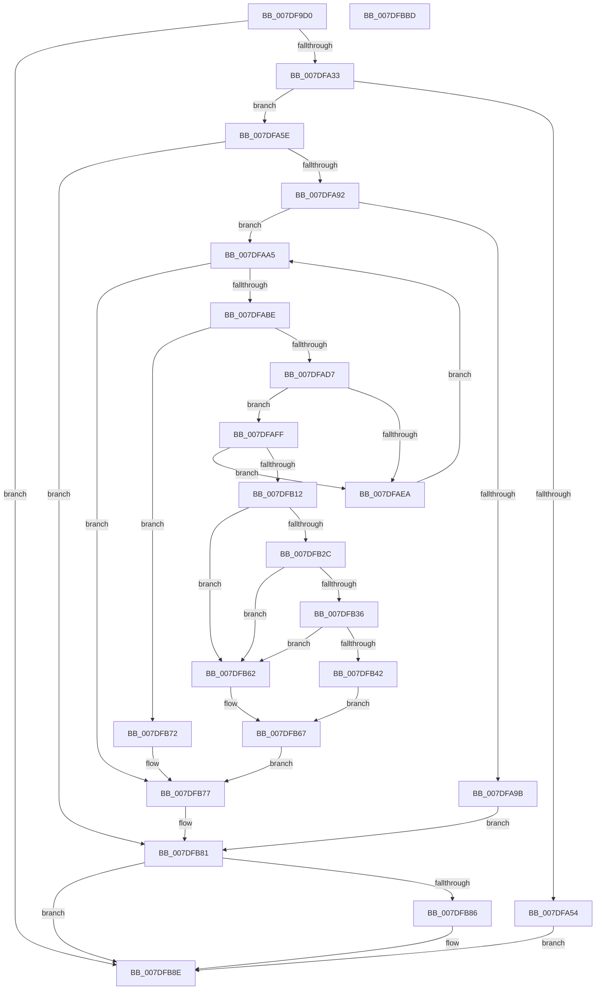

# NtCompressKey

- RVA: `0x007DF9D0`–`0x007DFBBE` (길이 `494` bytes)
- VA: `0x00000001407DF9D0`
- 실행 섹션: `PAGE`
- PDB 이름 있음: `예`; PDB Function 태그: `아니요`
- unwind 정보 RVA: `0x000D6764`
- 디코드: `127`개 명령, `494/494` bytes 표시
- 미해석 바이트: `0` (있으면 어셈블리에 `.byte`로 보존)

> 이 문서는 커널 이미지의 기계어와 PDB 기호를 분석해 생성했습니다. 4번과 5번은 함수 원형과 자료형을 바이너리 사용 방식에서 추정한 C 해석이며 원본 소스 복구 결과는 아닙니다.

## 1. Dependencies

- 직접 호출 지점: **19**; 고유 호출 대상: **18**
- 직접 호출자로 확인된 함수: **0**
- RIP 상대 이미지 참조: **3**

### Outgoing calls
- `0x007DFA1F` → [CmpInitializeThreadInfo](../../text/3F/CmpInitializeThreadInfo_function_003FBE70.md) (function, `0x003FBE70`)
- `0x007DFA24` → [CmCheckNoTxContext](../87/CmCheckNoTxContext_function_00876A80.md) (function, `0x00876A80`)
- `0x007DFA4B` → [SeSinglePrivilegeCheck](../87/SeSinglePrivilegeCheck_function_00871E20.md) (function, `0x00871E20`)
- `0x007DFA7F` → [CmObReferenceObjectByHandle](../../pagecmrc/BC/CmObReferenceObjectByHandle_function_00BC9350.md) (function, `0x00BC9350`)
- `0x007DFA92` → [CmpAcquireShutdownRundown](../../pagecmrc/BC/CmpAcquireShutdownRundown_function_00BC9400.md) (function, `0x00BC9400`)
- `0x007DFAA5` → [CmpLockRegistryExclusive](../84/CmpLockRegistryExclusive_function_0084F9B4.md) (function, `0x0084F9B4`)
- `0x007DFAAF` → [CmpPerformKeyBodyDeletionCheck](../../pagecmrc/BC/CmpPerformKeyBodyDeletionCheck_function_00BC97D0.md) (function, `0x00BC97D0`)
- `0x007DFAE1` → [CmpIsWriteQueueActive](../../text/48/CmpIsWriteQueueActive_function_0048C7D8.md) (function, `0x0048C7D8`)
- `0x007DFAED` → [HvLockHiveFlusherExclusive](../../pagecmrc/BC/HvLockHiveFlusherExclusive_function_00BC9C50.md) (function, `0x00BC9C50`)
- `0x007DFAF8` → [CmpWaitOnHiveWriteQueue](../AA/CmpWaitOnHiveWriteQueue_function_00AA0110.md) (function, `0x00AA0110`)
- `0x007DFB09` → [CmpIsWriteQueueActive](../../text/48/CmpIsWriteQueueActive_function_0048C7D8.md) (function, `0x0048C7D8`)
- `0x007DFB16` → [CmpAttachToRegistryProcess](../../pagecmrc/BC/CmpAttachToRegistryProcess_function_00BC98E0.md) (function, `0x00BC98E0`)
- `0x007DFB59` → [HvMarkBaseBlockDirty](../87/HvMarkBaseBlockDirty_function_0087BD04.md) (function, `0x0087BD04`)
- `0x007DFB6B` → [CmpDetachFromRegistryProcess](../../pagecmrc/BC/CmpDetachFromRegistryProcess_function_00BC9920.md) (function, `0x00BC9920`)
- `0x007DFB77` → [CmpUnlockRegistry](../../pagecmrc/BC/CmpUnlockRegistry_function_00BC9A84.md) (function, `0x00BC9A84`)
- `0x007DFB7C` → [CmpReleaseShutdownRundown](../../pagecmrc/BC/CmpReleaseShutdownRundown_function_00BC9880.md) (function, `0x00BC9880`)
- `0x007DFB89` → [ObfDereferenceObject](../../text/2F/ObfDereferenceObject_function_002F9350.md) (function, `0x002F9350`)
- `0x007DFB92` → [CmCleanupThreadInfo](../../text/41/CmCleanupThreadInfo_function_0041FD50.md) (function, `0x0041FD50`)
- `0x007DFBA0` → [_security_check_cookie](../../text/6A/_security_check_cookie_function_006AC640.md) (function, `0x006AC640`)

### Direct callers
- 이 함수 시작 RVA로 연결되는 직접 call은 확인되지 않았습니다. 간접 호출은 완전히 역산할 수 없습니다.

### Static image references
- `0x007DF9EA` → RVA `0x00E0A740` (`.data`; read)
- `0x007DFA3C` → RVA `0x00FD9AC0` (`PAGEDATA`; read)
- `0x007DFB23` → RVA `0x00FD9A90` (`PAGEDATA`; read)

## 2. Other-region calls and transfers

- 다른 실행 섹션으로 향하는 call: **14**
  - `0x007DFA1F` → [CmpInitializeThreadInfo](../../text/3F/CmpInitializeThreadInfo_function_003FBE70.md) (`PAGE` → `.text`)
  - `0x007DFA7F` → [CmObReferenceObjectByHandle](../../pagecmrc/BC/CmObReferenceObjectByHandle_function_00BC9350.md) (`PAGE` → `PAGECMRC`)
  - `0x007DFA92` → [CmpAcquireShutdownRundown](../../pagecmrc/BC/CmpAcquireShutdownRundown_function_00BC9400.md) (`PAGE` → `PAGECMRC`)
  - `0x007DFAAF` → [CmpPerformKeyBodyDeletionCheck](../../pagecmrc/BC/CmpPerformKeyBodyDeletionCheck_function_00BC97D0.md) (`PAGE` → `PAGECMRC`)
  - `0x007DFAE1` → [CmpIsWriteQueueActive](../../text/48/CmpIsWriteQueueActive_function_0048C7D8.md) (`PAGE` → `.text`)
  - `0x007DFAED` → [HvLockHiveFlusherExclusive](../../pagecmrc/BC/HvLockHiveFlusherExclusive_function_00BC9C50.md) (`PAGE` → `PAGECMRC`)
  - `0x007DFB09` → [CmpIsWriteQueueActive](../../text/48/CmpIsWriteQueueActive_function_0048C7D8.md) (`PAGE` → `.text`)
  - `0x007DFB16` → [CmpAttachToRegistryProcess](../../pagecmrc/BC/CmpAttachToRegistryProcess_function_00BC98E0.md) (`PAGE` → `PAGECMRC`)
  - `0x007DFB6B` → [CmpDetachFromRegistryProcess](../../pagecmrc/BC/CmpDetachFromRegistryProcess_function_00BC9920.md) (`PAGE` → `PAGECMRC`)
  - `0x007DFB77` → [CmpUnlockRegistry](../../pagecmrc/BC/CmpUnlockRegistry_function_00BC9A84.md) (`PAGE` → `PAGECMRC`)
  - `0x007DFB7C` → [CmpReleaseShutdownRundown](../../pagecmrc/BC/CmpReleaseShutdownRundown_function_00BC9880.md) (`PAGE` → `PAGECMRC`)
  - `0x007DFB89` → [ObfDereferenceObject](../../text/2F/ObfDereferenceObject_function_002F9350.md) (`PAGE` → `.text`)
  - `0x007DFB92` → [CmCleanupThreadInfo](../../text/41/CmCleanupThreadInfo_function_0041FD50.md) (`PAGE` → `.text`)
  - `0x007DFBA0` → [_security_check_cookie](../../text/6A/_security_check_cookie_function_006AC640.md) (`PAGE` → `.text`)
- 별도 외부 분기/꼬리 이동을 확인하지 못했습니다.

## 3. Assembly (complete function range)

```asm
007DF9D0  48 89 5C 24 10                  mov qword ptr [rsp + 0x10], rbx
007DF9D5  48 89 74 24 18                  mov qword ptr [rsp + 0x18], rsi
007DF9DA  55                              push rbp
007DF9DB  57                              push rdi
007DF9DC  41 56                           push r14
007DF9DE  48 8D 6C 24 B9                  lea rbp, [rsp - 0x47]
007DF9E3  48 81 EC 90 00 00 00            sub rsp, 0x90
007DF9EA  48 8B 05 4F AD 62 00            mov rax, qword ptr [rip + 0x62ad4f]
007DF9F1  48 33 C4                        xor rax, rsp
007DF9F4  48 89 45 37                     mov qword ptr [rbp + 0x37], rax
007DF9F8  0F 57 C9                        xorps xmm1, xmm1
007DF9FB  33 C0                           xor eax, eax
007DF9FD  48 21 45 E7                     and qword ptr [rbp - 0x19], rax
007DFA01  0F 57 C0                        xorps xmm0, xmm0
007DFA04  48 8B F9                        mov rdi, rcx
007DFA07  48 89 45 FF                     mov qword ptr [rbp - 1], rax
007DFA0B  48 8D 4D EF                     lea rcx, [rbp - 0x11]
007DFA0F  0F 11 45 EF                     movups xmmword ptr [rbp - 0x11], xmm0
007DFA13  0F 11 4D 07                     movups xmmword ptr [rbp + 7], xmm1
007DFA17  0F 11 4D 17                     movups xmmword ptr [rbp + 0x17], xmm1
007DFA1B  0F 11 4D 27                     movups xmmword ptr [rbp + 0x27], xmm1
007DFA1F  E8 4C C4 C1 FF                  call 0x1403fbe70
007DFA24  E8 57 70 09 00                  call 0x140876a80
007DFA29  8B D8                           mov ebx, eax
007DFA2B  85 C0                           test eax, eax
007DFA2D  0F 88 5B 01 00 00               js 0x1407dfb8e
007DFA33  65 48 8B 04 25 88 01 00 00      mov rax, qword ptr gs:[0x188]
007DFA3C  48 8B 0D 7D A0 7F 00            mov rcx, qword ptr [rip + 0x7fa07d]
007DFA43  8A 98 32 02 00 00               mov bl, byte ptr [rax + 0x232]
007DFA49  8A D3                           mov dl, bl
007DFA4B  E8 D0 23 09 00                  call 0x140871e20
007DFA50  84 C0                           test al, al
007DFA52  75 0A                           jne 0x1407dfa5e
007DFA54  BB 61 00 00 C0                  mov ebx, 0xc0000061
007DFA59  E9 30 01 00 00                  jmp 0x1407dfb8e
007DFA5E  48 83 64 24 28 00               and qword ptr [rsp + 0x28], 0
007DFA64  48 8D 45 E7                     lea rax, [rbp - 0x19]
007DFA68  44 8B F7                        mov r14d, edi
007DFA6B  48 89 44 24 20                  mov qword ptr [rsp + 0x20], rax
007DFA70  44 8A CB                        mov r9b, bl
007DFA73  BA 06 00 02 00                  mov edx, 0x20006
007DFA78  48 8B CF                        mov rcx, rdi
007DFA7B  41 83 E6 03                     and r14d, 3
007DFA7F  E8 CC 98 3E 00                  call 0x140bc9350
007DFA84  48 8B 7D E7                     mov rdi, qword ptr [rbp - 0x19]
007DFA88  8B D8                           mov ebx, eax
007DFA8A  85 C0                           test eax, eax
007DFA8C  0F 88 EF 00 00 00               js 0x1407dfb81
007DFA92  E8 69 99 3E 00                  call 0x140bc9400
007DFA97  84 C0                           test al, al
007DFA99  75 0A                           jne 0x1407dfaa5
007DFA9B  BB 89 01 00 C0                  mov ebx, 0xc0000189
007DFAA0  E9 DC 00 00 00                  jmp 0x1407dfb81
007DFAA5  E8 0A FF 06 00                  call 0x14084f9b4
007DFAAA  33 D2                           xor edx, edx
007DFAAC  48 8B CF                        mov rcx, rdi
007DFAAF  E8 1C 9D 3E 00                  call 0x140bc97d0
007DFAB4  8B D8                           mov ebx, eax
007DFAB6  85 C0                           test eax, eax
007DFAB8  0F 88 B9 00 00 00               js 0x1407dfb77
007DFABE  4C 8B 47 08                     mov r8, qword ptr [rdi + 8]
007DFAC2  49 8B 58 20                     mov rbx, qword ptr [r8 + 0x20]
007DFAC6  48 8B 43 40                     mov rax, qword ptr [rbx + 0x40]
007DFACA  8B 50 24                        mov edx, dword ptr [rax + 0x24]
007DFACD  41 39 50 28                     cmp dword ptr [r8 + 0x28], edx
007DFAD1  0F 85 9B 00 00 00               jne 0x1407dfb72
007DFAD7  48 8D B3 70 10 00 00            lea rsi, [rbx + 0x1070]
007DFADE  48 8B CE                        mov rcx, rsi
007DFAE1  E8 F2 CC CA FF                  call 0x14048c7d8
007DFAE6  84 C0                           test al, al
007DFAE8  74 15                           je 0x1407dfaff
007DFAEA  48 8B CB                        mov rcx, rbx
007DFAED  E8 5E A1 3E 00                  call 0x140bc9c50
007DFAF2  48 8B D6                        mov rdx, rsi
007DFAF5  48 8B CB                        mov rcx, rbx
007DFAF8  E8 13 06 2C 00                  call 0x140aa0110
007DFAFD  EB A6                           jmp 0x1407dfaa5
007DFAFF  48 8D B3 60 10 00 00            lea rsi, [rbx + 0x1060]
007DFB06  48 8B CE                        mov rcx, rsi
007DFB09  E8 CA CC CA FF                  call 0x14048c7d8
007DFB0E  84 C0                           test al, al
007DFB10  75 D8                           jne 0x1407dfaea
007DFB12  48 8D 4D 07                     lea rcx, [rbp + 7]
007DFB16  E8 C5 9D 3E 00                  call 0x140bc98e0
007DFB1B  48 8B 47 08                     mov rax, qword ptr [rdi + 8]
007DFB1F  48 8B 48 20                     mov rcx, qword ptr [rax + 0x20]
007DFB23  48 3B 0D 66 9F 7F 00            cmp rcx, qword ptr [rip + 0x7f9f66]
007DFB2A  74 36                           je 0x1407dfb62
007DFB2C  48 83 B9 08 06 00 00 00         cmp qword ptr [rcx + 0x608], 0
007DFB34  74 2C                           je 0x1407dfb62
007DFB36  F7 81 A0 00 00 00 03 80 00 00   test dword ptr [rcx + 0xa0], 0x8003
007DFB40  75 20                           jne 0x1407dfb62
007DFB42  33 C0                           xor eax, eax
007DFB44  41 83 FE 03                     cmp r14d, 3
007DFB48  41 0F 45 C6                     cmovne eax, r14d
007DFB4C  8B D0                           mov edx, eax
007DFB4E  48 8B 41 40                     mov rax, qword ptr [rcx + 0x40]
007DFB52  48 89 90 A8 00 00 00            mov qword ptr [rax + 0xa8], rdx
007DFB59  E8 A6 C1 09 00                  call 0x14087bd04
007DFB5E  33 DB                           xor ebx, ebx
007DFB60  EB 05                           jmp 0x1407dfb67
007DFB62  BB 0D 00 00 C0                  mov ebx, 0xc000000d
007DFB67  48 8D 4D 07                     lea rcx, [rbp + 7]
007DFB6B  E8 B0 9D 3E 00                  call 0x140bc9920
007DFB70  EB 05                           jmp 0x1407dfb77
007DFB72  BB 0D 00 00 C0                  mov ebx, 0xc000000d
007DFB77  E8 08 9F 3E 00                  call 0x140bc9a84
007DFB7C  E8 FF 9C 3E 00                  call 0x140bc9880
007DFB81  48 85 FF                        test rdi, rdi
007DFB84  74 08                           je 0x1407dfb8e
007DFB86  48 8B CF                        mov rcx, rdi
007DFB89  E8 C2 97 B1 FF                  call 0x1402f9350
007DFB8E  48 8D 4D EF                     lea rcx, [rbp - 0x11]
007DFB92  E8 B9 01 C4 FF                  call 0x14041fd50
007DFB97  8B C3                           mov eax, ebx
007DFB99  48 8B 4D 37                     mov rcx, qword ptr [rbp + 0x37]
007DFB9D  48 33 CC                        xor rcx, rsp
007DFBA0  E8 9B CA EC FF                  call 0x1406ac640
007DFBA5  4C 8D 9C 24 90 00 00 00         lea r11, [rsp + 0x90]
007DFBAD  49 8B 5B 28                     mov rbx, qword ptr [r11 + 0x28]
007DFBB1  49 8B 73 30                     mov rsi, qword ptr [r11 + 0x30]
007DFBB5  49 8B E3                        mov rsp, r11
007DFBB8  41 5E                           pop r14
007DFBBA  5F                              pop rdi
007DFBBB  5D                              pop rbp
007DFBBC  C3                              ret
007DFBBD  CC                              int3
```

## 4. C-style interpretation (structured pseudocode)

```c
__int64 __fastcall NtCompressKey(__int64 a1)
{
    __int64 result;
    __int64 v_r14;
    __int64 v_rbx;
    __int64 v_rsp;
    unsigned __int64 v_stack_m18;
    unsigned __int64 v_stack_m28;
    unsigned __int64 v_stack_m38;
    unsigned __int64 v_stack_m48;
    unsigned __int64 v_stack_m58;
    unsigned __int64 v_stack_m5F;
    unsigned __int64 v_stack_m60;
    unsigned __int64 v_stack_m70;
    unsigned __int64 v_stack_m78;
    unsigned __int64 v_stack_m80;
    unsigned __int64 v_stack_m88;
    unsigned __int64 v_stack_p10;
    unsigned __int64 v_stack_p18;

    v_stack_p10 = v_rbx;
    v_stack_p18 = v_rsi;
    v_rsp = (v_rsp) - (144);
    result = (*(unsigned __int64 *)(v_rip + 6466895)) ^ (v_rsp);
    v_stack_m28 = result;
    result = 0;
    v_stack_m60 = 0;
    v_stack_m70 = v_xmm0;
    v_stack_m58 = v_xmm1;
    v_stack_m48 = v_xmm1;
    v_stack_m38 = v_xmm1;
    result = CmpInitializeThreadInfo(v_stack_m70, a2, a3, a4);
    result = CmCheckNoTxContext(v_stack_m70, a2, a3, a4);
    if (sign_flag) goto loc_007DFB8E;
    result = SeSinglePrivilegeCheck(*(unsigned __int64 *)(v_rip + 8364157), (unsigned __int8)(*(unsigned __int8 *)(*(unsigned __int64 *)(gs_base + (0 + 392)) + 562)), a3, a4);
    if ((unsigned __int8)(result) != 0) goto loc_007DFA5E;
    goto loc_007DFB8E;
loc_007DFA5E:
    v_stack_m88 = v_stack_m78;
    v_r14 = (unsigned int)(((unsigned int)((unsigned int)(a1))) & (3));
    result = CmObReferenceObjectByHandle(a1, (unsigned int)(0x20006ULL), a3, (unsigned __int8)((unsigned int)(0xC0000061ULL)));
    if (sign_flag) goto loc_007DFB81;
    result = CmpAcquireShutdownRundown(a1, (unsigned int)(0x20006ULL), a3, (unsigned __int8)((unsigned int)(0xC0000061ULL)));
    if ((unsigned __int8)(result) != 0) goto loc_007DFAA5;
    goto loc_007DFB81;
loc_007DFAA5:
    result = CmpLockRegistryExclusive(a1, (unsigned int)(0x20006ULL), a3, (unsigned __int8)((unsigned int)(0xC0000061ULL)));
    a2 = 0;
    result = CmpPerformKeyBodyDeletionCheck(v_stack_m78, a2, a3, (unsigned __int8)((unsigned int)(0xC0000061ULL)));
    if (sign_flag) goto loc_007DFB77;
    if ((*(unsigned int *)(*(unsigned __int64 *)(v_stack_m78 + 8) + 40)) != ((unsigned int)((unsigned int)(*(unsigned int *)(*(unsigned __int64 *)(*(unsigned __int64 *)(*(unsigned __int64 *)(v_stack_m78 + 8) + 32) + 64) + 36))))) goto loc_007DFB72;
    result = CmpIsWriteQueueActive(*(unsigned __int64 *)(*(unsigned __int64 *)(v_stack_m78 + 8) + 32) + 4208, (unsigned int)(*(unsigned int *)(*(unsigned __int64 *)(*(unsigned __int64 *)(*(unsigned __int64 *)(v_stack_m78 + 8) + 32) + 64) + 36)), *(unsigned __int64 *)(v_stack_m78 + 8), (unsigned __int8)((unsigned int)(0xC0000061ULL)));
    if ((unsigned __int8)(result) == 0) goto loc_007DFAFF;
loc_007DFAEA:
    result = HvLockHiveFlusherExclusive(*(unsigned __int64 *)(*(unsigned __int64 *)(v_stack_m78 + 8) + 32), (unsigned int)(*(unsigned int *)(*(unsigned __int64 *)(*(unsigned __int64 *)(*(unsigned __int64 *)(v_stack_m78 + 8) + 32) + 64) + 36)), *(unsigned __int64 *)(v_stack_m78 + 8), (unsigned __int8)((unsigned int)(0xC0000061ULL)));
    result = CmpWaitOnHiveWriteQueue(*(unsigned __int64 *)(*(unsigned __int64 *)(v_stack_m78 + 8) + 32), *(unsigned __int64 *)(*(unsigned __int64 *)(v_stack_m78 + 8) + 32) + 4208, *(unsigned __int64 *)(v_stack_m78 + 8), (unsigned __int8)((unsigned int)(0xC0000061ULL)));
    goto loc_007DFAA5;
loc_007DFAFF:
    result = CmpIsWriteQueueActive(*(unsigned __int64 *)(*(unsigned __int64 *)(v_stack_m78 + 8) + 32) + 4192, *(unsigned __int64 *)(*(unsigned __int64 *)(v_stack_m78 + 8) + 32) + 4208, *(unsigned __int64 *)(v_stack_m78 + 8), (unsigned __int8)((unsigned int)(0xC0000061ULL)));
    if ((unsigned __int8)(result) != 0) goto loc_007DFAEA;
    result = CmpAttachToRegistryProcess(v_stack_m58, *(unsigned __int64 *)(*(unsigned __int64 *)(v_stack_m78 + 8) + 32) + 4208, *(unsigned __int64 *)(v_stack_m78 + 8), (unsigned __int8)((unsigned int)(0xC0000061ULL)));
    if ((*(unsigned __int64 *)(*(unsigned __int64 *)(v_stack_m78 + 8) + 32)) == (*(unsigned __int64 *)(v_rip + 8363878))) goto loc_007DFB62;
    if ((*(unsigned __int64 *)(*(unsigned __int64 *)(*(unsigned __int64 *)(v_stack_m78 + 8) + 32) + 1544)) == 0) goto loc_007DFB62;
    if (((*(unsigned int *)(*(unsigned __int64 *)(*(unsigned __int64 *)(v_stack_m78 + 8) + 32) + 160)) & (0x8003ULL)) != 0) goto loc_007DFB62;
    result = 0;
    if (((unsigned int)(v_r14)) != 3) { result = (unsigned int)(v_r14); }
    *(unsigned __int64 *)(*(unsigned __int64 *)(*(unsigned __int64 *)(*(unsigned __int64 *)(v_stack_m78 + 8) + 32) + 64) + 168) = (unsigned int)((unsigned int)(result));
    result = HvMarkBaseBlockDirty(*(unsigned __int64 *)(*(unsigned __int64 *)(v_stack_m78 + 8) + 32), (unsigned int)((unsigned int)(result)), *(unsigned __int64 *)(v_stack_m78 + 8), (unsigned __int8)((unsigned int)(0xC0000061ULL)));
    v_rbx = 0;
    goto loc_007DFB67;
loc_007DFB62:
loc_007DFB67:
    result = CmpDetachFromRegistryProcess(v_stack_m58, (unsigned int)((unsigned int)(result)), *(unsigned __int64 *)(v_stack_m78 + 8), (unsigned __int8)((unsigned int)(0xC0000061ULL)));
    goto loc_007DFB77;
loc_007DFB72:
loc_007DFB77:
    result = CmpUnlockRegistry(v_stack_m58, (unsigned int)((unsigned int)(result)), *(unsigned __int64 *)(v_stack_m78 + 8), (unsigned __int8)((unsigned int)(0xC0000061ULL)));
    result = CmpReleaseShutdownRundown(v_stack_m58, (unsigned int)((unsigned int)(result)), *(unsigned __int64 *)(v_stack_m78 + 8), (unsigned __int8)((unsigned int)(0xC0000061ULL)));
loc_007DFB81:
    if (v_stack_m78 != 0) {
        a1 = v_stack_m78;
        result = ObfDereferenceObject(a1, (unsigned int)((unsigned int)(result)), *(unsigned __int64 *)(v_stack_m78 + 8), (unsigned __int8)((unsigned int)(0xC0000061ULL)));
    }
    result = CmCleanupThreadInfo(v_stack_m70, (unsigned int)((unsigned int)(result)), *(unsigned __int64 *)(v_stack_m78 + 8), (unsigned __int8)((unsigned int)(0xC0000061ULL)));
    a1 = (v_stack_m28) ^ (v_rsp);
    result = _security_check_cookie(a1, (unsigned int)((unsigned int)(result)), *(unsigned __int64 *)(v_stack_m78 + 8), (unsigned __int8)((unsigned int)(0xC0000061ULL)));
    return result;
}
```

## 5. (Beta) C Style

```c
int64_t NtCompressKey(int64_t Arg1)
{
    int64_t result;
    int64_t local_r14;
    int64_t local_rbx;
    int64_t local_rsp;
    uint64_t v_stack_m18;
    uint64_t v_stack_m28;
    uint64_t v_stack_m38;
    uint64_t v_stack_m48;
    uint64_t v_stack_m58;
    uint64_t v_stack_m5F;
    uint64_t v_stack_m60;
    uint64_t v_stack_m70;
    uint64_t v_stack_m78;
    uint64_t v_stack_m80;
    uint64_t v_stack_m88;
    uint64_t v_stack_p10;
    uint64_t v_stack_p18;

    v_stack_p10 = local_rbx;
    v_stack_p18 = local_rsi;
    local_rsp = (local_rsp) - (144);
    result = (*(uint64_t *)(v_rip + 0x62AD4F)) ^ (local_rsp);
    v_stack_m28 = result;
    result = 0;
    v_stack_m60 = 0;
    v_stack_m70 = v_xmm0;
    v_stack_m58 = v_xmm1;
    v_stack_m48 = v_xmm1;
    v_stack_m38 = v_xmm1;
    result = CmpInitializeThreadInfo(v_stack_m70, a2, a3, a4);
    result = CmCheckNoTxContext(v_stack_m70, a2, a3, a4);
    if (sign_flag) goto loc_007DFB8E;
    result = SeSinglePrivilegeCheck(*(uint64_t *)(v_rip + 0x7FA07D), (uint8_t)(*(uint8_t *)(*(uint64_t *)(gs_base + (0 + 0x188)) + 0x232)), a3, a4);
    if ((uint8_t)(result) != 0) goto loc_007DFA5E;
    goto loc_007DFB8E;
loc_007DFA5E:
    v_stack_m88 = v_stack_m78;
    local_r14 = (uint32_t)(((uint32_t)((uint32_t)(Arg1))) & (3));
    result = CmObReferenceObjectByHandle(Arg1, (uint32_t)(0x20006ULL), a3, (uint8_t)((uint32_t)(0xC0000061ULL)));
    if (sign_flag) goto loc_007DFB81;
    result = CmpAcquireShutdownRundown(Arg1, (uint32_t)(0x20006ULL), a3, (uint8_t)((uint32_t)(0xC0000061ULL)));
    if ((uint8_t)(result) != 0) goto loc_007DFAA5;
    goto loc_007DFB81;
loc_007DFAA5:
    result = CmpLockRegistryExclusive(Arg1, (uint32_t)(0x20006ULL), a3, (uint8_t)((uint32_t)(0xC0000061ULL)));
    a2 = 0;
    result = CmpPerformKeyBodyDeletionCheck(v_stack_m78, a2, a3, (uint8_t)((uint32_t)(0xC0000061ULL)));
    if (sign_flag) goto loc_007DFB77;
    if ((*(uint32_t *)(*(uint64_t *)(v_stack_m78 + 0x8) + 0x28)) != ((uint32_t)((uint32_t)(*(uint32_t *)(*(uint64_t *)(*(uint64_t *)(*(uint64_t *)(v_stack_m78 + 0x8) + 0x20) + 0x40) + 0x24))))) goto loc_007DFB72;
    result = CmpIsWriteQueueActive(*(uint64_t *)(*(uint64_t *)(v_stack_m78 + 0x8) + 0x20) + 4208, (uint32_t)(*(uint32_t *)(*(uint64_t *)(*(uint64_t *)(*(uint64_t *)(v_stack_m78 + 0x8) + 0x20) + 0x40) + 0x24)), *(uint64_t *)(v_stack_m78 + 0x8), (uint8_t)((uint32_t)(0xC0000061ULL)));
    if ((uint8_t)(result) == 0) goto loc_007DFAFF;
loc_007DFAEA:
    result = HvLockHiveFlusherExclusive(*(uint64_t *)(*(uint64_t *)(v_stack_m78 + 0x8) + 0x20), (uint32_t)(*(uint32_t *)(*(uint64_t *)(*(uint64_t *)(*(uint64_t *)(v_stack_m78 + 0x8) + 0x20) + 0x40) + 0x24)), *(uint64_t *)(v_stack_m78 + 0x8), (uint8_t)((uint32_t)(0xC0000061ULL)));
    result = CmpWaitOnHiveWriteQueue(*(uint64_t *)(*(uint64_t *)(v_stack_m78 + 0x8) + 0x20), *(uint64_t *)(*(uint64_t *)(v_stack_m78 + 0x8) + 0x20) + 4208, *(uint64_t *)(v_stack_m78 + 0x8), (uint8_t)((uint32_t)(0xC0000061ULL)));
    goto loc_007DFAA5;
loc_007DFAFF:
    result = CmpIsWriteQueueActive(*(uint64_t *)(*(uint64_t *)(v_stack_m78 + 0x8) + 0x20) + 4192, *(uint64_t *)(*(uint64_t *)(v_stack_m78 + 0x8) + 0x20) + 4208, *(uint64_t *)(v_stack_m78 + 0x8), (uint8_t)((uint32_t)(0xC0000061ULL)));
    if ((uint8_t)(result) != 0) goto loc_007DFAEA;
    result = CmpAttachToRegistryProcess(v_stack_m58, *(uint64_t *)(*(uint64_t *)(v_stack_m78 + 0x8) + 0x20) + 4208, *(uint64_t *)(v_stack_m78 + 0x8), (uint8_t)((uint32_t)(0xC0000061ULL)));
    if ((*(uint64_t *)(*(uint64_t *)(v_stack_m78 + 0x8) + 0x20)) == (*(uint64_t *)(v_rip + 0x7F9F66))) goto loc_007DFB62;
    if ((*(uint64_t *)(*(uint64_t *)(*(uint64_t *)(v_stack_m78 + 0x8) + 0x20) + 0x608)) == 0) goto loc_007DFB62;
    if (((*(uint32_t *)(*(uint64_t *)(*(uint64_t *)(v_stack_m78 + 0x8) + 0x20) + 0xA0)) & (0x8003ULL)) != 0) goto loc_007DFB62;
    result = 0;
    if (((uint32_t)(local_r14)) != 3) { result = (uint32_t)(local_r14); }
    *(uint64_t *)(*(uint64_t *)(*(uint64_t *)(*(uint64_t *)(v_stack_m78 + 0x8) + 0x20) + 0x40) + 0xA8) = (uint32_t)((uint32_t)(result));
    result = HvMarkBaseBlockDirty(*(uint64_t *)(*(uint64_t *)(v_stack_m78 + 0x8) + 0x20), (uint32_t)((uint32_t)(result)), *(uint64_t *)(v_stack_m78 + 0x8), (uint8_t)((uint32_t)(0xC0000061ULL)));
    local_rbx = 0;
    goto loc_007DFB67;
loc_007DFB62:
loc_007DFB67:
    result = CmpDetachFromRegistryProcess(v_stack_m58, (uint32_t)((uint32_t)(result)), *(uint64_t *)(v_stack_m78 + 0x8), (uint8_t)((uint32_t)(0xC0000061ULL)));
    goto loc_007DFB77;
loc_007DFB72:
loc_007DFB77:
    result = CmpUnlockRegistry(v_stack_m58, (uint32_t)((uint32_t)(result)), *(uint64_t *)(v_stack_m78 + 0x8), (uint8_t)((uint32_t)(0xC0000061ULL)));
    result = CmpReleaseShutdownRundown(v_stack_m58, (uint32_t)((uint32_t)(result)), *(uint64_t *)(v_stack_m78 + 0x8), (uint8_t)((uint32_t)(0xC0000061ULL)));
loc_007DFB81:
    if (v_stack_m78 != 0) {
        Arg1 = v_stack_m78;
        result = ObfDereferenceObject(Arg1, (uint32_t)((uint32_t)(result)), *(uint64_t *)(v_stack_m78 + 0x8), (uint8_t)((uint32_t)(0xC0000061ULL)));
    }
    result = CmCleanupThreadInfo(v_stack_m70, (uint32_t)((uint32_t)(result)), *(uint64_t *)(v_stack_m78 + 0x8), (uint8_t)((uint32_t)(0xC0000061ULL)));
    Arg1 = (v_stack_m28) ^ (local_rsp);
    result = _security_check_cookie(Arg1, (uint32_t)((uint32_t)(result)), *(uint64_t *)(v_stack_m78 + 0x8), (uint8_t)((uint32_t)(0xC0000061ULL)));
    return result;
}
```

## 6. Execution-region graph

[열기: 2D/3D 그래프와 함수 탐색 컨트롤 패널](../../../control-panel.html?section=page&rva=0x007DF9D0&view=graph)

- 2D 그래프는 위에서 아래로 흐르고, 3D 그래프는 빈 공간을 드래그해 회전합니다. Shift+드래그는 이동, 휠은 확대·축소, 함수 노드 선택은 대상 보고서 이동입니다.

### Static fallback


