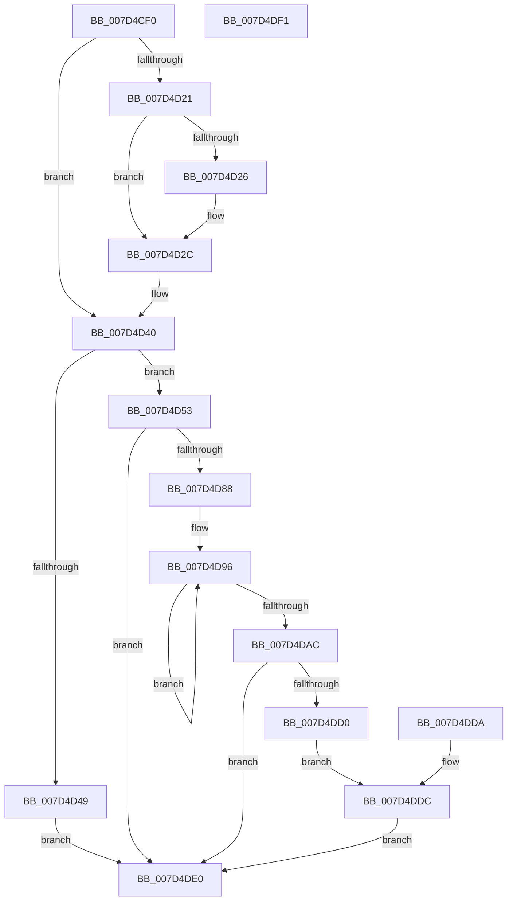

# NtCreateKeyedEvent

- RVA: `0x007D4CF0`–`0x007D4DF2` (길이 `258` bytes)
- VA: `0x00000001407D4CF0`
- 실행 섹션: `PAGE`
- PDB 이름 있음: `예`; PDB Function 태그: `아니요`
- unwind 정보 RVA: `0x000D5B98`
- 디코드: `66`개 명령, `258/258` bytes 표시
- 미해석 바이트: `0` (있으면 어셈블리에 `.byte`로 보존)

> 이 문서는 커널 이미지의 기계어와 PDB 기호를 분석해 생성했습니다. 4번과 5번은 함수 원형과 자료형을 바이너리 사용 방식에서 추정한 C 해석이며 원본 소스 복구 결과는 아닙니다.

## 1. Dependencies

- 직접 호출 지점: **3**; 고유 호출 대상: **3**
- 직접 호출자로 확인된 함수: **0**
- RIP 상대 이미지 참조: **1**

### Outgoing calls
- `0x007D4D26` → [ExRaiseDatatypeMisalignment](../89/ExRaiseDatatypeMisalignment_function_00899FD0.md) (function, `0x00899FD0`)
- `0x007D4D7F` → [ObCreateObjectEx](../89/ObCreateObjectEx_function_0089B1E0.md) (function, `0x0089B1E0`)
- `0x007D4DC5` → [ObInsertObjectEx](../8B/ObInsertObjectEx_function_008B97A0.md) (function, `0x008B97A0`)

### Direct callers
- 이 함수 시작 RVA로 연결되는 직접 call은 확인되지 않았습니다. 간접 호출은 완전히 역산할 수 없습니다.

### Static image references
- `0x007D4D53` → RVA `0x00FC52B0` (`ALMOSTRO`; read)

## 2. Other-region calls and transfers

- 다른 실행 섹션으로 향하는 call: **0**
- 별도 외부 분기/꼬리 이동을 확인하지 못했습니다.

## 3. Assembly (complete function range)

```asm
007D4CF0  48 89 5C 24 08                  mov qword ptr [rsp + 8], rbx
007D4CF5  57                              push rdi
007D4CF6  48 81 EC 80 00 00 00            sub rsp, 0x80
007D4CFD  8B FA                           mov edi, edx
007D4CFF  48 8B D9                        mov rbx, rcx
007D4D02  48 83 64 24 58 00               and qword ptr [rsp + 0x58], 0
007D4D08  48 83 64 24 60 00               and qword ptr [rsp + 0x60], 0
007D4D0E  65 48 8B 04 25 88 01 00 00      mov rax, qword ptr gs:[0x188]
007D4D17  8A 88 32 02 00 00               mov cl, byte ptr [rax + 0x232]
007D4D1D  84 C9                           test cl, cl
007D4D1F  74 1F                           je 0x1407d4d40
007D4D21  F6 C3 07                        test bl, 7
007D4D24  74 06                           je 0x1407d4d2c
007D4D26  E8 A5 52 0C 00                  call 0x140899fd0
007D4D2B  CC                              int3
007D4D2C  48 B8 00 00 FF FF FF 7F 00 00   movabs rax, 0x7fffffff0000
007D4D36  48 3B D8                        cmp rbx, rax
007D4D39  48 0F 42 C3                     cmovb rax, rbx
007D4D3D  90                              nop
007D4D3E  8A 00                           mov al, byte ptr [rax]
007D4D40  48 83 23 00                     and qword ptr [rbx], 0
007D4D44  45 85 C9                        test r9d, r9d
007D4D47  74 0A                           je 0x1407d4d53
007D4D49  B8 F2 00 00 C0                  mov eax, 0xc00000f2
007D4D4E  E9 8D 00 00 00                  jmp 0x1407d4de0
007D4D53  48 8B 15 56 05 7F 00            mov rdx, qword ptr [rip + 0x7f0556]
007D4D5A  48 83 64 24 48 00               and qword ptr [rsp + 0x48], 0
007D4D60  48 8D 44 24 58                  lea rax, [rsp + 0x58]
007D4D65  48 89 44 24 40                  mov qword ptr [rsp + 0x40], rax
007D4D6A  83 64 24 38 00                  and dword ptr [rsp + 0x38], 0
007D4D6F  83 64 24 30 00                  and dword ptr [rsp + 0x30], 0
007D4D74  C7 44 24 28 00 06 00 00         mov dword ptr [rsp + 0x28], 0x600
007D4D7C  44 8A C9                        mov r9b, cl
007D4D7F  E8 5C 64 0C 00                  call 0x14089b1e0
007D4D84  85 C0                           test eax, eax
007D4D86  78 58                           js 0x1407d4de0
007D4D88  48 8B 4C 24 58                  mov rcx, qword ptr [rsp + 0x58]
007D4D8D  48 8D 41 08                     lea rax, [rcx + 8]
007D4D91  BA 40 00 00 00                  mov edx, 0x40
007D4D96  48 83 60 F8 00                  and qword ptr [rax - 8], 0
007D4D9B  48 89 40 08                     mov qword ptr [rax + 8], rax
007D4D9F  48 89 00                        mov qword ptr [rax], rax
007D4DA2  48 83 C0 18                     add rax, 0x18
007D4DA6  48 83 EA 01                     sub rdx, 1
007D4DAA  75 EA                           jne 0x1407d4d96
007D4DAC  48 8D 44 24 60                  lea rax, [rsp + 0x60]
007D4DB1  48 89 44 24 30                  mov qword ptr [rsp + 0x30], rax
007D4DB6  48 21 54 24 28                  and qword ptr [rsp + 0x28], rdx
007D4DBB  21 54 24 20                     and dword ptr [rsp + 0x20], edx
007D4DBF  45 33 C9                        xor r9d, r9d
007D4DC2  44 8B C7                        mov r8d, edi
007D4DC5  E8 D6 49 0E 00                  call 0x1408b97a0
007D4DCA  8B C8                           mov ecx, eax
007D4DCC  85 C0                           test eax, eax
007D4DCE  78 10                           js 0x1407d4de0
007D4DD0  48 8B 44 24 60                  mov rax, qword ptr [rsp + 0x60]
007D4DD5  48 89 03                        mov qword ptr [rbx], rax
007D4DD8  EB 02                           jmp 0x1407d4ddc
007D4DDA  8B C8                           mov ecx, eax
007D4DDC  8B C1                           mov eax, ecx
007D4DDE  EB 00                           jmp 0x1407d4de0
007D4DE0  48 8B 9C 24 90 00 00 00         mov rbx, qword ptr [rsp + 0x90]
007D4DE8  48 81 C4 80 00 00 00            add rsp, 0x80
007D4DEF  5F                              pop rdi
007D4DF0  C3                              ret
007D4DF1  CC                              int3
```

## 4. C-style interpretation (structured pseudocode)

```c
__int64 __fastcall NtCreateKeyedEvent(__int64 a1, int a2, __int64 a3, int a4)
{
    __int64 result;
    __int64 v_rsp;
    unsigned __int64 v_stack_m28;
    unsigned __int64 v_stack_m30;
    unsigned __int64 v_stack_m40;
    unsigned __int64 v_stack_m48;
    unsigned int v_stack_m50;
    unsigned int v_stack_m58;
    unsigned int v_stack_m60;
    unsigned int v_stack_m68;
    unsigned __int64 v_stack_p8;

    v_stack_p8 = v_rbx;
    v_rsp = (v_rsp) - (128);
    if ((unsigned __int8)(*(unsigned __int8 *)(*(unsigned __int64 *)(gs_base + (0 + 392)) + 562)) == 0) goto loc_007D4D40;
    result = *(unsigned __int64 *)(gs_base + (0 + 392));
    if ((((unsigned __int8)(a1)) & (7)) != 0) {
        result = ExRaiseDatatypeMisalignment(*(unsigned __int8 *)(*(unsigned __int64 *)(gs_base + (0 + 392)) + 562), a2, a3, a4);
    }
    if (a1 < result) { result = a1; }
loc_007D4D40:
    if (a4 == 0) goto loc_007D4D53;
    goto loc_007D4DE0;
loc_007D4D53:
    v_stack_m48 = v_stack_m30;
    v_stack_m60 = 0x600ULL;
    result = ObCreateObjectEx(*(unsigned __int8 *)(*(unsigned __int64 *)(gs_base + (0 + 392)) + 562), *(unsigned __int64 *)(v_rip + 8324438), a3, (unsigned __int8)(*(unsigned __int8 *)(*(unsigned __int64 *)(gs_base + (0 + 392)) + 562)));
    if (sign_flag) goto loc_007D4DE0;
loc_007D4D96:
    *(unsigned __int64 *)(v_stack_m30 + 8 + 8) = v_stack_m30 + 8;
    *(unsigned __int64 *)(v_stack_m30 + 8) = v_stack_m30 + 8;
    result = (v_stack_m30 + 8) + (24);
    a2 = (64) - (1);
    if (condition_is_not_equal) goto loc_007D4D96;
    v_stack_m58 = v_stack_m28;
    a4 = 0;
    result = ObInsertObjectEx(v_stack_m30, a2, (unsigned int)((unsigned int)((unsigned int)(a2))), a4);
    if (sign_flag) goto loc_007D4DE0;
    *(unsigned __int64 *)(a1) = v_stack_m28;
    goto loc_007D4DDC;
loc_007D4DDC:
    goto loc_007D4DE0;
loc_007D4DE0:
    v_rsp = (v_rsp) + (128);
    return (unsigned int)((unsigned int)((unsigned int)((unsigned int)(result))));
}
```

## 5. (Beta) C Style

```c
int64_t NtCreateKeyedEvent(int64_t Arg1, int32_t Arg2, int64_t Arg3, int32_t Arg4)
{
    int64_t result;
    int64_t local_rsp;
    uint64_t v_stack_m28;
    uint64_t v_stack_m30;
    uint64_t v_stack_m40;
    uint64_t v_stack_m48;
    uint32_t v_stack_m50;
    uint32_t v_stack_m58;
    uint32_t v_stack_m60;
    uint32_t v_stack_m68;
    uint64_t v_stack_p8;

    v_stack_p8 = local_rbx;
    local_rsp = (local_rsp) - (128);
    if ((uint8_t)(*(uint8_t *)(*(uint64_t *)(gs_base + (0 + 0x188)) + 0x232)) == 0) goto loc_007D4D40;
    result = *(uint64_t *)(gs_base + (0 + 0x188));
    if ((((uint8_t)(Arg1)) & (7)) != 0) {
        result = ExRaiseDatatypeMisalignment(*(uint8_t *)(*(uint64_t *)(gs_base + (0 + 0x188)) + 0x232), Arg2, Arg3, Arg4);
    }
    if (Arg1 < result) { result = Arg1; }
loc_007D4D40:
    if (Arg4 == 0) goto loc_007D4D53;
    goto loc_007D4DE0;
loc_007D4D53:
    v_stack_m48 = v_stack_m30;
    v_stack_m60 = 0x600ULL;
    result = ObCreateObjectEx(*(uint8_t *)(*(uint64_t *)(gs_base + (0 + 0x188)) + 0x232), *(uint64_t *)(v_rip + 0x7F0556), Arg3, (uint8_t)(*(uint8_t *)(*(uint64_t *)(gs_base + (0 + 0x188)) + 0x232)));
    if (sign_flag) goto loc_007D4DE0;
loc_007D4D96:
    *(uint64_t *)(v_stack_m30 + 0x8 + 0x8) = v_stack_m30 + 8;
    *(uint64_t *)(v_stack_m30 + 0x8) = v_stack_m30 + 8;
    result = (v_stack_m30 + 8) + (24);
    Arg2 = (64) - (1);
    if (condition_is_not_equal) goto loc_007D4D96;
    v_stack_m58 = v_stack_m28;
    Arg4 = 0;
    result = ObInsertObjectEx(v_stack_m30, Arg2, (uint32_t)((uint32_t)((uint32_t)(Arg2))), Arg4);
    if (sign_flag) goto loc_007D4DE0;
    *(uint64_t *)(Arg1) = v_stack_m28;
    goto loc_007D4DDC;
loc_007D4DDC:
    goto loc_007D4DE0;
loc_007D4DE0:
    local_rsp = (local_rsp) + (128);
    return (uint32_t)((uint32_t)((uint32_t)((uint32_t)(result))));
}
```

## 6. Execution-region graph

[열기: 2D/3D 그래프와 함수 탐색 컨트롤 패널](../../../control-panel.html?section=page&rva=0x007D4CF0&view=graph)

- 2D 그래프는 위에서 아래로 흐르고, 3D 그래프는 빈 공간을 드래그해 회전합니다. Shift+드래그는 이동, 휠은 확대·축소, 함수 노드 선택은 대상 보고서 이동입니다.

### Static fallback


