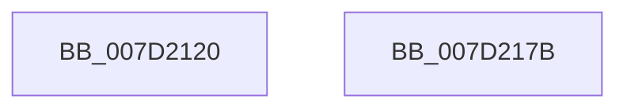

# NtCreateProfileEx

- RVA: `0x007D2120`–`0x007D217C` (길이 `92` bytes)
- VA: `0x00000001407D2120`
- 실행 섹션: `PAGE`
- PDB 이름 있음: `예`; PDB Function 태그: `아니요`
- unwind 정보 RVA: `0x0006E590`
- 디코드: `18`개 명령, `92/92` bytes 표시
- 미해석 바이트: `0` (있으면 어셈블리에 `.byte`로 보존)

> 이 문서는 커널 이미지의 기계어와 PDB 기호를 분석해 생성했습니다. 4번과 5번은 함수 원형과 자료형을 바이너리 사용 방식에서 추정한 C 해석이며 원본 소스 복구 결과는 아닙니다.

## 1. Dependencies

- 직접 호출 지점: **1**; 고유 호출 대상: **1**
- 직접 호출자로 확인된 함수: **0**
- RIP 상대 이미지 참조: **0**

### Outgoing calls
- `0x007D2171` → [ExpProfileCreate](ExpProfileCreate_function_007D1AB8.md) (function, `0x007D1AB8`)

### Direct callers
- 이 함수 시작 RVA로 연결되는 직접 call은 확인되지 않았습니다. 간접 호출은 완전히 역산할 수 없습니다.

### Static image references
- 디코드된 RIP-relative 메모리 참조가 없습니다.

## 2. Other-region calls and transfers

- 다른 실행 섹션으로 향하는 call: **0**
- 별도 외부 분기/꼬리 이동을 확인하지 못했습니다.

## 3. Assembly (complete function range)

```asm
007D2120  48 83 EC 68                     sub rsp, 0x68
007D2124  48 8B 84 24 B8 00 00 00         mov rax, qword ptr [rsp + 0xb8]
007D212C  C6 44 24 50 00                  mov byte ptr [rsp + 0x50], 0
007D2131  48 89 44 24 48                  mov qword ptr [rsp + 0x48], rax
007D2136  0F B7 84 24 B0 00 00 00         movzx eax, word ptr [rsp + 0xb0]
007D213E  66 89 44 24 40                  mov word ptr [rsp + 0x40], ax
007D2143  8B 84 24 A8 00 00 00            mov eax, dword ptr [rsp + 0xa8]
007D214A  89 44 24 38                     mov dword ptr [rsp + 0x38], eax
007D214E  8B 84 24 A0 00 00 00            mov eax, dword ptr [rsp + 0xa0]
007D2155  89 44 24 30                     mov dword ptr [rsp + 0x30], eax
007D2159  48 8B 84 24 98 00 00 00         mov rax, qword ptr [rsp + 0x98]
007D2161  48 89 44 24 28                  mov qword ptr [rsp + 0x28], rax
007D2166  8B 84 24 90 00 00 00            mov eax, dword ptr [rsp + 0x90]
007D216D  89 44 24 20                     mov dword ptr [rsp + 0x20], eax
007D2171  E8 42 F9 FF FF                  call 0x1407d1ab8
007D2176  48 83 C4 68                     add rsp, 0x68
007D217A  C3                              ret
007D217B  CC                              int3
```

## 4. C-style interpretation (structured pseudocode)

```c
__int64 __fastcall NtCreateProfileEx(__int64 a1, __int64 a2, __int64 a3, __int64 a4, unsigned int a5, __int64 a6, unsigned int a7, unsigned int a8, unsigned __int16 a9, __int64 a10)
{
    __int64 result;
    __int64 v_rsp;
    unsigned __int8 v_stack_m18;
    unsigned __int64 v_stack_m20;
    unsigned __int16 v_stack_m28;
    unsigned int v_stack_m30;
    unsigned int v_stack_m38;
    unsigned __int64 v_stack_m40;
    unsigned int v_stack_m48;

    v_rsp = (v_rsp) - (104);
    v_stack_m18 = 0;
    v_stack_m20 = a10;
    v_stack_m28 = a9;
    v_stack_m30 = (unsigned int)((unsigned int)(a8));
    v_stack_m38 = (unsigned int)((unsigned int)(a7));
    v_stack_m40 = a6;
    v_stack_m48 = (unsigned int)((unsigned int)(a5));
    result = ExpProfileCreate(a1, a2, a3, a4);
    v_rsp = (v_rsp) + (104);
    return result;
}
```

## 5. (Beta) C Style

```c
int64_t NtCreateProfileEx(int64_t Arg1, int64_t Arg2, int64_t Arg3, int64_t Arg4, uint32_t Arg5, int64_t Arg6, uint32_t Arg7, uint32_t Arg8, uint16_t Arg9, int64_t Arg10)
{
    int64_t result;
    int64_t local_rsp;
    uint8_t v_stack_m18;
    uint64_t v_stack_m20;
    uint16_t v_stack_m28;
    uint32_t v_stack_m30;
    uint32_t v_stack_m38;
    uint64_t v_stack_m40;
    uint32_t v_stack_m48;

    local_rsp = (local_rsp) - (104);
    v_stack_m18 = 0;
    v_stack_m20 = Arg10;
    v_stack_m28 = Arg9;
    v_stack_m30 = (uint32_t)((uint32_t)(Arg8));
    v_stack_m38 = (uint32_t)((uint32_t)(Arg7));
    v_stack_m40 = Arg6;
    v_stack_m48 = (uint32_t)((uint32_t)(Arg5));
    result = ExpProfileCreate(Arg1, Arg2, Arg3, Arg4);
    local_rsp = (local_rsp) + (104);
    return result;
}
```

## 6. Execution-region graph

[열기: 2D/3D 그래프와 함수 탐색 컨트롤 패널](../../../control-panel.html?section=page&rva=0x007D2120&view=graph)

- 2D 그래프는 위에서 아래로 흐르고, 3D 그래프는 빈 공간을 드래그해 회전합니다. Shift+드래그는 이동, 휠은 확대·축소, 함수 노드 선택은 대상 보고서 이동입니다.

### Static fallback


