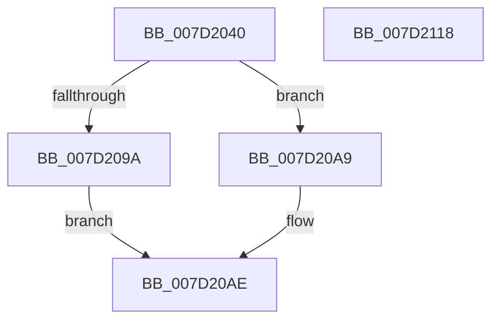

# NtCreateProfile

- RVA: `0x007D2040`–`0x007D2119` (길이 `217` bytes)
- VA: `0x00000001407D2040`
- 실행 섹션: `PAGE`
- PDB 이름 있음: `예`; PDB Function 태그: `아니요`
- unwind 정보 RVA: `0x000C449C`
- 디코드: `55`개 명령, `217/217` bytes 표시
- 미해석 바이트: `0` (있으면 어셈블리에 `.byte`로 보존)

> 이 문서는 커널 이미지의 기계어와 PDB 기호를 분석해 생성했습니다. 4번과 5번은 함수 원형과 자료형을 바이너리 사용 방식에서 추정한 C 해석이며 원본 소스 복구 결과는 아닙니다.

## 1. Dependencies

- 직접 호출 지점: **4**; 고유 호출 대상: **4**
- 직접 호출자로 확인된 함수: **0**
- RIP 상대 이미지 참조: **1**

### Outgoing calls
- `0x007D2082` → [KeQueryPrimaryGroupThread](../../text/49/KeQueryPrimaryGroupThread_function_004903B4.md) (function, `0x004903B4`)
- `0x007D209D` → [KeQueryGroupAffinity](../../text/47/KeQueryGroupAffinity_function_00471A60.md) (function, `0x00471A60`)
- `0x007D20F8` → [ExpProfileCreate](ExpProfileCreate_function_007D1AB8.md) (function, `0x007D1AB8`)
- `0x007D2105` → [_security_check_cookie](../../text/6A/_security_check_cookie_function_006AC640.md) (function, `0x006AC640`)

### Direct callers
- 이 함수 시작 RVA로 연결되는 직접 call은 확인되지 않았습니다. 간접 호출은 완전히 역산할 수 없습니다.

### Static image references
- `0x007D204E` → RVA `0x00E0A740` (`.data`; read)

## 2. Other-region calls and transfers

- 다른 실행 섹션으로 향하는 call: **3**
  - `0x007D2082` → [KeQueryPrimaryGroupThread](../../text/49/KeQueryPrimaryGroupThread_function_004903B4.md) (`PAGE` → `.text`)
  - `0x007D209D` → [KeQueryGroupAffinity](../../text/47/KeQueryGroupAffinity_function_00471A60.md) (`PAGE` → `.text`)
  - `0x007D2105` → [_security_check_cookie](../../text/6A/_security_check_cookie_function_006AC640.md) (`PAGE` → `.text`)
- 별도 외부 분기/꼬리 이동을 확인하지 못했습니다.

## 3. Assembly (complete function range)

```asm
007D2040  40 53                           push rbx
007D2042  55                              push rbp
007D2043  56                              push rsi
007D2044  57                              push rdi
007D2045  41 56                           push r14
007D2047  48 81 EC 80 00 00 00            sub rsp, 0x80
007D204E  48 8B 05 EB 86 63 00            mov rax, qword ptr [rip + 0x6386eb]
007D2055  48 33 C4                        xor rax, rsp
007D2058  48 89 44 24 70                  mov qword ptr [rsp + 0x70], rax
007D205D  4C 8B B4 24 D8 00 00 00         mov r14, qword ptr [rsp + 0xd8]
007D2065  48 8B D9                        mov rbx, rcx
007D2068  65 48 8B 0C 25 88 01 00 00      mov rcx, qword ptr gs:[0x188]
007D2071  0F 57 C0                        xorps xmm0, xmm0
007D2074  0F 11 44 24 60                  movups xmmword ptr [rsp + 0x60], xmm0
007D2079  49 8B E9                        mov rbp, r9
007D207C  49 8B F0                        mov rsi, r8
007D207F  48 8B FA                        mov rdi, rdx
007D2082  E8 2D E3 CB FF                  call 0x1404903b4
007D2087  48 8B 8C 24 F0 00 00 00         mov rcx, qword ptr [rsp + 0xf0]
007D208F  66 89 44 24 68                  mov word ptr [rsp + 0x68], ax
007D2094  48 83 F9 FF                     cmp rcx, -1
007D2098  75 0F                           jne 0x1407d20a9
007D209A  0F B7 C8                        movzx ecx, ax
007D209D  E8 BE F9 C9 FF                  call 0x140471a60
007D20A2  48 89 44 24 60                  mov qword ptr [rsp + 0x60], rax
007D20A7  EB 05                           jmp 0x1407d20ae
007D20A9  48 89 4C 24 60                  mov qword ptr [rsp + 0x60], rcx
007D20AE  B9 01 00 00 00                  mov ecx, 1
007D20B3  48 8D 44 24 60                  lea rax, [rsp + 0x60]
007D20B8  88 4C 24 50                     mov byte ptr [rsp + 0x50], cl
007D20BC  4C 8B CD                        mov r9, rbp
007D20BF  48 89 44 24 48                  mov qword ptr [rsp + 0x48], rax
007D20C4  4C 8B C6                        mov r8, rsi
007D20C7  8B 84 24 E8 00 00 00            mov eax, dword ptr [rsp + 0xe8]
007D20CE  48 8B D7                        mov rdx, rdi
007D20D1  66 89 4C 24 40                  mov word ptr [rsp + 0x40], cx
007D20D6  48 8B CB                        mov rcx, rbx
007D20D9  89 44 24 38                     mov dword ptr [rsp + 0x38], eax
007D20DD  8B 84 24 E0 00 00 00            mov eax, dword ptr [rsp + 0xe0]
007D20E4  89 44 24 30                     mov dword ptr [rsp + 0x30], eax
007D20E8  8B 84 24 D0 00 00 00            mov eax, dword ptr [rsp + 0xd0]
007D20EF  4C 89 74 24 28                  mov qword ptr [rsp + 0x28], r14
007D20F4  89 44 24 20                     mov dword ptr [rsp + 0x20], eax
007D20F8  E8 BB F9 FF FF                  call 0x1407d1ab8
007D20FD  48 8B 4C 24 70                  mov rcx, qword ptr [rsp + 0x70]
007D2102  48 33 CC                        xor rcx, rsp
007D2105  E8 36 A5 ED FF                  call 0x1406ac640
007D210A  48 81 C4 80 00 00 00            add rsp, 0x80
007D2111  41 5E                           pop r14
007D2113  5F                              pop rdi
007D2114  5E                              pop rsi
007D2115  5D                              pop rbp
007D2116  5B                              pop rbx
007D2117  C3                              ret
007D2118  CC                              int3
```

## 4. C-style interpretation (structured pseudocode)

```c
__int64 __fastcall NtCreateProfile(__int64 a1, __int64 a2, __int64 a3, __int64 a4, unsigned int a5, __int64 a6, unsigned int a7, unsigned int a8, __int64 a9)
{
    __int64 result;
    __int64 v_rsp;
    unsigned __int64 v_stack_m38;
    unsigned __int16 v_stack_m40;
    unsigned __int64 v_stack_m48;
    unsigned __int8 v_stack_m58;
    unsigned __int64 v_stack_m60;
    unsigned __int16 v_stack_m68;
    unsigned int v_stack_m70;
    unsigned int v_stack_m78;
    unsigned __int64 v_stack_m80;
    unsigned int v_stack_m88;

    v_rsp = (v_rsp) - (128);
    result = (*(unsigned __int64 *)(v_rip + 6522603)) ^ (v_rsp);
    v_stack_m38 = result;
    v_stack_m48 = v_xmm0;
    result = KeQueryPrimaryGroupThread(*(unsigned __int64 *)(gs_base + (0 + 392)), a2, a3, a4);
    v_stack_m40 = (unsigned __int16)(result);
    if (a9 != -1) goto loc_007D20A9;
    result = KeQueryGroupAffinity((unsigned __int16)(result), a2, a3, a4);
    v_stack_m48 = result;
    goto loc_007D20AE;
loc_007D20A9:
    v_stack_m48 = (unsigned __int16)(result);
loc_007D20AE:
    v_stack_m58 = 1;
    v_stack_m60 = v_stack_m48;
    v_stack_m68 = 1;
    v_stack_m70 = (unsigned int)((unsigned int)(a8));
    v_stack_m78 = (unsigned int)((unsigned int)(a7));
    v_stack_m80 = a6;
    v_stack_m88 = (unsigned int)((unsigned int)(a5));
    result = ExpProfileCreate(a1, a2, a3, a4);
    a1 = (v_stack_m38) ^ (v_rsp);
    result = _security_check_cookie(a1, a2, a3, a4);
    v_rsp = (v_rsp) + (128);
    return result;
}
```

## 5. (Beta) C Style

```c
int64_t NtCreateProfile(int64_t Arg1, int64_t Arg2, int64_t Arg3, int64_t Arg4, uint32_t Arg5, int64_t Arg6, uint32_t Arg7, uint32_t Arg8, int64_t Arg9)
{
    int64_t result;
    int64_t local_rsp;
    uint64_t v_stack_m38;
    uint16_t v_stack_m40;
    uint64_t v_stack_m48;
    uint8_t v_stack_m58;
    uint64_t v_stack_m60;
    uint16_t v_stack_m68;
    uint32_t v_stack_m70;
    uint32_t v_stack_m78;
    uint64_t v_stack_m80;
    uint32_t v_stack_m88;

    local_rsp = (local_rsp) - (128);
    result = (*(uint64_t *)(v_rip + 0x6386EB)) ^ (local_rsp);
    v_stack_m38 = result;
    v_stack_m48 = v_xmm0;
    result = KeQueryPrimaryGroupThread(*(uint64_t *)(gs_base + (0 + 0x188)), Arg2, Arg3, Arg4);
    v_stack_m40 = (uint16_t)(result);
    if (Arg9 != -1) goto loc_007D20A9;
    result = KeQueryGroupAffinity((uint16_t)(result), Arg2, Arg3, Arg4);
    v_stack_m48 = result;
    goto loc_007D20AE;
loc_007D20A9:
    v_stack_m48 = (uint16_t)(result);
loc_007D20AE:
    v_stack_m58 = 1;
    v_stack_m60 = v_stack_m48;
    v_stack_m68 = 1;
    v_stack_m70 = (uint32_t)((uint32_t)(Arg8));
    v_stack_m78 = (uint32_t)((uint32_t)(Arg7));
    v_stack_m80 = Arg6;
    v_stack_m88 = (uint32_t)((uint32_t)(Arg5));
    result = ExpProfileCreate(Arg1, Arg2, Arg3, Arg4);
    Arg1 = (v_stack_m38) ^ (local_rsp);
    result = _security_check_cookie(Arg1, Arg2, Arg3, Arg4);
    local_rsp = (local_rsp) + (128);
    return result;
}
```

## 6. Execution-region graph

[열기: 2D/3D 그래프와 함수 탐색 컨트롤 패널](../../../control-panel.html?section=page&rva=0x007D2040&view=graph)

- 2D 그래프는 위에서 아래로 흐르고, 3D 그래프는 빈 공간을 드래그해 회전합니다. Shift+드래그는 이동, 휠은 확대·축소, 함수 노드 선택은 대상 보고서 이동입니다.

### Static fallback


