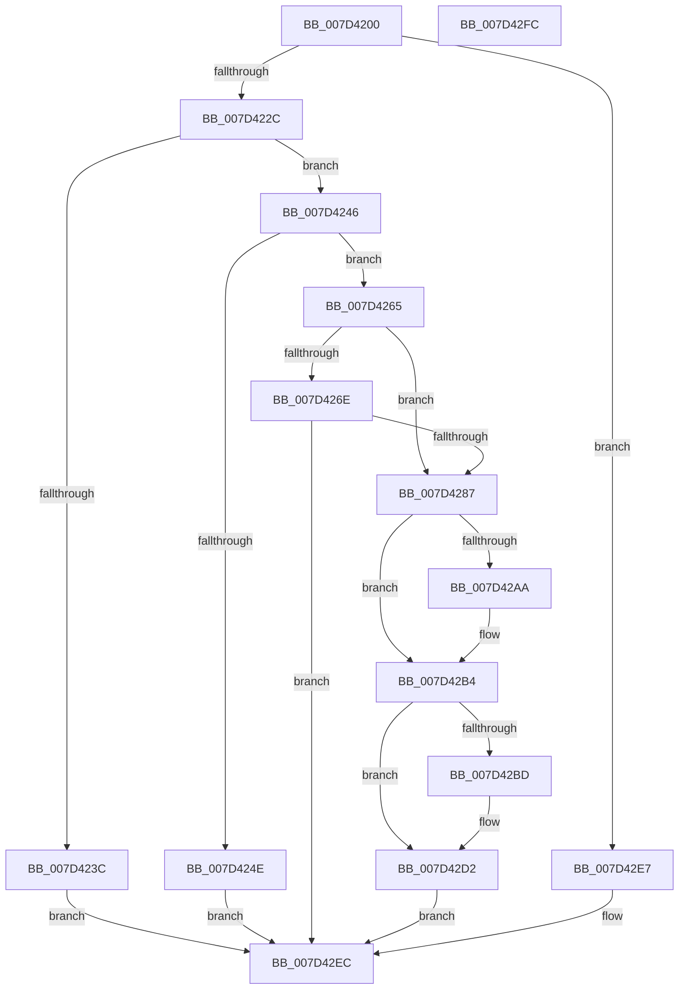

# NtFlushInstallUILanguage

- RVA: `0x007D4200`–`0x007D42FD` (길이 `253` bytes)
- VA: `0x00000001407D4200`
- 실행 섹션: `PAGE`
- PDB 이름 있음: `예`; PDB Function 태그: `아니요`
- unwind 정보 RVA: `0x00060BC4`
- 디코드: `61`개 명령, `253/253` bytes 표시
- 미해석 바이트: `0` (있으면 어셈블리에 `.byte`로 보존)

> 이 문서는 커널 이미지의 기계어와 PDB 기호를 분석해 생성했습니다. 4번과 5번은 함수 원형과 자료형을 바이너리 사용 방식에서 추정한 C 해석이며 원본 소스 복구 결과는 아닙니다.

## 1. Dependencies

- 직접 호출 지점: **6**; 고유 호출 대상: **6**
- 직접 호출자로 확인된 함수: **0**
- RIP 상대 이미지 참조: **7**

### Outgoing calls
- `0x007D4233` → [SeSinglePrivilegeCheck](../87/SeSinglePrivilegeCheck_function_00871E20.md) (function, `0x00871E20`)
- `0x007D4275` → [MUIInitializeResourceLock](../9E/MUIInitializeResourceLock_function_009ECB08.md) (function, `0x009ECB08`)
- `0x007D42A1` → [ExAcquireResourceExclusiveLite](../../text/21/ExAcquireResourceExclusiveLite_function_00214E20.md) (function, `0x00214E20`)
- `0x007D42CB` → [MigrateOOBELanguageToInstallationLanguage](../../text/65/MigrateOOBELanguageToInstallationLanguage_function_0065CEA8.md) (function, `0x0065CEA8`)
- `0x007D42D9` → [ExReleaseResourceLite](../../text/25/ExReleaseResourceLite_function_0025FA10.md) (function, `0x0025FA10`)
- `0x007D42DE` → [KeLeaveCriticalRegion](../../text/25/KeLeaveCriticalRegion_function_0025D8B0.md) (function, `0x0025D8B0`)

### Direct callers
- 이 함수 시작 RVA로 연결되는 직접 call은 확인되지 않았습니다. 간접 호출은 완전히 역산할 수 없습니다.

### Static image references
- `0x007D422C` → RVA `0x00FD9A78` (`PAGEDATA`; read)
- `0x007D4246` → RVA `0x00FD9BB8` (`PAGEDATA`; read)
- `0x007D424E` → RVA `0x00FD9A60` (`PAGEDATA`; read)
- `0x007D4265` → RVA `0x00EEEFB8` (`.data`; read)
- `0x007D42AA` → RVA `0x00FD9BB8` (`PAGEDATA`; write)
- `0x007D42BD` → RVA `0x00FD9A60` (`PAGEDATA`; write)
- `0x007D42C4` → RVA `0x00FD9A70` (`PAGEDATA`; write)

## 2. Other-region calls and transfers

- 다른 실행 섹션으로 향하는 call: **4**
  - `0x007D42A1` → [ExAcquireResourceExclusiveLite](../../text/21/ExAcquireResourceExclusiveLite_function_00214E20.md) (`PAGE` → `.text`)
  - `0x007D42CB` → [MigrateOOBELanguageToInstallationLanguage](../../text/65/MigrateOOBELanguageToInstallationLanguage_function_0065CEA8.md) (`PAGE` → `.text`)
  - `0x007D42D9` → [ExReleaseResourceLite](../../text/25/ExReleaseResourceLite_function_0025FA10.md) (`PAGE` → `.text`)
  - `0x007D42DE` → [KeLeaveCriticalRegion](../../text/25/KeLeaveCriticalRegion_function_0025D8B0.md) (`PAGE` → `.text`)
- 별도 외부 분기/꼬리 이동을 확인하지 못했습니다.

## 3. Assembly (complete function range)

```asm
007D4200  48 89 5C 24 08                  mov qword ptr [rsp + 8], rbx
007D4205  48 89 74 24 10                  mov qword ptr [rsp + 0x10], rsi
007D420A  57                              push rdi
007D420B  48 83 EC 20                     sub rsp, 0x20
007D420F  65 48 8B 04 25 88 01 00 00      mov rax, qword ptr gs:[0x188]
007D4218  8B F2                           mov esi, edx
007D421A  33 FF                           xor edi, edi
007D421C  8B D9                           mov ebx, ecx
007D421E  8A 90 32 02 00 00               mov dl, byte ptr [rax + 0x232]
007D4224  84 D2                           test dl, dl
007D4226  0F 84 BB 00 00 00               je 0x1407d42e7
007D422C  48 8B 0D 45 58 80 00            mov rcx, qword ptr [rip + 0x805845]
007D4233  E8 E8 DB 09 00                  call 0x140871e20
007D4238  84 C0                           test al, al
007D423A  75 0A                           jne 0x1407d4246
007D423C  B8 22 00 00 C0                  mov eax, 0xc0000022
007D4241  E9 A6 00 00 00                  jmp 0x1407d42ec
007D4246  39 3D 6C 59 80 00               cmp dword ptr [rip + 0x80596c], edi
007D424C  74 17                           je 0x1407d4265
007D424E  0F B7 05 0B 58 80 00            movzx eax, word ptr [rip + 0x80580b]
007D4255  2B D8                           sub ebx, eax
007D4257  F7 DB                           neg ebx
007D4259  1B C0                           sbb eax, eax
007D425B  25 01 00 00 C0                  and eax, 0xc0000001
007D4260  E9 87 00 00 00                  jmp 0x1407d42ec
007D4265  48 39 3D 4C AD 71 00            cmp qword ptr [rip + 0x71ad4c], rdi
007D426C  75 19                           jne 0x1407d4287
007D426E  48 8D 0D 43 AD 71 00            lea rcx, [rip + 0x71ad43]
007D4275  E8 8E 88 21 00                  call 0x1409ecb08
007D427A  BA 00 00 00 C0                  mov edx, 0xc0000000
007D427F  8B C8                           mov ecx, eax
007D4281  23 CA                           and ecx, edx
007D4283  3B CA                           cmp ecx, edx
007D4285  74 65                           je 0x1407d42ec
007D4287  65 48 8B 04 25 88 01 00 00      mov rax, qword ptr gs:[0x188]
007D4290  B2 01                           mov dl, 1
007D4292  66 FF 88 E4 01 00 00            dec word ptr [rax + 0x1e4]
007D4299  90                              nop
007D429A  48 8B 0D 17 AD 71 00            mov rcx, qword ptr [rip + 0x71ad17]
007D42A1  E8 7A 0B A4 FF                  call 0x140214e20
007D42A6  85 F6                           test esi, esi
007D42A8  74 0A                           je 0x1407d42b4
007D42AA  C7 05 04 59 80 00 01 00 00 00   mov dword ptr [rip + 0x805904], 1
007D42B4  66 3B 1D A5 57 80 00            cmp bx, word ptr [rip + 0x8057a5]
007D42BB  74 15                           je 0x1407d42d2
007D42BD  66 89 1D 9C 57 80 00            mov word ptr [rip + 0x80579c], bx
007D42C4  66 89 1D A5 57 80 00            mov word ptr [rip + 0x8057a5], bx
007D42CB  E8 D8 8B E8 FF                  call 0x14065cea8
007D42D0  8B F8                           mov edi, eax
007D42D2  48 8B 0D DF AC 71 00            mov rcx, qword ptr [rip + 0x71acdf]
007D42D9  E8 32 B7 A8 FF                  call 0x14025fa10
007D42DE  E8 CD 95 A8 FF                  call 0x14025d8b0
007D42E3  8B C7                           mov eax, edi
007D42E5  EB 05                           jmp 0x1407d42ec
007D42E7  B8 01 00 00 C0                  mov eax, 0xc0000001
007D42EC  48 8B 5C 24 30                  mov rbx, qword ptr [rsp + 0x30]
007D42F1  48 8B 74 24 38                  mov rsi, qword ptr [rsp + 0x38]
007D42F6  48 83 C4 20                     add rsp, 0x20
007D42FA  5F                              pop rdi
007D42FB  C3                              ret
007D42FC  CC                              int3
```

## 4. C-style interpretation (structured pseudocode)

```c
__int64 __fastcall NtFlushInstallUILanguage(int a1, int a2)
{
    __int64 result;
    __int64 v_rbx;
    __int64 v_rdi;
    __int64 v_rsp;
    unsigned __int64 v_stack_p10;
    unsigned __int64 v_stack_p8;

    v_stack_p8 = v_rbx;
    v_stack_p10 = v_rsi;
    v_rsp = (v_rsp) - (32);
    v_rdi = 0;
    if ((unsigned __int8)(*(unsigned __int8 *)(*(unsigned __int64 *)(gs_base + (0 + 392)) + 562)) == 0) goto loc_007D42E7;
    result = SeSinglePrivilegeCheck(*(unsigned __int64 *)(v_rip + 8411205), *(unsigned __int8 *)(*(unsigned __int64 *)(gs_base + (0 + 392)) + 562), a3, a4);
    if ((unsigned __int8)(result) != 0) goto loc_007D4246;
    goto loc_007D42EC;
loc_007D4246:
    if ((*(unsigned int *)(v_rip + 8411500)) == 0) goto loc_007D4265;
    v_rbx = (unsigned int)(((unsigned int)(a1)) - ((unsigned int)(*(unsigned __int16 *)(v_rip + 8411147))));
    v_rbx = (unsigned int)(-(v_rbx));
    result = (unsigned int)((*(unsigned __int16 *)(v_rip + 8411147)) & (0xC0000001ULL));
    goto loc_007D42EC;
loc_007D4265:
    if ((*(unsigned __int64 *)(v_rip + 7449932)) != 0) goto loc_007D4287;
    result = MUIInitializeResourceLock(v_rip + 7449923, *(unsigned __int8 *)(*(unsigned __int64 *)(gs_base + (0 + 392)) + 562), a3, a4);
    a1 = (unsigned int)(((unsigned int)((unsigned int)(result))) & ((unsigned int)((unsigned int)(0xC0000000ULL))));
    if (a1 == ((unsigned int)((unsigned int)(0xC0000000ULL)))) goto loc_007D42EC;
loc_007D4287:
    result = ExAcquireResourceExclusiveLite(*(unsigned __int64 *)(v_rip + 7449879), 1, a3, a4);
    if ((unsigned int)((unsigned int)(a2)) != 0) {
        *(unsigned int *)(v_rip + 8411396) = 1;
    }
    if (((unsigned __int16)(v_rbx)) != (*(unsigned __int16 *)(v_rip + 8411045))) {
        *(unsigned __int16 *)(v_rip + 8411036) = (unsigned __int16)(v_rbx);
        *(unsigned __int16 *)(v_rip + 8411045) = (unsigned __int16)(v_rbx);
        result = MigrateOOBELanguageToInstallationLanguage(*(unsigned __int64 *)(v_rip + 7449879), 1, a3, a4);
        v_rdi = (unsigned int)(result);
    }
    result = ExReleaseResourceLite(*(unsigned __int64 *)(v_rip + 7449823), 1, a3, a4);
    result = KeLeaveCriticalRegion(*(unsigned __int64 *)(v_rip + 7449823), 1, a3, a4);
    goto loc_007D42EC;
loc_007D42E7:
loc_007D42EC:
    v_rsp = (v_rsp) + (32);
    return (unsigned int)(0xC0000001ULL);
}
```

## 5. (Beta) C Style

```c
int64_t NtFlushInstallUILanguage(int32_t Arg1, int32_t Arg2)
{
    int64_t result;
    int64_t local_rbx;
    int64_t local_rdi;
    int64_t local_rsp;
    uint64_t v_stack_p10;
    uint64_t v_stack_p8;

    v_stack_p8 = local_rbx;
    v_stack_p10 = local_rsi;
    local_rsp = (local_rsp) - (32);
    local_rdi = 0;
    if ((uint8_t)(*(uint8_t *)(*(uint64_t *)(gs_base + (0 + 0x188)) + 0x232)) == 0) goto loc_007D42E7;
    result = SeSinglePrivilegeCheck(*(uint64_t *)(v_rip + 0x805845), *(uint8_t *)(*(uint64_t *)(gs_base + (0 + 0x188)) + 0x232), a3, a4);
    if ((uint8_t)(result) != 0) goto loc_007D4246;
    goto loc_007D42EC;
loc_007D4246:
    if ((*(uint32_t *)(v_rip + 0x80596C)) == 0) goto loc_007D4265;
    local_rbx = (uint32_t)(((uint32_t)(Arg1)) - ((uint32_t)(*(uint16_t *)(v_rip + 0x80580B))));
    local_rbx = (uint32_t)(-(local_rbx));
    result = (uint32_t)((*(uint16_t *)(v_rip + 0x80580B)) & (0xC0000001ULL));
    goto loc_007D42EC;
loc_007D4265:
    if ((*(uint64_t *)(v_rip + 0x71AD4C)) != 0) goto loc_007D4287;
    result = MUIInitializeResourceLock(v_rip + 7449923, *(uint8_t *)(*(uint64_t *)(gs_base + (0 + 0x188)) + 0x232), a3, a4);
    Arg1 = (uint32_t)(((uint32_t)((uint32_t)(result))) & ((uint32_t)((uint32_t)(0xC0000000ULL))));
    if (Arg1 == ((uint32_t)((uint32_t)(0xC0000000ULL)))) goto loc_007D42EC;
loc_007D4287:
    result = ExAcquireResourceExclusiveLite(*(uint64_t *)(v_rip + 0x71AD17), 1, a3, a4);
    if ((uint32_t)((uint32_t)(Arg2)) != 0) {
        *(uint32_t *)(v_rip + 0x805904) = 1;
    }
    if (((uint16_t)(local_rbx)) != (*(uint16_t *)(v_rip + 0x8057A5))) {
        *(uint16_t *)(v_rip + 0x80579C) = (uint16_t)(local_rbx);
        *(uint16_t *)(v_rip + 0x8057A5) = (uint16_t)(local_rbx);
        result = MigrateOOBELanguageToInstallationLanguage(*(uint64_t *)(v_rip + 0x71AD17), 1, a3, a4);
        local_rdi = (uint32_t)(result);
    }
    result = ExReleaseResourceLite(*(uint64_t *)(v_rip + 0x71ACDF), 1, a3, a4);
    result = KeLeaveCriticalRegion(*(uint64_t *)(v_rip + 0x71ACDF), 1, a3, a4);
    goto loc_007D42EC;
loc_007D42E7:
loc_007D42EC:
    local_rsp = (local_rsp) + (32);
    return (uint32_t)(0xC0000001ULL);
}
```

## 6. Execution-region graph

[열기: 2D/3D 그래프와 함수 탐색 컨트롤 패널](../../../control-panel.html?section=page&rva=0x007D4200&view=graph)

- 2D 그래프는 위에서 아래로 흐르고, 3D 그래프는 빈 공간을 드래그해 회전합니다. Shift+드래그는 이동, 휠은 확대·축소, 함수 노드 선택은 대상 보고서 이동입니다.

### Static fallback


