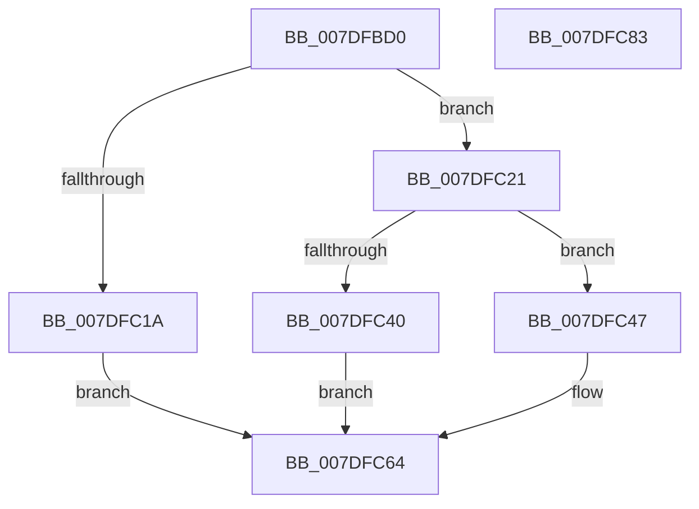

# NtFreezeRegistry

- RVA: `0x007DFBD0`–`0x007DFC84` (길이 `180` bytes)
- VA: `0x00000001407DFBD0`
- 실행 섹션: `PAGE`
- PDB 이름 있음: `예`; PDB Function 태그: `아니요`
- unwind 정보 RVA: `0x0009DFE8`
- 디코드: `45`개 명령, `180/180` bytes 표시
- 미해석 바이트: `0` (있으면 어셈블리에 `.byte`로 보존)

> 이 문서는 커널 이미지의 기계어와 PDB 기호를 분석해 생성했습니다. 4번과 5번은 함수 원형과 자료형을 바이너리 사용 방식에서 추정한 C 해석이며 원본 소스 복구 결과는 아닙니다.

## 1. Dependencies

- 직접 호출 지점: **7**; 고유 호출 대상: **7**
- 직접 호출자로 확인된 함수: **0**
- RIP 상대 이미지 참조: **2**

### Outgoing calls
- `0x007DFC0D` → [CmpInitializeThreadInfo](../../text/3F/CmpInitializeThreadInfo_function_003FBE70.md) (function, `0x003FBE70`)
- `0x007DFC37` → [SeSinglePrivilegeCheck](../87/SeSinglePrivilegeCheck_function_00871E20.md) (function, `0x00871E20`)
- `0x007DFC4C` → [CmpAttachToRegistryProcess](../../pagecmrc/BC/CmpAttachToRegistryProcess_function_00BC98E0.md) (function, `0x00BC98E0`)
- `0x007DFC53` → [CmFreezeRegistry](../7E/CmFreezeRegistry_function_007E834C.md) (function, `0x007E834C`)
- `0x007DFC5F` → [CmpDetachFromRegistryProcess](../../pagecmrc/BC/CmpDetachFromRegistryProcess_function_00BC9920.md) (function, `0x00BC9920`)
- `0x007DFC69` → [CmCleanupThreadInfo](../../text/41/CmCleanupThreadInfo_function_0041FD50.md) (function, `0x0041FD50`)
- `0x007DFC78` → [_security_check_cookie](../../text/6A/_security_check_cookie_function_006AC640.md) (function, `0x006AC640`)

### Direct callers
- 이 함수 시작 RVA로 연결되는 직접 call은 확인되지 않았습니다. 간접 호출은 완전히 역산할 수 없습니다.

### Static image references
- `0x007DFBD6` → RVA `0x00E0A740` (`.data`; read)
- `0x007DFC2A` → RVA `0x00FD9AC0` (`PAGEDATA`; read)

## 2. Other-region calls and transfers

- 다른 실행 섹션으로 향하는 call: **5**
  - `0x007DFC0D` → [CmpInitializeThreadInfo](../../text/3F/CmpInitializeThreadInfo_function_003FBE70.md) (`PAGE` → `.text`)
  - `0x007DFC4C` → [CmpAttachToRegistryProcess](../../pagecmrc/BC/CmpAttachToRegistryProcess_function_00BC98E0.md) (`PAGE` → `PAGECMRC`)
  - `0x007DFC5F` → [CmpDetachFromRegistryProcess](../../pagecmrc/BC/CmpDetachFromRegistryProcess_function_00BC9920.md) (`PAGE` → `PAGECMRC`)
  - `0x007DFC69` → [CmCleanupThreadInfo](../../text/41/CmCleanupThreadInfo_function_0041FD50.md) (`PAGE` → `.text`)
  - `0x007DFC78` → [_security_check_cookie](../../text/6A/_security_check_cookie_function_006AC640.md) (`PAGE` → `.text`)
- 별도 외부 분기/꼬리 이동을 확인하지 못했습니다.

## 3. Assembly (complete function range)

```asm
007DFBD0  40 53                           push rbx
007DFBD2  48 83 EC 70                     sub rsp, 0x70
007DFBD6  48 8B 05 63 AB 62 00            mov rax, qword ptr [rip + 0x62ab63]
007DFBDD  48 33 C4                        xor rax, rsp
007DFBE0  48 89 44 24 68                  mov qword ptr [rsp + 0x68], rax
007DFBE5  0F 57 C9                        xorps xmm1, xmm1
007DFBE8  0F 57 C0                        xorps xmm0, xmm0
007DFBEB  33 C0                           xor eax, eax
007DFBED  8B D9                           mov ebx, ecx
007DFBEF  48 8D 4C 24 20                  lea rcx, [rsp + 0x20]
007DFBF4  48 89 44 24 30                  mov qword ptr [rsp + 0x30], rax
007DFBF9  0F 11 44 24 20                  movups xmmword ptr [rsp + 0x20], xmm0
007DFBFE  0F 11 4C 24 38                  movups xmmword ptr [rsp + 0x38], xmm1
007DFC03  0F 11 4C 24 48                  movups xmmword ptr [rsp + 0x48], xmm1
007DFC08  0F 11 4C 24 58                  movups xmmword ptr [rsp + 0x58], xmm1
007DFC0D  E8 5E C2 C1 FF                  call 0x1403fbe70
007DFC12  81 FB 84 03 00 00               cmp ebx, 0x384
007DFC18  76 07                           jbe 0x1407dfc21
007DFC1A  BB 0D 00 00 C0                  mov ebx, 0xc000000d
007DFC1F  EB 43                           jmp 0x1407dfc64
007DFC21  65 48 8B 04 25 88 01 00 00      mov rax, qword ptr gs:[0x188]
007DFC2A  48 8B 0D 8F 9E 7F 00            mov rcx, qword ptr [rip + 0x7f9e8f]
007DFC31  8A 90 32 02 00 00               mov dl, byte ptr [rax + 0x232]
007DFC37  E8 E4 21 09 00                  call 0x140871e20
007DFC3C  84 C0                           test al, al
007DFC3E  75 07                           jne 0x1407dfc47
007DFC40  BB 61 00 00 C0                  mov ebx, 0xc0000061
007DFC45  EB 1D                           jmp 0x1407dfc64
007DFC47  48 8D 4C 24 38                  lea rcx, [rsp + 0x38]
007DFC4C  E8 8F 9C 3E 00                  call 0x140bc98e0
007DFC51  8B CB                           mov ecx, ebx
007DFC53  E8 F4 86 00 00                  call 0x1407e834c
007DFC58  48 8D 4C 24 38                  lea rcx, [rsp + 0x38]
007DFC5D  8B D8                           mov ebx, eax
007DFC5F  E8 BC 9C 3E 00                  call 0x140bc9920
007DFC64  48 8D 4C 24 20                  lea rcx, [rsp + 0x20]
007DFC69  E8 E2 00 C4 FF                  call 0x14041fd50
007DFC6E  8B C3                           mov eax, ebx
007DFC70  48 8B 4C 24 68                  mov rcx, qword ptr [rsp + 0x68]
007DFC75  48 33 CC                        xor rcx, rsp
007DFC78  E8 C3 C9 EC FF                  call 0x1406ac640
007DFC7D  48 83 C4 70                     add rsp, 0x70
007DFC81  5B                              pop rbx
007DFC82  C3                              ret
007DFC83  CC                              int3
```

## 4. C-style interpretation (structured pseudocode)

```c
__int64 __fastcall NtFreezeRegistry(int a1)
{
    __int64 result;
    __int64 v_rsp;
    unsigned __int64 v_stack_m10;
    unsigned __int64 v_stack_m20;
    unsigned __int64 v_stack_m30;
    unsigned __int64 v_stack_m40;
    unsigned __int64 v_stack_m48;
    unsigned __int64 v_stack_m58;

    v_rsp = (v_rsp) - (112);
    result = (*(unsigned __int64 *)(v_rip + 6466403)) ^ (v_rsp);
    v_stack_m10 = result;
    result = 0;
    v_stack_m48 = 0;
    v_stack_m58 = v_xmm0;
    v_stack_m40 = v_xmm1;
    v_stack_m30 = v_xmm1;
    v_stack_m20 = v_xmm1;
    result = CmpInitializeThreadInfo(v_stack_m58, a2, a3, a4);
    if (((unsigned int)((unsigned int)(a1))) <= 900) goto loc_007DFC21;
    goto loc_007DFC64;
loc_007DFC21:
    result = SeSinglePrivilegeCheck(*(unsigned __int64 *)(v_rip + 8363663), *(unsigned __int8 *)(*(unsigned __int64 *)(gs_base + (0 + 392)) + 562), a3, a4);
    if ((unsigned __int8)(result) != 0) goto loc_007DFC47;
    goto loc_007DFC64;
loc_007DFC47:
    result = CmpAttachToRegistryProcess(v_stack_m40, *(unsigned __int8 *)(*(unsigned __int64 *)(gs_base + (0 + 392)) + 562), a3, a4);
    result = CmFreezeRegistry((unsigned int)((unsigned int)((unsigned int)(0xC0000061ULL))), *(unsigned __int8 *)(*(unsigned __int64 *)(gs_base + (0 + 392)) + 562), a3, a4);
    result = CmpDetachFromRegistryProcess(v_stack_m40, *(unsigned __int8 *)(*(unsigned __int64 *)(gs_base + (0 + 392)) + 562), a3, a4);
loc_007DFC64:
    result = CmCleanupThreadInfo(v_stack_m58, *(unsigned __int8 *)(*(unsigned __int64 *)(gs_base + (0 + 392)) + 562), a3, a4);
    a1 = (v_stack_m10) ^ (v_rsp);
    result = _security_check_cookie(a1, *(unsigned __int8 *)(*(unsigned __int64 *)(gs_base + (0 + 392)) + 562), a3, a4);
    v_rsp = (v_rsp) + (112);
    return result;
}
```

## 5. (Beta) C Style

```c
int64_t NtFreezeRegistry(int32_t Arg1)
{
    int64_t result;
    int64_t local_rsp;
    uint64_t v_stack_m10;
    uint64_t v_stack_m20;
    uint64_t v_stack_m30;
    uint64_t v_stack_m40;
    uint64_t v_stack_m48;
    uint64_t v_stack_m58;

    local_rsp = (local_rsp) - (112);
    result = (*(uint64_t *)(v_rip + 0x62AB63)) ^ (local_rsp);
    v_stack_m10 = result;
    result = 0;
    v_stack_m48 = 0;
    v_stack_m58 = v_xmm0;
    v_stack_m40 = v_xmm1;
    v_stack_m30 = v_xmm1;
    v_stack_m20 = v_xmm1;
    result = CmpInitializeThreadInfo(v_stack_m58, a2, a3, a4);
    if (((uint32_t)((uint32_t)(Arg1))) <= 900) goto loc_007DFC21;
    goto loc_007DFC64;
loc_007DFC21:
    result = SeSinglePrivilegeCheck(*(uint64_t *)(v_rip + 0x7F9E8F), *(uint8_t *)(*(uint64_t *)(gs_base + (0 + 0x188)) + 0x232), a3, a4);
    if ((uint8_t)(result) != 0) goto loc_007DFC47;
    goto loc_007DFC64;
loc_007DFC47:
    result = CmpAttachToRegistryProcess(v_stack_m40, *(uint8_t *)(*(uint64_t *)(gs_base + (0 + 0x188)) + 0x232), a3, a4);
    result = CmFreezeRegistry((uint32_t)((uint32_t)((uint32_t)(0xC0000061ULL))), *(uint8_t *)(*(uint64_t *)(gs_base + (0 + 0x188)) + 0x232), a3, a4);
    result = CmpDetachFromRegistryProcess(v_stack_m40, *(uint8_t *)(*(uint64_t *)(gs_base + (0 + 0x188)) + 0x232), a3, a4);
loc_007DFC64:
    result = CmCleanupThreadInfo(v_stack_m58, *(uint8_t *)(*(uint64_t *)(gs_base + (0 + 0x188)) + 0x232), a3, a4);
    Arg1 = (v_stack_m10) ^ (local_rsp);
    result = _security_check_cookie(Arg1, *(uint8_t *)(*(uint64_t *)(gs_base + (0 + 0x188)) + 0x232), a3, a4);
    local_rsp = (local_rsp) + (112);
    return result;
}
```

## 6. Execution-region graph

[열기: 2D/3D 그래프와 함수 탐색 컨트롤 패널](../../../control-panel.html?section=page&rva=0x007DFBD0&view=graph)

- 2D 그래프는 위에서 아래로 흐르고, 3D 그래프는 빈 공간을 드래그해 회전합니다. Shift+드래그는 이동, 휠은 확대·축소, 함수 노드 선택은 대상 보고서 이동입니다.

### Static fallback


