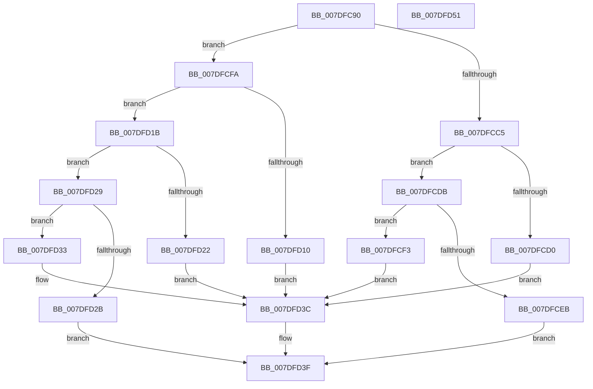

# NtInitializeRegistry

- RVA: `0x007DFC90`–`0x007DFD52` (길이 `194` bytes)
- VA: `0x00000001407DFC90`
- 실행 섹션: `PAGE`
- PDB 이름 있음: `예`; PDB Function 태그: `아니요`
- unwind 정보 RVA: `0x00063458`
- 디코드: `51`개 명령, `194/194` bytes 표시
- 미해석 바이트: `0` (있으면 어셈블리에 `.byte`로 보존)

> 이 문서는 커널 이미지의 기계어와 PDB 기호를 분석해 생성했습니다. 4번과 5번은 함수 원형과 자료형을 바이너리 사용 방식에서 추정한 C 해석이며 원본 소스 복구 결과는 아닙니다.

## 1. Dependencies

- 직접 호출 지점: **8**; 고유 호출 대상: **8**
- 직접 호출자로 확인된 함수: **0**
- RIP 상대 이미지 참조: **1**

### Outgoing calls
- `0x007DFCAC` → [CmpInitializeThreadInfo](../../text/3F/CmpInitializeThreadInfo_function_003FBE70.md) (function, `0x003FBE70`)
- `0x007DFCD4` → [ZwInitializeRegistry](../../text/6A/ZwInitializeRegistry_function_006AF1F0.md) (function, `0x006AF1F0`)
- `0x007DFCE2` → [SeSinglePrivilegeCheck](../87/SeSinglePrivilegeCheck_function_00871E20.md) (function, `0x00871E20`)
- `0x007DFCF3` → [CmpSyncNextBackupHive](../7E/CmpSyncNextBackupHive_function_007EC6C8.md) (function, `0x007EC6C8`)
- `0x007DFD14` → [CmpAcceptBoot](CmpAcceptBoot_function_007DF574.md) (function, `0x007DF574`)
- `0x007DFD22` → [CmpHandlePageFileOpenNotification](CmpHandlePageFileOpenNotification_function_007DF640.md) (function, `0x007DF640`)
- `0x007DFD37` → [CmCompleteRegistryInitialization](CmCompleteRegistryInitialization_function_007DF1EC.md) (function, `0x007DF1EC`)
- `0x007DFD44` → [CmCleanupThreadInfo](../../text/41/CmCleanupThreadInfo_function_0041FD50.md) (function, `0x0041FD50`)

### Direct callers
- 이 함수 시작 RVA로 연결되는 직접 call은 확인되지 않았습니다. 간접 호출은 완전히 역산할 수 없습니다.

### Static image references
- `0x007DFCDB` → RVA `0x00FD9AC0` (`PAGEDATA`; read)

## 2. Other-region calls and transfers

- 다른 실행 섹션으로 향하는 call: **3**
  - `0x007DFCAC` → [CmpInitializeThreadInfo](../../text/3F/CmpInitializeThreadInfo_function_003FBE70.md) (`PAGE` → `.text`)
  - `0x007DFCD4` → [ZwInitializeRegistry](../../text/6A/ZwInitializeRegistry_function_006AF1F0.md) (`PAGE` → `.text`)
  - `0x007DFD44` → [CmCleanupThreadInfo](../../text/41/CmCleanupThreadInfo_function_0041FD50.md) (`PAGE` → `.text`)
- 별도 외부 분기/꼬리 이동을 확인하지 못했습니다.

## 3. Assembly (complete function range)

```asm
007DFC90  48 83 EC 48                     sub rsp, 0x48
007DFC94  0F 57 C0                        xorps xmm0, xmm0
007DFC97  33 C0                           xor eax, eax
007DFC99  44 0F B7 D1                     movzx r10d, cx
007DFC9D  48 89 44 24 30                  mov qword ptr [rsp + 0x30], rax
007DFCA2  48 8D 4C 24 20                  lea rcx, [rsp + 0x20]
007DFCA7  0F 11 44 24 20                  movups xmmword ptr [rsp + 0x20], xmm0
007DFCAC  E8 BF C1 C1 FF                  call 0x1403fbe70
007DFCB1  65 4C 8B 0C 25 88 01 00 00      mov r9, qword ptr gs:[0x188]
007DFCBA  41 8A 91 32 02 00 00            mov dl, byte ptr [r9 + 0x232]
007DFCC1  84 D2                           test dl, dl
007DFCC3  74 35                           je 0x1407dfcfa
007DFCC5  B8 E8 13 00 00                  mov eax, 0x13e8
007DFCCA  66 44 3B D0                     cmp r10w, ax
007DFCCE  74 0B                           je 0x1407dfcdb
007DFCD0  41 0F B7 CA                     movzx ecx, r10w
007DFCD4  E8 17 F5 EC FF                  call 0x1406af1f0
007DFCD9  EB 61                           jmp 0x1407dfd3c
007DFCDB  48 8B 0D DE 9D 7F 00            mov rcx, qword ptr [rip + 0x7f9dde]
007DFCE2  E8 39 21 09 00                  call 0x140871e20
007DFCE7  84 C0                           test al, al
007DFCE9  75 08                           jne 0x1407dfcf3
007DFCEB  41 B8 61 00 00 C0               mov r8d, 0xc0000061
007DFCF1  EB 4C                           jmp 0x1407dfd3f
007DFCF3  E8 D0 C9 00 00                  call 0x1407ec6c8
007DFCF8  EB 42                           jmp 0x1407dfd3c
007DFCFA  B9 00 10 00 00                  mov ecx, 0x1000
007DFCFF  41 0F B7 C2                     movzx eax, r10w
007DFD03  66 2B C1                        sub ax, cx
007DFD06  B9 E7 03 00 00                  mov ecx, 0x3e7
007DFD0B  66 3B C1                        cmp ax, cx
007DFD0E  77 0B                           ja 0x1407dfd1b
007DFD10  41 0F B7 CA                     movzx ecx, r10w
007DFD14  E8 5B F8 FF FF                  call 0x1407df574
007DFD19  EB 21                           jmp 0x1407dfd3c
007DFD1B  66 41 83 FA 02                  cmp r10w, 2
007DFD20  75 07                           jne 0x1407dfd29
007DFD22  E8 19 F9 FF FF                  call 0x1407df640
007DFD27  EB 13                           jmp 0x1407dfd3c
007DFD29  72 08                           jb 0x1407dfd33
007DFD2B  41 B8 0D 00 00 C0               mov r8d, 0xc000000d
007DFD31  EB 0C                           jmp 0x1407dfd3f
007DFD33  41 0F B7 CA                     movzx ecx, r10w
007DFD37  E8 B0 F4 FF FF                  call 0x1407df1ec
007DFD3C  44 8B C0                        mov r8d, eax
007DFD3F  48 8D 4C 24 20                  lea rcx, [rsp + 0x20]
007DFD44  E8 07 00 C4 FF                  call 0x14041fd50
007DFD49  41 8B C0                        mov eax, r8d
007DFD4C  48 83 C4 48                     add rsp, 0x48
007DFD50  C3                              ret
007DFD51  CC                              int3
```

## 4. C-style interpretation (structured pseudocode)

```c
__int64 __fastcall NtInitializeRegistry(unsigned __int16 a1)
{
    __int64 result;
    __int64 v_rsp;
    unsigned __int64 v_stack_m18;
    unsigned __int64 v_stack_m28;

    v_rsp = (v_rsp) - (72);
    result = 0;
    v_stack_m18 = 0;
    v_stack_m28 = v_xmm0;
    result = CmpInitializeThreadInfo(v_stack_m28, a2, a3, a4);
    if ((unsigned __int8)(*(unsigned __int8 *)(*(unsigned __int64 *)(gs_base + (0 + 392)) + 562)) == 0) goto loc_007DFCFA;
    if (a1 == ((unsigned __int16)((unsigned int)(0x13E8ULL)))) goto loc_007DFCDB;
    result = ZwInitializeRegistry(a1, *(unsigned __int8 *)(*(unsigned __int64 *)(gs_base + (0 + 392)) + 562), a3, *(unsigned __int64 *)(gs_base + (0 + 392)));
    goto loc_007DFD3C;
loc_007DFCDB:
    result = SeSinglePrivilegeCheck(*(unsigned __int64 *)(v_rip + 8363486), *(unsigned __int8 *)(*(unsigned __int64 *)(gs_base + (0 + 392)) + 562), a3, *(unsigned __int64 *)(gs_base + (0 + 392)));
    if ((unsigned __int8)(result) != 0) goto loc_007DFCF3;
    goto loc_007DFD3F;
loc_007DFCF3:
    result = CmpSyncNextBackupHive(*(unsigned __int64 *)(v_rip + 8363486), *(unsigned __int8 *)(*(unsigned __int64 *)(gs_base + (0 + 392)) + 562), (unsigned int)(0xC0000061ULL), *(unsigned __int64 *)(gs_base + (0 + 392)));
    goto loc_007DFD3C;
loc_007DFCFA:
    result = (unsigned __int16)((a1) - ((unsigned __int16)((unsigned int)(0x1000ULL))));
    if (((unsigned __int16)(result)) > 999) goto loc_007DFD1B;
    result = CmpAcceptBoot(a1, *(unsigned __int8 *)(*(unsigned __int64 *)(gs_base + (0 + 392)) + 562), (unsigned int)(0xC0000061ULL), *(unsigned __int64 *)(gs_base + (0 + 392)));
    goto loc_007DFD3C;
loc_007DFD1B:
    if (a1 != 2) goto loc_007DFD29;
    result = CmpHandlePageFileOpenNotification(a1, *(unsigned __int8 *)(*(unsigned __int64 *)(gs_base + (0 + 392)) + 562), (unsigned int)(0xC0000061ULL), *(unsigned __int64 *)(gs_base + (0 + 392)));
    goto loc_007DFD3C;
loc_007DFD29:
    if (a1 < 2) goto loc_007DFD33;
    goto loc_007DFD3F;
loc_007DFD33:
    result = CmCompleteRegistryInitialization(a1, *(unsigned __int8 *)(*(unsigned __int64 *)(gs_base + (0 + 392)) + 562), (unsigned int)(0xC000000DULL), *(unsigned __int64 *)(gs_base + (0 + 392)));
loc_007DFD3C:
loc_007DFD3F:
    result = CmCleanupThreadInfo(v_stack_m28, *(unsigned __int8 *)(*(unsigned __int64 *)(gs_base + (0 + 392)) + 562), (unsigned int)((unsigned int)(result)), *(unsigned __int64 *)(gs_base + (0 + 392)));
    v_rsp = (v_rsp) + (72);
    return (unsigned int)((unsigned int)((unsigned int)((unsigned int)(result))));
}
```

## 5. (Beta) C Style

```c
int64_t NtInitializeRegistry(uint16_t Arg1)
{
    int64_t result;
    int64_t local_rsp;
    uint64_t v_stack_m18;
    uint64_t v_stack_m28;

    local_rsp = (local_rsp) - (72);
    result = 0;
    v_stack_m18 = 0;
    v_stack_m28 = v_xmm0;
    result = CmpInitializeThreadInfo(v_stack_m28, a2, a3, a4);
    if ((uint8_t)(*(uint8_t *)(*(uint64_t *)(gs_base + (0 + 0x188)) + 0x232)) == 0) goto loc_007DFCFA;
    if (Arg1 == ((uint16_t)((uint32_t)(0x13E8ULL)))) goto loc_007DFCDB;
    result = ZwInitializeRegistry(Arg1, *(uint8_t *)(*(uint64_t *)(gs_base + (0 + 0x188)) + 0x232), a3, *(uint64_t *)(gs_base + (0 + 0x188)));
    goto loc_007DFD3C;
loc_007DFCDB:
    result = SeSinglePrivilegeCheck(*(uint64_t *)(v_rip + 0x7F9DDE), *(uint8_t *)(*(uint64_t *)(gs_base + (0 + 0x188)) + 0x232), a3, *(uint64_t *)(gs_base + (0 + 0x188)));
    if ((uint8_t)(result) != 0) goto loc_007DFCF3;
    goto loc_007DFD3F;
loc_007DFCF3:
    result = CmpSyncNextBackupHive(*(uint64_t *)(v_rip + 0x7F9DDE), *(uint8_t *)(*(uint64_t *)(gs_base + (0 + 0x188)) + 0x232), (uint32_t)(0xC0000061ULL), *(uint64_t *)(gs_base + (0 + 0x188)));
    goto loc_007DFD3C;
loc_007DFCFA:
    result = (uint16_t)((Arg1) - ((uint16_t)((uint32_t)(0x1000ULL))));
    if (((uint16_t)(result)) > 999) goto loc_007DFD1B;
    result = CmpAcceptBoot(Arg1, *(uint8_t *)(*(uint64_t *)(gs_base + (0 + 0x188)) + 0x232), (uint32_t)(0xC0000061ULL), *(uint64_t *)(gs_base + (0 + 0x188)));
    goto loc_007DFD3C;
loc_007DFD1B:
    if (Arg1 != 2) goto loc_007DFD29;
    result = CmpHandlePageFileOpenNotification(Arg1, *(uint8_t *)(*(uint64_t *)(gs_base + (0 + 0x188)) + 0x232), (uint32_t)(0xC0000061ULL), *(uint64_t *)(gs_base + (0 + 0x188)));
    goto loc_007DFD3C;
loc_007DFD29:
    if (Arg1 < 2) goto loc_007DFD33;
    goto loc_007DFD3F;
loc_007DFD33:
    result = CmCompleteRegistryInitialization(Arg1, *(uint8_t *)(*(uint64_t *)(gs_base + (0 + 0x188)) + 0x232), (uint32_t)(0xC000000DULL), *(uint64_t *)(gs_base + (0 + 0x188)));
loc_007DFD3C:
loc_007DFD3F:
    result = CmCleanupThreadInfo(v_stack_m28, *(uint8_t *)(*(uint64_t *)(gs_base + (0 + 0x188)) + 0x232), (uint32_t)((uint32_t)(result)), *(uint64_t *)(gs_base + (0 + 0x188)));
    local_rsp = (local_rsp) + (72);
    return (uint32_t)((uint32_t)((uint32_t)((uint32_t)(result))));
}
```

## 6. Execution-region graph

[열기: 2D/3D 그래프와 함수 탐색 컨트롤 패널](../../../control-panel.html?section=page&rva=0x007DFC90&view=graph)

- 2D 그래프는 위에서 아래로 흐르고, 3D 그래프는 빈 공간을 드래그해 회전합니다. Shift+드래그는 이동, 휠은 확대·축소, 함수 노드 선택은 대상 보고서 이동입니다.

### Static fallback


