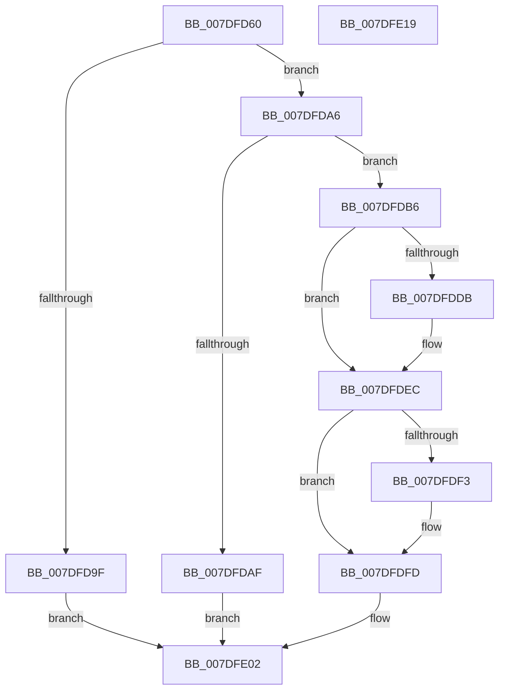

# NtLockRegistryKey

- RVA: `0x007DFD60`–`0x007DFE1A` (길이 `186` bytes)
- VA: `0x00000001407DFD60`
- 실행 섹션: `PAGE`
- PDB 이름 있음: `예`; PDB Function 태그: `아니요`
- unwind 정보 RVA: `0x000D66C8`
- 디코드: `50`개 명령, `186/186` bytes 표시
- 미해석 바이트: `0` (있으면 어셈블리에 `.byte`로 보존)

> 이 문서는 커널 이미지의 기계어와 PDB 기호를 분석해 생성했습니다. 4번과 5번은 함수 원형과 자료형을 바이너리 사용 방식에서 추정한 C 해석이며 원본 소스 복구 결과는 아닙니다.

## 1. Dependencies

- 직접 호출 지점: **7**; 고유 호출 대상: **7**
- 직접 호출자로 확인된 함수: **0**
- RIP 상대 이미지 참조: **0**

### Outgoing calls
- `0x007DFD81` → [CmpInitializeThreadInfo](../../text/3F/CmpInitializeThreadInfo_function_003FBE70.md) (function, `0x003FBE70`)
- `0x007DFDA6` → [CmpAcquireShutdownRundown](../../pagecmrc/BC/CmpAcquireShutdownRundown_function_00BC9400.md) (function, `0x00BC9400`)
- `0x007DFDD0` → [CmObReferenceObjectByHandle](../../pagecmrc/BC/CmObReferenceObjectByHandle_function_00BC9350.md) (function, `0x00BC9350`)
- `0x007DFDE0` → [CmLockKeyForWrite](../9E/CmLockKeyForWrite_function_009E7EE8.md) (function, `0x009E7EE8`)
- `0x007DFDF8` → [ObfDereferenceObject](../../text/2F/ObfDereferenceObject_function_002F9350.md) (function, `0x002F9350`)
- `0x007DFDFD` → [CmpReleaseShutdownRundown](../../pagecmrc/BC/CmpReleaseShutdownRundown_function_00BC9880.md) (function, `0x00BC9880`)
- `0x007DFE07` → [CmCleanupThreadInfo](../../text/41/CmCleanupThreadInfo_function_0041FD50.md) (function, `0x0041FD50`)

### Direct callers
- 이 함수 시작 RVA로 연결되는 직접 call은 확인되지 않았습니다. 간접 호출은 완전히 역산할 수 없습니다.

### Static image references
- 디코드된 RIP-relative 메모리 참조가 없습니다.

## 2. Other-region calls and transfers

- 다른 실행 섹션으로 향하는 call: **6**
  - `0x007DFD81` → [CmpInitializeThreadInfo](../../text/3F/CmpInitializeThreadInfo_function_003FBE70.md) (`PAGE` → `.text`)
  - `0x007DFDA6` → [CmpAcquireShutdownRundown](../../pagecmrc/BC/CmpAcquireShutdownRundown_function_00BC9400.md) (`PAGE` → `PAGECMRC`)
  - `0x007DFDD0` → [CmObReferenceObjectByHandle](../../pagecmrc/BC/CmObReferenceObjectByHandle_function_00BC9350.md) (`PAGE` → `PAGECMRC`)
  - `0x007DFDF8` → [ObfDereferenceObject](../../text/2F/ObfDereferenceObject_function_002F9350.md) (`PAGE` → `.text`)
  - `0x007DFDFD` → [CmpReleaseShutdownRundown](../../pagecmrc/BC/CmpReleaseShutdownRundown_function_00BC9880.md) (`PAGE` → `PAGECMRC`)
  - `0x007DFE07` → [CmCleanupThreadInfo](../../text/41/CmCleanupThreadInfo_function_0041FD50.md) (`PAGE` → `.text`)
- 별도 외부 분기/꼬리 이동을 확인하지 못했습니다.

## 3. Assembly (complete function range)

```asm
007DFD60  48 89 5C 24 08                  mov qword ptr [rsp + 8], rbx
007DFD65  56                              push rsi
007DFD66  48 83 EC 50                     sub rsp, 0x50
007DFD6A  0F 57 C0                        xorps xmm0, xmm0
007DFD6D  33 C0                           xor eax, eax
007DFD6F  48 8B D9                        mov rbx, rcx
007DFD72  48 89 44 24 40                  mov qword ptr [rsp + 0x40], rax
007DFD77  48 8D 4C 24 30                  lea rcx, [rsp + 0x30]
007DFD7C  0F 11 44 24 30                  movups xmmword ptr [rsp + 0x30], xmm0
007DFD81  E8 EA C0 C1 FF                  call 0x1403fbe70
007DFD86  65 48 8B 04 25 88 01 00 00      mov rax, qword ptr gs:[0x188]
007DFD8F  33 F6                           xor esi, esi
007DFD91  48 89 74 24 68                  mov qword ptr [rsp + 0x68], rsi
007DFD96  40 38 B0 32 02 00 00            cmp byte ptr [rax + 0x232], sil
007DFD9D  74 07                           je 0x1407dfda6
007DFD9F  BB 61 00 00 C0                  mov ebx, 0xc0000061
007DFDA4  EB 5C                           jmp 0x1407dfe02
007DFDA6  E8 55 96 3E 00                  call 0x140bc9400
007DFDAB  84 C0                           test al, al
007DFDAD  75 07                           jne 0x1407dfdb6
007DFDAF  BB 89 01 00 C0                  mov ebx, 0xc0000189
007DFDB4  EB 4C                           jmp 0x1407dfe02
007DFDB6  48 8D 44 24 68                  lea rax, [rsp + 0x68]
007DFDBB  48 89 74 24 28                  mov qword ptr [rsp + 0x28], rsi
007DFDC0  45 33 C9                        xor r9d, r9d
007DFDC3  48 89 44 24 20                  mov qword ptr [rsp + 0x20], rax
007DFDC8  BA 06 00 02 00                  mov edx, 0x20006
007DFDCD  48 8B CB                        mov rcx, rbx
007DFDD0  E8 7B 95 3E 00                  call 0x140bc9350
007DFDD5  8B D8                           mov ebx, eax
007DFDD7  85 C0                           test eax, eax
007DFDD9  78 11                           js 0x1407dfdec
007DFDDB  48 8B 4C 24 68                  mov rcx, qword ptr [rsp + 0x68]
007DFDE0  E8 03 81 20 00                  call 0x1409e7ee8
007DFDE5  85 C0                           test eax, eax
007DFDE7  8B D8                           mov ebx, eax
007DFDE9  0F 49 DE                        cmovns ebx, esi
007DFDEC  48 39 74 24 68                  cmp qword ptr [rsp + 0x68], rsi
007DFDF1  74 0A                           je 0x1407dfdfd
007DFDF3  48 8B 4C 24 68                  mov rcx, qword ptr [rsp + 0x68]
007DFDF8  E8 53 95 B1 FF                  call 0x1402f9350
007DFDFD  E8 7E 9A 3E 00                  call 0x140bc9880
007DFE02  48 8D 4C 24 30                  lea rcx, [rsp + 0x30]
007DFE07  E8 44 FF C3 FF                  call 0x14041fd50
007DFE0C  8B C3                           mov eax, ebx
007DFE0E  48 8B 5C 24 60                  mov rbx, qword ptr [rsp + 0x60]
007DFE13  48 83 C4 50                     add rsp, 0x50
007DFE17  5E                              pop rsi
007DFE18  C3                              ret
007DFE19  CC                              int3
```

## 4. C-style interpretation (structured pseudocode)

```c
__int64 __fastcall NtLockRegistryKey(__int64 a1, __int64 a2, __int64 a3, int a4)
{
    __int64 result;
    __int64 v_rbx;
    __int64 v_rsi;
    __int64 v_rsp;
    unsigned __int64 v_stack_m18;
    unsigned __int64 v_stack_m28;
    unsigned __int64 v_stack_m30;
    unsigned __int64 v_stack_m38;
    unsigned __int64 v_stack_p10;
    unsigned __int64 v_stack_p8;

    v_stack_p8 = v_rbx;
    v_rsp = (v_rsp) - (80);
    result = 0;
    v_stack_m18 = 0;
    v_stack_m28 = v_xmm0;
    result = CmpInitializeThreadInfo(v_stack_m28, a2, a3, a4);
    v_rsi = 0;
    v_stack_p10 = 0;
    if ((*(unsigned __int8 *)(*(unsigned __int64 *)(gs_base + (0 + 392)) + 562)) == 0) goto loc_007DFDA6;
    goto loc_007DFE02;
loc_007DFDA6:
    result = CmpAcquireShutdownRundown(v_stack_m28, a2, a3, a4);
    if ((unsigned __int8)(result) != 0) goto loc_007DFDB6;
    goto loc_007DFE02;
loc_007DFDB6:
    v_stack_m30 = 0;
    a4 = 0;
    v_stack_m38 = v_stack_p10;
    result = CmObReferenceObjectByHandle((unsigned int)(0xC0000189ULL), (unsigned int)(0x20006ULL), a3, a4);
    v_rbx = (unsigned int)((unsigned int)(result));
    if (!(sign_flag)) {
        a1 = v_stack_p10;
        result = CmLockKeyForWrite(a1, (unsigned int)(0x20006ULL), a3, a4);
        v_rbx = (unsigned int)(result);
        if (!sign_flag) { v_rbx = 0; }
    }
    if (v_stack_p10 != 0) {
        a1 = v_stack_p10;
        result = ObfDereferenceObject(a1, (unsigned int)(0x20006ULL), a3, a4);
    }
    result = CmpReleaseShutdownRundown(a1, (unsigned int)(0x20006ULL), a3, a4);
loc_007DFE02:
    result = CmCleanupThreadInfo(v_stack_m28, (unsigned int)(0x20006ULL), a3, a4);
    v_rsp = (v_rsp) + (80);
    return (unsigned int)((unsigned int)(v_rbx));
}
```

## 5. (Beta) C Style

```c
int64_t NtLockRegistryKey(int64_t Arg1, int64_t Arg2, int64_t Arg3, int32_t Arg4)
{
    int64_t result;
    int64_t local_rbx;
    int64_t local_rsi;
    int64_t local_rsp;
    uint64_t v_stack_m18;
    uint64_t v_stack_m28;
    uint64_t v_stack_m30;
    uint64_t v_stack_m38;
    uint64_t v_stack_p10;
    uint64_t v_stack_p8;

    v_stack_p8 = local_rbx;
    local_rsp = (local_rsp) - (80);
    result = 0;
    v_stack_m18 = 0;
    v_stack_m28 = v_xmm0;
    result = CmpInitializeThreadInfo(v_stack_m28, Arg2, Arg3, Arg4);
    local_rsi = 0;
    v_stack_p10 = 0;
    if ((*(uint8_t *)(*(uint64_t *)(gs_base + (0 + 0x188)) + 0x232)) == 0) goto loc_007DFDA6;
    goto loc_007DFE02;
loc_007DFDA6:
    result = CmpAcquireShutdownRundown(v_stack_m28, Arg2, Arg3, Arg4);
    if ((uint8_t)(result) != 0) goto loc_007DFDB6;
    goto loc_007DFE02;
loc_007DFDB6:
    v_stack_m30 = 0;
    Arg4 = 0;
    v_stack_m38 = v_stack_p10;
    result = CmObReferenceObjectByHandle((uint32_t)(0xC0000189ULL), (uint32_t)(0x20006ULL), Arg3, Arg4);
    local_rbx = (uint32_t)((uint32_t)(result));
    if (!(sign_flag)) {
        Arg1 = v_stack_p10;
        result = CmLockKeyForWrite(Arg1, (uint32_t)(0x20006ULL), Arg3, Arg4);
        local_rbx = (uint32_t)(result);
        if (!sign_flag) { local_rbx = 0; }
    }
    if (v_stack_p10 != 0) {
        Arg1 = v_stack_p10;
        result = ObfDereferenceObject(Arg1, (uint32_t)(0x20006ULL), Arg3, Arg4);
    }
    result = CmpReleaseShutdownRundown(Arg1, (uint32_t)(0x20006ULL), Arg3, Arg4);
loc_007DFE02:
    result = CmCleanupThreadInfo(v_stack_m28, (uint32_t)(0x20006ULL), Arg3, Arg4);
    local_rsp = (local_rsp) + (80);
    return (uint32_t)((uint32_t)(local_rbx));
}
```

## 6. Execution-region graph

[열기: 2D/3D 그래프와 함수 탐색 컨트롤 패널](../../../control-panel.html?section=page&rva=0x007DFD60&view=graph)

- 2D 그래프는 위에서 아래로 흐르고, 3D 그래프는 빈 공간을 드래그해 회전합니다. Shift+드래그는 이동, 휠은 확대·축소, 함수 노드 선택은 대상 보고서 이동입니다.

### Static fallback


