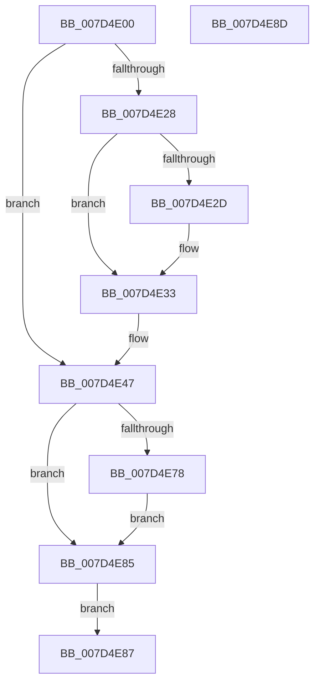

# NtOpenKeyedEvent

- RVA: `0x007D4E00`–`0x007D4E8E` (길이 `142` bytes)
- VA: `0x00000001407D4E00`
- 실행 섹션: `PAGE`
- PDB 이름 있음: `예`; PDB Function 태그: `아니요`
- unwind 정보 RVA: `0x000D5BD0`
- 디코드: `38`개 명령, `142/142` bytes 표시
- 미해석 바이트: `0` (있으면 어셈블리에 `.byte`로 보존)

> 이 문서는 커널 이미지의 기계어와 PDB 기호를 분석해 생성했습니다. 4번과 5번은 함수 원형과 자료형을 바이너리 사용 방식에서 추정한 C 해석이며 원본 소스 복구 결과는 아닙니다.

## 1. Dependencies

- 직접 호출 지점: **2**; 고유 호출 대상: **2**
- 직접 호출자로 확인된 함수: **0**
- RIP 상대 이미지 참조: **1**

### Outgoing calls
- `0x007D4E2D` → [ExRaiseDatatypeMisalignment](../89/ExRaiseDatatypeMisalignment_function_00899FD0.md) (function, `0x00899FD0`)
- `0x007D4E6F` → [ObOpenObjectByName](../89/ObOpenObjectByName_function_00899F50.md) (function, `0x00899F50`)

### Direct callers
- 이 함수 시작 RVA로 연결되는 직접 call은 확인되지 않았습니다. 간접 호출은 완전히 역산할 수 없습니다.

### Static image references
- `0x007D4E65` → RVA `0x00FC52B0` (`ALMOSTRO`; read)

## 2. Other-region calls and transfers

- 다른 실행 섹션으로 향하는 call: **0**
- 별도 외부 분기/꼬리 이동을 확인하지 못했습니다.

## 3. Assembly (complete function range)

```asm
007D4E00  48 8B C4                        mov rax, rsp
007D4E03  53                              push rbx
007D4E04  48 83 EC 60                     sub rsp, 0x60
007D4E08  4D 8B D0                        mov r10, r8
007D4E0B  48 8B D9                        mov rbx, rcx
007D4E0E  48 83 60 20 00                  and qword ptr [rax + 0x20], 0
007D4E13  65 48 8B 04 25 88 01 00 00      mov rax, qword ptr gs:[0x188]
007D4E1C  44 8A 80 32 02 00 00            mov r8b, byte ptr [rax + 0x232]
007D4E23  45 84 C0                        test r8b, r8b
007D4E26  74 1F                           je 0x1407d4e47
007D4E28  F6 C3 07                        test bl, 7
007D4E2B  74 06                           je 0x1407d4e33
007D4E2D  E8 9E 51 0C 00                  call 0x140899fd0
007D4E32  CC                              int3
007D4E33  48 B8 00 00 FF FF FF 7F 00 00   movabs rax, 0x7fffffff0000
007D4E3D  48 3B D8                        cmp rbx, rax
007D4E40  48 0F 42 C3                     cmovb rax, rbx
007D4E44  90                              nop
007D4E45  8A 00                           mov al, byte ptr [rax]
007D4E47  48 83 21 00                     and qword ptr [rcx], 0
007D4E4B  48 8D 84 24 88 00 00 00         lea rax, [rsp + 0x88]
007D4E53  48 89 44 24 30                  mov qword ptr [rsp + 0x30], rax
007D4E58  48 83 64 24 28 00               and qword ptr [rsp + 0x28], 0
007D4E5E  89 54 24 20                     mov dword ptr [rsp + 0x20], edx
007D4E62  45 33 C9                        xor r9d, r9d
007D4E65  48 8B 15 44 04 7F 00            mov rdx, qword ptr [rip + 0x7f0444]
007D4E6C  49 8B CA                        mov rcx, r10
007D4E6F  E8 DC 50 0C 00                  call 0x140899f50
007D4E74  85 C0                           test eax, eax
007D4E76  78 0D                           js 0x1407d4e85
007D4E78  48 8B 8C 24 88 00 00 00         mov rcx, qword ptr [rsp + 0x88]
007D4E80  48 89 0B                        mov qword ptr [rbx], rcx
007D4E83  EB 00                           jmp 0x1407d4e85
007D4E85  EB 00                           jmp 0x1407d4e87
007D4E87  48 83 C4 60                     add rsp, 0x60
007D4E8B  5B                              pop rbx
007D4E8C  C3                              ret
007D4E8D  CC                              int3
```

## 4. C-style interpretation (structured pseudocode)

```c
__int64 __fastcall NtOpenKeyedEvent(__int64 a1, int a2, __int64 a3, int a4)
{
    __int64 result;
    __int64 v_rsp;
    unsigned __int64 v_stack_m38;
    unsigned __int64 v_stack_m40;
    unsigned int v_stack_m48;
    unsigned __int64 v_stack_p20;

    v_rsp = (v_rsp) - (96);
    if ((unsigned __int8)(*(unsigned __int8 *)(*(unsigned __int64 *)(gs_base + (0 + 392)) + 562)) == 0) goto loc_007D4E47;
    result = *(unsigned __int64 *)(gs_base + (0 + 392));
    if ((((unsigned __int8)(a1)) & (7)) != 0) {
        result = ExRaiseDatatypeMisalignment(a1, a2, *(unsigned __int8 *)(*(unsigned __int64 *)(gs_base + (0 + 392)) + 562), a4);
    }
    if (a1 < result) { result = a1; }
loc_007D4E47:
    v_stack_m38 = v_stack_p20;
    v_stack_m48 = a2;
    a4 = 0;
    result = ObOpenObjectByName(a3, *(unsigned __int64 *)(v_rip + 8324164), *(unsigned __int8 *)(*(unsigned __int64 *)(gs_base + (0 + 392)) + 562), a4);
    if (sign_flag) goto loc_007D4E85;
    *(unsigned __int64 *)(a1) = v_stack_p20;
    goto loc_007D4E85;
loc_007D4E85:
    goto loc_007D4E87;
loc_007D4E87:
    v_rsp = (v_rsp) + (96);
    return result;
}
```

## 5. (Beta) C Style

```c
int64_t NtOpenKeyedEvent(int64_t Arg1, int32_t Arg2, int64_t Arg3, int32_t Arg4)
{
    int64_t result;
    int64_t local_rsp;
    uint64_t v_stack_m38;
    uint64_t v_stack_m40;
    uint32_t v_stack_m48;
    uint64_t v_stack_p20;

    local_rsp = (local_rsp) - (96);
    if ((uint8_t)(*(uint8_t *)(*(uint64_t *)(gs_base + (0 + 0x188)) + 0x232)) == 0) goto loc_007D4E47;
    result = *(uint64_t *)(gs_base + (0 + 0x188));
    if ((((uint8_t)(Arg1)) & (7)) != 0) {
        result = ExRaiseDatatypeMisalignment(Arg1, Arg2, *(uint8_t *)(*(uint64_t *)(gs_base + (0 + 0x188)) + 0x232), Arg4);
    }
    if (Arg1 < result) { result = Arg1; }
loc_007D4E47:
    v_stack_m38 = v_stack_p20;
    v_stack_m48 = Arg2;
    Arg4 = 0;
    result = ObOpenObjectByName(Arg3, *(uint64_t *)(v_rip + 0x7F0444), *(uint8_t *)(*(uint64_t *)(gs_base + (0 + 0x188)) + 0x232), Arg4);
    if (sign_flag) goto loc_007D4E85;
    *(uint64_t *)(Arg1) = v_stack_p20;
    goto loc_007D4E85;
loc_007D4E85:
    goto loc_007D4E87;
loc_007D4E87:
    local_rsp = (local_rsp) + (96);
    return result;
}
```

## 6. Execution-region graph

[열기: 2D/3D 그래프와 함수 탐색 컨트롤 패널](../../../control-panel.html?section=page&rva=0x007D4E00&view=graph)

- 2D 그래프는 위에서 아래로 흐르고, 3D 그래프는 빈 공간을 드래그해 회전합니다. Shift+드래그는 이동, 휠은 확대·축소, 함수 노드 선택은 대상 보고서 이동입니다.

### Static fallback


