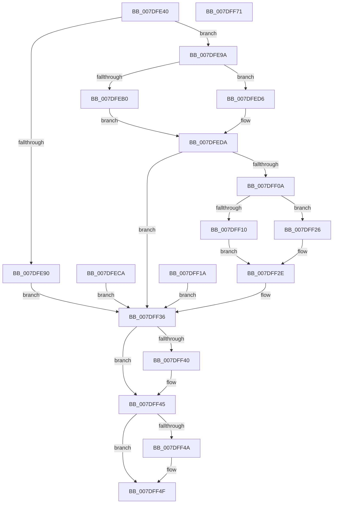

# NtOpenRegistryTransaction

- RVA: `0x007DFE40`–`0x007DFF72` (길이 `306` bytes)
- VA: `0x00000001407DFE40`
- 실행 섹션: `PAGE`
- PDB 이름 있음: `예`; PDB Function 태그: `아니요`
- unwind 정보 RVA: `0x000D6724`
- 디코드: `81`개 명령, `306/306` bytes 표시
- 미해석 바이트: `0` (있으면 어셈블리에 `.byte`로 보존)

> 이 문서는 커널 이미지의 기계어와 PDB 기호를 분석해 생성했습니다. 4번과 5번은 함수 원형과 자료형을 바이너리 사용 방식에서 추정한 C 해석이며 원본 소스 복구 결과는 아닙니다.

## 1. Dependencies

- 직접 호출 지점: **6**; 고유 호출 대상: **6**
- 직접 호출자로 확인된 함수: **0**
- RIP 상대 이미지 참조: **1**

### Outgoing calls
- `0x007DFE78` → [CmpInitializeThreadInfo](../../text/3F/CmpInitializeThreadInfo_function_003FBE70.md) (function, `0x003FBE70`)
- `0x007DFE7D` → [CmpAcquireShutdownRundown](../../pagecmrc/BC/CmpAcquireShutdownRundown_function_00BC9400.md) (function, `0x00BC9400`)
- `0x007DFEFF` → [ObOpenObjectByName](../89/ObOpenObjectByName_function_00899F50.md) (function, `0x00899F50`)
- `0x007DFF40` → [NtClose](../86/NtClose_function_00868870.md) (function, `0x00868870`)
- `0x007DFF4A` → [CmpReleaseShutdownRundown](../../pagecmrc/BC/CmpReleaseShutdownRundown_function_00BC9880.md) (function, `0x00BC9880`)
- `0x007DFF54` → [CmCleanupThreadInfo](../../text/41/CmCleanupThreadInfo_function_0041FD50.md) (function, `0x0041FD50`)

### Direct callers
- 이 함수 시작 RVA로 연결되는 직접 call은 확인되지 않았습니다. 간접 호출은 완전히 역산할 수 없습니다.

### Static image references
- `0x007DFEF5` → RVA `0x00EF5720` (`.data`; read)

## 2. Other-region calls and transfers

- 다른 실행 섹션으로 향하는 call: **4**
  - `0x007DFE78` → [CmpInitializeThreadInfo](../../text/3F/CmpInitializeThreadInfo_function_003FBE70.md) (`PAGE` → `.text`)
  - `0x007DFE7D` → [CmpAcquireShutdownRundown](../../pagecmrc/BC/CmpAcquireShutdownRundown_function_00BC9400.md) (`PAGE` → `PAGECMRC`)
  - `0x007DFF4A` → [CmpReleaseShutdownRundown](../../pagecmrc/BC/CmpReleaseShutdownRundown_function_00BC9880.md) (`PAGE` → `PAGECMRC`)
  - `0x007DFF54` → [CmCleanupThreadInfo](../../text/41/CmCleanupThreadInfo_function_0041FD50.md) (`PAGE` → `.text`)
- 별도 외부 분기/꼬리 이동을 확인하지 못했습니다.

## 3. Assembly (complete function range)

```asm
007DFE40  4C 8B DC                        mov r11, rsp
007DFE43  49 89 5B 08                     mov qword ptr [r11 + 8], rbx
007DFE47  49 89 73 10                     mov qword ptr [r11 + 0x10], rsi
007DFE4B  57                              push rdi
007DFE4C  41 56                           push r14
007DFE4E  41 57                           push r15
007DFE50  48 83 EC 70                     sub rsp, 0x70
007DFE54  49 8B D8                        mov rbx, r8
007DFE57  44 8B FA                        mov r15d, edx
007DFE5A  48 8B F9                        mov rdi, rcx
007DFE5D  83 64 24 40 00                  and dword ptr [rsp + 0x40], 0
007DFE62  0F 57 C0                        xorps xmm0, xmm0
007DFE65  33 C0                           xor eax, eax
007DFE67  0F 11 44 24 50                  movups xmmword ptr [rsp + 0x50], xmm0
007DFE6C  49 89 43 D8                     mov qword ptr [r11 - 0x28], rax
007DFE70  49 21 43 C0                     and qword ptr [r11 - 0x40], rax
007DFE74  49 8D 4B C8                     lea rcx, [r11 - 0x38]
007DFE78  E8 F3 BF C1 FF                  call 0x1403fbe70
007DFE7D  E8 7E 95 3E 00                  call 0x140bc9400
007DFE82  40 8A F0                        mov sil, al
007DFE85  88 84 24 A8 00 00 00            mov byte ptr [rsp + 0xa8], al
007DFE8C  84 C0                           test al, al
007DFE8E  75 0A                           jne 0x1407dfe9a
007DFE90  BB 89 01 00 C0                  mov ebx, 0xc0000189
007DFE95  E9 9C 00 00 00                  jmp 0x1407dff36
007DFE9A  65 48 8B 04 25 88 01 00 00      mov rax, qword ptr gs:[0x188]
007DFEA3  44 8A B0 32 02 00 00            mov r14b, byte ptr [rax + 0x232]
007DFEAA  41 80 FE 01                     cmp r14b, 1
007DFEAE  75 26                           jne 0x1407dfed6
007DFEB0  48 B8 00 00 FF FF FF 7F 00 00   movabs rax, 0x7fffffff0000
007DFEBA  48 3B F8                        cmp rdi, rax
007DFEBD  48 0F 42 C7                     cmovb rax, rdi
007DFEC1  48 C7 00 00 00 00 00            mov qword ptr [rax], 0
007DFEC8  EB 10                           jmp 0x1407dfeda
007DFECA  8B D8                           mov ebx, eax
007DFECC  40 8A B4 24 A8 00 00 00         mov sil, byte ptr [rsp + 0xa8]
007DFED4  EB 60                           jmp 0x1407dff36
007DFED6  48 83 27 00                     and qword ptr [rdi], 0
007DFEDA  48 8D 44 24 48                  lea rax, [rsp + 0x48]
007DFEDF  48 89 44 24 30                  mov qword ptr [rsp + 0x30], rax
007DFEE4  48 83 64 24 28 00               and qword ptr [rsp + 0x28], 0
007DFEEA  44 89 7C 24 20                  mov dword ptr [rsp + 0x20], r15d
007DFEEF  45 33 C9                        xor r9d, r9d
007DFEF2  45 8A C6                        mov r8b, r14b
007DFEF5  48 8B 15 24 58 71 00            mov rdx, qword ptr [rip + 0x715824]
007DFEFC  48 8B CB                        mov rcx, rbx
007DFEFF  E8 4C A0 0B 00                  call 0x140899f50
007DFF04  8B D8                           mov ebx, eax
007DFF06  85 C0                           test eax, eax
007DFF08  78 2C                           js 0x1407dff36
007DFF0A  41 80 FE 01                     cmp r14b, 1
007DFF0E  75 16                           jne 0x1407dff26
007DFF10  48 8B 44 24 48                  mov rax, qword ptr [rsp + 0x48]
007DFF15  48 89 07                        mov qword ptr [rdi], rax
007DFF18  EB 14                           jmp 0x1407dff2e
007DFF1A  8B D8                           mov ebx, eax
007DFF1C  40 8A B4 24 A8 00 00 00         mov sil, byte ptr [rsp + 0xa8]
007DFF24  EB 10                           jmp 0x1407dff36
007DFF26  48 8B 44 24 48                  mov rax, qword ptr [rsp + 0x48]
007DFF2B  48 89 07                        mov qword ptr [rdi], rax
007DFF2E  48 83 64 24 48 00               and qword ptr [rsp + 0x48], 0
007DFF34  33 DB                           xor ebx, ebx
007DFF36  48 8B 4C 24 48                  mov rcx, qword ptr [rsp + 0x48]
007DFF3B  48 85 C9                        test rcx, rcx
007DFF3E  74 05                           je 0x1407dff45
007DFF40  E8 2B 89 08 00                  call 0x140868870
007DFF45  40 84 F6                        test sil, sil
007DFF48  74 05                           je 0x1407dff4f
007DFF4A  E8 31 99 3E 00                  call 0x140bc9880
007DFF4F  48 8D 4C 24 50                  lea rcx, [rsp + 0x50]
007DFF54  E8 F7 FD C3 FF                  call 0x14041fd50
007DFF59  8B C3                           mov eax, ebx
007DFF5B  4C 8D 5C 24 70                  lea r11, [rsp + 0x70]
007DFF60  49 8B 5B 20                     mov rbx, qword ptr [r11 + 0x20]
007DFF64  49 8B 73 28                     mov rsi, qword ptr [r11 + 0x28]
007DFF68  49 8B E3                        mov rsp, r11
007DFF6B  41 5F                           pop r15
007DFF6D  41 5E                           pop r14
007DFF6F  5F                              pop rdi
007DFF70  C3                              ret
007DFF71  CC                              int3
```

## 4. C-style interpretation (structured pseudocode)

```c
__int64 __fastcall NtOpenRegistryTransaction(__int64 a1, int a2, __int64 a3, int a4)
{
    __int64 result;
    __int64 v_rbx;
    __int64 v_rsp;
    unsigned __int64 v_stack_m18;
    unsigned __int64 v_stack_m38;
    unsigned __int64 v_stack_m40;
    unsigned int v_stack_m48;
    unsigned __int64 v_stack_m58;
    unsigned __int64 v_stack_m60;
    unsigned int v_stack_m68;
    unsigned __int8 v_stack_p20;

    *(unsigned __int64 *)(v_rsp + 8) = v_rbx;
    *(unsigned __int64 *)(v_rsp + 16) = v_rsi;
    v_rsp = (v_rsp) - (112);
    result = 0;
    v_stack_m38 = v_xmm0;
    *(unsigned __int64 *)(v_rsp - 40) = 0;
    result = CmpInitializeThreadInfo(v_rsp - 56, a2, a3, a4);
    result = CmpAcquireShutdownRundown(v_rsp - 56, a2, a3, a4);
    v_stack_p20 = (unsigned __int8)(result);
    if ((unsigned __int8)(result) != 0) goto loc_007DFE9A;
    goto loc_007DFF36;
loc_007DFE9A:
    if (((unsigned __int8)(*(unsigned __int8 *)(*(unsigned __int64 *)(gs_base + (0 + 392)) + 562))) != 1) goto loc_007DFED6;
    result = *(unsigned __int64 *)(gs_base + (0 + 392));
    if (a1 < (*(unsigned __int64 *)(gs_base + (0 + 392)))) { result = a1; }
    *(unsigned __int64 *)(result) = 0;
    goto loc_007DFEDA;
loc_007DFED6:
loc_007DFEDA:
    v_stack_m58 = v_stack_m40;
    v_stack_m68 = (unsigned int)((unsigned int)(a2));
    a4 = 0;
    result = ObOpenObjectByName((unsigned int)(0xC0000189ULL), *(unsigned __int64 *)(v_rip + 7428132), (unsigned __int8)(*(unsigned __int8 *)(*(unsigned __int64 *)(gs_base + (0 + 392)) + 562)), a4);
    if (sign_flag) goto loc_007DFF36;
    if (((unsigned __int8)(*(unsigned __int8 *)(*(unsigned __int64 *)(gs_base + (0 + 392)) + 562))) != 1) goto loc_007DFF26;
    *(unsigned __int64 *)(a1) = v_stack_m40;
    goto loc_007DFF2E;
loc_007DFF26:
    *(unsigned __int64 *)(a1) = v_stack_m40;
loc_007DFF2E:
    v_rbx = 0;
loc_007DFF36:
    result = v_stack_m40;
    if (v_stack_m40 != 0) {
        result = NtClose(v_stack_m40, *(unsigned __int64 *)(v_rip + 7428132), (unsigned __int8)(*(unsigned __int8 *)(*(unsigned __int64 *)(gs_base + (0 + 392)) + 562)), a4);
    }
    if ((unsigned __int8)((unsigned __int8)(result)) != 0) {
        result = CmpReleaseShutdownRundown(v_stack_m40, *(unsigned __int64 *)(v_rip + 7428132), (unsigned __int8)(*(unsigned __int8 *)(*(unsigned __int64 *)(gs_base + (0 + 392)) + 562)), a4);
    }
    result = CmCleanupThreadInfo(v_stack_m38, *(unsigned __int64 *)(v_rip + 7428132), (unsigned __int8)(*(unsigned __int8 *)(*(unsigned __int64 *)(gs_base + (0 + 392)) + 562)), a4);
    return 0;
}
```

## 5. (Beta) C Style

```c
int64_t NtOpenRegistryTransaction(void *Arg1, int32_t Arg2, int64_t Arg3, int32_t Arg4)
{
    uint8_t *arg1 = (uint8_t *)Arg1;

    int64_t result;
    int64_t local_rbx;
    int64_t local_rsp;
    uint64_t v_stack_m18;
    uint64_t v_stack_m38;
    uint64_t v_stack_m40;
    uint32_t v_stack_m48;
    uint64_t v_stack_m58;
    uint64_t v_stack_m60;
    uint32_t v_stack_m68;
    uint8_t v_stack_p20;

    *(uint64_t *)(local_rsp + 0x8) = local_rbx;
    *(uint64_t *)(local_rsp + 0x10) = local_rsi;
    local_rsp = (local_rsp) - (112);
    result = 0;
    v_stack_m38 = v_xmm0;
    *(uint64_t *)(local_rsp - 0x28) = 0;
    result = CmpInitializeThreadInfo(local_rsp - 56, Arg2, Arg3, Arg4);
    result = CmpAcquireShutdownRundown(local_rsp - 56, Arg2, Arg3, Arg4);
    v_stack_p20 = (uint8_t)(result);
    if ((uint8_t)(result) != 0) goto loc_007DFE9A;
    goto loc_007DFF36;
loc_007DFE9A:
    if (((uint8_t)(*(uint8_t *)(*(uint64_t *)(gs_base + (0 + 0x188)) + 0x232))) != 1) goto loc_007DFED6;
    result = *(uint64_t *)(gs_base + (0 + 0x188));
    if (Arg1 < (*(uint64_t *)(gs_base + (0 + 0x188)))) { result = Arg1; }
    *(uint64_t *)(result) = 0;
    goto loc_007DFEDA;
loc_007DFED6:
loc_007DFEDA:
    v_stack_m58 = v_stack_m40;
    v_stack_m68 = (uint32_t)((uint32_t)(Arg2));
    Arg4 = 0;
    result = ObOpenObjectByName((uint32_t)(0xC0000189ULL), *(uint64_t *)(v_rip + 0x715824), (uint8_t)(*(uint8_t *)(*(uint64_t *)(gs_base + (0 + 0x188)) + 0x232)), Arg4);
    if (sign_flag) goto loc_007DFF36;
    if (((uint8_t)(*(uint8_t *)(*(uint64_t *)(gs_base + (0 + 0x188)) + 0x232))) != 1) goto loc_007DFF26;
    *(uint64_t *)(arg1) = v_stack_m40;
    goto loc_007DFF2E;
loc_007DFF26:
    *(uint64_t *)(arg1) = v_stack_m40;
loc_007DFF2E:
    local_rbx = 0;
loc_007DFF36:
    result = v_stack_m40;
    if (v_stack_m40 != 0) {
        result = NtClose(v_stack_m40, *(uint64_t *)(v_rip + 0x715824), (uint8_t)(*(uint8_t *)(*(uint64_t *)(gs_base + (0 + 0x188)) + 0x232)), Arg4);
    }
    if ((uint8_t)((uint8_t)(result)) != 0) {
        result = CmpReleaseShutdownRundown(v_stack_m40, *(uint64_t *)(v_rip + 0x715824), (uint8_t)(*(uint8_t *)(*(uint64_t *)(gs_base + (0 + 0x188)) + 0x232)), Arg4);
    }
    result = CmCleanupThreadInfo(v_stack_m38, *(uint64_t *)(v_rip + 0x715824), (uint8_t)(*(uint8_t *)(*(uint64_t *)(gs_base + (0 + 0x188)) + 0x232)), Arg4);
    return 0;
}
```

### 관측된 메모리 오프셋

구조체 형식이 확인되지 않은 접근은 인자 기준의 오프셋으로만 기록했습니다.

| 기준 인자 | 오프셋 표현 | 폭 (bit) | 접근 |
|---|---:|---:|---|
| `Arg1` | `+ 0x0` | `64` | `R/W` |

## 6. Execution-region graph

[열기: 2D/3D 그래프와 함수 탐색 컨트롤 패널](../../../control-panel.html?section=page&rva=0x007DFE40&view=graph)

- 2D 그래프는 위에서 아래로 흐르고, 3D 그래프는 빈 공간을 드래그해 회전합니다. Shift+드래그는 이동, 휠은 확대·축소, 함수 노드 선택은 대상 보고서 이동입니다.

### Static fallback


