# NtPssCaptureVaSpaceBulk

- RVA: `0x007D4EA0`–`0x007D5305` (길이 `1,125` bytes)
- VA: `0x00000001407D4EA0`
- 실행 섹션: `PAGE`
- PDB 이름 있음: `예`; PDB Function 태그: `아니요`
- unwind 정보 RVA: `0x000D5C04`
- 디코드: `260`개 명령, `1,125/1,125` bytes 표시
- 미해석 바이트: `0` (있으면 어셈블리에 `.byte`로 보존)

> 이 문서는 커널 이미지의 기계어와 PDB 기호를 분석해 생성했습니다. 4번과 5번은 함수 원형과 자료형을 바이너리 사용 방식에서 추정한 C 해석이며 원본 소스 복구 결과는 아닙니다.

## 1. Dependencies

- 직접 호출 지점: **13**; 고유 호출 대상: **13**
- 직접 호출자로 확인된 함수: **0**
- RIP 상대 이미지 참조: **2**

### Outgoing calls
- `0x007D4F8E` → [ProbeForWrite](../8E/ProbeForWrite_function_008E91C0.md) (function, `0x008E91C0`)
- `0x007D5091` → [IoAllocateMdl](../../text/29/IoAllocateMdl_function_0029EBF0.md) (function, `0x0029EBF0`)
- `0x007D50B6` → [MmProbeAndLockPages](../../text/23/MmProbeAndLockPages_function_0023B990.md) (function, `0x0023B990`)
- `0x007D50E7` → [MmMapLockedPagesSpecifyCache](../../text/31/MmMapLockedPagesSpecifyCache_function_00318800.md) (function, `0x00318800`)
- `0x007D5154` → [ObpReferenceObjectByHandleWithTag](../86/ObpReferenceObjectByHandleWithTag_function_00869650.md) (function, `0x00869650`)
- `0x007D5180` → [ObfDereferenceObjectWithTag](../../text/2F/ObfDereferenceObjectWithTag_function_002F78E0.md) (function, `0x002F78E0`)
- `0x007D5199` → [KiStackAttachProcess](../../text/21/KiStackAttachProcess_function_00216820.md) (function, `0x00216820`)
- `0x007D51BF` → [ZwPssCaptureVaSpaceBulk](../../text/6A/ZwPssCaptureVaSpaceBulk_function_006AF9D0.md) (function, `0x006AF9D0`)
- `0x007D5226` → [MmQueryVirtualMemory](../9D/MmQueryVirtualMemory_function_009D9280.md) (function, `0x009D9280`)
- `0x007D52AE` → [KiUnstackDetachProcess](../../text/21/KiUnstackDetachProcess_function_00217D30.md) (function, `0x00217D30`)
- `0x007D52C0` → [MmUnlockPages](../../text/29/MmUnlockPages_function_0029EEE0.md) (function, `0x0029EEE0`)
- `0x007D52C8` → [IoFreeMdl](../../text/29/IoFreeMdl_function_0029EA80.md) (function, `0x0029EA80`)
- `0x007D52ED` → [_security_check_cookie](../../text/6A/_security_check_cookie_function_006AC640.md) (function, `0x006AC640`)

### Direct callers
- 이 함수 시작 RVA로 연결되는 직접 call은 확인되지 않았습니다. 간접 호출은 완전히 역산할 수 없습니다.

### Static image references
- `0x007D4EB4` → RVA `0x00E0A740` (`.data`; read)
- `0x007D5121` → RVA `0x00FC6A98` (`ALMOSTRO`; read)

## 2. Other-region calls and transfers

- 다른 실행 섹션으로 향하는 call: **10**
  - `0x007D5091` → [IoAllocateMdl](../../text/29/IoAllocateMdl_function_0029EBF0.md) (`PAGE` → `.text`)
  - `0x007D50B6` → [MmProbeAndLockPages](../../text/23/MmProbeAndLockPages_function_0023B990.md) (`PAGE` → `.text`)
  - `0x007D50E7` → [MmMapLockedPagesSpecifyCache](../../text/31/MmMapLockedPagesSpecifyCache_function_00318800.md) (`PAGE` → `.text`)
  - `0x007D5180` → [ObfDereferenceObjectWithTag](../../text/2F/ObfDereferenceObjectWithTag_function_002F78E0.md) (`PAGE` → `.text`)
  - `0x007D5199` → [KiStackAttachProcess](../../text/21/KiStackAttachProcess_function_00216820.md) (`PAGE` → `.text`)
  - `0x007D51BF` → [ZwPssCaptureVaSpaceBulk](../../text/6A/ZwPssCaptureVaSpaceBulk_function_006AF9D0.md) (`PAGE` → `.text`)
  - `0x007D52AE` → [KiUnstackDetachProcess](../../text/21/KiUnstackDetachProcess_function_00217D30.md) (`PAGE` → `.text`)
  - `0x007D52C0` → [MmUnlockPages](../../text/29/MmUnlockPages_function_0029EEE0.md) (`PAGE` → `.text`)
  - `0x007D52C8` → [IoFreeMdl](../../text/29/IoFreeMdl_function_0029EA80.md) (`PAGE` → `.text`)
  - `0x007D52ED` → [_security_check_cookie](../../text/6A/_security_check_cookie_function_006AC640.md) (`PAGE` → `.text`)
- 별도 외부 분기/꼬리 이동을 확인하지 못했습니다.

## 3. Assembly (complete function range)

```asm
007D4EA0  4C 8B DC                        mov r11, rsp
007D4EA3  53                              push rbx
007D4EA4  57                              push rdi
007D4EA5  41 54                           push r12
007D4EA7  41 55                           push r13
007D4EA9  41 56                           push r14
007D4EAB  41 57                           push r15
007D4EAD  48 81 EC 08 01 00 00            sub rsp, 0x108
007D4EB4  48 8B 05 85 58 63 00            mov rax, qword ptr [rip + 0x635885]
007D4EBB  48 33 C4                        xor rax, rsp
007D4EBE  48 89 84 24 F8 00 00 00         mov qword ptr [rsp + 0xf8], rax
007D4EC6  4D 8B E1                        mov r12, r9
007D4EC9  4D 8B F0                        mov r14, r8
007D4ECC  48 89 54 24 58                  mov qword ptr [rsp + 0x58], rdx
007D4ED1  48 89 4C 24 78                  mov qword ptr [rsp + 0x78], rcx
007D4ED6  48 8B 84 24 60 01 00 00         mov rax, qword ptr [rsp + 0x160]
007D4EDE  48 89 44 24 48                  mov qword ptr [rsp + 0x48], rax
007D4EE3  48 89 8C 24 A0 00 00 00         mov qword ptr [rsp + 0xa0], rcx
007D4EEB  48 89 94 24 A8 00 00 00         mov qword ptr [rsp + 0xa8], rdx
007D4EF3  4C 89 84 24 B0 00 00 00         mov qword ptr [rsp + 0xb0], r8
007D4EFB  4C 89 8C 24 B8 00 00 00         mov qword ptr [rsp + 0xb8], r9
007D4F03  48 89 44 24 70                  mov qword ptr [rsp + 0x70], rax
007D4F08  49 83 A3 48 FF FF FF 00         and qword ptr [r11 - 0xb8], 0
007D4F10  0F 57 C0                        xorps xmm0, xmm0
007D4F13  41 0F 11 43 90                  movups xmmword ptr [r11 - 0x70], xmm0
007D4F18  41 0F 11 43 A0                  movups xmmword ptr [r11 - 0x60], xmm0
007D4F1D  41 0F 11 43 B0                  movups xmmword ptr [r11 - 0x50], xmm0
007D4F22  49 83 A3 50 FF FF FF 00         and qword ptr [r11 - 0xb0], 0
007D4F2A  48 83 64 24 60 00               and qword ptr [rsp + 0x60], 0
007D4F30  33 DB                           xor ebx, ebx
007D4F32  89 5C 24 50                     mov dword ptr [rsp + 0x50], ebx
007D4F36  45 33 FF                        xor r15d, r15d
007D4F39  4C 89 7C 24 68                  mov qword ptr [rsp + 0x68], r15
007D4F3E  33 FF                           xor edi, edi
007D4F40  89 7C 24 40                     mov dword ptr [rsp + 0x40], edi
007D4F44  49 83 F9 10                     cmp r9, 0x10
007D4F48  73 0A                           jae 0x1407d4f54
007D4F4A  B8 04 00 00 C0                  mov eax, 0xc0000004
007D4F4F  E9 8E 03 00 00                  jmp 0x1407d52e2
007D4F54  65 48 8B 04 25 88 01 00 00      mov rax, qword ptr gs:[0x188]
007D4F5D  48 89 84 24 C0 00 00 00         mov qword ptr [rsp + 0xc0], rax
007D4F65  44 8A A8 32 02 00 00            mov r13b, byte ptr [rax + 0x232]
007D4F6C  44 88 6C 24 44                  mov byte ptr [rsp + 0x44], r13b
007D4F71  45 84 ED                        test r13b, r13b
007D4F74  0F 84 A1 00 00 00               je 0x1407d501b
007D4F7A  0F 11 84 24 90 00 00 00         movups xmmword ptr [rsp + 0x90], xmm0
007D4F82  41 B8 08 00 00 00               mov r8d, 8
007D4F88  49 8B D1                        mov rdx, r9
007D4F8B  49 8B CE                        mov rcx, r14
007D4F8E  E8 2D 42 11 00                  call 0x1408e91c0
007D4F93  48 8B 44 24 48                  mov rax, qword ptr [rsp + 0x48]
007D4F98  48 85 C0                        test rax, rax
007D4F9B  74 1A                           je 0x1407d4fb7
007D4F9D  49 B8 00 00 FF FF FF 7F 00 00   movabs r8, 0x7fffffff0000
007D4FA7  49 8B C8                        mov rcx, r8
007D4FAA  49 3B C0                        cmp rax, r8
007D4FAD  48 0F 42 C8                     cmovb rcx, rax
007D4FB1  48 8B 01                        mov rax, qword ptr [rcx]
007D4FB4  48 89 01                        mov qword ptr [rcx], rax
007D4FB7  41 0F 10 06                     movups xmm0, xmmword ptr [r14]
007D4FBB  F3 0F 7F 84 24 90 00 00 00      movdqu xmmword ptr [rsp + 0x90], xmm0
007D4FC4  48 8B 54 24 58                  mov rdx, qword ptr [rsp + 0x58]
007D4FC9  EB 47                           jmp 0x1407d5012
007D4FCB  8B F8                           mov edi, eax
007D4FCD  89 44 24 40                     mov dword ptr [rsp + 0x40], eax
007D4FD1  44 8A 6C 24 44                  mov r13b, byte ptr [rsp + 0x44]
007D4FD6  4C 8B 7C 24 68                  mov r15, qword ptr [rsp + 0x68]
007D4FDB  41 8B DF                        mov ebx, r15d
007D4FDE  48 8B 84 24 A0 00 00 00         mov rax, qword ptr [rsp + 0xa0]
007D4FE6  48 89 44 24 78                  mov qword ptr [rsp + 0x78], rax
007D4FEB  48 8B 94 24 A8 00 00 00         mov rdx, qword ptr [rsp + 0xa8]
007D4FF3  48 89 54 24 58                  mov qword ptr [rsp + 0x58], rdx
007D4FF8  4C 8B B4 24 B0 00 00 00         mov r14, qword ptr [rsp + 0xb0]
007D5000  4C 8B A4 24 B8 00 00 00         mov r12, qword ptr [rsp + 0xb8]
007D5008  48 8B 44 24 70                  mov rax, qword ptr [rsp + 0x70]
007D500D  48 89 44 24 48                  mov qword ptr [rsp + 0x48], rax
007D5012  85 FF                           test edi, edi
007D5014  79 12                           jns 0x1407d5028
007D5016  E9 C5 02 00 00                  jmp 0x1407d52e0
007D501B  41 0F 10 00                     movups xmm0, xmmword ptr [r8]
007D501F  F3 0F 7F 84 24 90 00 00 00      movdqu xmmword ptr [rsp + 0x90], xmm0
007D5028  83 BC 24 90 00 00 00 00         cmp dword ptr [rsp + 0x90], 0
007D5030  75 0A                           jne 0x1407d503c
007D5032  BF 0D 00 00 C0                  mov edi, 0xc000000d
007D5037  E9 5A 02 00 00                  jmp 0x1407d5296
007D503C  F7 84 24 90 00 00 00 FC FF FF FF  test dword ptr [rsp + 0x90], 0xfffffffc
007D5047  74 0A                           je 0x1407d5053
007D5049  BF BB 00 00 C0                  mov edi, 0xc00000bb
007D504E  E9 43 02 00 00                  jmp 0x1407d5296
007D5053  48 B8 FF FF FE FF FF 7F 00 00   movabs rax, 0x7ffffffeffff
007D505D  48 3B D0                        cmp rdx, rax
007D5060  76 0A                           jbe 0x1407d506c
007D5062  BF 41 01 00 C0                  mov edi, 0xc0000141
007D5067  E9 2A 02 00 00                  jmp 0x1407d5296
007D506C  45 84 ED                        test r13b, r13b
007D506F  0F 84 9A 00 00 00               je 0x1407d510f
007D5075  B8 FF FF FF FF                  mov eax, 0xffffffff
007D507A  4C 3B E0                        cmp r12, rax
007D507D  77 B3                           ja 0x1407d5032
007D507F  48 83 64 24 20 00               and qword ptr [rsp + 0x20], 0
007D5085  45 33 C9                        xor r9d, r9d
007D5088  45 33 C0                        xor r8d, r8d
007D508B  41 8B D4                        mov edx, r12d
007D508E  49 8B CE                        mov rcx, r14
007D5091  E8 5A 9B AC FF                  call 0x14029ebf0
007D5096  4C 8B F8                        mov r15, rax
007D5099  48 89 44 24 68                  mov qword ptr [rsp + 0x68], rax
007D509E  48 85 C0                        test rax, rax
007D50A1  75 0A                           jne 0x1407d50ad
007D50A3  BF 9A 00 00 C0                  mov edi, 0xc000009a
007D50A8  E9 E9 01 00 00                  jmp 0x1407d5296
007D50AD  33 D2                           xor edx, edx
007D50AF  44 8D 42 01                     lea r8d, [rdx + 1]
007D50B3  49 8B CF                        mov rcx, r15
007D50B6  E8 D5 68 A6 FF                  call 0x14023b990
007D50BB  90                              nop
007D50BC  BB 02 00 00 00                  mov ebx, 2
007D50C1  41 F6 47 0A 05                  test byte ptr [r15 + 0xa], 5
007D50C6  74 06                           je 0x1407d50ce
007D50C8  4D 8B 77 18                     mov r14, qword ptr [r15 + 0x18]
007D50CC  EB 21                           jmp 0x1407d50ef
007D50CE  C7 44 24 28 10 00 00 40         mov dword ptr [rsp + 0x28], 0x40000010
007D50D6  83 64 24 20 00                  and dword ptr [rsp + 0x20], 0
007D50DB  45 33 C9                        xor r9d, r9d
007D50DE  33 D2                           xor edx, edx
007D50E0  45 8D 41 01                     lea r8d, [r9 + 1]
007D50E4  49 8B CF                        mov rcx, r15
007D50E7  E8 14 37 B4 FF                  call 0x140318800
007D50EC  4C 8B F0                        mov r14, rax
007D50EF  4D 85 F6                        test r14, r14
007D50F2  75 1E                           jne 0x1407d5112
007D50F4  EB AD                           jmp 0x1407d50a3
007D50F6  8B F8                           mov edi, eax
007D50F8  89 44 24 40                     mov dword ptr [rsp + 0x40], eax
007D50FC  4C 8B 7C 24 68                  mov r15, qword ptr [rsp + 0x68]
007D5101  8B 5C 24 50                     mov ebx, dword ptr [rsp + 0x50]
007D5105  4C 8B 74 24 70                  mov r14, qword ptr [rsp + 0x70]
007D510A  E9 90 01 00 00                  jmp 0x1407d529f
007D510F  45 33 FF                        xor r15d, r15d
007D5112  48 8B 44 24 78                  mov rax, qword ptr [rsp + 0x78]
007D5117  48 83 F8 FF                     cmp rax, -1
007D511B  0F 84 80 00 00 00               je 0x1407d51a1
007D5121  4C 8B 05 70 19 7F 00            mov r8, qword ptr [rip + 0x7f1970]
007D5128  48 83 64 24 38 00               and qword ptr [rsp + 0x38], 0
007D512E  48 83 64 24 30 00               and qword ptr [rsp + 0x30], 0
007D5134  48 8D 8C 24 80 00 00 00         lea rcx, [rsp + 0x80]
007D513C  48 89 4C 24 28                  mov qword ptr [rsp + 0x28], rcx
007D5141  C7 44 24 20 50 73 73 41         mov dword ptr [rsp + 0x20], 0x41737350
007D5149  45 8A CD                        mov r9b, r13b
007D514C  BA 00 10 00 00                  mov edx, 0x1000
007D5151  48 8B C8                        mov rcx, rax
007D5154  E8 F7 44 09 00                  call 0x140869650
007D5159  8B F8                           mov edi, eax
007D515B  89 44 24 40                     mov dword ptr [rsp + 0x40], eax
007D515F  85 C0                           test eax, eax
007D5161  0F 88 33 01 00 00               js 0x1407d529a
007D5167  48 8B 8C 24 80 00 00 00         mov rcx, qword ptr [rsp + 0x80]
007D516F  F7 81 FC 05 00 00 00 10 00 00   test dword ptr [rcx + 0x5fc], 0x1000
007D5179  74 14                           je 0x1407d518f
007D517B  BA 50 73 73 41                  mov edx, 0x41737350
007D5180  E8 5B 27 B2 FF                  call 0x1402f78e0
007D5185  BF 22 00 00 C0                  mov edi, 0xc0000022
007D518A  E9 07 01 00 00                  jmp 0x1407d5296
007D518F  4C 8D 84 24 C8 00 00 00         lea r8, [rsp + 0xc8]
007D5197  33 D2                           xor edx, edx
007D5199  E8 82 16 A4 FF                  call 0x140216820
007D519E  83 CB 01                        or ebx, 1
007D51A1  45 84 ED                        test r13b, r13b
007D51A4  74 29                           je 0x1407d51cf
007D51A6  48 8D 44 24 60                  lea rax, [rsp + 0x60]
007D51AB  48 89 44 24 20                  mov qword ptr [rsp + 0x20], rax
007D51B0  4D 8B CC                        mov r9, r12
007D51B3  4D 8B C6                        mov r8, r14
007D51B6  48 8B 54 24 58                  mov rdx, qword ptr [rsp + 0x58]
007D51BB  48 83 C9 FF                     or rcx, 0xffffffffffffffff
007D51BF  E8 0C A8 ED FF                  call 0x1406af9d0
007D51C4  8B F8                           mov edi, eax
007D51C6  89 44 24 40                     mov dword ptr [rsp + 0x40], eax
007D51CA  E9 CB 00 00 00                  jmp 0x1407d529a
007D51CF  41 83 66 04 00                  and dword ptr [r14 + 4], 0
007D51D4  48 C7 44 24 60 10 00 00 00      mov qword ptr [rsp + 0x60], 0x10
007D51DD  49 83 C4 F0                     add r12, -0x10
007D51E1  4D 8D 6E 10                     lea r13, [r14 + 0x10]
007D51E5  EB 77                           jmp 0x1407d525e
007D51E7  48 8B 84 24 C0 00 00 00         mov rax, qword ptr [rsp + 0xc0]
007D51EF  8B 80 A0 05 00 00               mov eax, dword ptr [rax + 0x5a0]
007D51F5  A8 01                           test al, 1
007D51F7  75 7C                           jne 0x1407d5275
007D51F9  C7 44 24 30 02 00 00 00         mov dword ptr [rsp + 0x30], 2
007D5201  48 8D 84 24 88 00 00 00         lea rax, [rsp + 0x88]
007D5209  48 89 44 24 28                  mov qword ptr [rsp + 0x28], rax
007D520E  48 C7 44 24 20 30 00 00 00      mov qword ptr [rsp + 0x20], 0x30
007D5217  4D 8B CD                        mov r9, r13
007D521A  45 33 C0                        xor r8d, r8d
007D521D  48 8B 54 24 58                  mov rdx, qword ptr [rsp + 0x58]
007D5222  48 83 C9 FF                     or rcx, 0xffffffffffffffff
007D5226  E8 55 40 20 00                  call 0x1409d9280
007D522B  8B F8                           mov edi, eax
007D522D  89 44 24 40                     mov dword ptr [rsp + 0x40], eax
007D5231  85 C0                           test eax, eax
007D5233  78 31                           js 0x1407d5266
007D5235  48 8B 84 24 88 00 00 00         mov rax, qword ptr [rsp + 0x88]
007D523D  4C 2B E0                        sub r12, rax
007D5240  48 01 44 24 60                  add qword ptr [rsp + 0x60], rax
007D5245  49 8B 45 18                     mov rax, qword ptr [r13 + 0x18]
007D5249  49 03 45 00                     add rax, qword ptr [r13]
007D524D  48 89 44 24 58                  mov qword ptr [rsp + 0x58], rax
007D5252  49 83 C5 30                     add r13, 0x30
007D5256  41 FF 46 04                     inc dword ptr [r14 + 4]
007D525A  49 89 46 08                     mov qword ptr [r14 + 8], rax
007D525E  49 83 FC 30                     cmp r12, 0x30
007D5262  73 83                           jae 0x1407d51e7
007D5264  EB 16                           jmp 0x1407d527c
007D5266  41 83 7E 04 00                  cmp dword ptr [r14 + 4], 0
007D526B  76 0F                           jbe 0x1407d527c
007D526D  33 FF                           xor edi, edi
007D526F  89 7C 24 40                     mov dword ptr [rsp + 0x40], edi
007D5273  EB 07                           jmp 0x1407d527c
007D5275  BF 4B 00 00 C0                  mov edi, 0xc000004b
007D527A  EB 1A                           jmp 0x1407d5296
007D527C  85 FF                           test edi, edi
007D527E  78 1A                           js 0x1407d529a
007D5280  B9 05 01 00 00                  mov ecx, 0x105
007D5285  48 B8 00 00 FF FF FF 7F 00 00   movabs rax, 0x7fffffff0000
007D528F  49 39 46 08                     cmp qword ptr [r14 + 8], rax
007D5293  0F 45 F9                        cmovne edi, ecx
007D5296  89 7C 24 40                     mov dword ptr [rsp + 0x40], edi
007D529A  4C 8B 74 24 48                  mov r14, qword ptr [rsp + 0x48]
007D529F  F6 C3 01                        test bl, 1
007D52A2  74 0F                           je 0x1407d52b3
007D52A4  33 D2                           xor edx, edx
007D52A6  48 8D 8C 24 C8 00 00 00         lea rcx, [rsp + 0xc8]
007D52AE  E8 7D 2A A4 FF                  call 0x140217d30
007D52B3  4D 85 FF                        test r15, r15
007D52B6  74 15                           je 0x1407d52cd
007D52B8  83 FB 02                        cmp ebx, 2
007D52BB  72 08                           jb 0x1407d52c5
007D52BD  49 8B CF                        mov rcx, r15
007D52C0  E8 1B 9C AC FF                  call 0x14029eee0
007D52C5  49 8B CF                        mov rcx, r15
007D52C8  E8 B3 97 AC FF                  call 0x14029ea80
007D52CD  4D 85 F6                        test r14, r14
007D52D0  74 0E                           je 0x1407d52e0
007D52D2  48 8B 44 24 60                  mov rax, qword ptr [rsp + 0x60]
007D52D7  49 89 06                        mov qword ptr [r14], rax
007D52DA  EB 04                           jmp 0x1407d52e0
007D52DC  8B 7C 24 40                     mov edi, dword ptr [rsp + 0x40]
007D52E0  8B C7                           mov eax, edi
007D52E2  48 8B 8C 24 F8 00 00 00         mov rcx, qword ptr [rsp + 0xf8]
007D52EA  48 33 CC                        xor rcx, rsp
007D52ED  E8 4E 73 ED FF                  call 0x1406ac640
007D52F2  48 81 C4 08 01 00 00            add rsp, 0x108
007D52F9  41 5F                           pop r15
007D52FB  41 5E                           pop r14
007D52FD  41 5D                           pop r13
007D52FF  41 5C                           pop r12
007D5301  5F                              pop rdi
007D5302  5B                              pop rbx
007D5303  C3                              ret
007D5304  CC                              int3
```

## 4. C-style interpretation (structured pseudocode)

```c
__int64 __fastcall NtPssCaptureVaSpaceBulk(__int64 a1, __int64 a2, __int64 a3, __int64 a4, __int64 a5)
{
    __int64 result;
    __int64 v_r12;
    __int64 v_r13;
    __int64 v_r15;
    __int64 v_rbx;
    __int64 v_rdi;
    __int64 v_rsp;
    unsigned __int64 v_stack_m100;
    unsigned __int64 v_stack_m108;
    unsigned int v_stack_m110;
    unsigned __int64 v_stack_m118;
    unsigned __int64 v_stack_m40;
    unsigned __int64 v_stack_m70;
    unsigned __int64 v_stack_m78;
    unsigned __int64 v_stack_m80;
    unsigned __int64 v_stack_m88;
    unsigned __int64 v_stack_m90;
    unsigned __int64 v_stack_m98;
    unsigned __int64 v_stack_mA8;
    unsigned __int64 v_stack_mB0;
    unsigned __int64 v_stack_mB8;
    unsigned __int64 v_stack_mC0;
    unsigned __int64 v_stack_mC8;
    unsigned __int64 v_stack_mD0;
    unsigned __int64 v_stack_mD8;
    unsigned __int64 v_stack_mE0;
    unsigned int v_stack_mE8;
    unsigned __int64 v_stack_mF0;
    unsigned __int8 v_stack_mF4;
    unsigned int v_stack_mF8;

    v_rsp = (v_rsp) - (264);
    result = (*(unsigned __int64 *)(v_rip + 6510725)) ^ (v_rsp);
    v_stack_m40 = result;
    v_stack_mE0 = a2;
    v_stack_mC0 = a1;
    v_stack_mF0 = a5;
    v_stack_m98 = a1;
    v_stack_m90 = a2;
    v_stack_m88 = a3;
    v_stack_m80 = a4;
    v_stack_mC8 = a5;
    *(unsigned __int64 *)(v_rsp - 112) = v_xmm0;
    *(unsigned __int64 *)(v_rsp - 96) = v_xmm0;
    *(unsigned __int64 *)(v_rsp - 80) = v_xmm0;
    v_rbx = 0;
    v_stack_mE8 = 0;
    v_r15 = 0;
    v_stack_mD0 = 0;
    v_rdi = 0;
    v_stack_mF8 = 0;
    if (a4 >= 16) goto loc_007D4F54;
    goto loc_007D52E2;
loc_007D4F54:
    v_stack_m78 = *(unsigned __int64 *)(gs_base + (0 + 392));
    v_stack_mF4 = (unsigned __int8)(*(unsigned __int8 *)(*(unsigned __int64 *)(gs_base + (0 + 392)) + 562));
    if ((unsigned __int8)(*(unsigned __int8 *)(*(unsigned __int64 *)(gs_base + (0 + 392)) + 562)) == 0) goto loc_007D501B;
    v_stack_mA8 = v_xmm0;
    result = ProbeForWrite(a3, a4, 8, a4);
    result = v_stack_mF0;
    if (v_stack_mF0 != 0) {
        a1 = 8;
        if (v_stack_mF0 < 8) { a1 = v_stack_mF0; }
        result = *(unsigned __int64 *)(a1);
        *(unsigned __int64 *)(a1) = result;
    }
    v_stack_mA8 = v_xmm0;
    goto loc_007D5012;
loc_007D5012:
    if (!sign_flag) goto loc_007D5028;
    goto loc_007D52E0;
loc_007D501B:
    v_stack_mA8 = v_xmm0;
loc_007D5028:
    if (v_stack_mA8 != 0) goto loc_007D503C;
loc_007D5032:
    goto loc_007D5296;
loc_007D503C:
    if (((v_stack_mA8) & (0xFFFFFFFCULL)) == 0) goto loc_007D5053;
    goto loc_007D5296;
loc_007D5053:
    if (v_stack_mE0 <= result) goto loc_007D506C;
    goto loc_007D5296;
loc_007D506C:
    if ((unsigned __int8)(*(unsigned __int8 *)(*(unsigned __int64 *)(gs_base + (0 + 392)) + 562)) == 0) goto loc_007D510F;
    if (a4 > ((unsigned int)(0xFFFFFFFFULL))) goto loc_007D5032;
    a4 = 0;
    a3 = 0;
    result = IoAllocateMdl(0, 0, a3, a4);
    v_stack_mD0 = result;
    if (result != 0) goto loc_007D50AD;
loc_007D50A3:
    goto loc_007D5296;
loc_007D50AD:
    a2 = 0;
    result = MmProbeAndLockPages(result, a2, a2 + 1, a4);
    if (((*(unsigned __int8 *)(result + 10)) & (5)) == 0) goto loc_007D50CE;
    goto loc_007D50EF;
loc_007D50CE:
    v_stack_m110 = 0x40000010ULL;
    a4 = 0;
    a2 = 0;
    result = MmMapLockedPagesSpecifyCache(result, a2, a4 + 1, a4);
loc_007D50EF:
    if (result != 0) goto loc_007D5112;
    goto loc_007D50A3;
loc_007D510F:
    v_r15 = 0;
loc_007D5112:
    if (v_stack_mC0 == -1) goto loc_007D51A1;
    v_stack_m110 = v_stack_mB8;
    v_stack_m118 = 0x41737350ULL;
    result = ObpReferenceObjectByHandleWithTag(v_stack_mC0, (unsigned int)(0x1000ULL), *(unsigned __int64 *)(v_rip + 8329584), (unsigned __int8)(*(unsigned __int8 *)(*(unsigned __int64 *)(gs_base + (0 + 392)) + 562)));
    v_stack_mF8 = (unsigned int)(result);
    if (sign_flag) goto loc_007D529A;
    if (((*(unsigned int *)(v_stack_mB8 + 1532)) & (0x1000ULL)) == 0) goto loc_007D518F;
    result = ObfDereferenceObjectWithTag(v_stack_mB8, (unsigned int)(0x41737350ULL), *(unsigned __int64 *)(v_rip + 8329584), (unsigned __int8)(*(unsigned __int8 *)(*(unsigned __int64 *)(gs_base + (0 + 392)) + 562)));
    goto loc_007D5296;
loc_007D518F:
    a2 = 0;
    result = KiStackAttachProcess(v_stack_mB8, a2, v_stack_m70, (unsigned __int8)(*(unsigned __int8 *)(*(unsigned __int64 *)(gs_base + (0 + 392)) + 562)));
    v_rbx = (unsigned int)((2) | (1));
loc_007D51A1:
    if ((unsigned __int8)(*(unsigned __int8 *)(*(unsigned __int64 *)(gs_base + (0 + 392)) + 562)) == 0) goto loc_007D51CF;
    v_stack_m118 = v_stack_mD8;
    a1 = (v_stack_mB8) | (-1);
    result = ZwPssCaptureVaSpaceBulk(a1, v_stack_mE0, result, 0);
    v_stack_mF8 = (unsigned int)(result);
    goto loc_007D529A;
loc_007D51CF:
    v_stack_mD8 = 16;
    v_r12 = (a4) + (-16);
    goto loc_007D525E;
loc_007D51E7:
    if ((((unsigned __int8)((unsigned int)(*(unsigned int *)(v_stack_m78 + 1440)))) & (1)) != 0) goto loc_007D5275;
    v_stack_m108 = 2;
    v_stack_m110 = v_stack_mB0;
    v_stack_m118 = 48;
    a3 = 0;
    a1 = (a1) | (-1);
    result = MmQueryVirtualMemory(a1, v_stack_mE0, a3, result + 16);
    v_stack_mF8 = (unsigned int)(result);
    if (sign_flag) goto loc_007D5266;
    v_r12 = (v_r12) - (v_stack_mB0);
    result = (*(unsigned __int64 *)(result + 16 + 24)) + (*(unsigned __int64 *)(result + 16));
    v_stack_mE0 = result;
    v_r13 = (result + 16) + (48);
    *(unsigned __int64 *)(result + 8) = result;
loc_007D525E:
    if (v_r12 >= 48) goto loc_007D51E7;
    goto loc_007D527C;
loc_007D5266:
    if ((*(unsigned int *)(result + 4)) <= 0) goto loc_007D527C;
    v_rdi = 0;
    v_stack_mF8 = 0;
    goto loc_007D527C;
loc_007D5275:
    goto loc_007D5296;
loc_007D527C:
    if (sign_flag) goto loc_007D529A;
    v_rdi = (unsigned int)(0xC000004BULL);
    if ((*(unsigned __int64 *)(result + 8)) != result) { v_rdi = 261; }
loc_007D5296:
    v_stack_mF8 = (unsigned int)(v_rdi);
loc_007D529A:
loc_007D529F:
    if ((((unsigned __int8)(v_rbx)) & (1)) != 0) {
        a2 = 0;
        a1 = v_stack_m70;
        result = KiUnstackDetachProcess(a1, a2, a3, result + 16);
    }
    if (0 == 0) goto loc_007D52CD;
    if (((unsigned int)(v_rbx)) >= 2) {
        a1 = 0;
        result = MmUnlockPages(a1, a2, a3, result + 16);
    }
    result = IoFreeMdl(0, a2, a3, result + 16);
loc_007D52CD:
    if (v_stack_mF0 == 0) goto loc_007D52E0;
    *(unsigned __int64 *)(v_stack_mF0) = v_stack_mD8;
    goto loc_007D52E0;
loc_007D52E0:
loc_007D52E2:
    a1 = (v_stack_m40) ^ (v_rsp);
    result = _security_check_cookie(a1, a2, a3, result + 16);
    v_rsp = (v_rsp) + (264);
    return result;
}
```

## 5. (Beta) C Style

```c
int64_t NtPssCaptureVaSpaceBulk(int64_t Arg1, int64_t Arg2, void *Arg3, int64_t Arg4, int64_t Arg5)
{
    uint8_t *arg3 = (uint8_t *)Arg3;

    int64_t result;
    int64_t local_r12;
    int64_t local_r13;
    int64_t local_r15;
    int64_t local_rbx;
    int64_t local_rdi;
    int64_t local_rsp;
    uint64_t v_stack_m100;
    uint64_t v_stack_m108;
    uint32_t v_stack_m110;
    uint64_t v_stack_m118;
    uint64_t v_stack_m40;
    uint64_t v_stack_m70;
    uint64_t v_stack_m78;
    uint64_t v_stack_m80;
    uint64_t v_stack_m88;
    uint64_t v_stack_m90;
    uint64_t v_stack_m98;
    uint64_t v_stack_mA8;
    uint64_t v_stack_mB0;
    uint64_t v_stack_mB8;
    uint64_t v_stack_mC0;
    uint64_t v_stack_mC8;
    uint64_t v_stack_mD0;
    uint64_t v_stack_mD8;
    uint64_t v_stack_mE0;
    uint32_t v_stack_mE8;
    uint64_t v_stack_mF0;
    uint8_t v_stack_mF4;
    uint32_t v_stack_mF8;

    local_rsp = (local_rsp) - (264);
    result = (*(uint64_t *)(v_rip + 0x635885)) ^ (local_rsp);
    v_stack_m40 = result;
    v_stack_mE0 = Arg2;
    v_stack_mC0 = Arg1;
    v_stack_mF0 = Arg5;
    v_stack_m98 = Arg1;
    v_stack_m90 = Arg2;
    v_stack_m88 = Arg3;
    v_stack_m80 = Arg4;
    v_stack_mC8 = Arg5;
    *(uint64_t *)(local_rsp - 0x70) = v_xmm0;
    *(uint64_t *)(local_rsp - 0x60) = v_xmm0;
    *(uint64_t *)(local_rsp - 0x50) = v_xmm0;
    local_rbx = 0;
    v_stack_mE8 = 0;
    local_r15 = 0;
    v_stack_mD0 = 0;
    local_rdi = 0;
    v_stack_mF8 = 0;
    if (Arg4 >= 16) goto loc_007D4F54;
    goto loc_007D52E2;
loc_007D4F54:
    v_stack_m78 = *(uint64_t *)(gs_base + (0 + 0x188));
    v_stack_mF4 = (uint8_t)(*(uint8_t *)(*(uint64_t *)(gs_base + (0 + 0x188)) + 0x232));
    if ((uint8_t)(*(uint8_t *)(*(uint64_t *)(gs_base + (0 + 0x188)) + 0x232)) == 0) goto loc_007D501B;
    v_stack_mA8 = v_xmm0;
    result = ProbeForWrite(Arg3, Arg4, 8, Arg4);
    result = v_stack_mF0;
    if (v_stack_mF0 != 0) {
        Arg1 = 8;
        if (v_stack_mF0 < 8) { Arg1 = v_stack_mF0; }
        result = *(uint64_t *)(Arg1);
        *(uint64_t *)(Arg1) = result;
    }
    v_stack_mA8 = v_xmm0;
    goto loc_007D5012;
loc_007D5012:
    if (!sign_flag) goto loc_007D5028;
    goto loc_007D52E0;
loc_007D501B:
    v_stack_mA8 = v_xmm0;
loc_007D5028:
    if (v_stack_mA8 != 0) goto loc_007D503C;
loc_007D5032:
    goto loc_007D5296;
loc_007D503C:
    if (((v_stack_mA8) & (0xFFFFFFFCULL)) == 0) goto loc_007D5053;
    goto loc_007D5296;
loc_007D5053:
    if (v_stack_mE0 <= result) goto loc_007D506C;
    goto loc_007D5296;
loc_007D506C:
    if ((uint8_t)(*(uint8_t *)(*(uint64_t *)(gs_base + (0 + 0x188)) + 0x232)) == 0) goto loc_007D510F;
    if (Arg4 > ((uint32_t)(0xFFFFFFFFULL))) goto loc_007D5032;
    Arg4 = 0;
    Arg3 = 0;
    result = IoAllocateMdl(0, 0, Arg3, Arg4);
    v_stack_mD0 = result;
    if (result != 0) goto loc_007D50AD;
loc_007D50A3:
    goto loc_007D5296;
loc_007D50AD:
    Arg2 = 0;
    result = MmProbeAndLockPages(result, Arg2, Arg2 + 1, Arg4);
    if (((*(uint8_t *)(result + 0xA)) & (5)) == 0) goto loc_007D50CE;
    goto loc_007D50EF;
loc_007D50CE:
    v_stack_m110 = 0x40000010ULL;
    Arg4 = 0;
    Arg2 = 0;
    result = MmMapLockedPagesSpecifyCache(result, Arg2, Arg4 + 1, Arg4);
loc_007D50EF:
    if (result != 0) goto loc_007D5112;
    goto loc_007D50A3;
loc_007D510F:
    local_r15 = 0;
loc_007D5112:
    if (v_stack_mC0 == -1) goto loc_007D51A1;
    v_stack_m110 = v_stack_mB8;
    v_stack_m118 = 0x41737350ULL;
    result = ObpReferenceObjectByHandleWithTag(v_stack_mC0, (uint32_t)(0x1000ULL), *(uint64_t *)(v_rip + 0x7F1970), (uint8_t)(*(uint8_t *)(*(uint64_t *)(gs_base + (0 + 0x188)) + 0x232)));
    v_stack_mF8 = (uint32_t)(result);
    if (sign_flag) goto loc_007D529A;
    if (((*(uint32_t *)(v_stack_mB8 + 0x5FC)) & (0x1000ULL)) == 0) goto loc_007D518F;
    result = ObfDereferenceObjectWithTag(v_stack_mB8, (uint32_t)(0x41737350ULL), *(uint64_t *)(v_rip + 0x7F1970), (uint8_t)(*(uint8_t *)(*(uint64_t *)(gs_base + (0 + 0x188)) + 0x232)));
    goto loc_007D5296;
loc_007D518F:
    Arg2 = 0;
    result = KiStackAttachProcess(v_stack_mB8, Arg2, v_stack_m70, (uint8_t)(*(uint8_t *)(*(uint64_t *)(gs_base + (0 + 0x188)) + 0x232)));
    local_rbx = (uint32_t)((2) | (1));
loc_007D51A1:
    if ((uint8_t)(*(uint8_t *)(*(uint64_t *)(gs_base + (0 + 0x188)) + 0x232)) == 0) goto loc_007D51CF;
    v_stack_m118 = v_stack_mD8;
    Arg1 = (v_stack_mB8) | (-1);
    result = ZwPssCaptureVaSpaceBulk(Arg1, v_stack_mE0, result, 0);
    v_stack_mF8 = (uint32_t)(result);
    goto loc_007D529A;
loc_007D51CF:
    v_stack_mD8 = 16;
    local_r12 = (Arg4) + (-16);
    goto loc_007D525E;
loc_007D51E7:
    if ((((uint8_t)((uint32_t)(*(uint32_t *)(v_stack_m78 + 0x5A0)))) & (1)) != 0) goto loc_007D5275;
    v_stack_m108 = 2;
    v_stack_m110 = v_stack_mB0;
    v_stack_m118 = 48;
    Arg3 = 0;
    Arg1 = (Arg1) | (-1);
    result = MmQueryVirtualMemory(Arg1, v_stack_mE0, Arg3, result + 16);
    v_stack_mF8 = (uint32_t)(result);
    if (sign_flag) goto loc_007D5266;
    local_r12 = (local_r12) - (v_stack_mB0);
    result = (*(uint64_t *)(result + 0x10 + 0x18)) + (*(uint64_t *)(result + 0x10));
    v_stack_mE0 = result;
    local_r13 = (result + 16) + (48);
    *(uint64_t *)(result + 0x8) = result;
loc_007D525E:
    if (local_r12 >= 48) goto loc_007D51E7;
    goto loc_007D527C;
loc_007D5266:
    if ((*(uint32_t *)(result + 0x4)) <= 0) goto loc_007D527C;
    local_rdi = 0;
    v_stack_mF8 = 0;
    goto loc_007D527C;
loc_007D5275:
    goto loc_007D5296;
loc_007D527C:
    if (sign_flag) goto loc_007D529A;
    local_rdi = (uint32_t)(0xC000004BULL);
    if ((*(uint64_t *)(result + 0x8)) != result) { local_rdi = 261; }
loc_007D5296:
    v_stack_mF8 = (uint32_t)(local_rdi);
loc_007D529A:
loc_007D529F:
    if ((((uint8_t)(local_rbx)) & (1)) != 0) {
        Arg2 = 0;
        Arg1 = v_stack_m70;
        result = KiUnstackDetachProcess(Arg1, Arg2, Arg3, result + 16);
    }
    if (0 == 0) goto loc_007D52CD;
    if (((uint32_t)(local_rbx)) >= 2) {
        Arg1 = 0;
        result = MmUnlockPages(Arg1, Arg2, Arg3, result + 16);
    }
    result = IoFreeMdl(0, Arg2, Arg3, result + 16);
loc_007D52CD:
    if (v_stack_mF0 == 0) goto loc_007D52E0;
    *(uint64_t *)(v_stack_mF0) = v_stack_mD8;
    goto loc_007D52E0;
loc_007D52E0:
loc_007D52E2:
    Arg1 = (v_stack_m40) ^ (local_rsp);
    result = _security_check_cookie(Arg1, Arg2, Arg3, result + 16);
    local_rsp = (local_rsp) + (264);
    return result;
}
```

### 관측된 메모리 오프셋

구조체 형식이 확인되지 않은 접근은 인자 기준의 오프셋으로만 기록했습니다.

| 기준 인자 | 오프셋 표현 | 폭 (bit) | 접근 |
|---|---:|---:|---|
| `Arg3` | `+ 0x0` | `128` | `R` |

## 6. Execution-region graph

[열기: 2D/3D 그래프와 함수 탐색 컨트롤 패널](../../../control-panel.html?section=page&rva=0x007D4EA0&view=graph)

- 2D 그래프는 위에서 아래로 흐르고, 3D 그래프는 빈 공간을 드래그해 회전합니다. Shift+드래그는 이동, 휠은 확대·축소, 함수 노드 선택은 대상 보고서 이동입니다.

### Static fallback

```mermaid
flowchart TD
  bb_007D4EA0[BB_007D4EA0]
  bb_007D4F4A[BB_007D4F4A]
  bb_007D4F54[BB_007D4F54]
  bb_007D4F7A[BB_007D4F7A]
  bb_007D4F9D[BB_007D4F9D]
  bb_007D4FB7[BB_007D4FB7]
  bb_007D4FCB[BB_007D4FCB]
  bb_007D5012[BB_007D5012]
  bb_007D5016[BB_007D5016]
  bb_007D501B[BB_007D501B]
  bb_007D5028[BB_007D5028]
  bb_007D5032[BB_007D5032]
  bb_007D503C[BB_007D503C]
  bb_007D5049[BB_007D5049]
  bb_007D5053[BB_007D5053]
  bb_007D5062[BB_007D5062]
  bb_007D506C[BB_007D506C]
  bb_007D5075[BB_007D5075]
  bb_007D507F[BB_007D507F]
  bb_007D50A3[BB_007D50A3]
  bb_007D50AD[BB_007D50AD]
  bb_007D50C8[BB_007D50C8]
  bb_007D50CE[BB_007D50CE]
  bb_007D50EF[BB_007D50EF]
  bb_007D50F4[BB_007D50F4]
  bb_007D50F6[BB_007D50F6]
  bb_007D510F[BB_007D510F]
  bb_007D5112[BB_007D5112]
  bb_007D5121[BB_007D5121]
  bb_007D5167[BB_007D5167]
  bb_007D517B[BB_007D517B]
  bb_007D518F[BB_007D518F]
  bb_007D51A1[BB_007D51A1]
  bb_007D51A6[BB_007D51A6]
  bb_007D51CF[BB_007D51CF]
  bb_007D51E7[BB_007D51E7]
  bb_007D51F9[BB_007D51F9]
  bb_007D5235[BB_007D5235]
  bb_007D525E[BB_007D525E]
  bb_007D5264[BB_007D5264]
  bb_007D5266[BB_007D5266]
  bb_007D526D[BB_007D526D]
  bb_007D5275[BB_007D5275]
  bb_007D527C[BB_007D527C]
  bb_007D5280[BB_007D5280]
  bb_007D5296[BB_007D5296]
  bb_007D529A[BB_007D529A]
  bb_007D529F[BB_007D529F]
  bb_007D52A4[BB_007D52A4]
  bb_007D52B3[BB_007D52B3]
  bb_007D52B8[BB_007D52B8]
  bb_007D52BD[BB_007D52BD]
  bb_007D52C5[BB_007D52C5]
  bb_007D52CD[BB_007D52CD]
  bb_007D52D2[BB_007D52D2]
  bb_007D52DC[BB_007D52DC]
  bb_007D52E0[BB_007D52E0]
  bb_007D52E2[BB_007D52E2]
  bb_007D5304[BB_007D5304]
  bb_007D4EA0 -->|branch| bb_007D4F54
  bb_007D4EA0 -->|fallthrough| bb_007D4F4A
  bb_007D4F4A -->|branch| bb_007D52E2
  bb_007D4F54 -->|branch| bb_007D501B
  bb_007D4F54 -->|fallthrough| bb_007D4F7A
  bb_007D4F7A -->|branch| bb_007D4FB7
  bb_007D4F7A -->|fallthrough| bb_007D4F9D
  bb_007D4F9D -->|flow| bb_007D4FB7
  bb_007D4FB7 -->|branch| bb_007D5012
  bb_007D4FCB -->|flow| bb_007D5012
  bb_007D5012 -->|branch| bb_007D5028
  bb_007D5012 -->|fallthrough| bb_007D5016
  bb_007D5016 -->|branch| bb_007D52E0
  bb_007D501B -->|flow| bb_007D5028
  bb_007D5028 -->|branch| bb_007D503C
  bb_007D5028 -->|fallthrough| bb_007D5032
  bb_007D5032 -->|branch| bb_007D5296
  bb_007D503C -->|branch| bb_007D5053
  bb_007D503C -->|fallthrough| bb_007D5049
  bb_007D5049 -->|branch| bb_007D5296
  bb_007D5053 -->|branch| bb_007D506C
  bb_007D5053 -->|fallthrough| bb_007D5062
  bb_007D5062 -->|branch| bb_007D5296
  bb_007D506C -->|branch| bb_007D510F
  bb_007D506C -->|fallthrough| bb_007D5075
  bb_007D5075 -->|branch| bb_007D5032
  bb_007D5075 -->|fallthrough| bb_007D507F
  bb_007D507F -->|branch| bb_007D50AD
  bb_007D507F -->|fallthrough| bb_007D50A3
  bb_007D50A3 -->|branch| bb_007D5296
  bb_007D50AD -->|branch| bb_007D50CE
  bb_007D50AD -->|fallthrough| bb_007D50C8
  bb_007D50C8 -->|branch| bb_007D50EF
  bb_007D50CE -->|flow| bb_007D50EF
  bb_007D50EF -->|branch| bb_007D5112
  bb_007D50EF -->|fallthrough| bb_007D50F4
  bb_007D50F4 -->|branch| bb_007D50A3
  bb_007D50F6 -->|branch| bb_007D529F
  bb_007D510F -->|flow| bb_007D5112
  bb_007D5112 -->|branch| bb_007D51A1
  bb_007D5112 -->|fallthrough| bb_007D5121
  bb_007D5121 -->|branch| bb_007D529A
  bb_007D5121 -->|fallthrough| bb_007D5167
  bb_007D5167 -->|branch| bb_007D518F
  bb_007D5167 -->|fallthrough| bb_007D517B
  bb_007D517B -->|branch| bb_007D5296
  bb_007D518F -->|flow| bb_007D51A1
  bb_007D51A1 -->|branch| bb_007D51CF
  bb_007D51A1 -->|fallthrough| bb_007D51A6
  bb_007D51A6 -->|branch| bb_007D529A
  bb_007D51CF -->|branch| bb_007D525E
  bb_007D51E7 -->|branch| bb_007D5275
  bb_007D51E7 -->|fallthrough| bb_007D51F9
  bb_007D51F9 -->|branch| bb_007D5266
  bb_007D51F9 -->|fallthrough| bb_007D5235
  bb_007D5235 -->|flow| bb_007D525E
  bb_007D525E -->|branch| bb_007D51E7
  bb_007D525E -->|fallthrough| bb_007D5264
  bb_007D5264 -->|branch| bb_007D527C
  bb_007D5266 -->|branch| bb_007D527C
  bb_007D5266 -->|fallthrough| bb_007D526D
  bb_007D526D -->|branch| bb_007D527C
  bb_007D5275 -->|branch| bb_007D5296
  bb_007D527C -->|branch| bb_007D529A
  bb_007D527C -->|fallthrough| bb_007D5280
  bb_007D5280 -->|flow| bb_007D5296
  bb_007D5296 -->|flow| bb_007D529A
  bb_007D529A -->|flow| bb_007D529F
  bb_007D529F -->|branch| bb_007D52B3
  bb_007D529F -->|fallthrough| bb_007D52A4
  bb_007D52A4 -->|flow| bb_007D52B3
  bb_007D52B3 -->|branch| bb_007D52CD
  bb_007D52B3 -->|fallthrough| bb_007D52B8
  bb_007D52B8 -->|branch| bb_007D52C5
  bb_007D52B8 -->|fallthrough| bb_007D52BD
  bb_007D52BD -->|flow| bb_007D52C5
  bb_007D52C5 -->|flow| bb_007D52CD
  bb_007D52CD -->|branch| bb_007D52E0
  bb_007D52CD -->|fallthrough| bb_007D52D2
  bb_007D52D2 -->|branch| bb_007D52E0
  bb_007D52DC -->|flow| bb_007D52E0
  bb_007D52E0 -->|flow| bb_007D52E2
```


