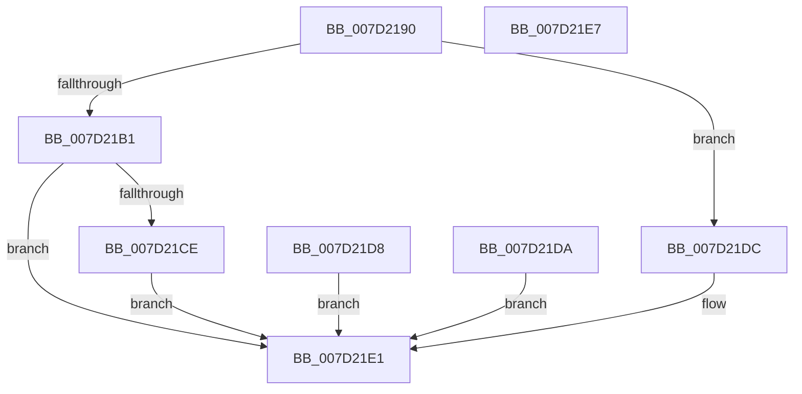

# NtQueryAuxiliaryCounterFrequency

- RVA: `0x007D2190`–`0x007D21E8` (길이 `88` bytes)
- VA: `0x00000001407D2190`
- 실행 섹션: `PAGE`
- PDB 이름 있음: `예`; PDB Function 태그: `아니요`
- unwind 정보 RVA: `0x000D59E8`
- 디코드: `25`개 명령, `88/88` bytes 표시
- 미해석 바이트: `0` (있으면 어셈블리에 `.byte`로 보존)

> 이 문서는 커널 이미지의 기계어와 PDB 기호를 분석해 생성했습니다. 4번과 5번은 함수 원형과 자료형을 바이너리 사용 방식에서 추정한 C 해석이며 원본 소스 복구 결과는 아닙니다.

## 1. Dependencies

- 직접 호출 지점: **3**; 고유 호출 대상: **2**
- 직접 호출자로 확인된 함수: **0**
- RIP 상대 이미지 참조: **0**

### Outgoing calls
- `0x007D21BA` → [ProbeForWrite](../8E/ProbeForWrite_function_008E91C0.md) (function, `0x008E91C0`)
- `0x007D21C5` → [KeQueryAuxiliaryCounterFrequency](../../text/5B/KeQueryAuxiliaryCounterFrequency_function_005B1990.md) (function, `0x005B1990`)
- `0x007D21DC` → [KeQueryAuxiliaryCounterFrequency](../../text/5B/KeQueryAuxiliaryCounterFrequency_function_005B1990.md) (function, `0x005B1990`)

### Direct callers
- 이 함수 시작 RVA로 연결되는 직접 call은 확인되지 않았습니다. 간접 호출은 완전히 역산할 수 없습니다.

### Static image references
- 디코드된 RIP-relative 메모리 참조가 없습니다.

## 2. Other-region calls and transfers

- 다른 실행 섹션으로 향하는 call: **2**
  - `0x007D21C5` → [KeQueryAuxiliaryCounterFrequency](../../text/5B/KeQueryAuxiliaryCounterFrequency_function_005B1990.md) (`PAGE` → `.text`)
  - `0x007D21DC` → [KeQueryAuxiliaryCounterFrequency](../../text/5B/KeQueryAuxiliaryCounterFrequency_function_005B1990.md) (`PAGE` → `.text`)
- 별도 외부 분기/꼬리 이동을 확인하지 못했습니다.

## 3. Assembly (complete function range)

```asm
007D2190  40 53                           push rbx
007D2192  48 83 EC 20                     sub rsp, 0x20
007D2196  48 8B D9                        mov rbx, rcx
007D2199  48 83 64 24 38 00               and qword ptr [rsp + 0x38], 0
007D219F  65 48 8B 04 25 88 01 00 00      mov rax, qword ptr gs:[0x188]
007D21A8  80 B8 32 02 00 00 00            cmp byte ptr [rax + 0x232], 0
007D21AF  74 2B                           je 0x1407d21dc
007D21B1  BA 08 00 00 00                  mov edx, 8
007D21B6  44 8D 42 FC                     lea r8d, [rdx - 4]
007D21BA  E8 01 70 11 00                  call 0x1408e91c0
007D21BF  90                              nop
007D21C0  48 8D 4C 24 38                  lea rcx, [rsp + 0x38]
007D21C5  E8 C6 F7 DD FF                  call 0x1405b1990
007D21CA  85 C0                           test eax, eax
007D21CC  78 13                           js 0x1407d21e1
007D21CE  48 8B 4C 24 38                  mov rcx, qword ptr [rsp + 0x38]
007D21D3  48 89 0B                        mov qword ptr [rbx], rcx
007D21D6  EB 09                           jmp 0x1407d21e1
007D21D8  EB 07                           jmp 0x1407d21e1
007D21DA  EB 05                           jmp 0x1407d21e1
007D21DC  E8 AF F7 DD FF                  call 0x1405b1990
007D21E1  48 83 C4 20                     add rsp, 0x20
007D21E5  5B                              pop rbx
007D21E6  C3                              ret
007D21E7  CC                              int3
```

## 4. C-style interpretation (structured pseudocode)

```c
__int64 __fastcall NtQueryAuxiliaryCounterFrequency(__int64 a1)
{
    __int64 result;
    __int64 v_rsp;
    unsigned __int64 v_stack_p10;

    v_rsp = (v_rsp) - (32);
    if ((*(unsigned __int8 *)(*(unsigned __int64 *)(gs_base + (0 + 392)) + 562)) == 0) goto loc_007D21DC;
    result = ProbeForWrite(a1, 8, 8 - 4, a4);
    result = KeQueryAuxiliaryCounterFrequency(v_stack_p10, 8, 8 - 4, a4);
    if (sign_flag) goto loc_007D21E1;
    *(unsigned __int64 *)(a1) = v_stack_p10;
    goto loc_007D21E1;
loc_007D21DC:
    result = KeQueryAuxiliaryCounterFrequency(v_stack_p10, 8, 8 - 4, a4);
loc_007D21E1:
    v_rsp = (v_rsp) + (32);
    return result;
}
```

## 5. (Beta) C Style

```c
int64_t NtQueryAuxiliaryCounterFrequency(void *Arg1)
{
    uint8_t *arg1 = (uint8_t *)Arg1;

    int64_t result;
    int64_t local_rsp;
    uint64_t v_stack_p10;

    local_rsp = (local_rsp) - (32);
    if ((*(uint8_t *)(*(uint64_t *)(gs_base + (0 + 0x188)) + 0x232)) == 0) goto loc_007D21DC;
    result = ProbeForWrite(Arg1, 8, 8 - 4, a4);
    result = KeQueryAuxiliaryCounterFrequency(v_stack_p10, 8, 8 - 4, a4);
    if (sign_flag) goto loc_007D21E1;
    *(uint64_t *)(arg1) = v_stack_p10;
    goto loc_007D21E1;
loc_007D21DC:
    result = KeQueryAuxiliaryCounterFrequency(v_stack_p10, 8, 8 - 4, a4);
loc_007D21E1:
    local_rsp = (local_rsp) + (32);
    return result;
}
```

### 관측된 메모리 오프셋

구조체 형식이 확인되지 않은 접근은 인자 기준의 오프셋으로만 기록했습니다.

| 기준 인자 | 오프셋 표현 | 폭 (bit) | 접근 |
|---|---:|---:|---|
| `Arg1` | `+ 0x0` | `64` | `W` |

## 6. Execution-region graph

[열기: 2D/3D 그래프와 함수 탐색 컨트롤 패널](../../../control-panel.html?section=page&rva=0x007D2190&view=graph)

- 2D 그래프는 위에서 아래로 흐르고, 3D 그래프는 빈 공간을 드래그해 회전합니다. Shift+드래그는 이동, 휠은 확대·축소, 함수 노드 선택은 대상 보고서 이동입니다.

### Static fallback


