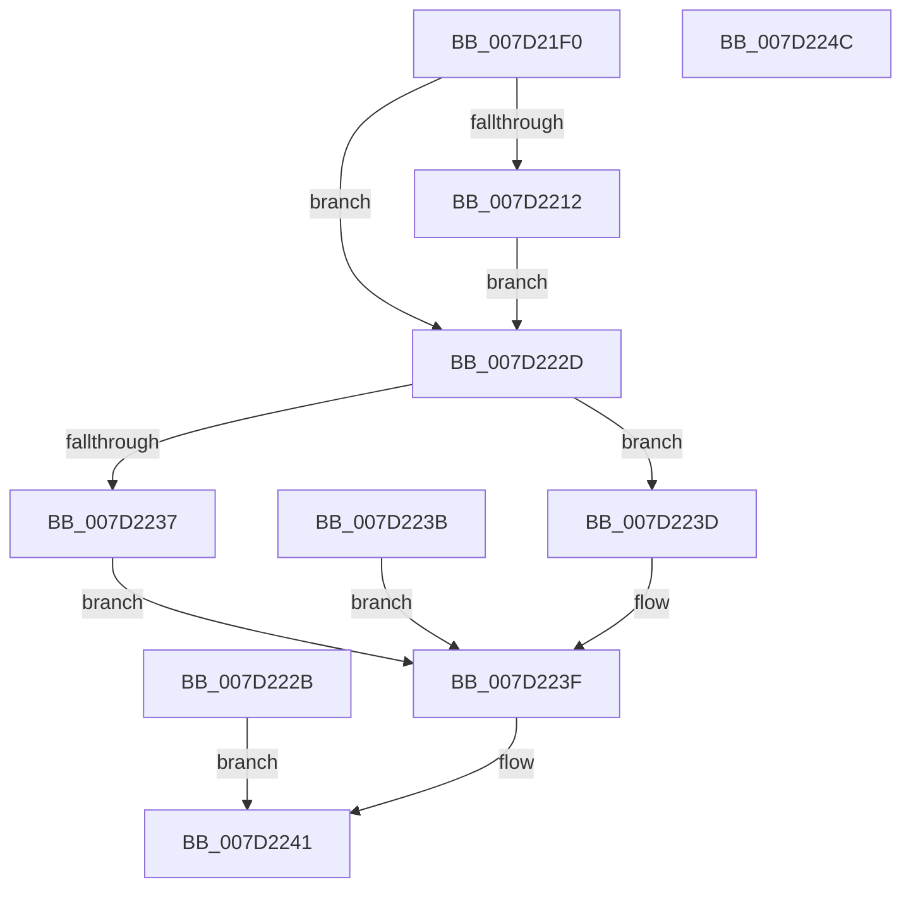

# NtQueryIntervalProfile

- RVA: `0x007D21F0`–`0x007D224D` (길이 `93` bytes)
- VA: `0x00000001407D21F0`
- 실행 섹션: `PAGE`
- PDB 이름 있음: `예`; PDB Function 태그: `아니요`
- unwind 정보 RVA: `0x000D597C`
- 디코드: `28`개 명령, `93/93` bytes 표시
- 미해석 바이트: `0` (있으면 어셈블리에 `.byte`로 보존)

> 이 문서는 커널 이미지의 기계어와 PDB 기호를 분석해 생성했습니다. 4번과 5번은 함수 원형과 자료형을 바이너리 사용 방식에서 추정한 C 해석이며 원본 소스 복구 결과는 아닙니다.

## 1. Dependencies

- 직접 호출 지점: **1**; 고유 호출 대상: **1**
- 직접 호출자로 확인된 함수: **0**
- RIP 상대 이미지 참조: **0**

### Outgoing calls
- `0x007D222D` → [KeQueryIntervalProfile](../74/KeQueryIntervalProfile_function_00746F90.md) (function, `0x00746F90`)

### Direct callers
- 이 함수 시작 RVA로 연결되는 직접 call은 확인되지 않았습니다. 간접 호출은 완전히 역산할 수 없습니다.

### Static image references
- 디코드된 RIP-relative 메모리 참조가 없습니다.

## 2. Other-region calls and transfers

- 다른 실행 섹션으로 향하는 call: **0**
- 별도 외부 분기/꼬리 이동을 확인하지 못했습니다.

## 3. Assembly (complete function range)

```asm
007D21F0  48 89 5C 24 08                  mov qword ptr [rsp + 8], rbx
007D21F5  57                              push rdi
007D21F6  48 83 EC 20                     sub rsp, 0x20
007D21FA  48 8B DA                        mov rbx, rdx
007D21FD  65 48 8B 04 25 88 01 00 00      mov rax, qword ptr gs:[0x188]
007D2206  40 8A B8 32 02 00 00            mov dil, byte ptr [rax + 0x232]
007D220D  40 84 FF                        test dil, dil
007D2210  74 1B                           je 0x1407d222d
007D2212  49 B8 00 00 FF FF FF 7F 00 00   movabs r8, 0x7fffffff0000
007D221C  49 3B D0                        cmp rdx, r8
007D221F  4C 0F 42 C2                     cmovb r8, rdx
007D2223  41 8B 00                        mov eax, dword ptr [r8]
007D2226  41 89 00                        mov dword ptr [r8], eax
007D2229  EB 02                           jmp 0x1407d222d
007D222B  EB 14                           jmp 0x1407d2241
007D222D  E8 5E 4D F7 FF                  call 0x140746f90
007D2232  40 84 FF                        test dil, dil
007D2235  74 06                           je 0x1407d223d
007D2237  89 03                           mov dword ptr [rbx], eax
007D2239  EB 04                           jmp 0x1407d223f
007D223B  EB 02                           jmp 0x1407d223f
007D223D  89 03                           mov dword ptr [rbx], eax
007D223F  33 C0                           xor eax, eax
007D2241  48 8B 5C 24 30                  mov rbx, qword ptr [rsp + 0x30]
007D2246  48 83 C4 20                     add rsp, 0x20
007D224A  5F                              pop rdi
007D224B  C3                              ret
007D224C  CC                              int3
```

## 4. C-style interpretation (structured pseudocode)

```c
__int64 __fastcall NtQueryIntervalProfile(__int64 a1, __int64 a2)
{
    __int64 result;
    __int64 v_rsp;
    unsigned __int64 v_stack_p8;

    v_stack_p8 = v_rbx;
    v_rsp = (v_rsp) - (32);
    if ((unsigned __int8)(*(unsigned __int8 *)(*(unsigned __int64 *)(gs_base + (0 + 392)) + 562)) == 0) goto loc_007D222D;
    if (a2 < a3) { a3 = a2; }
    *(unsigned int *)(a3) = (unsigned int)((unsigned int)(*(unsigned int *)(a3)));
    goto loc_007D222D;
loc_007D222D:
    result = KeQueryIntervalProfile(a1, a2, a3, a4);
    if ((unsigned __int8)(*(unsigned __int8 *)(*(unsigned __int64 *)(gs_base + (0 + 392)) + 562)) == 0) goto loc_007D223D;
    *(unsigned int *)(a2) = (unsigned int)(result);
    goto loc_007D223F;
loc_007D223D:
    *(unsigned int *)(a2) = (unsigned int)(result);
loc_007D223F:
    result = 0;
loc_007D2241:
    v_rsp = (v_rsp) + (32);
    return result;
}
```

## 5. (Beta) C Style

```c
int64_t NtQueryIntervalProfile(int64_t Arg1, void *Arg2)
{
    uint8_t *arg2 = (uint8_t *)Arg2;

    int64_t result;
    int64_t local_rsp;
    uint64_t v_stack_p8;

    v_stack_p8 = local_rbx;
    local_rsp = (local_rsp) - (32);
    if ((uint8_t)(*(uint8_t *)(*(uint64_t *)(gs_base + (0 + 0x188)) + 0x232)) == 0) goto loc_007D222D;
    if (Arg2 < a3) { a3 = Arg2; }
    *(uint32_t *)(a3) = (uint32_t)((uint32_t)(*(uint32_t *)(a3)));
    goto loc_007D222D;
loc_007D222D:
    result = KeQueryIntervalProfile(Arg1, Arg2, a3, a4);
    if ((uint8_t)(*(uint8_t *)(*(uint64_t *)(gs_base + (0 + 0x188)) + 0x232)) == 0) goto loc_007D223D;
    *(uint32_t *)(arg2) = (uint32_t)(result);
    goto loc_007D223F;
loc_007D223D:
    *(uint32_t *)(arg2) = (uint32_t)(result);
loc_007D223F:
    result = 0;
loc_007D2241:
    local_rsp = (local_rsp) + (32);
    return result;
}
```

### 관측된 메모리 오프셋

구조체 형식이 확인되지 않은 접근은 인자 기준의 오프셋으로만 기록했습니다.

| 기준 인자 | 오프셋 표현 | 폭 (bit) | 접근 |
|---|---:|---:|---|
| `Arg2` | `+ 0x0` | `32` | `W` |

## 6. Execution-region graph

[열기: 2D/3D 그래프와 함수 탐색 컨트롤 패널](../../../control-panel.html?section=page&rva=0x007D21F0&view=graph)

- 2D 그래프는 위에서 아래로 흐르고, 3D 그래프는 빈 공간을 드래그해 회전합니다. Shift+드래그는 이동, 휠은 확대·축소, 함수 노드 선택은 대상 보고서 이동입니다.

### Static fallback


