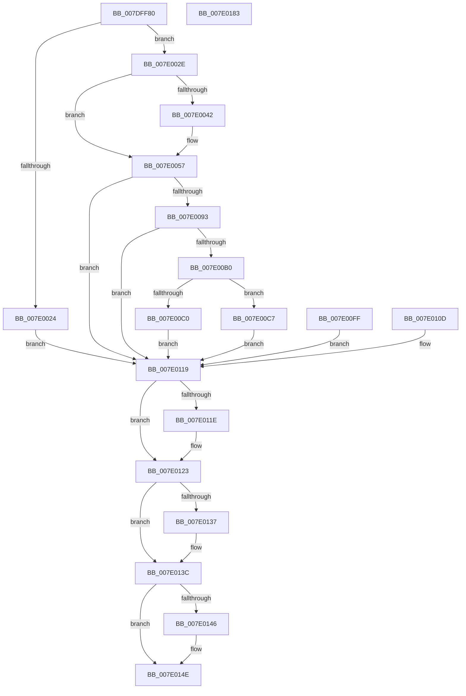

# NtQueryOpenSubKeys

- RVA: `0x007DFF80`–`0x007E0184` (길이 `516` bytes)
- VA: `0x00000001407DFF80`
- 실행 섹션: `PAGE`
- PDB 이름 있음: `예`; PDB Function 태그: `아니요`
- unwind 정보 RVA: `0x000D6788`
- 디코드: `125`개 명령, `516/516` bytes 표시
- 미해석 바이트: `0` (있으면 어셈블리에 `.byte`로 보존)

> 이 문서는 커널 이미지의 기계어와 PDB 기호를 분석해 생성했습니다. 4번과 5번은 함수 원형과 자료형을 바이너리 사용 방식에서 추정한 C 해석이며 원본 소스 복구 결과는 아닙니다.

## 1. Dependencies

- 직접 호출 지점: **17**; 고유 호출 대상: **16**
- 직접 호출자로 확인된 함수: **0**
- RIP 상대 이미지 참조: **2**

### Outgoing calls
- `0x007DFFCD` → [memset](../../text/6C/memset_function_006C6C40.md) (function, `0x006C6C40`)
- `0x007DFFFD` → [CmpInitializeParseContext](../87/CmpInitializeParseContext_function_008767F0.md) (function, `0x008767F0`)
- `0x007E000F` → [CmpInitializeThreadInfo](../../text/3F/CmpInitializeThreadInfo_function_003FBE70.md) (function, `0x003FBE70`)
- `0x007E0014` → [CmpAcquireShutdownRundown](../../pagecmrc/BC/CmpAcquireShutdownRundown_function_00BC9400.md) (function, `0x00BC9400`)
- `0x007E0084` → [ObReferenceObjectByNameEx](../8B/ObReferenceObjectByNameEx_function_008BD524.md) (function, `0x008BD524`)
- `0x007E0093` → [CmpLockRegistryExclusive](../84/CmpLockRegistryExclusive_function_0084F9B4.md) (function, `0x0084F9B4`)
- `0x007E00A5` → [CmpPerformKeyBodyDeletionCheck](../../pagecmrc/BC/CmpPerformKeyBodyDeletionCheck_function_00BC97D0.md) (function, `0x00BC97D0`)
- `0x007E00CC` → [CmpAttachToRegistryProcess](../../pagecmrc/BC/CmpAttachToRegistryProcess_function_00BC98E0.md) (function, `0x00BC98E0`)
- `0x007E00DA` → [CmpSearchForOpenSubKeys](../9A/CmpSearchForOpenSubKeys_function_009AE76C.md) (function, `0x009AE76C`)
- `0x007E00E6` → [CmpDetachFromRegistryProcess](../../pagecmrc/BC/CmpDetachFromRegistryProcess_function_00BC9920.md) (function, `0x00BC9920`)
- `0x007E00EB` → [CmpUnlockRegistry](../../pagecmrc/BC/CmpUnlockRegistry_function_00BC9A84.md) (function, `0x00BC9A84`)
- `0x007E011E` → [CmpUnlockRegistry](../../pagecmrc/BC/CmpUnlockRegistry_function_00BC9A84.md) (function, `0x00BC9A84`)
- `0x007E012D` → [CmpCleanupParseContext](../87/CmpCleanupParseContext_function_00876910.md) (function, `0x00876910`)
- `0x007E0137` → [CmpReleaseShutdownRundown](../../pagecmrc/BC/CmpReleaseShutdownRundown_function_00BC9880.md) (function, `0x00BC9880`)
- `0x007E0149` → [ObfDereferenceObject](../../text/2F/ObfDereferenceObject_function_002F9350.md) (function, `0x002F9350`)
- `0x007E0153` → [CmCleanupThreadInfo](../../text/41/CmCleanupThreadInfo_function_0041FD50.md) (function, `0x0041FD50`)
- `0x007E0165` → [_security_check_cookie](../../text/6A/_security_check_cookie_function_006AC640.md) (function, `0x006AC640`)

### Direct callers
- 이 함수 시작 RVA로 연결되는 직접 call은 확인되지 않았습니다. 간접 호출은 완전히 역산할 수 없습니다.

### Static image references
- `0x007DFF96` → RVA `0x00E0A740` (`.data`; read)
- `0x007E0072` → RVA `0x00FC6AC0` (`ALMOSTRO`; read)

## 2. Other-region calls and transfers

- 다른 실행 섹션으로 향하는 call: **12**
  - `0x007DFFCD` → [memset](../../text/6C/memset_function_006C6C40.md) (`PAGE` → `.text`)
  - `0x007E000F` → [CmpInitializeThreadInfo](../../text/3F/CmpInitializeThreadInfo_function_003FBE70.md) (`PAGE` → `.text`)
  - `0x007E0014` → [CmpAcquireShutdownRundown](../../pagecmrc/BC/CmpAcquireShutdownRundown_function_00BC9400.md) (`PAGE` → `PAGECMRC`)
  - `0x007E00A5` → [CmpPerformKeyBodyDeletionCheck](../../pagecmrc/BC/CmpPerformKeyBodyDeletionCheck_function_00BC97D0.md) (`PAGE` → `PAGECMRC`)
  - `0x007E00CC` → [CmpAttachToRegistryProcess](../../pagecmrc/BC/CmpAttachToRegistryProcess_function_00BC98E0.md) (`PAGE` → `PAGECMRC`)
  - `0x007E00E6` → [CmpDetachFromRegistryProcess](../../pagecmrc/BC/CmpDetachFromRegistryProcess_function_00BC9920.md) (`PAGE` → `PAGECMRC`)
  - `0x007E00EB` → [CmpUnlockRegistry](../../pagecmrc/BC/CmpUnlockRegistry_function_00BC9A84.md) (`PAGE` → `PAGECMRC`)
  - `0x007E011E` → [CmpUnlockRegistry](../../pagecmrc/BC/CmpUnlockRegistry_function_00BC9A84.md) (`PAGE` → `PAGECMRC`)
  - `0x007E0137` → [CmpReleaseShutdownRundown](../../pagecmrc/BC/CmpReleaseShutdownRundown_function_00BC9880.md) (`PAGE` → `PAGECMRC`)
  - `0x007E0149` → [ObfDereferenceObject](../../text/2F/ObfDereferenceObject_function_002F9350.md) (`PAGE` → `.text`)
  - `0x007E0153` → [CmCleanupThreadInfo](../../text/41/CmCleanupThreadInfo_function_0041FD50.md) (`PAGE` → `.text`)
  - `0x007E0165` → [_security_check_cookie](../../text/6A/_security_check_cookie_function_006AC640.md) (`PAGE` → `.text`)
- 별도 외부 분기/꼬리 이동을 확인하지 못했습니다.

## 3. Assembly (complete function range)

```asm
007DFF80  48 89 5C 24 18                  mov qword ptr [rsp + 0x18], rbx
007DFF85  48 89 74 24 20                  mov qword ptr [rsp + 0x20], rsi
007DFF8A  57                              push rdi
007DFF8B  41 56                           push r14
007DFF8D  41 57                           push r15
007DFF8F  48 81 EC 80 02 00 00            sub rsp, 0x280
007DFF96  48 8B 05 A3 A7 62 00            mov rax, qword ptr [rip + 0x62a7a3]
007DFF9D  48 33 C4                        xor rax, rsp
007DFFA0  48 89 84 24 70 02 00 00         mov qword ptr [rsp + 0x270], rax
007DFFA8  4C 8B FA                        mov r15, rdx
007DFFAB  48 8B D9                        mov rbx, rcx
007DFFAE  0F 57 C0                        xorps xmm0, xmm0
007DFFB1  33 C0                           xor eax, eax
007DFFB3  0F 11 44 24 58                  movups xmmword ptr [rsp + 0x58], xmm0
007DFFB8  48 89 44 24 68                  mov qword ptr [rsp + 0x68], rax
007DFFBD  33 D2                           xor edx, edx
007DFFBF  41 B8 D0 01 00 00               mov r8d, 0x1d0
007DFFC5  48 8D 8C 24 A0 00 00 00         lea rcx, [rsp + 0xa0]
007DFFCD  E8 6E 6C EE FF                  call 0x1406c6c40
007DFFD2  83 64 24 50 00                  and dword ptr [rsp + 0x50], 0
007DFFD7  0F 57 C0                        xorps xmm0, xmm0
007DFFDA  0F 11 44 24 70                  movups xmmword ptr [rsp + 0x70], xmm0
007DFFDF  0F 11 84 24 80 00 00 00         movups xmmword ptr [rsp + 0x80], xmm0
007DFFE7  0F 11 84 24 90 00 00 00         movups xmmword ptr [rsp + 0x90], xmm0
007DFFEF  48 83 64 24 48 00               and qword ptr [rsp + 0x48], 0
007DFFF5  48 8D 8C 24 A0 00 00 00         lea rcx, [rsp + 0xa0]
007DFFFD  E8 EE 67 09 00                  call 0x1408767f0
007E0002  40 32 F6                        xor sil, sil
007E0005  40 88 74 24 40                  mov byte ptr [rsp + 0x40], sil
007E000A  48 8D 4C 24 58                  lea rcx, [rsp + 0x58]
007E000F  E8 5C BE C1 FF                  call 0x1403fbe70
007E0014  E8 E7 93 3E 00                  call 0x140bc9400
007E0019  44 8A F0                        mov r14b, al
007E001C  88 44 24 41                     mov byte ptr [rsp + 0x41], al
007E0020  84 C0                           test al, al
007E0022  75 0A                           jne 0x1407e002e
007E0024  BB 89 01 00 C0                  mov ebx, 0xc0000189
007E0029  E9 EB 00 00 00                  jmp 0x1407e0119
007E002E  65 48 8B 04 25 88 01 00 00      mov rax, qword ptr gs:[0x188]
007E0037  8A 90 32 02 00 00               mov dl, byte ptr [rax + 0x232]
007E003D  80 FA 01                        cmp dl, 1
007E0040  75 15                           jne 0x1407e0057
007E0042  48 B9 00 00 FF FF FF 7F 00 00   movabs rcx, 0x7fffffff0000
007E004C  4C 3B F9                        cmp r15, rcx
007E004F  49 0F 42 CF                     cmovb rcx, r15
007E0053  8B 01                           mov eax, dword ptr [rcx]
007E0055  89 01                           mov dword ptr [rcx], eax
007E0057  48 8D 44 24 48                  lea rax, [rsp + 0x48]
007E005C  48 89 44 24 30                  mov qword ptr [rsp + 0x30], rax
007E0061  48 8D 84 24 A0 00 00 00         lea rax, [rsp + 0xa0]
007E0069  48 89 44 24 28                  mov qword ptr [rsp + 0x28], rax
007E006E  88 54 24 20                     mov byte ptr [rsp + 0x20], dl
007E0072  4C 8B 0D 47 6A 7E 00            mov r9, qword ptr [rip + 0x7e6a47]
007E0079  33 D2                           xor edx, edx
007E007B  41 B8 19 00 02 00               mov r8d, 0x20019
007E0081  48 8B CB                        mov rcx, rbx
007E0084  E8 9B D4 0D 00                  call 0x1408bd524
007E0089  8B D8                           mov ebx, eax
007E008B  85 C0                           test eax, eax
007E008D  0F 88 86 00 00 00               js 0x1407e0119
007E0093  E8 1C F9 06 00                  call 0x14084f9b4
007E0098  40 B6 01                        mov sil, 1
007E009B  33 D2                           xor edx, edx
007E009D  48 8B 7C 24 48                  mov rdi, qword ptr [rsp + 0x48]
007E00A2  48 8B CF                        mov rcx, rdi
007E00A5  E8 26 97 3E 00                  call 0x140bc97d0
007E00AA  8B D8                           mov ebx, eax
007E00AC  85 C0                           test eax, eax
007E00AE  78 69                           js 0x1407e0119
007E00B0  48 8B 47 08                     mov rax, qword ptr [rdi + 8]
007E00B4  F7 80 B8 00 00 00 00 00 04 00   test dword ptr [rax + 0xb8], 0x40000
007E00BE  75 07                           jne 0x1407e00c7
007E00C0  BB 0D 00 00 C0                  mov ebx, 0xc000000d
007E00C5  EB 52                           jmp 0x1407e0119
007E00C7  48 8D 4C 24 70                  lea rcx, [rsp + 0x70]
007E00CC  E8 0F 98 3E 00                  call 0x140bc98e0
007E00D1  45 33 C0                        xor r8d, r8d
007E00D4  33 D2                           xor edx, edx
007E00D6  48 8B 4F 08                     mov rcx, qword ptr [rdi + 8]
007E00DA  E8 8D E6 1C 00                  call 0x1409ae76c
007E00DF  8B D8                           mov ebx, eax
007E00E1  48 8D 4C 24 70                  lea rcx, [rsp + 0x70]
007E00E6  E8 35 98 3E 00                  call 0x140bc9920
007E00EB  E8 94 99 3E 00                  call 0x140bc9a84
007E00F0  40 32 F6                        xor sil, sil
007E00F3  40 88 74 24 40                  mov byte ptr [rsp + 0x40], sil
007E00F8  41 89 1F                        mov dword ptr [r15], ebx
007E00FB  33 DB                           xor ebx, ebx
007E00FD  EB 1A                           jmp 0x1407e0119
007E00FF  8B D8                           mov ebx, eax
007E0101  40 8A 74 24 40                  mov sil, byte ptr [rsp + 0x40]
007E0106  44 8A 74 24 41                  mov r14b, byte ptr [rsp + 0x41]
007E010B  EB 0C                           jmp 0x1407e0119
007E010D  8B D8                           mov ebx, eax
007E010F  40 8A 74 24 40                  mov sil, byte ptr [rsp + 0x40]
007E0114  44 8A 74 24 41                  mov r14b, byte ptr [rsp + 0x41]
007E0119  40 84 F6                        test sil, sil
007E011C  74 05                           je 0x1407e0123
007E011E  E8 61 99 3E 00                  call 0x140bc9a84
007E0123  33 D2                           xor edx, edx
007E0125  48 8D 8C 24 A0 00 00 00         lea rcx, [rsp + 0xa0]
007E012D  E8 DE 67 09 00                  call 0x140876910
007E0132  45 84 F6                        test r14b, r14b
007E0135  74 05                           je 0x1407e013c
007E0137  E8 44 97 3E 00                  call 0x140bc9880
007E013C  48 8B 7C 24 48                  mov rdi, qword ptr [rsp + 0x48]
007E0141  48 85 FF                        test rdi, rdi
007E0144  74 08                           je 0x1407e014e
007E0146  48 8B CF                        mov rcx, rdi
007E0149  E8 02 92 B1 FF                  call 0x1402f9350
007E014E  48 8D 4C 24 58                  lea rcx, [rsp + 0x58]
007E0153  E8 F8 FB C3 FF                  call 0x14041fd50
007E0158  8B C3                           mov eax, ebx
007E015A  48 8B 8C 24 70 02 00 00         mov rcx, qword ptr [rsp + 0x270]
007E0162  48 33 CC                        xor rcx, rsp
007E0165  E8 D6 C4 EC FF                  call 0x1406ac640
007E016A  4C 8D 9C 24 80 02 00 00         lea r11, [rsp + 0x280]
007E0172  49 8B 5B 30                     mov rbx, qword ptr [r11 + 0x30]
007E0176  49 8B 73 38                     mov rsi, qword ptr [r11 + 0x38]
007E017A  49 8B E3                        mov rsp, r11
007E017D  41 5F                           pop r15
007E017F  41 5E                           pop r14
007E0181  5F                              pop rdi
007E0182  C3                              ret
007E0183  CC                              int3
```

## 4. C-style interpretation (structured pseudocode)

```c
__int64 __fastcall NtQueryOpenSubKeys(__int64 a1, __int64 a2)
{
    __int64 result;
    __int64 v_rbx;
    __int64 v_rsi;
    __int64 v_rsp;
    unsigned __int64 v_stack_m18;
    unsigned __int64 v_stack_m1F8;
    unsigned __int64 v_stack_m208;
    unsigned __int64 v_stack_m218;
    unsigned __int64 v_stack_m228;
    unsigned __int64 v_stack_m230;
    unsigned __int64 v_stack_m240;
    unsigned int v_stack_m248;
    unsigned __int64 v_stack_m250;
    unsigned __int8 v_stack_m257;
    unsigned __int8 v_stack_m258;
    unsigned __int64 v_stack_m268;
    unsigned __int64 v_stack_m270;
    unsigned __int8 v_stack_m278;
    unsigned __int64 v_stack_m28;
    unsigned __int64 v_stack_p18;
    unsigned __int64 v_stack_p20;

    v_stack_p18 = v_rbx;
    v_stack_p20 = v_rsi;
    v_rsp = (v_rsp) - (640);
    result = (*(unsigned __int64 *)(v_rip + 6465443)) ^ (v_rsp);
    v_stack_m28 = result;
    result = 0;
    v_stack_m240 = v_xmm0;
    v_stack_m230 = 0;
    a2 = 0;
    result = memset(v_stack_m1F8, a2, 464, a4);
    v_stack_m228 = v_xmm0;
    v_stack_m218 = v_xmm0;
    v_stack_m208 = v_xmm0;
    result = CmpInitializeParseContext(v_stack_m1F8, a2, 464, a4);
    v_rsi = 0;
    v_stack_m258 = 0;
    result = CmpInitializeThreadInfo(v_stack_m240, a2, 464, a4);
    result = CmpAcquireShutdownRundown(v_stack_m240, a2, 464, a4);
    v_stack_m257 = (unsigned __int8)(result);
    if ((unsigned __int8)(result) != 0) goto loc_007E002E;
    goto loc_007E0119;
loc_007E002E:
    result = *(unsigned __int64 *)(gs_base + (0 + 392));
    if (((unsigned __int8)(*(unsigned __int8 *)(*(unsigned __int64 *)(gs_base + (0 + 392)) + 562))) == 1) {
        a1 = v_stack_m240;
        if (0 < v_stack_m240) { a1 = 0; }
        result = *(unsigned int *)(a1);
        *(unsigned int *)(a1) = (unsigned int)(result);
    }
    v_stack_m268 = v_stack_m250;
    v_stack_m270 = v_stack_m1F8;
    v_stack_m278 = (unsigned __int8)(*(unsigned __int8 *)(*(unsigned __int64 *)(gs_base + (0 + 392)) + 562));
    a2 = 0;
    result = ObReferenceObjectByNameEx((unsigned int)(0xC0000189ULL), a2, (unsigned int)(0x20019ULL), *(unsigned __int64 *)(v_rip + 8284743));
    if (sign_flag) goto loc_007E0119;
    result = CmpLockRegistryExclusive((unsigned int)(0xC0000189ULL), a2, (unsigned int)(0x20019ULL), *(unsigned __int64 *)(v_rip + 8284743));
    a2 = 0;
    result = CmpPerformKeyBodyDeletionCheck(v_stack_m250, a2, (unsigned int)(0x20019ULL), *(unsigned __int64 *)(v_rip + 8284743));
    if (sign_flag) goto loc_007E0119;
    if (((*(unsigned int *)(*(unsigned __int64 *)(v_stack_m250 + 8) + 184)) & (0x40000ULL)) != 0) goto loc_007E00C7;
    goto loc_007E0119;
loc_007E00C7:
    result = CmpAttachToRegistryProcess(v_stack_m228, a2, (unsigned int)(0x20019ULL), *(unsigned __int64 *)(v_rip + 8284743));
    a3 = 0;
    a2 = 0;
    result = CmpSearchForOpenSubKeys(*(unsigned __int64 *)(v_stack_m250 + 8), a2, a3, *(unsigned __int64 *)(v_rip + 8284743));
    result = CmpDetachFromRegistryProcess(v_stack_m228, a2, a3, *(unsigned __int64 *)(v_rip + 8284743));
    result = CmpUnlockRegistry(v_stack_m228, a2, a3, *(unsigned __int64 *)(v_rip + 8284743));
    v_rsi = 0;
    v_stack_m258 = 0;
    *(unsigned int *)(a2) = (unsigned int)((unsigned int)((unsigned int)(result)));
    v_rbx = 0;
    goto loc_007E0119;
loc_007E0119:
    if (0 != 0) {
        result = CmpUnlockRegistry(v_stack_m228, a2, a3, *(unsigned __int64 *)(v_rip + 8284743));
    }
    a2 = 0;
    result = CmpCleanupParseContext(v_stack_m1F8, a2, a3, *(unsigned __int64 *)(v_rip + 8284743));
    if ((unsigned __int8)((unsigned __int8)(result)) != 0) {
        result = CmpReleaseShutdownRundown(v_stack_m1F8, a2, a3, *(unsigned __int64 *)(v_rip + 8284743));
    }
    if (v_stack_m250 != 0) {
        a1 = v_stack_m250;
        result = ObfDereferenceObject(a1, a2, a3, *(unsigned __int64 *)(v_rip + 8284743));
    }
    result = CmCleanupThreadInfo(v_stack_m240, a2, a3, *(unsigned __int64 *)(v_rip + 8284743));
    a1 = (v_stack_m28) ^ (v_rsp);
    result = _security_check_cookie(a1, a2, a3, *(unsigned __int64 *)(v_rip + 8284743));
    return result;
}
```

## 5. (Beta) C Style

```c
int64_t NtQueryOpenSubKeys(int64_t Arg1, int64_t Arg2)
{
    int64_t result;
    int64_t local_rbx;
    int64_t local_rsi;
    int64_t local_rsp;
    uint64_t v_stack_m18;
    uint64_t v_stack_m1F8;
    uint64_t v_stack_m208;
    uint64_t v_stack_m218;
    uint64_t v_stack_m228;
    uint64_t v_stack_m230;
    uint64_t v_stack_m240;
    uint32_t v_stack_m248;
    uint64_t v_stack_m250;
    uint8_t v_stack_m257;
    uint8_t v_stack_m258;
    uint64_t v_stack_m268;
    uint64_t v_stack_m270;
    uint8_t v_stack_m278;
    uint64_t v_stack_m28;
    uint64_t v_stack_p18;
    uint64_t v_stack_p20;

    v_stack_p18 = local_rbx;
    v_stack_p20 = local_rsi;
    local_rsp = (local_rsp) - (640);
    result = (*(uint64_t *)(v_rip + 0x62A7A3)) ^ (local_rsp);
    v_stack_m28 = result;
    result = 0;
    v_stack_m240 = v_xmm0;
    v_stack_m230 = 0;
    Arg2 = 0;
    result = memset(v_stack_m1F8, Arg2, 464, a4);
    v_stack_m228 = v_xmm0;
    v_stack_m218 = v_xmm0;
    v_stack_m208 = v_xmm0;
    result = CmpInitializeParseContext(v_stack_m1F8, Arg2, 464, a4);
    local_rsi = 0;
    v_stack_m258 = 0;
    result = CmpInitializeThreadInfo(v_stack_m240, Arg2, 464, a4);
    result = CmpAcquireShutdownRundown(v_stack_m240, Arg2, 464, a4);
    v_stack_m257 = (uint8_t)(result);
    if ((uint8_t)(result) != 0) goto loc_007E002E;
    goto loc_007E0119;
loc_007E002E:
    result = *(uint64_t *)(gs_base + (0 + 0x188));
    if (((uint8_t)(*(uint8_t *)(*(uint64_t *)(gs_base + (0 + 0x188)) + 0x232))) == 1) {
        Arg1 = v_stack_m240;
        if (0 < v_stack_m240) { Arg1 = 0; }
        result = *(uint32_t *)(Arg1);
        *(uint32_t *)(Arg1) = (uint32_t)(result);
    }
    v_stack_m268 = v_stack_m250;
    v_stack_m270 = v_stack_m1F8;
    v_stack_m278 = (uint8_t)(*(uint8_t *)(*(uint64_t *)(gs_base + (0 + 0x188)) + 0x232));
    Arg2 = 0;
    result = ObReferenceObjectByNameEx((uint32_t)(0xC0000189ULL), Arg2, (uint32_t)(0x20019ULL), *(uint64_t *)(v_rip + 0x7E6A47));
    if (sign_flag) goto loc_007E0119;
    result = CmpLockRegistryExclusive((uint32_t)(0xC0000189ULL), Arg2, (uint32_t)(0x20019ULL), *(uint64_t *)(v_rip + 0x7E6A47));
    Arg2 = 0;
    result = CmpPerformKeyBodyDeletionCheck(v_stack_m250, Arg2, (uint32_t)(0x20019ULL), *(uint64_t *)(v_rip + 0x7E6A47));
    if (sign_flag) goto loc_007E0119;
    if (((*(uint32_t *)(*(uint64_t *)(v_stack_m250 + 0x8) + 0xB8)) & (0x40000ULL)) != 0) goto loc_007E00C7;
    goto loc_007E0119;
loc_007E00C7:
    result = CmpAttachToRegistryProcess(v_stack_m228, Arg2, (uint32_t)(0x20019ULL), *(uint64_t *)(v_rip + 0x7E6A47));
    a3 = 0;
    Arg2 = 0;
    result = CmpSearchForOpenSubKeys(*(uint64_t *)(v_stack_m250 + 0x8), Arg2, a3, *(uint64_t *)(v_rip + 0x7E6A47));
    result = CmpDetachFromRegistryProcess(v_stack_m228, Arg2, a3, *(uint64_t *)(v_rip + 0x7E6A47));
    result = CmpUnlockRegistry(v_stack_m228, Arg2, a3, *(uint64_t *)(v_rip + 0x7E6A47));
    local_rsi = 0;
    v_stack_m258 = 0;
    *(uint32_t *)(Arg2) = (uint32_t)((uint32_t)((uint32_t)(result)));
    local_rbx = 0;
    goto loc_007E0119;
loc_007E0119:
    if (0 != 0) {
        result = CmpUnlockRegistry(v_stack_m228, Arg2, a3, *(uint64_t *)(v_rip + 0x7E6A47));
    }
    Arg2 = 0;
    result = CmpCleanupParseContext(v_stack_m1F8, Arg2, a3, *(uint64_t *)(v_rip + 0x7E6A47));
    if ((uint8_t)((uint8_t)(result)) != 0) {
        result = CmpReleaseShutdownRundown(v_stack_m1F8, Arg2, a3, *(uint64_t *)(v_rip + 0x7E6A47));
    }
    if (v_stack_m250 != 0) {
        Arg1 = v_stack_m250;
        result = ObfDereferenceObject(Arg1, Arg2, a3, *(uint64_t *)(v_rip + 0x7E6A47));
    }
    result = CmCleanupThreadInfo(v_stack_m240, Arg2, a3, *(uint64_t *)(v_rip + 0x7E6A47));
    Arg1 = (v_stack_m28) ^ (local_rsp);
    result = _security_check_cookie(Arg1, Arg2, a3, *(uint64_t *)(v_rip + 0x7E6A47));
    return result;
}
```

## 6. Execution-region graph

[열기: 2D/3D 그래프와 함수 탐색 컨트롤 패널](../../../control-panel.html?section=page&rva=0x007DFF80&view=graph)

- 2D 그래프는 위에서 아래로 흐르고, 3D 그래프는 빈 공간을 드래그해 회전합니다. Shift+드래그는 이동, 휠은 확대·축소, 함수 노드 선택은 대상 보고서 이동입니다.

### Static fallback


