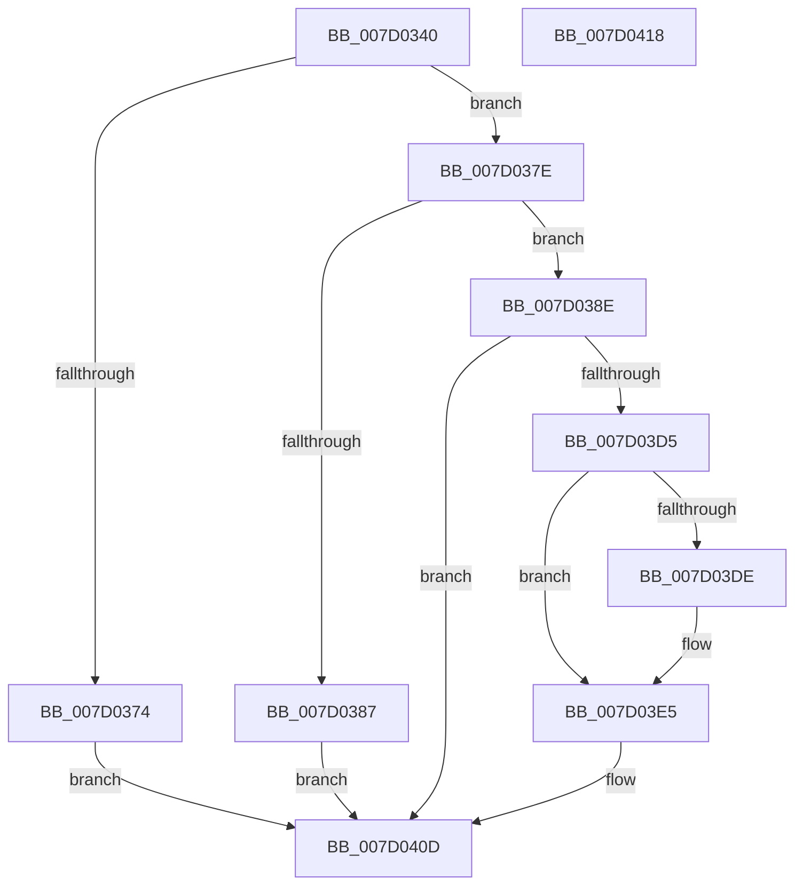

# NtSetDefaultHardErrorPort

- RVA: `0x007D0340`–`0x007D0419` (길이 `217` bytes)
- VA: `0x00000001407D0340`
- 실행 섹션: `PAGE`
- PDB 이름 있음: `예`; PDB Function 태그: `아니요`
- unwind 정보 RVA: `0x0006E5F8`
- 디코드: `47`개 명령, `217/217` bytes 표시
- 미해석 바이트: `0` (있으면 어셈블리에 `.byte`로 보존)

> 이 문서는 커널 이미지의 기계어와 PDB 기호를 분석해 생성했습니다. 4번과 5번은 함수 원형과 자료형을 바이너리 사용 방식에서 추정한 C 해석이며 원본 소스 복구 결과는 아닙니다.

## 1. Dependencies

- 직접 호출 지점: **5**; 고유 호출 대상: **5**
- 직접 호출자로 확인된 함수: **0**
- RIP 상대 이미지 참조: **3**

### Outgoing calls
- `0x007D034D` → [PsGetCurrentServerSiloGlobals](../../text/2F/PsGetCurrentServerSiloGlobals_function_002FE1F0.md) (function, `0x002FE1F0`)
- `0x007D036B` → [SeSinglePrivilegeCheck](../87/SeSinglePrivilegeCheck_function_00871E20.md) (function, `0x00871E20`)
- `0x007D03C0` → [ObReferenceObjectByHandle](../86/ObReferenceObjectByHandle_function_00868DB0.md) (function, `0x00868DB0`)
- `0x007D03D5` → [PsIsCurrentThreadInServerSilo](../../text/43/PsIsCurrentThreadInServerSilo_function_004362E0.md) (function, `0x004362E0`)
- `0x007D0406` → [ObfReferenceObject](../../text/20/ObfReferenceObject_function_0020FA20.md) (function, `0x0020FA20`)

### Direct callers
- 이 함수 시작 RVA로 연결되는 직접 call은 확인되지 않았습니다. 간접 호출은 완전히 역산할 수 없습니다.

### Static image references
- `0x007D035E` → RVA `0x00FD9A78` (`PAGEDATA`; read)
- `0x007D0399` → RVA `0x00FC6F70` (`ALMOSTRO`; read)
- `0x007D03DE` → RVA `0x00E685D0` (`.data`; write)

## 2. Other-region calls and transfers

- 다른 실행 섹션으로 향하는 call: **3**
  - `0x007D034D` → [PsGetCurrentServerSiloGlobals](../../text/2F/PsGetCurrentServerSiloGlobals_function_002FE1F0.md) (`PAGE` → `.text`)
  - `0x007D03D5` → [PsIsCurrentThreadInServerSilo](../../text/43/PsIsCurrentThreadInServerSilo_function_004362E0.md) (`PAGE` → `.text`)
  - `0x007D0406` → [ObfReferenceObject](../../text/20/ObfReferenceObject_function_0020FA20.md) (`PAGE` → `.text`)
- 별도 외부 분기/꼬리 이동을 확인하지 못했습니다.

## 3. Assembly (complete function range)

```asm
007D0340  48 89 5C 24 08                  mov qword ptr [rsp + 8], rbx
007D0345  57                              push rdi
007D0346  48 83 EC 30                     sub rsp, 0x30
007D034A  48 8B F9                        mov rdi, rcx
007D034D  E8 9E DE B2 FF                  call 0x1402fe1f0
007D0352  65 48 8B 14 25 88 01 00 00      mov rdx, qword ptr gs:[0x188]
007D035B  48 8B D8                        mov rbx, rax
007D035E  48 8B 0D 13 97 80 00            mov rcx, qword ptr [rip + 0x809713]
007D0365  8A 92 32 02 00 00               mov dl, byte ptr [rdx + 0x232]
007D036B  E8 B0 1A 0A 00                  call 0x140871e20
007D0370  84 C0                           test al, al
007D0372  75 0A                           jne 0x1407d037e
007D0374  B8 61 00 00 C0                  mov eax, 0xc0000061
007D0379  E9 8F 00 00 00                  jmp 0x1407d040d
007D037E  83 BB 60 03 00 00 01            cmp dword ptr [rbx + 0x360], 1
007D0385  75 07                           jne 0x1407d038e
007D0387  B8 01 00 00 C0                  mov eax, 0xc0000001
007D038C  EB 7F                           jmp 0x1407d040d
007D038E  65 48 8B 04 25 88 01 00 00      mov rax, qword ptr gs:[0x188]
007D0397  33 D2                           xor edx, edx
007D0399  4C 8B 05 D0 6B 7F 00            mov r8, qword ptr [rip + 0x7f6bd0]
007D03A0  48 8B CF                        mov rcx, rdi
007D03A3  48 83 64 24 28 00               and qword ptr [rsp + 0x28], 0
007D03A9  48 83 64 24 48 00               and qword ptr [rsp + 0x48], 0
007D03AF  44 8A 88 32 02 00 00            mov r9b, byte ptr [rax + 0x232]
007D03B6  48 8D 44 24 48                  lea rax, [rsp + 0x48]
007D03BB  48 89 44 24 20                  mov qword ptr [rsp + 0x20], rax
007D03C0  E8 EB 89 09 00                  call 0x140868db0
007D03C5  48 8B 4C 24 48                  mov rcx, qword ptr [rsp + 0x48]
007D03CA  48 89 8B 58 03 00 00            mov qword ptr [rbx + 0x358], rcx
007D03D1  85 C0                           test eax, eax
007D03D3  78 38                           js 0x1407d040d
007D03D5  E8 06 5F C6 FF                  call 0x1404362e0
007D03DA  84 C0                           test al, al
007D03DC  75 07                           jne 0x1407d03e5
007D03DE  C6 05 EB 81 69 00 01            mov byte ptr [rip + 0x6981eb], 1
007D03E5  C7 83 60 03 00 00 01 00 00 00   mov dword ptr [rbx + 0x360], 1
007D03EF  65 48 8B 04 25 88 01 00 00      mov rax, qword ptr gs:[0x188]
007D03F8  48 8B 88 B8 00 00 00            mov rcx, qword ptr [rax + 0xb8]
007D03FF  48 89 8B 50 03 00 00            mov qword ptr [rbx + 0x350], rcx
007D0406  E8 15 F6 A3 FF                  call 0x14020fa20
007D040B  33 C0                           xor eax, eax
007D040D  48 8B 5C 24 40                  mov rbx, qword ptr [rsp + 0x40]
007D0412  48 83 C4 30                     add rsp, 0x30
007D0416  5F                              pop rdi
007D0417  C3                              ret
007D0418  CC                              int3
```

## 4. C-style interpretation (structured pseudocode)

```c
__int64 __fastcall NtSetDefaultHardErrorPort(__int64 a1)
{
    __int64 result;
    __int64 v_rsp;
    unsigned __int64 v_stack_m10;
    unsigned __int64 v_stack_m18;
    unsigned __int64 v_stack_p10;
    unsigned __int64 v_stack_p8;

    v_stack_p8 = v_rbx;
    v_rsp = (v_rsp) - (48);
    result = PsGetCurrentServerSiloGlobals(a1, a2, a3, a4);
    result = SeSinglePrivilegeCheck(*(unsigned __int64 *)(v_rip + 8427283), *(unsigned __int8 *)(*(unsigned __int64 *)(gs_base + (0 + 392)) + 562), a3, a4);
    if ((unsigned __int8)(result) != 0) goto loc_007D037E;
    goto loc_007D040D;
loc_007D037E:
    if ((*(unsigned int *)(result + 864)) != 1) goto loc_007D038E;
    goto loc_007D040D;
loc_007D038E:
    a2 = 0;
    v_stack_m18 = v_stack_p10;
    result = ObReferenceObjectByHandle(a1, a2, *(unsigned __int64 *)(v_rip + 8350672), *(unsigned __int8 *)(*(unsigned __int64 *)(gs_base + (0 + 392)) + 562));
    *(unsigned __int64 *)(result + 856) = v_stack_p10;
    if (sign_flag) goto loc_007D040D;
    result = PsIsCurrentThreadInServerSilo(v_stack_p10, a2, *(unsigned __int64 *)(v_rip + 8350672), *(unsigned __int8 *)(*(unsigned __int64 *)(gs_base + (0 + 392)) + 562));
    if ((unsigned __int8)(result) == 0) {
        *(unsigned __int8 *)(v_rip + 6914539) = 1;
    }
    *(unsigned int *)(result + 864) = 1;
    *(unsigned __int64 *)(result + 848) = *(unsigned __int64 *)(*(unsigned __int64 *)(gs_base + (0 + 392)) + 184);
    result = ObfReferenceObject(*(unsigned __int64 *)(*(unsigned __int64 *)(gs_base + (0 + 392)) + 184), a2, *(unsigned __int64 *)(v_rip + 8350672), *(unsigned __int8 *)(*(unsigned __int64 *)(gs_base + (0 + 392)) + 562));
    result = 0;
loc_007D040D:
    v_rsp = (v_rsp) + (48);
    return result;
}
```

## 5. (Beta) C Style

```c
int64_t NtSetDefaultHardErrorPort(int64_t Arg1)
{
    int64_t result;
    int64_t local_rsp;
    uint64_t v_stack_m10;
    uint64_t v_stack_m18;
    uint64_t v_stack_p10;
    uint64_t v_stack_p8;

    v_stack_p8 = local_rbx;
    local_rsp = (local_rsp) - (48);
    result = PsGetCurrentServerSiloGlobals(Arg1, a2, a3, a4);
    result = SeSinglePrivilegeCheck(*(uint64_t *)(v_rip + 0x809713), *(uint8_t *)(*(uint64_t *)(gs_base + (0 + 0x188)) + 0x232), a3, a4);
    if ((uint8_t)(result) != 0) goto loc_007D037E;
    goto loc_007D040D;
loc_007D037E:
    if ((*(uint32_t *)(result + 0x360)) != 1) goto loc_007D038E;
    goto loc_007D040D;
loc_007D038E:
    a2 = 0;
    v_stack_m18 = v_stack_p10;
    result = ObReferenceObjectByHandle(Arg1, a2, *(uint64_t *)(v_rip + 0x7F6BD0), *(uint8_t *)(*(uint64_t *)(gs_base + (0 + 0x188)) + 0x232));
    *(uint64_t *)(result + 0x358) = v_stack_p10;
    if (sign_flag) goto loc_007D040D;
    result = PsIsCurrentThreadInServerSilo(v_stack_p10, a2, *(uint64_t *)(v_rip + 0x7F6BD0), *(uint8_t *)(*(uint64_t *)(gs_base + (0 + 0x188)) + 0x232));
    if ((uint8_t)(result) == 0) {
        *(uint8_t *)(v_rip + 0x6981EB) = 1;
    }
    *(uint32_t *)(result + 0x360) = 1;
    *(uint64_t *)(result + 0x350) = *(uint64_t *)(*(uint64_t *)(gs_base + (0 + 0x188)) + 0xB8);
    result = ObfReferenceObject(*(uint64_t *)(*(uint64_t *)(gs_base + (0 + 0x188)) + 0xB8), a2, *(uint64_t *)(v_rip + 0x7F6BD0), *(uint8_t *)(*(uint64_t *)(gs_base + (0 + 0x188)) + 0x232));
    result = 0;
loc_007D040D:
    local_rsp = (local_rsp) + (48);
    return result;
}
```

## 6. Execution-region graph

[열기: 2D/3D 그래프와 함수 탐색 컨트롤 패널](../../../control-panel.html?section=page&rva=0x007D0340&view=graph)

- 2D 그래프는 위에서 아래로 흐르고, 3D 그래프는 빈 공간을 드래그해 회전합니다. Shift+드래그는 이동, 휠은 확대·축소, 함수 노드 선택은 대상 보고서 이동입니다.

### Static fallback


