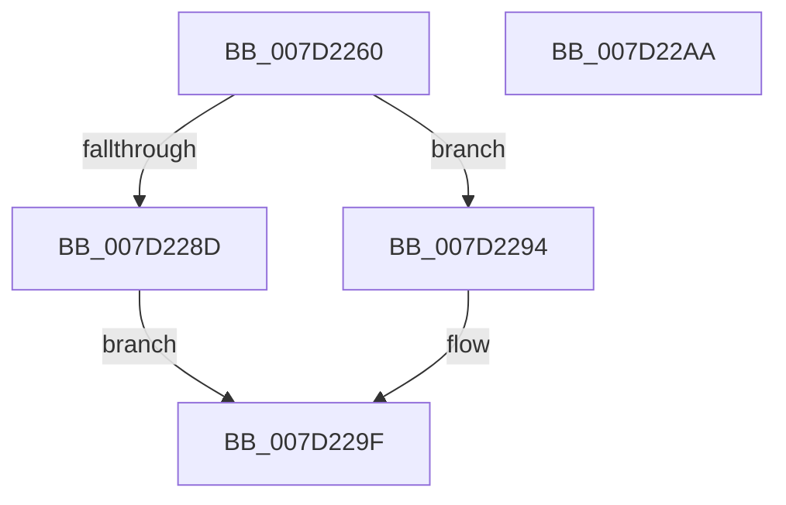

# NtSetIntervalProfile

- RVA: `0x007D2260`–`0x007D22AB` (길이 `75` bytes)
- VA: `0x00000001407D2260`
- 실행 섹션: `PAGE`
- PDB 이름 있음: `예`; PDB Function 태그: `아니요`
- unwind 정보 RVA: `0x0005CAAC`
- 디코드: `22`개 명령, `75/75` bytes 표시
- 미해석 바이트: `0` (있으면 어셈블리에 `.byte`로 보존)

> 이 문서는 커널 이미지의 기계어와 PDB 기호를 분석해 생성했습니다. 4번과 5번은 함수 원형과 자료형을 바이너리 사용 방식에서 추정한 C 해석이며 원본 소스 복구 결과는 아닙니다.

## 1. Dependencies

- 직접 호출 지점: **2**; 고유 호출 대상: **2**
- 직접 호출자로 확인된 함수: **1**
- RIP 상대 이미지 참조: **1**

### Outgoing calls
- `0x007D2284` → [SeSinglePrivilegeCheck](../87/SeSinglePrivilegeCheck_function_00871E20.md) (function, `0x00871E20`)
- `0x007D2298` → [KeSetIntervalProfile](../AD/KeSetIntervalProfile_function_00ADB5A8.md) (function, `0x00ADB5A8`)

### Direct callers
- [sub_00B3C988](../B3/Unknown_function_00B3C988.md) at `0x00B3CB77`

### Static image references
- `0x007D2277` → RVA `0x00FD9B48` (`PAGEDATA`; read)

## 2. Other-region calls and transfers

- 다른 실행 섹션으로 향하는 call: **0**
- 별도 외부 분기/꼬리 이동을 확인하지 못했습니다.

## 3. Assembly (complete function range)

```asm
007D2260  48 89 5C 24 08                  mov qword ptr [rsp + 8], rbx
007D2265  57                              push rdi
007D2266  48 83 EC 20                     sub rsp, 0x20
007D226A  65 48 8B 04 25 88 01 00 00      mov rax, qword ptr gs:[0x188]
007D2273  8B DA                           mov ebx, edx
007D2275  8B F9                           mov edi, ecx
007D2277  48 8B 0D CA 78 80 00            mov rcx, qword ptr [rip + 0x8078ca]
007D227E  8A 90 32 02 00 00               mov dl, byte ptr [rax + 0x232]
007D2284  E8 97 FB 09 00                  call 0x140871e20
007D2289  84 C0                           test al, al
007D228B  75 07                           jne 0x1407d2294
007D228D  B8 61 00 00 C0                  mov eax, 0xc0000061
007D2292  EB 0B                           jmp 0x1407d229f
007D2294  8B D3                           mov edx, ebx
007D2296  8B CF                           mov ecx, edi
007D2298  E8 0B 93 30 00                  call 0x140adb5a8
007D229D  33 C0                           xor eax, eax
007D229F  48 8B 5C 24 30                  mov rbx, qword ptr [rsp + 0x30]
007D22A4  48 83 C4 20                     add rsp, 0x20
007D22A8  5F                              pop rdi
007D22A9  C3                              ret
007D22AA  CC                              int3
```

## 4. C-style interpretation (structured pseudocode)

```c
__int64 __fastcall NtSetIntervalProfile(int a1, int a2)
{
    __int64 result;
    __int64 v_rsp;
    unsigned __int64 v_stack_p8;

    v_stack_p8 = v_rbx;
    v_rsp = (v_rsp) - (32);
    result = SeSinglePrivilegeCheck(*(unsigned __int64 *)(v_rip + 8419530), *(unsigned __int8 *)(*(unsigned __int64 *)(gs_base + (0 + 392)) + 562), a3, a4);
    if ((unsigned __int8)(result) != 0) goto loc_007D2294;
    goto loc_007D229F;
loc_007D2294:
    result = KeSetIntervalProfile((unsigned int)((unsigned int)((unsigned int)(a1))), (unsigned int)((unsigned int)((unsigned int)(a2))), a3, a4);
    result = 0;
loc_007D229F:
    v_rsp = (v_rsp) + (32);
    return result;
}
```

## 5. (Beta) C Style

```c
int64_t NtSetIntervalProfile(int32_t Arg1, int32_t Arg2)
{
    int64_t result;
    int64_t local_rsp;
    uint64_t v_stack_p8;

    v_stack_p8 = local_rbx;
    local_rsp = (local_rsp) - (32);
    result = SeSinglePrivilegeCheck(*(uint64_t *)(v_rip + 0x8078CA), *(uint8_t *)(*(uint64_t *)(gs_base + (0 + 0x188)) + 0x232), a3, a4);
    if ((uint8_t)(result) != 0) goto loc_007D2294;
    goto loc_007D229F;
loc_007D2294:
    result = KeSetIntervalProfile((uint32_t)((uint32_t)((uint32_t)(Arg1))), (uint32_t)((uint32_t)((uint32_t)(Arg2))), a3, a4);
    result = 0;
loc_007D229F:
    local_rsp = (local_rsp) + (32);
    return result;
}
```

## 6. Execution-region graph

[열기: 2D/3D 그래프와 함수 탐색 컨트롤 패널](../../../control-panel.html?section=page&rva=0x007D2260&view=graph)

- 2D 그래프는 위에서 아래로 흐르고, 3D 그래프는 빈 공간을 드래그해 회전합니다. Shift+드래그는 이동, 휠은 확대·축소, 함수 노드 선택은 대상 보고서 이동입니다.

### Static fallback


