# NtSetUuidSeed

- RVA: `0x007D0DD0`–`0x007D1176` (길이 `934` bytes)
- VA: `0x00000001407D0DD0`
- 실행 섹션: `PAGE`
- PDB 이름 있음: `예`; PDB Function 태그: `아니요`
- unwind 정보 RVA: `0x000D56BC`
- 디코드: `221`개 명령, `934/934` bytes 표시
- 미해석 바이트: `0` (있으면 어셈블리에 `.byte`로 보존)

> 이 문서는 커널 이미지의 기계어와 PDB 기호를 분석해 생성했습니다. 4번과 5번은 함수 원형과 자료형을 바이너리 사용 방식에서 추정한 C 해석이며 원본 소스 복구 결과는 아닙니다.

## 1. Dependencies

- 직접 호출 지점: **29**; 고유 호출 대상: **20**
- 직접 호출자로 확인된 함수: **0**
- RIP 상대 이미지 참조: **7**

### Outgoing calls
- `0x007D0E78` → [SeCaptureSubjectContext](../86/SeCaptureSubjectContext_function_0086B820.md) (function, `0x0086B820`)
- `0x007D0E85` → [RtlLengthRequiredSid](../9C/RtlLengthRequiredSid_function_009CA4D0.md) (function, `0x009CA4D0`)
- `0x007D0E9E` → [ExAllocatePool2](../../poolcode/B8/ExAllocatePool2_function_00B820F0.md) (function, `0x00B820F0`)
- `0x007D0EB5` → [RtlRaiseStatus](../../text/2F/RtlRaiseStatus_function_002F6A50.md) (function, `0x002F6A50`)
- `0x007D0EC5` → [RtlInitializeSid](../9E/RtlInitializeSid_function_009EB720.md) (function, `0x009EB720`)
- `0x007D0ED4` → [RtlRaiseStatus](../../text/2F/RtlRaiseStatus_function_002F6A50.md) (function, `0x002F6A50`)
- `0x007D0EF2` → [RtlSubAuthoritySid](../../text/45/RtlSubAuthoritySid_function_00456D10.md) (function, `0x00456D10`)
- `0x007D0F01` → [RtlLengthSid](../../text/45/RtlLengthSid_function_0045D270.md) (function, `0x0045D270`)
- `0x007D0F1D` → [ExAllocatePool2](../../poolcode/B8/ExAllocatePool2_function_00B820F0.md) (function, `0x00B820F0`)
- `0x007D0F37` → [RtlRaiseStatus](../../text/2F/RtlRaiseStatus_function_002F6A50.md) (function, `0x002F6A50`)
- `0x007D0F47` → [RtlCreateAcl](../91/RtlCreateAcl_function_00916F00.md) (function, `0x00916F00`)
- `0x007D0F56` → [RtlRaiseStatus](../../text/2F/RtlRaiseStatus_function_002F6A50.md) (function, `0x002F6A50`)
- `0x007D0F75` → [RtlpAddKnownAce](../92/RtlpAddKnownAce_function_00929A20.md) (function, `0x00929A20`)
- `0x007D0F8B` → [RtlRaiseStatus](../../text/2F/RtlRaiseStatus_function_002F6A50.md) (function, `0x002F6A50`)
- `0x007D0F9D` → [RtlCreateSecurityDescriptor](../9F/RtlCreateSecurityDescriptor_function_009F1DF0.md) (function, `0x009F1DF0`)
- `0x007D0FAC` → [RtlRaiseStatus](../../text/2F/RtlRaiseStatus_function_002F6A50.md) (function, `0x002F6A50`)
- `0x007D0FC1` → [RtlSetDaclSecurityDescriptor](../9E/RtlSetDaclSecurityDescriptor_function_009EC210.md) (function, `0x009EC210`)
- `0x007D0FD0` → [RtlRaiseStatus](../../text/2F/RtlRaiseStatus_function_002F6A50.md) (function, `0x002F6A50`)
- `0x007D101C` → [SeAccessCheck](../../text/3A/SeAccessCheck_function_003A6BC0.md) (function, `0x003A6BC0`)
- `0x007D102E` → [RtlRaiseStatus](../../text/2F/RtlRaiseStatus_function_002F6A50.md) (function, `0x002F6A50`)
- `0x007D1072` → [ExFreePoolWithTag](../../poolcode/B8/ExFreePoolWithTag_function_00B82870.md) (function, `0x00B82870`)
- `0x007D1086` → [ExFreePoolWithTag](../../poolcode/B8/ExFreePoolWithTag_function_00B82870.md) (function, `0x00B82870`)
- `0x007D10BA` → [KeAbPreAcquire](../../text/21/KeAbPreAcquire_function_00210230.md) (function, `0x00210230`)
- `0x007D10D4` → [ExfAcquirePushLockExclusiveEx](../../text/20/ExfAcquirePushLockExclusiveEx_function_0020FC90.md) (function, `0x0020FC90`)
- `0x007D111A` → [ExfTryToWakePushLock](../../text/26/ExfTryToWakePushLock_function_00265DD0.md) (function, `0x00265DD0`)
- `0x007D1122` → [KeAbPostRelease](../../text/2E/KeAbPostRelease_function_002E1600.md) (function, `0x002E1600`)
- `0x007D112A` → [KiLeaveCriticalRegionUnsafe](../../text/25/KiLeaveCriticalRegionUnsafe_function_0025F010.md) (function, `0x0025F010`)
- `0x007D113E` → [SeReleaseSubjectContext](../86/SeReleaseSubjectContext_function_0086B710.md) (function, `0x0086B710`)
- `0x007D1152` → [_security_check_cookie](../../text/6A/_security_check_cookie_function_006AC640.md) (function, `0x006AC640`)

### Direct callers
- 이 함수 시작 RVA로 연결되는 직접 call은 확인되지 않았습니다. 간접 호출은 완전히 역산할 수 없습니다.

### Static image references
- `0x007D0DEC` → RVA `0x00E0A740` (`.data`; read)
- `0x007D0FEE` → RVA `0x00039500` (`.rdata`; read)
- `0x007D10B0` → RVA `0x00E685D8` (`.data`; read)
- `0x007D10E6` → RVA `0x00FD825E` (`PAGEDATA`; write)
- `0x007D10F1` → RVA `0x00FD8262` (`PAGEDATA`; write)
- `0x007D1100` → RVA `0x00FD8007` (`PAGEDATA`; write)
- `0x007D1106` → RVA `0x00E685D8` (`.data`; read/write)

## 2. Other-region calls and transfers

- 다른 실행 섹션으로 향하는 call: **21**
  - `0x007D0E9E` → [ExAllocatePool2](../../poolcode/B8/ExAllocatePool2_function_00B820F0.md) (`PAGE` → `POOLCODE`)
  - `0x007D0EB5` → [RtlRaiseStatus](../../text/2F/RtlRaiseStatus_function_002F6A50.md) (`PAGE` → `.text`)
  - `0x007D0ED4` → [RtlRaiseStatus](../../text/2F/RtlRaiseStatus_function_002F6A50.md) (`PAGE` → `.text`)
  - `0x007D0EF2` → [RtlSubAuthoritySid](../../text/45/RtlSubAuthoritySid_function_00456D10.md) (`PAGE` → `.text`)
  - `0x007D0F01` → [RtlLengthSid](../../text/45/RtlLengthSid_function_0045D270.md) (`PAGE` → `.text`)
  - `0x007D0F1D` → [ExAllocatePool2](../../poolcode/B8/ExAllocatePool2_function_00B820F0.md) (`PAGE` → `POOLCODE`)
  - `0x007D0F37` → [RtlRaiseStatus](../../text/2F/RtlRaiseStatus_function_002F6A50.md) (`PAGE` → `.text`)
  - `0x007D0F56` → [RtlRaiseStatus](../../text/2F/RtlRaiseStatus_function_002F6A50.md) (`PAGE` → `.text`)
  - `0x007D0F8B` → [RtlRaiseStatus](../../text/2F/RtlRaiseStatus_function_002F6A50.md) (`PAGE` → `.text`)
  - `0x007D0FAC` → [RtlRaiseStatus](../../text/2F/RtlRaiseStatus_function_002F6A50.md) (`PAGE` → `.text`)
  - `0x007D0FD0` → [RtlRaiseStatus](../../text/2F/RtlRaiseStatus_function_002F6A50.md) (`PAGE` → `.text`)
  - `0x007D101C` → [SeAccessCheck](../../text/3A/SeAccessCheck_function_003A6BC0.md) (`PAGE` → `.text`)
  - `0x007D102E` → [RtlRaiseStatus](../../text/2F/RtlRaiseStatus_function_002F6A50.md) (`PAGE` → `.text`)
  - `0x007D1072` → [ExFreePoolWithTag](../../poolcode/B8/ExFreePoolWithTag_function_00B82870.md) (`PAGE` → `POOLCODE`)
  - `0x007D1086` → [ExFreePoolWithTag](../../poolcode/B8/ExFreePoolWithTag_function_00B82870.md) (`PAGE` → `POOLCODE`)
  - `0x007D10BA` → [KeAbPreAcquire](../../text/21/KeAbPreAcquire_function_00210230.md) (`PAGE` → `.text`)
  - `0x007D10D4` → [ExfAcquirePushLockExclusiveEx](../../text/20/ExfAcquirePushLockExclusiveEx_function_0020FC90.md) (`PAGE` → `.text`)
  - `0x007D111A` → [ExfTryToWakePushLock](../../text/26/ExfTryToWakePushLock_function_00265DD0.md) (`PAGE` → `.text`)
  - `0x007D1122` → [KeAbPostRelease](../../text/2E/KeAbPostRelease_function_002E1600.md) (`PAGE` → `.text`)
  - `0x007D112A` → [KiLeaveCriticalRegionUnsafe](../../text/25/KiLeaveCriticalRegionUnsafe_function_0025F010.md) (`PAGE` → `.text`)
  - `0x007D1152` → [_security_check_cookie](../../text/6A/_security_check_cookie_function_006AC640.md) (`PAGE` → `.text`)
- 별도 외부 분기/꼬리 이동을 확인하지 못했습니다.

## 3. Assembly (complete function range)

```asm
007D0DD0  4C 8B DC                        mov r11, rsp
007D0DD3  49 89 5B 08                     mov qword ptr [r11 + 8], rbx
007D0DD7  49 89 73 10                     mov qword ptr [r11 + 0x10], rsi
007D0DDB  49 89 7B 18                     mov qword ptr [r11 + 0x18], rdi
007D0DDF  4D 89 63 20                     mov qword ptr [r11 + 0x20], r12
007D0DE3  41 57                           push r15
007D0DE5  48 81 EC 00 01 00 00            sub rsp, 0x100
007D0DEC  48 8B 05 4D 99 63 00            mov rax, qword ptr [rip + 0x63994d]
007D0DF3  48 33 C4                        xor rax, rsp
007D0DF6  48 89 84 24 F8 00 00 00         mov qword ptr [rsp + 0xf8], rax
007D0DFE  4C 8B E1                        mov r12, rcx
007D0E01  33 FF                           xor edi, edi
007D0E03  89 7C 24 54                     mov dword ptr [rsp + 0x54], edi
007D0E07  0F 57 C0                        xorps xmm0, xmm0
007D0E0A  41 0F 11 43 90                  movups xmmword ptr [r11 - 0x70], xmm0
007D0E0F  41 0F 11 43 A0                  movups xmmword ptr [r11 - 0x60], xmm0
007D0E14  41 C7 43 D8 50 00 00 00         mov dword ptr [r11 - 0x28], 0x50
007D0E1C  41 C7 43 DC C6 C0 12 1F         mov dword ptr [r11 - 0x24], 0x1f12c0c6
007D0E24  41 C7 43 E0 46 13 01 36         mov dword ptr [r11 - 0x20], 0x36011346
007D0E2C  41 C7 43 E4 03 CE 5A E6         mov dword ptr [r11 - 0x1c], 0xe65ace03
007D0E34  41 C7 43 E8 38 EA E7 5A         mov dword ptr [r11 - 0x18], 0x5ae7ea38
007D0E3C  41 C7 43 EC 62 80 B5 CD         mov dword ptr [r11 - 0x14], 0xcdb58062
007D0E44  48 89 7C 24 78                  mov qword ptr [rsp + 0x78], rdi
007D0E49  89 7C 24 58                     mov dword ptr [rsp + 0x58], edi
007D0E4D  66 C7 44 24 5C 00 05            mov word ptr [rsp + 0x5c], 0x500
007D0E54  40 88 7C 24 50                  mov byte ptr [rsp + 0x50], dil
007D0E59  89 7C 24 70                     mov dword ptr [rsp + 0x70], edi
007D0E5D  33 C0                           xor eax, eax
007D0E5F  41 0F 11 43 B0                  movups xmmword ptr [r11 - 0x50], xmm0
007D0E64  41 0F 11 43 C0                  movups xmmword ptr [r11 - 0x40], xmm0
007D0E69  49 89 43 D0                     mov qword ptr [r11 - 0x30], rax
007D0E6D  49 89 BB 78 FF FF FF            mov qword ptr [r11 - 0x88], rdi
007D0E74  49 8D 4B 90                     lea rcx, [r11 - 0x70]
007D0E78  E8 A3 A9 09 00                  call 0x14086b820
007D0E7D  C6 44 24 50 01                  mov byte ptr [rsp + 0x50], 1
007D0E82  8D 4F 06                        lea ecx, [rdi + 6]
007D0E85  E8 46 96 1F 00                  call 0x1409ca4d0
007D0E8A  89 84 24 88 00 00 00            mov dword ptr [rsp + 0x88], eax
007D0E91  8B D0                           mov edx, eax
007D0E93  B9 00 01 00 00                  mov ecx, 0x100
007D0E98  41 B8 55 55 69 64               mov r8d, 0x64695555
007D0E9E  E8 4D 12 3B 00                  call 0x140b820f0
007D0EA3  4C 8B F8                        mov r15, rax
007D0EA6  48 89 44 24 78                  mov qword ptr [rsp + 0x78], rax
007D0EAB  48 85 C0                        test rax, rax
007D0EAE  75 0A                           jne 0x1407d0eba
007D0EB0  B9 9A 00 00 C0                  mov ecx, 0xc000009a
007D0EB5  E8 96 5B B2 FF                  call 0x1402f6a50
007D0EBA  41 B0 06                        mov r8b, 6
007D0EBD  48 8D 54 24 58                  lea rdx, [rsp + 0x58]
007D0EC2  49 8B CF                        mov rcx, r15
007D0EC5  E8 56 A8 21 00                  call 0x1409eb720
007D0ECA  89 44 24 54                     mov dword ptr [rsp + 0x54], eax
007D0ECE  85 C0                           test eax, eax
007D0ED0  79 07                           jns 0x1407d0ed9
007D0ED2  8B C8                           mov ecx, eax
007D0ED4  E8 77 5B B2 FF                  call 0x1402f6a50
007D0ED9  8B F7                           mov esi, edi
007D0EDB  89 7C 24 6C                     mov dword ptr [rsp + 0x6c], edi
007D0EDF  49 8B CF                        mov rcx, r15
007D0EE2  83 FE 06                        cmp esi, 6
007D0EE5  73 1A                           jae 0x1407d0f01
007D0EE7  8B C6                           mov eax, esi
007D0EE9  8B 9C 84 E0 00 00 00            mov ebx, dword ptr [rsp + rax*4 + 0xe0]
007D0EF0  8B D6                           mov edx, esi
007D0EF2  E8 19 5E C8 FF                  call 0x140456d10
007D0EF7  89 18                           mov dword ptr [rax], ebx
007D0EF9  FF C6                           inc esi
007D0EFB  89 74 24 6C                     mov dword ptr [rsp + 0x6c], esi
007D0EFF  EB DE                           jmp 0x1407d0edf
007D0F01  E8 6A C3 C8 FF                  call 0x14045d270
007D0F06  8D 70 14                        lea esi, [rax + 0x14]
007D0F09  89 B4 24 8C 00 00 00            mov dword ptr [rsp + 0x8c], esi
007D0F10  8B D6                           mov edx, esi
007D0F12  B9 00 01 00 00                  mov ecx, 0x100
007D0F17  41 B8 55 55 69 64               mov r8d, 0x64695555
007D0F1D  E8 CE 11 3B 00                  call 0x140b820f0
007D0F22  48 8B D8                        mov rbx, rax
007D0F25  48 89 84 24 80 00 00 00         mov qword ptr [rsp + 0x80], rax
007D0F2D  48 85 C0                        test rax, rax
007D0F30  75 0A                           jne 0x1407d0f3c
007D0F32  B9 9A 00 00 C0                  mov ecx, 0xc000009a
007D0F37  E8 14 5B B2 FF                  call 0x1402f6a50
007D0F3C  41 B8 02 00 00 00               mov r8d, 2
007D0F42  8B D6                           mov edx, esi
007D0F44  48 8B CB                        mov rcx, rbx
007D0F47  E8 B4 5F 14 00                  call 0x140916f00
007D0F4C  89 44 24 54                     mov dword ptr [rsp + 0x54], eax
007D0F50  85 C0                           test eax, eax
007D0F52  79 07                           jns 0x1407d0f5b
007D0F54  8B C8                           mov ecx, eax
007D0F56  E8 F5 5A B2 FF                  call 0x1402f6a50
007D0F5B  40 88 7C 24 28                  mov byte ptr [rsp + 0x28], dil
007D0F60  4C 89 7C 24 20                  mov qword ptr [rsp + 0x20], r15
007D0F65  41 B9 01 00 00 00               mov r9d, 1
007D0F6B  45 33 C0                        xor r8d, r8d
007D0F6E  41 8D 51 01                     lea edx, [r9 + 1]
007D0F72  48 8B CB                        mov rcx, rbx
007D0F75  E8 A6 8A 15 00                  call 0x140929a20
007D0F7A  89 84 24 90 00 00 00            mov dword ptr [rsp + 0x90], eax
007D0F81  89 44 24 54                     mov dword ptr [rsp + 0x54], eax
007D0F85  85 C0                           test eax, eax
007D0F87  79 07                           jns 0x1407d0f90
007D0F89  8B C8                           mov ecx, eax
007D0F8B  E8 C0 5A B2 FF                  call 0x1402f6a50
007D0F90  BA 01 00 00 00                  mov edx, 1
007D0F95  48 8D 8C 24 B8 00 00 00         lea rcx, [rsp + 0xb8]
007D0F9D  E8 4E 0E 22 00                  call 0x1409f1df0
007D0FA2  89 44 24 54                     mov dword ptr [rsp + 0x54], eax
007D0FA6  85 C0                           test eax, eax
007D0FA8  79 07                           jns 0x1407d0fb1
007D0FAA  8B C8                           mov ecx, eax
007D0FAC  E8 9F 5A B2 FF                  call 0x1402f6a50
007D0FB1  45 33 C9                        xor r9d, r9d
007D0FB4  4C 8B C3                        mov r8, rbx
007D0FB7  B2 01                           mov dl, 1
007D0FB9  48 8D 8C 24 B8 00 00 00         lea rcx, [rsp + 0xb8]
007D0FC1  E8 4A B2 21 00                  call 0x1409ec210
007D0FC6  89 44 24 54                     mov dword ptr [rsp + 0x54], eax
007D0FCA  85 C0                           test eax, eax
007D0FCC  79 07                           jns 0x1407d0fd5
007D0FCE  8B C8                           mov ecx, eax
007D0FD0  E8 7B 5A B2 FF                  call 0x1402f6a50
007D0FD5  48 8D 44 24 54                  lea rax, [rsp + 0x54]
007D0FDA  48 89 44 24 48                  mov qword ptr [rsp + 0x48], rax
007D0FDF  48 8D 44 24 70                  lea rax, [rsp + 0x70]
007D0FE4  48 89 44 24 40                  mov qword ptr [rsp + 0x40], rax
007D0FE9  C6 44 24 38 01                  mov byte ptr [rsp + 0x38], 1
007D0FEE  48 8D 05 0B 85 86 FF            lea rax, [rip - 0x797af5]
007D0FF5  48 89 44 24 30                  mov qword ptr [rsp + 0x30], rax
007D0FFA  48 89 7C 24 28                  mov qword ptr [rsp + 0x28], rdi
007D0FFF  89 7C 24 20                     mov dword ptr [rsp + 0x20], edi
007D1003  41 B9 01 00 00 00               mov r9d, 1
007D1009  45 33 C0                        xor r8d, r8d
007D100C  48 8D 94 24 98 00 00 00         lea rdx, [rsp + 0x98]
007D1014  48 8D 8C 24 B8 00 00 00         lea rcx, [rsp + 0xb8]
007D101C  E8 9F 5B BD FF                  call 0x1403a6bc0
007D1021  88 44 24 60                     mov byte ptr [rsp + 0x60], al
007D1025  84 C0                           test al, al
007D1027  75 0A                           jne 0x1407d1033
007D1029  B9 22 00 00 C0                  mov ecx, 0xc0000022
007D102E  E8 1D 5A B2 FF                  call 0x1402f6a50
007D1033  48 B8 00 00 FF FF FF 7F 00 00   movabs rax, 0x7fffffff0000
007D103D  4C 3B E0                        cmp r12, rax
007D1040  49 0F 42 C4                     cmovb rax, r12
007D1044  90                              nop
007D1045  8A 00                           mov al, byte ptr [rax]
007D1047  41 8B 04 24                     mov eax, dword ptr [r12]
007D104B  89 44 24 64                     mov dword ptr [rsp + 0x64], eax
007D104F  41 0F B7 44 24 04               movzx eax, word ptr [r12 + 4]
007D1055  66 89 44 24 68                  mov word ptr [rsp + 0x68], ax
007D105A  89 7C 24 54                     mov dword ptr [rsp + 0x54], edi
007D105E  EB 06                           jmp 0x1407d1066
007D1060  89 44 24 54                     mov dword ptr [rsp + 0x54], eax
007D1064  33 FF                           xor edi, edi
007D1066  48 8B 4C 24 78                  mov rcx, qword ptr [rsp + 0x78]
007D106B  48 85 C9                        test rcx, rcx
007D106E  74 07                           je 0x1407d1077
007D1070  33 D2                           xor edx, edx
007D1072  E8 F9 17 3B 00                  call 0x140b82870
007D1077  48 8B 8C 24 80 00 00 00         mov rcx, qword ptr [rsp + 0x80]
007D107F  48 85 C9                        test rcx, rcx
007D1082  74 07                           je 0x1407d108b
007D1084  33 D2                           xor edx, edx
007D1086  E8 E5 17 3B 00                  call 0x140b82870
007D108B  39 7C 24 54                     cmp dword ptr [rsp + 0x54], edi
007D108F  0F 85 9A 00 00 00               jne 0x1407d112f
007D1095  65 4C 8B 3C 25 88 01 00 00      mov r15, qword ptr gs:[0x188]
007D109E  48 83 CB FF                     or rbx, 0xffffffffffffffff
007D10A2  66 41 01 9F E4 01 00 00         add word ptr [r15 + 0x1e4], bx
007D10AA  90                              nop
007D10AB  45 33 C0                        xor r8d, r8d
007D10AE  33 D2                           xor edx, edx
007D10B0  4C 8D 25 21 75 69 00            lea r12, [rip + 0x697521]
007D10B7  49 8B CC                        mov rcx, r12
007D10BA  E8 71 F1 A3 FF                  call 0x140210230
007D10BF  48 8B F0                        mov rsi, rax
007D10C2  F0 49 0F BA 2C 24 00            lock bts qword ptr [r12], 0
007D10C9  73 0E                           jae 0x1407d10d9
007D10CB  4D 8B C4                        mov r8, r12
007D10CE  48 8B D0                        mov rdx, rax
007D10D1  49 8B CC                        mov rcx, r12
007D10D4  E8 B7 EB A3 FF                  call 0x14020fc90
007D10D9  48 85 F6                        test rsi, rsi
007D10DC  74 04                           je 0x1407d10e2
007D10DE  C6 46 0A 01                     mov byte ptr [rsi + 0xa], 1
007D10E2  8B 54 24 64                     mov edx, dword ptr [rsp + 0x64]
007D10E6  89 15 72 71 80 00               mov dword ptr [rip + 0x807172], edx
007D10EC  0F B7 44 24 68                  movzx eax, word ptr [rsp + 0x68]
007D10F1  66 89 05 6A 71 80 00            mov word ptr [rip + 0x80716a], ax
007D10F8  C0 EA 07                        shr dl, 7
007D10FB  F6 D2                           not dl
007D10FD  80 E2 01                        and dl, 1
007D1100  88 15 01 6F 80 00               mov byte ptr [rip + 0x806f01], dl
007D1106  F0 48 0F C1 1D C9 74 69 00      lock xadd qword ptr [rip + 0x6974c9], rbx
007D110F  80 E3 06                        and bl, 6
007D1112  80 FB 02                        cmp bl, 2
007D1115  75 08                           jne 0x1407d111f
007D1117  49 8B CC                        mov rcx, r12
007D111A  E8 B1 4C A9 FF                  call 0x140265dd0
007D111F  49 8B CC                        mov rcx, r12
007D1122  E8 D9 04 B1 FF                  call 0x1402e1600
007D1127  49 8B CF                        mov rcx, r15
007D112A  E8 E1 DE A8 FF                  call 0x14025f010
007D112F  40 38 7C 24 50                  cmp byte ptr [rsp + 0x50], dil
007D1134  74 0D                           je 0x1407d1143
007D1136  48 8D 8C 24 98 00 00 00         lea rcx, [rsp + 0x98]
007D113E  E8 CD A5 09 00                  call 0x14086b710
007D1143  8B 44 24 54                     mov eax, dword ptr [rsp + 0x54]
007D1147  48 8B 8C 24 F8 00 00 00         mov rcx, qword ptr [rsp + 0xf8]
007D114F  48 33 CC                        xor rcx, rsp
007D1152  E8 E9 B4 ED FF                  call 0x1406ac640
007D1157  4C 8D 9C 24 00 01 00 00         lea r11, [rsp + 0x100]
007D115F  49 8B 5B 10                     mov rbx, qword ptr [r11 + 0x10]
007D1163  49 8B 73 18                     mov rsi, qword ptr [r11 + 0x18]
007D1167  49 8B 7B 20                     mov rdi, qword ptr [r11 + 0x20]
007D116B  4D 8B 63 28                     mov r12, qword ptr [r11 + 0x28]
007D116F  49 8B E3                        mov rsp, r11
007D1172  41 5F                           pop r15
007D1174  C3                              ret
007D1175  CC                              int3
```

## 4. C-style interpretation (structured pseudocode)

```c
__int64 __fastcall NtSetUuidSeed(__int64 a1)
{
    __int64 result;
    __int64 v_rbx;
    __int64 v_rdi;
    __int64 v_rsi;
    __int64 v_rsp;
    unsigned __int64 v_stack_m10;
    unsigned __int64 v_stack_m50;
    unsigned __int64 v_stack_m70;
    unsigned int v_stack_m78;
    unsigned int v_stack_m7C;
    unsigned __int64 v_stack_m8;
    unsigned int v_stack_m80;
    unsigned __int64 v_stack_m88;
    unsigned __int64 v_stack_m90;
    unsigned int v_stack_m98;
    unsigned int v_stack_m9C;
    unsigned __int16 v_stack_mA0;
    unsigned int v_stack_mA4;
    unsigned __int8 v_stack_mA8;
    unsigned __int16 v_stack_mAC;
    unsigned int v_stack_mB0;
    unsigned int v_stack_mB4;
    unsigned __int8 v_stack_mB8;
    unsigned __int64 v_stack_mC0;
    unsigned __int64 v_stack_mC8;
    unsigned __int8 v_stack_mD0;
    unsigned __int64 v_stack_mD8;
    unsigned __int8 v_stack_mE0;
    unsigned __int64 v_stack_mE8;

    *(unsigned __int64 *)(v_rsp + 8) = v_rbx;
    *(unsigned __int64 *)(v_rsp + 16) = v_rsi;
    *(unsigned __int64 *)(v_rsp + 24) = v_rdi;
    *(unsigned __int64 *)(v_rsp + 32) = v_r12;
    v_rsp = (v_rsp) - (256);
    result = (*(unsigned __int64 *)(v_rip + 6527309)) ^ (v_rsp);
    v_stack_m10 = result;
    v_rdi = 0;
    v_stack_mB4 = 0;
    *(unsigned __int64 *)(v_rsp - 112) = v_xmm0;
    *(unsigned __int64 *)(v_rsp - 96) = v_xmm0;
    *(unsigned int *)(v_rsp - 40) = 80;
    *(unsigned int *)(v_rsp - 36) = 0x1F12C0C6ULL;
    *(unsigned int *)(v_rsp - 32) = 0x36011346ULL;
    *(unsigned int *)(v_rsp - 28) = 0xE65ACE03ULL;
    *(unsigned int *)(v_rsp - 24) = 0x5AE7EA38ULL;
    *(unsigned int *)(v_rsp - 20) = 0xCDB58062ULL;
    v_stack_m90 = 0;
    v_stack_mB0 = 0;
    v_stack_mAC = 0x500ULL;
    v_stack_mB8 = 0;
    v_stack_m98 = 0;
    result = 0;
    *(unsigned __int64 *)(v_rsp - 80) = v_xmm0;
    *(unsigned __int64 *)(v_rsp - 64) = v_xmm0;
    *(unsigned __int64 *)(v_rsp - 48) = 0;
    *(unsigned __int64 *)(v_rsp - 136) = 0;
    result = SeCaptureSubjectContext(v_rsp - 112, a2, a3, a4);
    v_stack_mB8 = 1;
    result = RtlLengthRequiredSid(v_rdi + 6, a2, a3, a4);
    v_stack_m80 = (unsigned int)(result);
    result = ExAllocatePool2(256, (unsigned int)((unsigned int)(result)), (unsigned int)(0x64695555ULL), a4);
    v_stack_m90 = result;
    if (result == 0) {
        a1 = 0xC000009AULL;
        result = RtlRaiseStatus(a1, (unsigned int)((unsigned int)(result)), (unsigned int)(0x64695555ULL), a4);
    }
    result = RtlInitializeSid(result, v_stack_mB0, 6, a4);
    v_stack_mB4 = (unsigned int)(result);
    if (sign_flag) {
        a1 = (unsigned int)(result);
        result = RtlRaiseStatus(a1, v_stack_mB0, 6, a4);
    }
    v_stack_m9C = 0;
loc_007D0EDF:
    if (0 >= 6) goto loc_007D0F01;
    result = RtlSubAuthoritySid(result, 0, 6, a4);
    *(unsigned int *)(result) = (unsigned int)((unsigned int)(*(unsigned int *)(v_rsp + 0 * 4 + 224)));
    v_rsi = (unsigned int)((0) + 1);
    v_stack_m9C = (unsigned int)(v_rsi);
    goto loc_007D0EDF;
loc_007D0F01:
    result = RtlLengthSid(result, 0, 6, a4);
    v_stack_m7C = (unsigned int)(result + 20);
    result = ExAllocatePool2(256, (unsigned int)((unsigned int)(result + 20)), (unsigned int)(0x64695555ULL), a4);
    v_stack_m88 = result;
    if (result == 0) {
        a1 = 0xC000009AULL;
        result = RtlRaiseStatus(a1, (unsigned int)((unsigned int)(result + 20)), (unsigned int)(0x64695555ULL), a4);
    }
    result = RtlCreateAcl(result, (unsigned int)((unsigned int)(result + 20)), 2, a4);
    v_stack_mB4 = (unsigned int)(result);
    if (sign_flag) {
        a1 = (unsigned int)(result);
        result = RtlRaiseStatus(a1, (unsigned int)((unsigned int)(result + 20)), 2, a4);
    }
    v_stack_mE0 = 0;
    v_stack_mE8 = result;
    a3 = 0;
    result = RtlpAddKnownAce(result, 1 + 1, a3, 1);
    v_stack_m78 = (unsigned int)(result);
    v_stack_mB4 = (unsigned int)(result);
    if (sign_flag) {
        a1 = (unsigned int)(result);
        result = RtlRaiseStatus(a1, 1 + 1, a3, 1);
    }
    result = RtlCreateSecurityDescriptor(v_stack_m50, 1, a3, 1);
    v_stack_mB4 = (unsigned int)(result);
    if (sign_flag) {
        a1 = (unsigned int)(result);
        result = RtlRaiseStatus(a1, 1, a3, 1);
    }
    a4 = 0;
    result = RtlSetDaclSecurityDescriptor(v_stack_m50, 1, result, a4);
    v_stack_mB4 = (unsigned int)(result);
    if (sign_flag) {
        a1 = (unsigned int)(result);
        result = RtlRaiseStatus(a1, 1, result, a4);
    }
    v_stack_mC0 = v_stack_mB4;
    v_stack_mC8 = v_stack_m98;
    v_stack_mD0 = 1;
    v_stack_mD8 = v_rip - 7961333;
    v_stack_mE0 = 0;
    v_stack_mE8 = 0;
    a3 = 0;
    result = SeAccessCheck(v_stack_m50, v_stack_m70, a3, 1);
    v_stack_mA8 = (unsigned __int8)(result);
    if ((unsigned __int8)(result) == 0) {
        a1 = 0xC0000022ULL;
        result = RtlRaiseStatus(a1, v_stack_m70, a3, 1);
    }
    if (a1 < result) { result = a1; }
    v_stack_mA4 = (unsigned int)((unsigned int)(*(unsigned int *)(a1)));
    v_stack_mA0 = (unsigned __int16)(*(unsigned __int16 *)(a1 + 4));
    v_stack_mB4 = 0;
    goto loc_007D1066;
loc_007D1066:
    result = *(unsigned __int16 *)(a1 + 4);
    if (v_stack_m90 != 0) {
        a2 = 0;
        result = ExFreePoolWithTag(v_stack_m90, a2, a3, 1);
    }
    if (v_stack_m88 != 0) {
        a2 = 0;
        result = ExFreePoolWithTag(v_stack_m88, a2, a3, 1);
    }
    if (v_stack_mB4 != 0) goto loc_007D112F;
    v_rbx = (result) | (-1);
    a3 = 0;
    a2 = 0;
    result = KeAbPreAcquire(v_rip + 6911265, a2, a3, 1);
    if (!(condition_is_above_or_equal)) {
        a3 = v_rip + 6911265;
        a2 = result;
        a1 = v_rip + 6911265;
        result = ExfAcquirePushLockExclusiveEx(a1, a2, a3, 1);
    }
    if (result != 0) {
        *(unsigned __int8 *)(result + 10) = 1;
    }
    *(unsigned int *)(v_rip + 8417650) = (unsigned int)((unsigned int)(v_stack_mA4));
    *(unsigned __int16 *)(v_rip + 8417642) = (unsigned __int16)(v_stack_mA0);
    a2 = (unsigned __int8)(((unsigned int)(v_stack_mA4)) >> (7));
    a2 = (unsigned __int8)(~(a2));
    a2 = (unsigned __int8)((a2) & (1));
    *(unsigned __int8 *)(v_rip + 8417025) = (unsigned __int8)(a2);
    v_rbx = (unsigned __int8)((v_rbx) & (6));
    result = v_stack_mA0;
    if (((unsigned __int8)(v_rbx)) == 2) {
        a1 = v_rip + 6911265;
        result = ExfTryToWakePushLock(a1, a2, a3, 1);
    }
    result = KeAbPostRelease(v_rip + 6911265, a2, a3, 1);
    result = KiLeaveCriticalRegionUnsafe(*(unsigned __int64 *)(gs_base + (0 + 392)), a2, a3, 1);
loc_007D112F:
    if (v_stack_mB8 != 0) {
        a1 = v_stack_m70;
        result = SeReleaseSubjectContext(a1, a2, a3, 1);
    }
    a1 = (v_stack_m10) ^ (v_rsp);
    result = _security_check_cookie(a1, a2, a3, 1);
    return result;
}
```

## 5. (Beta) C Style

```c
int64_t NtSetUuidSeed(int64_t Arg1)
{
    int64_t result;
    int64_t local_rbx;
    int64_t local_rdi;
    int64_t local_rsi;
    int64_t local_rsp;
    uint64_t v_stack_m10;
    uint64_t v_stack_m50;
    uint64_t v_stack_m70;
    uint32_t v_stack_m78;
    uint32_t v_stack_m7C;
    uint64_t v_stack_m8;
    uint32_t v_stack_m80;
    uint64_t v_stack_m88;
    uint64_t v_stack_m90;
    uint32_t v_stack_m98;
    uint32_t v_stack_m9C;
    uint16_t v_stack_mA0;
    uint32_t v_stack_mA4;
    uint8_t v_stack_mA8;
    uint16_t v_stack_mAC;
    uint32_t v_stack_mB0;
    uint32_t v_stack_mB4;
    uint8_t v_stack_mB8;
    uint64_t v_stack_mC0;
    uint64_t v_stack_mC8;
    uint8_t v_stack_mD0;
    uint64_t v_stack_mD8;
    uint8_t v_stack_mE0;
    uint64_t v_stack_mE8;

    *(uint64_t *)(local_rsp + 0x8) = local_rbx;
    *(uint64_t *)(local_rsp + 0x10) = local_rsi;
    *(uint64_t *)(local_rsp + 0x18) = local_rdi;
    *(uint64_t *)(local_rsp + 0x20) = local_r12;
    local_rsp = (local_rsp) - (256);
    result = (*(uint64_t *)(v_rip + 0x63994D)) ^ (local_rsp);
    v_stack_m10 = result;
    local_rdi = 0;
    v_stack_mB4 = 0;
    *(uint64_t *)(local_rsp - 0x70) = v_xmm0;
    *(uint64_t *)(local_rsp - 0x60) = v_xmm0;
    *(uint32_t *)(local_rsp - 0x28) = 80;
    *(uint32_t *)(local_rsp - 0x24) = 0x1F12C0C6ULL;
    *(uint32_t *)(local_rsp - 0x20) = 0x36011346ULL;
    *(uint32_t *)(local_rsp - 0x1C) = 0xE65ACE03ULL;
    *(uint32_t *)(local_rsp - 0x18) = 0x5AE7EA38ULL;
    *(uint32_t *)(local_rsp - 0x14) = 0xCDB58062ULL;
    v_stack_m90 = 0;
    v_stack_mB0 = 0;
    v_stack_mAC = 0x500ULL;
    v_stack_mB8 = 0;
    v_stack_m98 = 0;
    result = 0;
    *(uint64_t *)(local_rsp - 0x50) = v_xmm0;
    *(uint64_t *)(local_rsp - 0x40) = v_xmm0;
    *(uint64_t *)(local_rsp - 0x30) = 0;
    *(uint64_t *)(local_rsp - 0x88) = 0;
    result = SeCaptureSubjectContext(local_rsp - 112, a2, a3, a4);
    v_stack_mB8 = 1;
    result = RtlLengthRequiredSid(local_rdi + 6, a2, a3, a4);
    v_stack_m80 = (uint32_t)(result);
    result = ExAllocatePool2(256, (uint32_t)((uint32_t)(result)), (uint32_t)(0x64695555ULL), a4);
    v_stack_m90 = result;
    if (result == 0) {
        Arg1 = 0xC000009AULL;
        result = RtlRaiseStatus(Arg1, (uint32_t)((uint32_t)(result)), (uint32_t)(0x64695555ULL), a4);
    }
    result = RtlInitializeSid(result, v_stack_mB0, 6, a4);
    v_stack_mB4 = (uint32_t)(result);
    if (sign_flag) {
        Arg1 = (uint32_t)(result);
        result = RtlRaiseStatus(Arg1, v_stack_mB0, 6, a4);
    }
    v_stack_m9C = 0;
loc_007D0EDF:
    if (0 >= 6) goto loc_007D0F01;
    result = RtlSubAuthoritySid(result, 0, 6, a4);
    *(uint32_t *)(result) = (uint32_t)((uint32_t)(*(uint32_t *)(local_rsp + 0x0 * 4 + 0xE0)));
    local_rsi = (uint32_t)((0) + 1);
    v_stack_m9C = (uint32_t)(local_rsi);
    goto loc_007D0EDF;
loc_007D0F01:
    result = RtlLengthSid(result, 0, 6, a4);
    v_stack_m7C = (uint32_t)(result + 20);
    result = ExAllocatePool2(256, (uint32_t)((uint32_t)(result + 20)), (uint32_t)(0x64695555ULL), a4);
    v_stack_m88 = result;
    if (result == 0) {
        Arg1 = 0xC000009AULL;
        result = RtlRaiseStatus(Arg1, (uint32_t)((uint32_t)(result + 20)), (uint32_t)(0x64695555ULL), a4);
    }
    result = RtlCreateAcl(result, (uint32_t)((uint32_t)(result + 20)), 2, a4);
    v_stack_mB4 = (uint32_t)(result);
    if (sign_flag) {
        Arg1 = (uint32_t)(result);
        result = RtlRaiseStatus(Arg1, (uint32_t)((uint32_t)(result + 20)), 2, a4);
    }
    v_stack_mE0 = 0;
    v_stack_mE8 = result;
    a3 = 0;
    result = RtlpAddKnownAce(result, 1 + 1, a3, 1);
    v_stack_m78 = (uint32_t)(result);
    v_stack_mB4 = (uint32_t)(result);
    if (sign_flag) {
        Arg1 = (uint32_t)(result);
        result = RtlRaiseStatus(Arg1, 1 + 1, a3, 1);
    }
    result = RtlCreateSecurityDescriptor(v_stack_m50, 1, a3, 1);
    v_stack_mB4 = (uint32_t)(result);
    if (sign_flag) {
        Arg1 = (uint32_t)(result);
        result = RtlRaiseStatus(Arg1, 1, a3, 1);
    }
    a4 = 0;
    result = RtlSetDaclSecurityDescriptor(v_stack_m50, 1, result, a4);
    v_stack_mB4 = (uint32_t)(result);
    if (sign_flag) {
        Arg1 = (uint32_t)(result);
        result = RtlRaiseStatus(Arg1, 1, result, a4);
    }
    v_stack_mC0 = v_stack_mB4;
    v_stack_mC8 = v_stack_m98;
    v_stack_mD0 = 1;
    v_stack_mD8 = v_rip - 7961333;
    v_stack_mE0 = 0;
    v_stack_mE8 = 0;
    a3 = 0;
    result = SeAccessCheck(v_stack_m50, v_stack_m70, a3, 1);
    v_stack_mA8 = (uint8_t)(result);
    if ((uint8_t)(result) == 0) {
        Arg1 = 0xC0000022ULL;
        result = RtlRaiseStatus(Arg1, v_stack_m70, a3, 1);
    }
    if (Arg1 < result) { result = Arg1; }
    v_stack_mA4 = (uint32_t)((uint32_t)(*(uint32_t *)(Arg1)));
    v_stack_mA0 = (uint16_t)(*(uint16_t *)(Arg1 + 0x4));
    v_stack_mB4 = 0;
    goto loc_007D1066;
loc_007D1066:
    result = *(uint16_t *)(Arg1 + 0x4);
    if (v_stack_m90 != 0) {
        a2 = 0;
        result = ExFreePoolWithTag(v_stack_m90, a2, a3, 1);
    }
    if (v_stack_m88 != 0) {
        a2 = 0;
        result = ExFreePoolWithTag(v_stack_m88, a2, a3, 1);
    }
    if (v_stack_mB4 != 0) goto loc_007D112F;
    local_rbx = (result) | (-1);
    a3 = 0;
    a2 = 0;
    result = KeAbPreAcquire(v_rip + 6911265, a2, a3, 1);
    if (!(condition_is_above_or_equal)) {
        a3 = v_rip + 6911265;
        a2 = result;
        Arg1 = v_rip + 6911265;
        result = ExfAcquirePushLockExclusiveEx(Arg1, a2, a3, 1);
    }
    if (result != 0) {
        *(uint8_t *)(result + 0xA) = 1;
    }
    *(uint32_t *)(v_rip + 0x807172) = (uint32_t)((uint32_t)(v_stack_mA4));
    *(uint16_t *)(v_rip + 0x80716A) = (uint16_t)(v_stack_mA0);
    a2 = (uint8_t)(((uint32_t)(v_stack_mA4)) >> (7));
    a2 = (uint8_t)(~(a2));
    a2 = (uint8_t)((a2) & (1));
    *(uint8_t *)(v_rip + 0x806F01) = (uint8_t)(a2);
    local_rbx = (uint8_t)((local_rbx) & (6));
    result = v_stack_mA0;
    if (((uint8_t)(local_rbx)) == 2) {
        Arg1 = v_rip + 6911265;
        result = ExfTryToWakePushLock(Arg1, a2, a3, 1);
    }
    result = KeAbPostRelease(v_rip + 6911265, a2, a3, 1);
    result = KiLeaveCriticalRegionUnsafe(*(uint64_t *)(gs_base + (0 + 0x188)), a2, a3, 1);
loc_007D112F:
    if (v_stack_mB8 != 0) {
        Arg1 = v_stack_m70;
        result = SeReleaseSubjectContext(Arg1, a2, a3, 1);
    }
    Arg1 = (v_stack_m10) ^ (local_rsp);
    result = _security_check_cookie(Arg1, a2, a3, 1);
    return result;
}
```

## 6. Execution-region graph

[열기: 2D/3D 그래프와 함수 탐색 컨트롤 패널](../../../control-panel.html?section=page&rva=0x007D0DD0&view=graph)

- 2D 그래프는 위에서 아래로 흐르고, 3D 그래프는 빈 공간을 드래그해 회전합니다. Shift+드래그는 이동, 휠은 확대·축소, 함수 노드 선택은 대상 보고서 이동입니다.

### Static fallback

```mermaid
flowchart TD
  bb_007D0DD0[BB_007D0DD0]
  bb_007D0EB0[BB_007D0EB0]
  bb_007D0EBA[BB_007D0EBA]
  bb_007D0ED2[BB_007D0ED2]
  bb_007D0ED9[BB_007D0ED9]
  bb_007D0EDF[BB_007D0EDF]
  bb_007D0EE7[BB_007D0EE7]
  bb_007D0F01[BB_007D0F01]
  bb_007D0F32[BB_007D0F32]
  bb_007D0F3C[BB_007D0F3C]
  bb_007D0F54[BB_007D0F54]
  bb_007D0F5B[BB_007D0F5B]
  bb_007D0F89[BB_007D0F89]
  bb_007D0F90[BB_007D0F90]
  bb_007D0FAA[BB_007D0FAA]
  bb_007D0FB1[BB_007D0FB1]
  bb_007D0FCE[BB_007D0FCE]
  bb_007D0FD5[BB_007D0FD5]
  bb_007D1029[BB_007D1029]
  bb_007D1033[BB_007D1033]
  bb_007D1060[BB_007D1060]
  bb_007D1066[BB_007D1066]
  bb_007D1070[BB_007D1070]
  bb_007D1077[BB_007D1077]
  bb_007D1084[BB_007D1084]
  bb_007D108B[BB_007D108B]
  bb_007D1095[BB_007D1095]
  bb_007D10CB[BB_007D10CB]
  bb_007D10D9[BB_007D10D9]
  bb_007D10DE[BB_007D10DE]
  bb_007D10E2[BB_007D10E2]
  bb_007D1117[BB_007D1117]
  bb_007D111F[BB_007D111F]
  bb_007D112F[BB_007D112F]
  bb_007D1136[BB_007D1136]
  bb_007D1143[BB_007D1143]
  bb_007D1175[BB_007D1175]
  bb_007D0DD0 -->|branch| bb_007D0EBA
  bb_007D0DD0 -->|fallthrough| bb_007D0EB0
  bb_007D0EB0 -->|flow| bb_007D0EBA
  bb_007D0EBA -->|branch| bb_007D0ED9
  bb_007D0EBA -->|fallthrough| bb_007D0ED2
  bb_007D0ED2 -->|flow| bb_007D0ED9
  bb_007D0ED9 -->|flow| bb_007D0EDF
  bb_007D0EDF -->|branch| bb_007D0F01
  bb_007D0EDF -->|fallthrough| bb_007D0EE7
  bb_007D0EE7 -->|branch| bb_007D0EDF
  bb_007D0F01 -->|branch| bb_007D0F3C
  bb_007D0F01 -->|fallthrough| bb_007D0F32
  bb_007D0F32 -->|flow| bb_007D0F3C
  bb_007D0F3C -->|branch| bb_007D0F5B
  bb_007D0F3C -->|fallthrough| bb_007D0F54
  bb_007D0F54 -->|flow| bb_007D0F5B
  bb_007D0F5B -->|branch| bb_007D0F90
  bb_007D0F5B -->|fallthrough| bb_007D0F89
  bb_007D0F89 -->|flow| bb_007D0F90
  bb_007D0F90 -->|branch| bb_007D0FB1
  bb_007D0F90 -->|fallthrough| bb_007D0FAA
  bb_007D0FAA -->|flow| bb_007D0FB1
  bb_007D0FB1 -->|branch| bb_007D0FD5
  bb_007D0FB1 -->|fallthrough| bb_007D0FCE
  bb_007D0FCE -->|flow| bb_007D0FD5
  bb_007D0FD5 -->|branch| bb_007D1033
  bb_007D0FD5 -->|fallthrough| bb_007D1029
  bb_007D1029 -->|flow| bb_007D1033
  bb_007D1033 -->|branch| bb_007D1066
  bb_007D1060 -->|flow| bb_007D1066
  bb_007D1066 -->|branch| bb_007D1077
  bb_007D1066 -->|fallthrough| bb_007D1070
  bb_007D1070 -->|flow| bb_007D1077
  bb_007D1077 -->|branch| bb_007D108B
  bb_007D1077 -->|fallthrough| bb_007D1084
  bb_007D1084 -->|flow| bb_007D108B
  bb_007D108B -->|branch| bb_007D112F
  bb_007D108B -->|fallthrough| bb_007D1095
  bb_007D1095 -->|branch| bb_007D10D9
  bb_007D1095 -->|fallthrough| bb_007D10CB
  bb_007D10CB -->|flow| bb_007D10D9
  bb_007D10D9 -->|branch| bb_007D10E2
  bb_007D10D9 -->|fallthrough| bb_007D10DE
  bb_007D10DE -->|flow| bb_007D10E2
  bb_007D10E2 -->|branch| bb_007D111F
  bb_007D10E2 -->|fallthrough| bb_007D1117
  bb_007D1117 -->|flow| bb_007D111F
  bb_007D111F -->|flow| bb_007D112F
  bb_007D112F -->|branch| bb_007D1143
  bb_007D112F -->|fallthrough| bb_007D1136
  bb_007D1136 -->|flow| bb_007D1143
```


