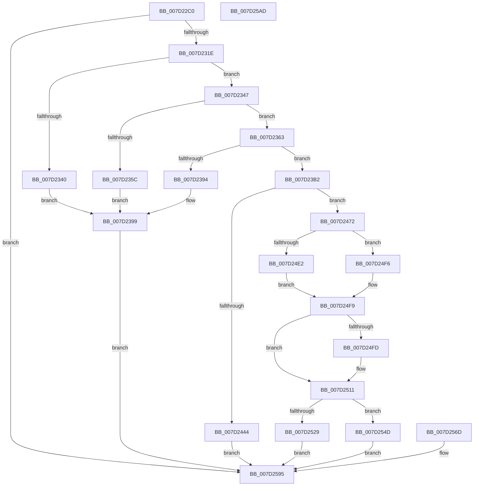

# NtStartProfile

- RVA: `0x007D22C0`–`0x007D25AE` (길이 `750` bytes)
- VA: `0x00000001407D22C0`
- 실행 섹션: `PAGE`
- PDB 이름 있음: `예`; PDB Function 태그: `아니요`
- unwind 정보 RVA: `0x000D59B4`
- 디코드: `194`개 명령, `750/750` bytes 표시
- 미해석 바이트: `0` (있으면 어셈블리에 `.byte`로 보존)

> 이 문서는 커널 이미지의 기계어와 PDB 기호를 분석해 생성했습니다. 4번과 5번은 함수 원형과 자료형을 바이너리 사용 방식에서 추정한 C 해석이며 원본 소스 복구 결과는 아닙니다.

## 1. Dependencies

- 직접 호출 지점: **26**; 고유 호출 대상: **15**
- 직접 호출자로 확인된 함수: **0**
- RIP 상대 이미지 참조: **5**

### Outgoing calls
- `0x007D230C` → [ObReferenceObjectByHandle](../86/ObReferenceObjectByHandle_function_00868DB0.md) (function, `0x00868DB0`)
- `0x007D2335` → [KeWaitForSingleObject](../../text/20/KeWaitForSingleObject_function_0020E6B0.md) (function, `0x0020E6B0`)
- `0x007D234C` → [KeQueryActiveProcessorCountEx](../../text/24/KeQueryActiveProcessorCountEx_function_00249EF0.md) (function, `0x00249EF0`)
- `0x007D236A` → [MmSizeOfMdl](../../text/46/MmSizeOfMdl_function_00460A10.md) (function, `0x00460A10`)
- `0x007D2382` → [ExAllocatePool2](../../poolcode/B8/ExAllocatePool2_function_00B820F0.md) (function, `0x00B820F0`)
- `0x007D239E` → [KeReleaseMutex](../../text/39/KeReleaseMutex_function_00396810.md) (function, `0x00396810`)
- `0x007D23A6` → [ObfDereferenceObject](../../text/2F/ObfDereferenceObject_function_002F9350.md) (function, `0x002F9350`)
- `0x007D2418` → [MmProbeAndLockPages](../../text/23/MmProbeAndLockPages_function_0023B990.md) (function, `0x0023B990`)
- `0x007D2437` → [MmMapLockedPagesSpecifyCache](../../text/31/MmMapLockedPagesSpecifyCache_function_00318800.md) (function, `0x00318800`)
- `0x007D2449` → [KeReleaseMutex](../../text/39/KeReleaseMutex_function_00396810.md) (function, `0x00396810`)
- `0x007D2451` → [MmUnlockPages](../../text/29/MmUnlockPages_function_0029EEE0.md) (function, `0x0029EEE0`)
- `0x007D245B` → [ExFreePoolWithTag](../../poolcode/B8/ExFreePoolWithTag_function_00B82870.md) (function, `0x00B82870`)
- `0x007D2463` → [ObfDereferenceObject](../../text/2F/ObfDereferenceObject_function_002F9350.md) (function, `0x002F9350`)
- `0x007D24D8` → [memset](../../text/6C/memset_function_006C6C40.md) (function, `0x006C6C40`)
- `0x007D24EF` → [KeAndAffinityEx2](../../text/3C/KeAndAffinityEx2_function_003C0740.md) (function, `0x003C0740`)
- `0x007D250C` → [KiCopyAffinityEx](../../text/2C/KiCopyAffinityEx_function_002CE860.md) (function, `0x002CE860`)
- `0x007D2514` → [KeStartProfile](../../text/4E/KeStartProfile_function_004E1120.md) (function, `0x004E1120`)
- `0x007D2529` → [KeReleaseMutex](../../text/39/KeReleaseMutex_function_00396810.md) (function, `0x00396810`)
- `0x007D2531` → [MmUnlockPages](../../text/29/MmUnlockPages_function_0029EEE0.md) (function, `0x0029EEE0`)
- `0x007D253B` → [ExFreePoolWithTag](../../poolcode/B8/ExFreePoolWithTag_function_00B82870.md) (function, `0x00B82870`)
- `0x007D2543` → [ObfDereferenceObject](../../text/2F/ObfDereferenceObject_function_002F9350.md) (function, `0x002F9350`)
- `0x007D255C` → [KeReleaseMutex](../../text/39/KeReleaseMutex_function_00396810.md) (function, `0x00396810`)
- `0x007D2564` → [ObfDereferenceObject](../../text/2F/ObfDereferenceObject_function_002F9350.md) (function, `0x002F9350`)
- `0x007D2578` → [KeReleaseMutex](../../text/39/KeReleaseMutex_function_00396810.md) (function, `0x00396810`)
- `0x007D2584` → [ExFreePoolWithTag](../../poolcode/B8/ExFreePoolWithTag_function_00B82870.md) (function, `0x00B82870`)
- `0x007D258E` → [ObfDereferenceObject](../../text/2F/ObfDereferenceObject_function_002F9350.md) (function, `0x002F9350`)

### Direct callers
- 이 함수 시작 RVA로 연결되는 직접 call은 확인되지 않았습니다. 간접 호출은 완전히 역산할 수 없습니다.

### Static image references
- `0x007D22E8` → RVA `0x00FC5390` (`ALMOSTRO`; read)
- `0x007D232B` → RVA `0x00EFA140` (`.data`; read)
- `0x007D2354` → RVA `0x00EEEF88` (`.data`; read)
- `0x007D24E5` → RVA `0x00FC7120` (`ALMOSTRO`; read)
- `0x007D2556` → RVA `0x00EEEF88` (`.data`; read/write)

## 2. Other-region calls and transfers

- 다른 실행 섹션으로 향하는 call: **25**
  - `0x007D2335` → [KeWaitForSingleObject](../../text/20/KeWaitForSingleObject_function_0020E6B0.md) (`PAGE` → `.text`)
  - `0x007D234C` → [KeQueryActiveProcessorCountEx](../../text/24/KeQueryActiveProcessorCountEx_function_00249EF0.md) (`PAGE` → `.text`)
  - `0x007D236A` → [MmSizeOfMdl](../../text/46/MmSizeOfMdl_function_00460A10.md) (`PAGE` → `.text`)
  - `0x007D2382` → [ExAllocatePool2](../../poolcode/B8/ExAllocatePool2_function_00B820F0.md) (`PAGE` → `POOLCODE`)
  - `0x007D239E` → [KeReleaseMutex](../../text/39/KeReleaseMutex_function_00396810.md) (`PAGE` → `.text`)
  - `0x007D23A6` → [ObfDereferenceObject](../../text/2F/ObfDereferenceObject_function_002F9350.md) (`PAGE` → `.text`)
  - `0x007D2418` → [MmProbeAndLockPages](../../text/23/MmProbeAndLockPages_function_0023B990.md) (`PAGE` → `.text`)
  - `0x007D2437` → [MmMapLockedPagesSpecifyCache](../../text/31/MmMapLockedPagesSpecifyCache_function_00318800.md) (`PAGE` → `.text`)
  - `0x007D2449` → [KeReleaseMutex](../../text/39/KeReleaseMutex_function_00396810.md) (`PAGE` → `.text`)
  - `0x007D2451` → [MmUnlockPages](../../text/29/MmUnlockPages_function_0029EEE0.md) (`PAGE` → `.text`)
  - `0x007D245B` → [ExFreePoolWithTag](../../poolcode/B8/ExFreePoolWithTag_function_00B82870.md) (`PAGE` → `POOLCODE`)
  - `0x007D2463` → [ObfDereferenceObject](../../text/2F/ObfDereferenceObject_function_002F9350.md) (`PAGE` → `.text`)
  - `0x007D24D8` → [memset](../../text/6C/memset_function_006C6C40.md) (`PAGE` → `.text`)
  - `0x007D24EF` → [KeAndAffinityEx2](../../text/3C/KeAndAffinityEx2_function_003C0740.md) (`PAGE` → `.text`)
  - `0x007D250C` → [KiCopyAffinityEx](../../text/2C/KiCopyAffinityEx_function_002CE860.md) (`PAGE` → `.text`)
  - `0x007D2514` → [KeStartProfile](../../text/4E/KeStartProfile_function_004E1120.md) (`PAGE` → `.text`)
  - `0x007D2529` → [KeReleaseMutex](../../text/39/KeReleaseMutex_function_00396810.md) (`PAGE` → `.text`)
  - `0x007D2531` → [MmUnlockPages](../../text/29/MmUnlockPages_function_0029EEE0.md) (`PAGE` → `.text`)
  - `0x007D253B` → [ExFreePoolWithTag](../../poolcode/B8/ExFreePoolWithTag_function_00B82870.md) (`PAGE` → `POOLCODE`)
  - `0x007D2543` → [ObfDereferenceObject](../../text/2F/ObfDereferenceObject_function_002F9350.md) (`PAGE` → `.text`)
  - `0x007D255C` → [KeReleaseMutex](../../text/39/KeReleaseMutex_function_00396810.md) (`PAGE` → `.text`)
  - `0x007D2564` → [ObfDereferenceObject](../../text/2F/ObfDereferenceObject_function_002F9350.md) (`PAGE` → `.text`)
  - `0x007D2578` → [KeReleaseMutex](../../text/39/KeReleaseMutex_function_00396810.md) (`PAGE` → `.text`)
  - `0x007D2584` → [ExFreePoolWithTag](../../poolcode/B8/ExFreePoolWithTag_function_00B82870.md) (`PAGE` → `POOLCODE`)
  - `0x007D258E` → [ObfDereferenceObject](../../text/2F/ObfDereferenceObject_function_002F9350.md) (`PAGE` → `.text`)
- 별도 외부 분기/꼬리 이동을 확인하지 못했습니다.

## 3. Assembly (complete function range)

```asm
007D22C0  4C 8B DC                        mov r11, rsp
007D22C3  49 89 5B 08                     mov qword ptr [r11 + 8], rbx
007D22C7  49 89 73 20                     mov qword ptr [r11 + 0x20], rsi
007D22CB  57                              push rdi
007D22CC  41 54                           push r12
007D22CE  41 55                           push r13
007D22D0  41 56                           push r14
007D22D2  41 57                           push r15
007D22D4  48 83 EC 30                     sub rsp, 0x30
007D22D8  65 48 8B 04 25 88 01 00 00      mov rax, qword ptr gs:[0x188]
007D22E1  44 8A B0 32 02 00 00            mov r14b, byte ptr [rax + 0x232]
007D22E8  4C 8B 05 A1 30 7F 00            mov r8, qword ptr [rip + 0x7f30a1]
007D22EF  45 33 ED                        xor r13d, r13d
007D22F2  4D 89 6B 10                     mov qword ptr [r11 + 0x10], r13
007D22F6  4D 89 6B D0                     mov qword ptr [r11 - 0x30], r13
007D22FA  49 8D 43 10                     lea rax, [r11 + 0x10]
007D22FE  49 89 43 C8                     mov qword ptr [r11 - 0x38], rax
007D2302  45 8A CE                        mov r9b, r14b
007D2305  45 8D 7D 01                     lea r15d, [r13 + 1]
007D2309  41 8B D7                        mov edx, r15d
007D230C  E8 9F 6A 09 00                  call 0x140868db0
007D2311  48 8B 5C 24 68                  mov rbx, qword ptr [rsp + 0x68]
007D2316  85 C0                           test eax, eax
007D2318  0F 88 77 02 00 00               js 0x1407d2595
007D231E  4C 89 6C 24 20                  mov qword ptr [rsp + 0x20], r13
007D2323  45 33 C9                        xor r9d, r9d
007D2326  45 33 C0                        xor r8d, r8d
007D2329  33 D2                           xor edx, edx
007D232B  4C 8D 25 0E 7E 72 00            lea r12, [rip + 0x727e0e]
007D2332  49 8B CC                        mov rcx, r12
007D2335  E8 76 C3 A3 FF                  call 0x14020e6b0
007D233A  4C 39 6B 30                     cmp qword ptr [rbx + 0x30], r13
007D233E  74 07                           je 0x1407d2347
007D2340  BF B8 00 00 C0                  mov edi, 0xc00000b8
007D2345  EB 52                           jmp 0x1407d2399
007D2347  B9 FF FF 00 00                  mov ecx, 0xffff
007D234C  E8 9F 7B A7 FF                  call 0x140249ef0
007D2351  C1 E0 0D                        shl eax, 0xd
007D2354  39 05 2E CC 71 00               cmp dword ptr [rip + 0x71cc2e], eax
007D235A  75 07                           jne 0x1407d2363
007D235C  BF D3 00 00 C0                  mov edi, 0xc00000d3
007D2361  EB 36                           jmp 0x1407d2399
007D2363  8B 53 20                        mov edx, dword ptr [rbx + 0x20]
007D2366  48 8B 4B 18                     mov rcx, qword ptr [rbx + 0x18]
007D236A  E8 A1 E6 C8 FF                  call 0x140460a10
007D236F  BA 68 02 00 00                  mov edx, 0x268
007D2374  48 03 D0                        add rdx, rax
007D2377  B9 40 00 00 00                  mov ecx, 0x40
007D237C  41 B8 50 72 6F 66               mov r8d, 0x666f7250
007D2382  E8 69 FD 3A 00                  call 0x140b820f0
007D2387  48 8B F8                        mov rdi, rax
007D238A  48 89 44 24 70                  mov qword ptr [rsp + 0x70], rax
007D238F  48 85 C0                        test rax, rax
007D2392  75 1E                           jne 0x1407d23b2
007D2394  BF 9A 00 00 C0                  mov edi, 0xc000009a
007D2399  33 D2                           xor edx, edx
007D239B  49 8B CC                        mov rcx, r12
007D239E  E8 6D 44 BC FF                  call 0x140396810
007D23A3  48 8B CB                        mov rcx, rbx
007D23A6  E8 A5 6F B2 FF                  call 0x1402f9350
007D23AB  8B C7                           mov eax, edi
007D23AD  E9 E3 01 00 00                  jmp 0x1407d2595
007D23B2  48 8D B0 68 02 00 00            lea rsi, [rax + 0x268]
007D23B9  48 89 73 38                     mov qword ptr [rbx + 0x38], rsi
007D23BD  48 89 7B 28                     mov qword ptr [rbx + 0x28], rdi
007D23C1  44 8B 53 20                     mov r10d, dword ptr [rbx + 0x20]
007D23C5  4C 8B 43 18                     mov r8, qword ptr [rbx + 0x18]
007D23C9  4C 89 2E                        mov qword ptr [rsi], r13
007D23CC  45 8B C8                        mov r9d, r8d
007D23CF  41 8B C1                        mov eax, r9d
007D23D2  BA FF 0F 00 00                  mov edx, 0xfff
007D23D7  48 23 C2                        and rax, rdx
007D23DA  49 8D 8A FF 0F 00 00            lea rcx, [r10 + 0xfff]
007D23E1  48 03 C8                        add rcx, rax
007D23E4  48 C1 E9 0C                     shr rcx, 0xc
007D23E8  66 83 C1 06                     add cx, 6
007D23EC  66 C1 E1 03                     shl cx, 3
007D23F0  66 89 4E 08                     mov word ptr [rsi + 8], cx
007D23F4  66 44 89 6E 0A                  mov word ptr [rsi + 0xa], r13w
007D23F9  49 81 E0 00 F0 FF FF            and r8, 0xfffffffffffff000
007D2400  4C 89 46 20                     mov qword ptr [rsi + 0x20], r8
007D2404  44 23 CA                        and r9d, edx
007D2407  44 89 4E 2C                     mov dword ptr [rsi + 0x2c], r9d
007D240B  44 89 56 28                     mov dword ptr [rsi + 0x28], r10d
007D240F  45 8B C7                        mov r8d, r15d
007D2412  41 8A D6                        mov dl, r14b
007D2415  48 8B CE                        mov rcx, rsi
007D2418  E8 73 95 A6 FF                  call 0x14023b990
007D241D  90                              nop
007D241E  C7 44 24 28 10 00 00 40         mov dword ptr [rsp + 0x28], 0x40000010
007D2426  44 89 6C 24 20                  mov dword ptr [rsp + 0x20], r13d
007D242B  45 33 C9                        xor r9d, r9d
007D242E  45 8B C7                        mov r8d, r15d
007D2431  33 D2                           xor edx, edx
007D2433  48 8B 4B 38                     mov rcx, qword ptr [rbx + 0x38]
007D2437  E8 C4 63 B4 FF                  call 0x140318800
007D243C  4C 8B F8                        mov r15, rax
007D243F  48 85 C0                        test rax, rax
007D2442  75 2E                           jne 0x1407d2472
007D2444  33 D2                           xor edx, edx
007D2446  49 8B CC                        mov rcx, r12
007D2449  E8 C2 43 BC FF                  call 0x140396810
007D244E  48 8B CE                        mov rcx, rsi
007D2451  E8 8A CA AC FF                  call 0x14029eee0
007D2456  33 D2                           xor edx, edx
007D2458  48 8B CF                        mov rcx, rdi
007D245B  E8 10 04 3B 00                  call 0x140b82870
007D2460  48 8B CB                        mov rcx, rbx
007D2463  E8 E8 6E B2 FF                  call 0x1402f9350
007D2468  B8 9A 00 00 C0                  mov eax, 0xc000009a
007D246D  E9 23 01 00 00                  jmp 0x1407d2595
007D2472  4C 8D 63 48                     lea r12, [rbx + 0x48]
007D2476  44 8B 53 44                     mov r10d, dword ptr [rbx + 0x44]
007D247A  44 8B 4B 40                     mov r9d, dword ptr [rbx + 0x40]
007D247E  44 8B 43 24                     mov r8d, dword ptr [rbx + 0x24]
007D2482  48 8B 53 10                     mov rdx, qword ptr [rbx + 0x10]
007D2486  48 8B 4B 08                     mov rcx, qword ptr [rbx + 8]
007D248A  48 8B 03                        mov rax, qword ptr [rbx]
007D248D  C7 07 17 00 68 02               mov dword ptr [rdi], 0x2680017
007D2493  48 89 47 18                     mov qword ptr [rdi + 0x18], rax
007D2497  4C 89 7F 38                     mov qword ptr [rdi + 0x38], r15
007D249B  48 89 4F 20                     mov qword ptr [rdi + 0x20], rcx
007D249F  48 8D 04 11                     lea rax, [rcx + rdx]
007D24A3  48 89 47 28                     mov qword ptr [rdi + 0x28], rax
007D24A7  41 8D 40 FE                     lea eax, [r8 - 2]
007D24AB  89 47 30                        mov dword ptr [rdi + 0x30], eax
007D24AE  44 88 AF 62 02 00 00            mov byte ptr [rdi + 0x262], r13b
007D24B5  44 89 4F 40                     mov dword ptr [rdi + 0x40], r9d
007D24B9  66 44 89 97 60 02 00 00         mov word ptr [rdi + 0x260], r10w
007D24C1  4C 8D 77 48                     lea r14, [rdi + 0x48]
007D24C5  49 C7 06 01 00 20 00            mov qword ptr [r14], 0x200001
007D24CC  49 8D 4E 08                     lea rcx, [r14 + 8]
007D24D0  33 D2                           xor edx, edx
007D24D2  41 B8 00 01 00 00               mov r8d, 0x100
007D24D8  E8 63 47 EF FF                  call 0x1406c6c40
007D24DD  4D 85 E4                        test r12, r12
007D24E0  74 14                           je 0x1407d24f6
007D24E2  4D 8B C6                        mov r8, r14
007D24E5  48 8D 15 34 4C 7F 00            lea rdx, [rip + 0x7f4c34]
007D24EC  49 8B CC                        mov rcx, r12
007D24EF  E8 4C E2 BE FF                  call 0x1403c0740
007D24F4  EB 03                           jmp 0x1407d24f9
007D24F6  41 8B C5                        mov eax, r13d
007D24F9  85 C0                           test eax, eax
007D24FB  75 14                           jne 0x1407d2511
007D24FD  4C 8D 05 1C 4C 7F 00            lea r8, [rip + 0x7f4c1c]
007D2504  41 0F B7 56 02                  movzx edx, word ptr [r14 + 2]
007D2509  49 8B CE                        mov rcx, r14
007D250C  E8 4F C3 AF FF                  call 0x1402ce860
007D2511  48 8B CF                        mov rcx, rdi
007D2514  E8 07 EC D0 FF                  call 0x1404e1120
007D2519  44 8B F0                        mov r14d, eax
007D251C  33 D2                           xor edx, edx
007D251E  48 8D 0D 1B 7C 72 00            lea rcx, [rip + 0x727c1b]
007D2525  85 C0                           test eax, eax
007D2527  79 24                           jns 0x1407d254d
007D2529  E8 E2 42 BC FF                  call 0x140396810
007D252E  48 8B CE                        mov rcx, rsi
007D2531  E8 AA C9 AC FF                  call 0x14029eee0
007D2536  33 D2                           xor edx, edx
007D2538  48 8B CF                        mov rcx, rdi
007D253B  E8 30 03 3B 00                  call 0x140b82870
007D2540  48 8B CB                        mov rcx, rbx
007D2543  E8 08 6E B2 FF                  call 0x1402f9350
007D2548  41 8B C6                        mov eax, r14d
007D254B  EB 48                           jmp 0x1407d2595
007D254D  4C 89 7B 30                     mov qword ptr [rbx + 0x30], r15
007D2551  B8 01 00 00 00                  mov eax, 1
007D2556  01 05 2C CA 71 00               add dword ptr [rip + 0x71ca2c], eax
007D255C  E8 AF 42 BC FF                  call 0x140396810
007D2561  48 8B CB                        mov rcx, rbx
007D2564  E8 E7 6D B2 FF                  call 0x1402f9350
007D2569  33 C0                           xor eax, eax
007D256B  EB 28                           jmp 0x1407d2595
007D256D  8B D8                           mov ebx, eax
007D256F  33 D2                           xor edx, edx
007D2571  48 8D 0D C8 7B 72 00            lea rcx, [rip + 0x727bc8]
007D2578  E8 93 42 BC FF                  call 0x140396810
007D257D  33 D2                           xor edx, edx
007D257F  48 8B 4C 24 70                  mov rcx, qword ptr [rsp + 0x70]
007D2584  E8 E7 02 3B 00                  call 0x140b82870
007D2589  48 8B 4C 24 68                  mov rcx, qword ptr [rsp + 0x68]
007D258E  E8 BD 6D B2 FF                  call 0x1402f9350
007D2593  8B C3                           mov eax, ebx
007D2595  48 8B 5C 24 60                  mov rbx, qword ptr [rsp + 0x60]
007D259A  48 8B 74 24 78                  mov rsi, qword ptr [rsp + 0x78]
007D259F  48 83 C4 30                     add rsp, 0x30
007D25A3  41 5F                           pop r15
007D25A5  41 5E                           pop r14
007D25A7  41 5D                           pop r13
007D25A9  41 5C                           pop r12
007D25AB  5F                              pop rdi
007D25AC  C3                              ret
007D25AD  CC                              int3
```

## 4. C-style interpretation (structured pseudocode)

```c
__int64 __fastcall NtStartProfile(void)
{
    __int64 result;
    __int64 v_r13;
    __int64 v_rsp;
    unsigned int v_stack_m30;
    unsigned __int64 v_stack_m38;
    unsigned __int64 v_stack_p10;
    unsigned __int64 v_stack_p18;
    unsigned __int64 v_stack_p20;
    unsigned __int64 v_stack_p8;

    *(unsigned __int64 *)(v_rsp + 8) = v_rbx;
    *(unsigned __int64 *)(v_rsp + 32) = v_rsi;
    v_rsp = (v_rsp) - (48);
    v_r13 = 0;
    *(unsigned __int64 *)(v_rsp + 16) = 0;
    *(unsigned __int64 *)(v_rsp - 48) = 0;
    *(unsigned __int64 *)(v_rsp - 56) = v_rsp + 16;
    result = ObReferenceObjectByHandle(a1, (unsigned int)((unsigned int)(v_r13 + 1)), *(unsigned __int64 *)(v_rip + 8335521), (unsigned __int8)(*(unsigned __int8 *)(*(unsigned __int64 *)(gs_base + (0 + 392)) + 562)));
    if (sign_flag) goto loc_007D2595;
    v_stack_m38 = 0;
    a4 = 0;
    a3 = 0;
    a2 = 0;
    result = KeWaitForSingleObject(v_rip + 7503374, a2, a3, a4);
    if ((*(unsigned __int64 *)(v_stack_p10 + 48)) == 0) goto loc_007D2347;
    goto loc_007D2399;
loc_007D2347:
    result = KeQueryActiveProcessorCountEx((unsigned int)(0xFFFFULL), a2, a3, a4);
    result = (unsigned int)((result) << (13));
    if ((*(unsigned int *)(v_rip + 7457838)) != ((unsigned int)(result))) goto loc_007D2363;
    goto loc_007D2399;
loc_007D2363:
    result = MmSizeOfMdl(*(unsigned __int64 *)(v_stack_p10 + 24), (unsigned int)(*(unsigned int *)(v_stack_p10 + 32)), a3, a4);
    a2 = (616) + (result);
    result = ExAllocatePool2(64, a2, (unsigned int)(0x666F7250ULL), a4);
    v_stack_p18 = result;
    if (result != 0) goto loc_007D23B2;
loc_007D2399:
    a2 = 0;
    result = KeReleaseMutex(v_rip + 7503374, a2, (unsigned int)(0x666F7250ULL), a4);
    result = ObfDereferenceObject(v_stack_p10, a2, (unsigned int)(0x666F7250ULL), a4);
    goto loc_007D2595;
loc_007D23B2:
    *(unsigned __int64 *)(v_stack_p10 + 56) = (unsigned int)((unsigned int)((unsigned int)(0xC000009AULL))) + 616;
    *(unsigned __int64 *)(v_stack_p10 + 40) = (unsigned int)(0xC000009AULL);
    *(unsigned __int64 *)((unsigned int)((unsigned int)((unsigned int)(0xC000009AULL))) + 616) = 0;
    result = ((unsigned int)((unsigned int)((unsigned int)((unsigned int)(*(unsigned __int64 *)(v_stack_p10 + 24)))))) & ((unsigned int)(0xFFFULL));
    a1 = ((unsigned int)(*(unsigned int *)(v_stack_p10 + 32)) + 4095) + (result);
    a1 = (a1) >> (12);
    a1 = (unsigned __int16)((a1) + (6));
    a1 = (unsigned __int16)((a1) << (3));
    *(unsigned __int16 *)((unsigned int)((unsigned int)((unsigned int)(0xC000009AULL))) + 616 + 8) = (unsigned __int16)(a1);
    *(unsigned __int16 *)((unsigned int)((unsigned int)((unsigned int)(0xC000009AULL))) + 616 + 10) = 0;
    a3 = (*(unsigned __int64 *)(v_stack_p10 + 24)) & (0xFFFFFFFFFFFFF000ULL);
    *(unsigned __int64 *)((unsigned int)((unsigned int)((unsigned int)(0xC000009AULL))) + 616 + 32) = a3;
    a4 = (unsigned int)(((unsigned int)((unsigned int)(*(unsigned __int64 *)(v_stack_p10 + 24)))) & ((unsigned int)((unsigned int)(0xFFFULL))));
    *(unsigned int *)((unsigned int)((unsigned int)((unsigned int)(0xC000009AULL))) + 616 + 44) = (unsigned int)(a4);
    *(unsigned int *)((unsigned int)((unsigned int)((unsigned int)(0xC000009AULL))) + 616 + 40) = (unsigned int)((unsigned int)(*(unsigned int *)(v_stack_p10 + 32)));
    result = MmProbeAndLockPages((unsigned int)((unsigned int)((unsigned int)(0xC000009AULL))) + 616, (unsigned __int8)(*(unsigned __int8 *)(*(unsigned __int64 *)(gs_base + (0 + 392)) + 562)), (unsigned int)((unsigned int)(v_r13 + 1)), a4);
    v_stack_m30 = 0x40000010ULL;
    v_stack_m38 = 0;
    a4 = 0;
    a2 = 0;
    result = MmMapLockedPagesSpecifyCache(*(unsigned __int64 *)(v_stack_p10 + 56), a2, (unsigned int)((unsigned int)(v_r13 + 1)), a4);
    if (result != 0) goto loc_007D2472;
    a2 = 0;
    result = KeReleaseMutex(v_rip + 7503374, a2, (unsigned int)((unsigned int)(v_r13 + 1)), a4);
    result = MmUnlockPages((unsigned int)((unsigned int)((unsigned int)(0xC000009AULL))) + 616, a2, (unsigned int)((unsigned int)(v_r13 + 1)), a4);
    a2 = 0;
    result = ExFreePoolWithTag((unsigned int)(0xC000009AULL), a2, (unsigned int)((unsigned int)(v_r13 + 1)), a4);
    result = ObfDereferenceObject(v_stack_p10, a2, (unsigned int)((unsigned int)(v_r13 + 1)), a4);
    goto loc_007D2595;
loc_007D2472:
    *(unsigned int *)((unsigned int)(0xC000009AULL)) = 0x2680017ULL;
    *(unsigned __int64 *)((unsigned int)(0xC000009AULL) + 24) = *(unsigned __int64 *)(v_stack_p10);
    *(unsigned __int64 *)((unsigned int)(0xC000009AULL) + 56) = result;
    *(unsigned __int64 *)((unsigned int)(0xC000009AULL) + 32) = *(unsigned __int64 *)(v_stack_p10 + 8);
    *(unsigned __int64 *)((unsigned int)(0xC000009AULL) + 40) = *(unsigned __int64 *)(v_stack_p10 + 8) + *(unsigned __int64 *)(v_stack_p10 + 16) * 1;
    *(unsigned int *)((unsigned int)(0xC000009AULL) + 48) = (unsigned int)((unsigned int)(*(unsigned int *)(v_stack_p10 + 36)) - 2);
    *(unsigned __int8 *)((unsigned int)(0xC000009AULL) + 610) = 0;
    *(unsigned int *)((unsigned int)(0xC000009AULL) + 64) = (unsigned int)((unsigned int)(*(unsigned int *)(v_stack_p10 + 64)));
    *(unsigned __int16 *)((unsigned int)(0xC000009AULL) + 608) = (unsigned __int16)((unsigned int)(*(unsigned int *)(v_stack_p10 + 68)));
    *(unsigned __int64 *)((unsigned int)(0xC000009AULL) + 72) = 0x200001ULL;
    a2 = 0;
    result = memset((unsigned int)(0xC000009AULL) + 72 + 8, a2, 256, (unsigned int)(*(unsigned int *)(v_stack_p10 + 64)));
    if (v_stack_p10 + 72 == 0) goto loc_007D24F6;
    result = KeAndAffinityEx2(v_stack_p10 + 72, v_rip + 8342580, (unsigned int)(0xC000009AULL) + 72, (unsigned int)(*(unsigned int *)(v_stack_p10 + 64)));
    goto loc_007D24F9;
loc_007D24F6:
loc_007D24F9:
    result = 0;
    if (0 == 0) {
        a3 = v_rip + 8342556;
        a2 = *(unsigned __int16 *)((unsigned int)(0xC000009AULL) + 72 + 2);
        a1 = (unsigned int)(0xC000009AULL) + 72;
        result = KiCopyAffinityEx(a1, a2, a3, (unsigned int)(*(unsigned int *)(v_stack_p10 + 64)));
    }
    result = KeStartProfile((unsigned int)(0xC000009AULL), a2, a3, (unsigned int)(*(unsigned int *)(v_stack_p10 + 64)));
    a2 = 0;
    if (!sign_flag) goto loc_007D254D;
    result = KeReleaseMutex(v_rip + 7502875, a2, a3, (unsigned int)(*(unsigned int *)(v_stack_p10 + 64)));
    result = MmUnlockPages((unsigned int)((unsigned int)((unsigned int)(0xC000009AULL))) + 616, a2, a3, (unsigned int)(*(unsigned int *)(v_stack_p10 + 64)));
    a2 = 0;
    result = ExFreePoolWithTag((unsigned int)(0xC000009AULL), a2, a3, (unsigned int)(*(unsigned int *)(v_stack_p10 + 64)));
    result = ObfDereferenceObject(v_stack_p10, a2, a3, (unsigned int)(*(unsigned int *)(v_stack_p10 + 64)));
    goto loc_007D2595;
loc_007D254D:
    *(unsigned __int64 *)(v_stack_p10 + 48) = result;
    result = KeReleaseMutex(v_stack_p10, a2, a3, (unsigned int)(*(unsigned int *)(v_stack_p10 + 64)));
    result = ObfDereferenceObject(v_stack_p10, a2, a3, (unsigned int)(*(unsigned int *)(v_stack_p10 + 64)));
    result = 0;
    goto loc_007D2595;
loc_007D2595:
    v_rsp = (v_rsp) + (48);
    return result;
}
```

## 5. (Beta) C Style

```c
void NtStartProfile(void)
{
    int64_t result;
    int64_t local_r13;
    int64_t local_rsp;
    uint32_t v_stack_m30;
    uint64_t v_stack_m38;
    uint64_t v_stack_p10;
    uint64_t v_stack_p18;
    uint64_t v_stack_p20;
    uint64_t v_stack_p8;

    *(uint64_t *)(local_rsp + 0x8) = local_rbx;
    *(uint64_t *)(local_rsp + 0x20) = local_rsi;
    local_rsp = (local_rsp) - (48);
    local_r13 = 0;
    *(uint64_t *)(local_rsp + 0x10) = 0;
    *(uint64_t *)(local_rsp - 0x30) = 0;
    *(uint64_t *)(local_rsp - 0x38) = local_rsp + 16;
    result = ObReferenceObjectByHandle(a1, (uint32_t)((uint32_t)(local_r13 + 1)), *(uint64_t *)(v_rip + 0x7F30A1), (uint8_t)(*(uint8_t *)(*(uint64_t *)(gs_base + (0 + 0x188)) + 0x232)));
    if (sign_flag) goto loc_007D2595;
    v_stack_m38 = 0;
    a4 = 0;
    a3 = 0;
    a2 = 0;
    result = KeWaitForSingleObject(v_rip + 7503374, a2, a3, a4);
    if ((*(uint64_t *)(v_stack_p10 + 0x30)) == 0) goto loc_007D2347;
    goto loc_007D2399;
loc_007D2347:
    result = KeQueryActiveProcessorCountEx((uint32_t)(0xFFFFULL), a2, a3, a4);
    result = (uint32_t)((result) << (13));
    if ((*(uint32_t *)(v_rip + 0x71CC2E)) != ((uint32_t)(result))) goto loc_007D2363;
    goto loc_007D2399;
loc_007D2363:
    result = MmSizeOfMdl(*(uint64_t *)(v_stack_p10 + 0x18), (uint32_t)(*(uint32_t *)(v_stack_p10 + 0x20)), a3, a4);
    a2 = (616) + (result);
    result = ExAllocatePool2(64, a2, (uint32_t)(0x666F7250ULL), a4);
    v_stack_p18 = result;
    if (result != 0) goto loc_007D23B2;
loc_007D2399:
    a2 = 0;
    result = KeReleaseMutex(v_rip + 7503374, a2, (uint32_t)(0x666F7250ULL), a4);
    result = ObfDereferenceObject(v_stack_p10, a2, (uint32_t)(0x666F7250ULL), a4);
    goto loc_007D2595;
loc_007D23B2:
    *(uint64_t *)(v_stack_p10 + 0x38) = (uint32_t)((uint32_t)((uint32_t)(0xC000009AULL))) + 616;
    *(uint64_t *)(v_stack_p10 + 0x28) = (uint32_t)(0xC000009AULL);
    *(uint64_t *)((uint32_t)((uint32_t)((uint32_t)(0xC000009AULL))) + 0x268) = 0;
    result = ((uint32_t)((uint32_t)((uint32_t)((uint32_t)(*(uint64_t *)(v_stack_p10 + 0x18)))))) & ((uint32_t)(0xFFFULL));
    a1 = ((uint32_t)(*(uint32_t *)(v_stack_p10 + 0x20)) + 4095) + (result);
    a1 = (a1) >> (12);
    a1 = (uint16_t)((a1) + (6));
    a1 = (uint16_t)((a1) << (3));
    *(uint16_t *)((uint32_t)((uint32_t)((uint32_t)(0xC000009AULL))) + 0x268 + 0x8) = (uint16_t)(a1);
    *(uint16_t *)((uint32_t)((uint32_t)((uint32_t)(0xC000009AULL))) + 0x268 + 0xA) = 0;
    a3 = (*(uint64_t *)(v_stack_p10 + 0x18)) & (0xFFFFFFFFFFFFF000ULL);
    *(uint64_t *)((uint32_t)((uint32_t)((uint32_t)(0xC000009AULL))) + 0x268 + 0x20) = a3;
    a4 = (uint32_t)(((uint32_t)((uint32_t)(*(uint64_t *)(v_stack_p10 + 0x18)))) & ((uint32_t)((uint32_t)(0xFFFULL))));
    *(uint32_t *)((uint32_t)((uint32_t)((uint32_t)(0xC000009AULL))) + 0x268 + 0x2C) = (uint32_t)(a4);
    *(uint32_t *)((uint32_t)((uint32_t)((uint32_t)(0xC000009AULL))) + 0x268 + 0x28) = (uint32_t)((uint32_t)(*(uint32_t *)(v_stack_p10 + 0x20)));
    result = MmProbeAndLockPages((uint32_t)((uint32_t)((uint32_t)(0xC000009AULL))) + 616, (uint8_t)(*(uint8_t *)(*(uint64_t *)(gs_base + (0 + 0x188)) + 0x232)), (uint32_t)((uint32_t)(local_r13 + 1)), a4);
    v_stack_m30 = 0x40000010ULL;
    v_stack_m38 = 0;
    a4 = 0;
    a2 = 0;
    result = MmMapLockedPagesSpecifyCache(*(uint64_t *)(v_stack_p10 + 0x38), a2, (uint32_t)((uint32_t)(local_r13 + 1)), a4);
    if (result != 0) goto loc_007D2472;
    a2 = 0;
    result = KeReleaseMutex(v_rip + 7503374, a2, (uint32_t)((uint32_t)(local_r13 + 1)), a4);
    result = MmUnlockPages((uint32_t)((uint32_t)((uint32_t)(0xC000009AULL))) + 616, a2, (uint32_t)((uint32_t)(local_r13 + 1)), a4);
    a2 = 0;
    result = ExFreePoolWithTag((uint32_t)(0xC000009AULL), a2, (uint32_t)((uint32_t)(local_r13 + 1)), a4);
    result = ObfDereferenceObject(v_stack_p10, a2, (uint32_t)((uint32_t)(local_r13 + 1)), a4);
    goto loc_007D2595;
loc_007D2472:
    *(uint32_t *)((uint32_t)(0xC000009AULL)) = 0x2680017ULL;
    *(uint64_t *)((uint32_t)(0xC000009AULL) + 0x18) = *(uint64_t *)(v_stack_p10);
    *(uint64_t *)((uint32_t)(0xC000009AULL) + 0x38) = result;
    *(uint64_t *)((uint32_t)(0xC000009AULL) + 0x20) = *(uint64_t *)(v_stack_p10 + 0x8);
    *(uint64_t *)((uint32_t)(0xC000009AULL) + 0x28) = *(uint64_t *)(v_stack_p10 + 0x8) + *(uint64_t *)(v_stack_p10 + 0x10) * 1;
    *(uint32_t *)((uint32_t)(0xC000009AULL) + 0x30) = (uint32_t)((uint32_t)(*(uint32_t *)(v_stack_p10 + 0x24)) - 2);
    *(uint8_t *)((uint32_t)(0xC000009AULL) + 0x262) = 0;
    *(uint32_t *)((uint32_t)(0xC000009AULL) + 0x40) = (uint32_t)((uint32_t)(*(uint32_t *)(v_stack_p10 + 0x40)));
    *(uint16_t *)((uint32_t)(0xC000009AULL) + 0x260) = (uint16_t)((uint32_t)(*(uint32_t *)(v_stack_p10 + 0x44)));
    *(uint64_t *)((uint32_t)(0xC000009AULL) + 0x48) = 0x200001ULL;
    a2 = 0;
    result = memset((uint32_t)(0xC000009AULL) + 72 + 8, a2, 256, (uint32_t)(*(uint32_t *)(v_stack_p10 + 0x40)));
    if (v_stack_p10 + 72 == 0) goto loc_007D24F6;
    result = KeAndAffinityEx2(v_stack_p10 + 72, v_rip + 8342580, (uint32_t)(0xC000009AULL) + 72, (uint32_t)(*(uint32_t *)(v_stack_p10 + 0x40)));
    goto loc_007D24F9;
loc_007D24F6:
loc_007D24F9:
    result = 0;
    if (0 == 0) {
        a3 = v_rip + 8342556;
        a2 = *(uint16_t *)((uint32_t)(0xC000009AULL) + 0x48 + 0x2);
        a1 = (uint32_t)(0xC000009AULL) + 72;
        result = KiCopyAffinityEx(a1, a2, a3, (uint32_t)(*(uint32_t *)(v_stack_p10 + 0x40)));
    }
    result = KeStartProfile((uint32_t)(0xC000009AULL), a2, a3, (uint32_t)(*(uint32_t *)(v_stack_p10 + 0x40)));
    a2 = 0;
    if (!sign_flag) goto loc_007D254D;
    result = KeReleaseMutex(v_rip + 7502875, a2, a3, (uint32_t)(*(uint32_t *)(v_stack_p10 + 0x40)));
    result = MmUnlockPages((uint32_t)((uint32_t)((uint32_t)(0xC000009AULL))) + 616, a2, a3, (uint32_t)(*(uint32_t *)(v_stack_p10 + 0x40)));
    a2 = 0;
    result = ExFreePoolWithTag((uint32_t)(0xC000009AULL), a2, a3, (uint32_t)(*(uint32_t *)(v_stack_p10 + 0x40)));
    result = ObfDereferenceObject(v_stack_p10, a2, a3, (uint32_t)(*(uint32_t *)(v_stack_p10 + 0x40)));
    goto loc_007D2595;
loc_007D254D:
    *(uint64_t *)(v_stack_p10 + 0x30) = result;
    result = KeReleaseMutex(v_stack_p10, a2, a3, (uint32_t)(*(uint32_t *)(v_stack_p10 + 0x40)));
    result = ObfDereferenceObject(v_stack_p10, a2, a3, (uint32_t)(*(uint32_t *)(v_stack_p10 + 0x40)));
    result = 0;
    goto loc_007D2595;
loc_007D2595:
    local_rsp = (local_rsp) + (48);
    return result;
}
```

## 6. Execution-region graph

[열기: 2D/3D 그래프와 함수 탐색 컨트롤 패널](../../../control-panel.html?section=page&rva=0x007D22C0&view=graph)

- 2D 그래프는 위에서 아래로 흐르고, 3D 그래프는 빈 공간을 드래그해 회전합니다. Shift+드래그는 이동, 휠은 확대·축소, 함수 노드 선택은 대상 보고서 이동입니다.

### Static fallback


