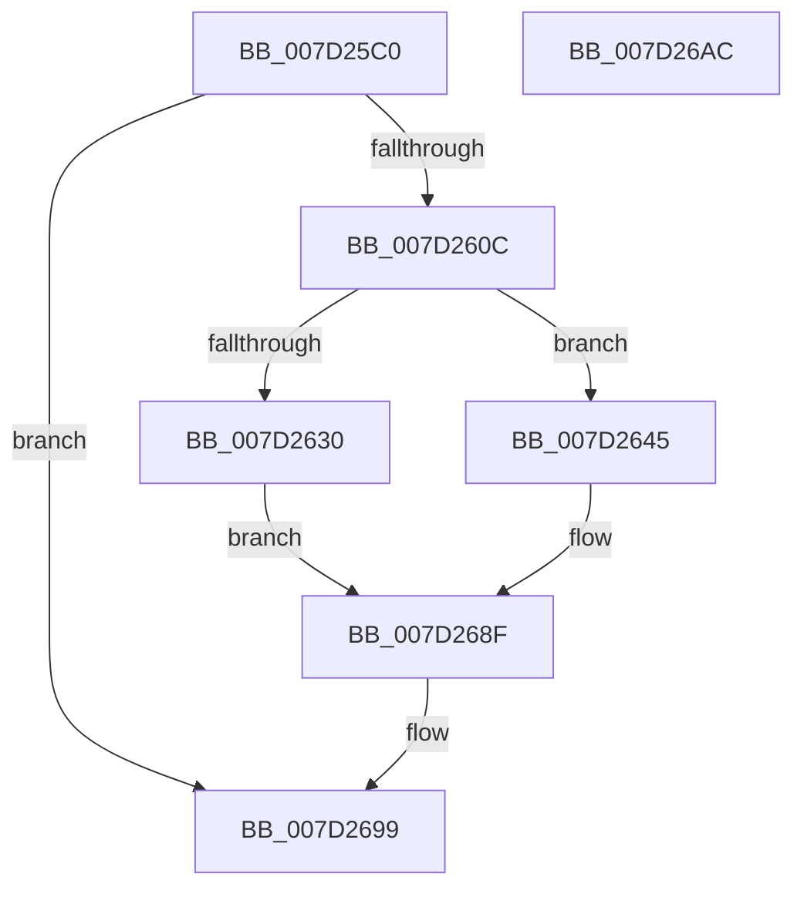

# NtStopProfile

- RVA: `0x007D25C0`–`0x007D26AD` (길이 `237` bytes)
- VA: `0x00000001407D25C0`
- 실행 섹션: `PAGE`
- PDB 이름 있음: `예`; PDB Function 태그: `아니요`
- unwind 정보 RVA: `0x000BEE5C`
- 디코드: `62`개 명령, `237/237` bytes 표시
- 미해석 바이트: `0` (있으면 어셈블리에 `.byte`로 보존)

> 이 문서는 커널 이미지의 기계어와 PDB 기호를 분석해 생성했습니다. 4번과 5번은 함수 원형과 자료형을 바이너리 사용 방식에서 추정한 C 해석이며 원본 소스 복구 결과는 아닙니다.

## 1. Dependencies

- 직접 호출 지점: **9**; 고유 호출 대상: **8**
- 직접 호출자로 확인된 함수: **0**
- RIP 상대 이미지 참조: **3**

### Outgoing calls
- `0x007D25FF` → [ObReferenceObjectByHandle](../86/ObReferenceObjectByHandle_function_00868DB0.md) (function, `0x00868DB0`)
- `0x007D2620` → [KeWaitForSingleObject](../../text/20/KeWaitForSingleObject_function_0020E6B0.md) (function, `0x0020E6B0`)
- `0x007D2639` → [KeReleaseMutex](../../text/39/KeReleaseMutex_function_00396810.md) (function, `0x00396810`)
- `0x007D2649` → [KeStopProfile](../../text/5C/KeStopProfile_function_005C0640.md) (function, `0x005C0640`)
- `0x007D266D` → [KeReleaseMutex](../../text/39/KeReleaseMutex_function_00396810.md) (function, `0x00396810`)
- `0x007D2678` → [MmUnmapLockedPages](../../text/24/MmUnmapLockedPages_function_00246E60.md) (function, `0x00246E60`)
- `0x007D2680` → [MmUnlockPages](../../text/29/MmUnlockPages_function_0029EEE0.md) (function, `0x0029EEE0`)
- `0x007D268A` → [ExFreePoolWithTag](../../poolcode/B8/ExFreePoolWithTag_function_00B82870.md) (function, `0x00B82870`)
- `0x007D2692` → [ObfDereferenceObject](../../text/2F/ObfDereferenceObject_function_002F9350.md) (function, `0x002F9350`)

### Direct callers
- 이 함수 시작 RVA로 연결되는 직접 call은 확인되지 않았습니다. 간접 호출은 완전히 역산할 수 없습니다.

### Static image references
- `0x007D25DE` → RVA `0x00FC5390` (`ALMOSTRO`; read)
- `0x007D2617` → RVA `0x00EFA140` (`.data`; read)
- `0x007D2663` → RVA `0x00EEEF88` (`.data`; read/write)

## 2. Other-region calls and transfers

- 다른 실행 섹션으로 향하는 call: **8**
  - `0x007D2620` → [KeWaitForSingleObject](../../text/20/KeWaitForSingleObject_function_0020E6B0.md) (`PAGE` → `.text`)
  - `0x007D2639` → [KeReleaseMutex](../../text/39/KeReleaseMutex_function_00396810.md) (`PAGE` → `.text`)
  - `0x007D2649` → [KeStopProfile](../../text/5C/KeStopProfile_function_005C0640.md) (`PAGE` → `.text`)
  - `0x007D266D` → [KeReleaseMutex](../../text/39/KeReleaseMutex_function_00396810.md) (`PAGE` → `.text`)
  - `0x007D2678` → [MmUnmapLockedPages](../../text/24/MmUnmapLockedPages_function_00246E60.md) (`PAGE` → `.text`)
  - `0x007D2680` → [MmUnlockPages](../../text/29/MmUnlockPages_function_0029EEE0.md) (`PAGE` → `.text`)
  - `0x007D268A` → [ExFreePoolWithTag](../../poolcode/B8/ExFreePoolWithTag_function_00B82870.md) (`PAGE` → `POOLCODE`)
  - `0x007D2692` → [ObfDereferenceObject](../../text/2F/ObfDereferenceObject_function_002F9350.md) (`PAGE` → `.text`)
- 별도 외부 분기/꼬리 이동을 확인하지 못했습니다.

## 3. Assembly (complete function range)

```asm
007D25C0  4C 8B DC                        mov r11, rsp
007D25C3  49 89 5B 08                     mov qword ptr [r11 + 8], rbx
007D25C7  49 89 6B 18                     mov qword ptr [r11 + 0x18], rbp
007D25CB  56                              push rsi
007D25CC  57                              push rdi
007D25CD  41 56                           push r14
007D25CF  48 83 EC 30                     sub rsp, 0x30
007D25D3  65 48 8B 04 25 88 01 00 00      mov rax, qword ptr gs:[0x188]
007D25DC  33 ED                           xor ebp, ebp
007D25DE  4C 8B 05 AB 2D 7F 00            mov r8, qword ptr [rip + 0x7f2dab]
007D25E5  49 89 6B E0                     mov qword ptr [r11 - 0x20], rbp
007D25E9  49 89 6B 10                     mov qword ptr [r11 + 0x10], rbp
007D25ED  44 8A 88 32 02 00 00            mov r9b, byte ptr [rax + 0x232]
007D25F4  8D 55 01                        lea edx, [rbp + 1]
007D25F7  49 8D 43 10                     lea rax, [r11 + 0x10]
007D25FB  49 89 43 D8                     mov qword ptr [r11 - 0x28], rax
007D25FF  E8 AC 67 09 00                  call 0x140868db0
007D2604  85 C0                           test eax, eax
007D2606  0F 88 8D 00 00 00               js 0x1407d2699
007D260C  45 33 C9                        xor r9d, r9d
007D260F  48 89 6C 24 20                  mov qword ptr [rsp + 0x20], rbp
007D2614  45 33 C0                        xor r8d, r8d
007D2617  48 8D 0D 22 7B 72 00            lea rcx, [rip + 0x727b22]
007D261E  33 D2                           xor edx, edx
007D2620  E8 8B C0 A3 FF                  call 0x14020e6b0
007D2625  4C 8B 74 24 58                  mov r14, qword ptr [rsp + 0x58]
007D262A  49 39 6E 30                     cmp qword ptr [r14 + 0x30], rbp
007D262E  75 15                           jne 0x1407d2645
007D2630  33 D2                           xor edx, edx
007D2632  48 8D 0D 07 7B 72 00            lea rcx, [rip + 0x727b07]
007D2639  E8 D2 41 BC FF                  call 0x140396810
007D263E  BD B7 00 00 C0                  mov ebp, 0xc00000b7
007D2643  EB 4A                           jmp 0x1407d268f
007D2645  49 8B 4E 28                     mov rcx, qword ptr [r14 + 0x28]
007D2649  E8 F2 DF DE FF                  call 0x1405c0640
007D264E  49 8B 5E 30                     mov rbx, qword ptr [r14 + 0x30]
007D2652  48 8D 0D E7 7A 72 00            lea rcx, [rip + 0x727ae7]
007D2659  49 8B 7E 38                     mov rdi, qword ptr [r14 + 0x38]
007D265D  33 D2                           xor edx, edx
007D265F  49 8B 76 28                     mov rsi, qword ptr [r14 + 0x28]
007D2663  FF 0D 1F C9 71 00               dec dword ptr [rip + 0x71c91f]
007D2669  49 89 6E 30                     mov qword ptr [r14 + 0x30], rbp
007D266D  E8 9E 41 BC FF                  call 0x140396810
007D2672  48 8B D7                        mov rdx, rdi
007D2675  48 8B CB                        mov rcx, rbx
007D2678  E8 E3 47 A7 FF                  call 0x140246e60
007D267D  48 8B CF                        mov rcx, rdi
007D2680  E8 5B C8 AC FF                  call 0x14029eee0
007D2685  33 D2                           xor edx, edx
007D2687  48 8B CE                        mov rcx, rsi
007D268A  E8 E1 01 3B 00                  call 0x140b82870
007D268F  49 8B CE                        mov rcx, r14
007D2692  E8 B9 6C B2 FF                  call 0x1402f9350
007D2697  8B C5                           mov eax, ebp
007D2699  48 8B 5C 24 50                  mov rbx, qword ptr [rsp + 0x50]
007D269E  48 8B 6C 24 60                  mov rbp, qword ptr [rsp + 0x60]
007D26A3  48 83 C4 30                     add rsp, 0x30
007D26A7  41 5E                           pop r14
007D26A9  5F                              pop rdi
007D26AA  5E                              pop rsi
007D26AB  C3                              ret
007D26AC  CC                              int3
```

## 4. C-style interpretation (structured pseudocode)

```c
__int64 __fastcall NtStopProfile(void)
{
    __int64 result;
    __int64 v_rbp;
    __int64 v_rsp;
    unsigned __int64 v_stack_m28;
    unsigned __int64 v_stack_p10;
    unsigned __int64 v_stack_p18;
    unsigned __int64 v_stack_p8;

    *(unsigned __int64 *)(v_rsp + 8) = v_rbx;
    *(unsigned __int64 *)(v_rsp + 24) = v_rbp;
    v_rsp = (v_rsp) - (48);
    v_rbp = 0;
    *(unsigned __int64 *)(v_rsp - 32) = 0;
    *(unsigned __int64 *)(v_rsp + 16) = 0;
    *(unsigned __int64 *)(v_rsp - 40) = v_rsp + 16;
    result = ObReferenceObjectByHandle(a1, v_rbp + 1, *(unsigned __int64 *)(v_rip + 8334763), *(unsigned __int8 *)(*(unsigned __int64 *)(gs_base + (0 + 392)) + 562));
    if (sign_flag) goto loc_007D2699;
    a4 = 0;
    v_stack_m28 = 0;
    a3 = 0;
    a2 = 0;
    result = KeWaitForSingleObject(v_rip + 7502626, a2, a3, a4);
    if ((*(unsigned __int64 *)(v_stack_p10 + 48)) != 0) goto loc_007D2645;
    a2 = 0;
    result = KeReleaseMutex(v_rip + 7502599, a2, a3, a4);
    goto loc_007D268F;
loc_007D2645:
    result = KeStopProfile(*(unsigned __int64 *)(v_stack_p10 + 40), a2, a3, a4);
    a2 = 0;
    *(unsigned __int64 *)(v_stack_p10 + 48) = (unsigned int)(0xC00000B7ULL);
    result = KeReleaseMutex(v_rip + 7502567, a2, a3, a4);
    result = MmUnmapLockedPages(*(unsigned __int64 *)(v_stack_p10 + 48), *(unsigned __int64 *)(v_stack_p10 + 56), a3, a4);
    result = MmUnlockPages(*(unsigned __int64 *)(v_stack_p10 + 56), *(unsigned __int64 *)(v_stack_p10 + 56), a3, a4);
    a2 = 0;
    result = ExFreePoolWithTag(*(unsigned __int64 *)(v_stack_p10 + 40), a2, a3, a4);
loc_007D268F:
    result = ObfDereferenceObject(v_stack_p10, a2, a3, a4);
loc_007D2699:
    v_rsp = (v_rsp) + (48);
    return (unsigned int)((unsigned int)((unsigned int)(0xC00000B7ULL)));
}
```

## 5. (Beta) C Style

```c
void NtStopProfile(void)
{
    int64_t result;
    int64_t local_rbp;
    int64_t local_rsp;
    uint64_t v_stack_m28;
    uint64_t v_stack_p10;
    uint64_t v_stack_p18;
    uint64_t v_stack_p8;

    *(uint64_t *)(local_rsp + 0x8) = local_rbx;
    *(uint64_t *)(local_rsp + 0x18) = local_rbp;
    local_rsp = (local_rsp) - (48);
    local_rbp = 0;
    *(uint64_t *)(local_rsp - 0x20) = 0;
    *(uint64_t *)(local_rsp + 0x10) = 0;
    *(uint64_t *)(local_rsp - 0x28) = local_rsp + 16;
    result = ObReferenceObjectByHandle(a1, local_rbp + 1, *(uint64_t *)(v_rip + 0x7F2DAB), *(uint8_t *)(*(uint64_t *)(gs_base + (0 + 0x188)) + 0x232));
    if (sign_flag) goto loc_007D2699;
    a4 = 0;
    v_stack_m28 = 0;
    a3 = 0;
    a2 = 0;
    result = KeWaitForSingleObject(v_rip + 7502626, a2, a3, a4);
    if ((*(uint64_t *)(v_stack_p10 + 0x30)) != 0) goto loc_007D2645;
    a2 = 0;
    result = KeReleaseMutex(v_rip + 7502599, a2, a3, a4);
    goto loc_007D268F;
loc_007D2645:
    result = KeStopProfile(*(uint64_t *)(v_stack_p10 + 0x28), a2, a3, a4);
    a2 = 0;
    *(uint64_t *)(v_stack_p10 + 0x30) = (uint32_t)(0xC00000B7ULL);
    result = KeReleaseMutex(v_rip + 7502567, a2, a3, a4);
    result = MmUnmapLockedPages(*(uint64_t *)(v_stack_p10 + 0x30), *(uint64_t *)(v_stack_p10 + 0x38), a3, a4);
    result = MmUnlockPages(*(uint64_t *)(v_stack_p10 + 0x38), *(uint64_t *)(v_stack_p10 + 0x38), a3, a4);
    a2 = 0;
    result = ExFreePoolWithTag(*(uint64_t *)(v_stack_p10 + 0x28), a2, a3, a4);
loc_007D268F:
    result = ObfDereferenceObject(v_stack_p10, a2, a3, a4);
loc_007D2699:
    local_rsp = (local_rsp) + (48);
    return (uint32_t)((uint32_t)((uint32_t)(0xC00000B7ULL)));
}
```

## 6. Execution-region graph

[열기: 2D/3D 그래프와 함수 탐색 컨트롤 패널](../../../control-panel.html?section=page&rva=0x007D25C0&view=graph)

- 2D 그래프는 위에서 아래로 흐르고, 3D 그래프는 빈 공간을 드래그해 회전합니다. Shift+드래그는 이동, 휠은 확대·축소, 함수 노드 선택은 대상 보고서 이동입니다.

### Static fallback


