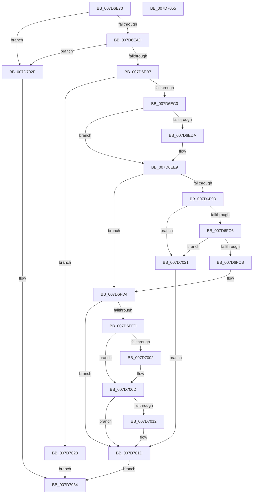

# WheaAddErrorSourceDeviceDriver

- RVA: `0x007D6E70`–`0x007D7056` (길이 `486` bytes)
- VA: `0x00000001407D6E70`
- 실행 섹션: `PAGE`
- PDB 이름 있음: `예`; PDB Function 태그: `아니요`
- unwind 정보 RVA: `0x000D5E70`
- 디코드: `128`개 명령, `486/486` bytes 표시
- 미해석 바이트: `0` (있으면 어셈블리에 `.byte`로 보존)

> 이 문서는 커널 이미지의 기계어와 PDB 기호를 분석해 생성했습니다. 4번과 5번은 함수 원형과 자료형을 바이너리 사용 방식에서 추정한 C 해석이며 원본 소스 복구 결과는 아닙니다.

## 1. Dependencies

- 직접 호출 지점: **8**; 고유 호출 대상: **6**
- 직접 호출자로 확인된 함수: **1**
- RIP 상대 이미지 참조: **3**

### Outgoing calls
- `0x007D6EE4` → [WheaConfigureErrorSource](../../pagelk/B7/WheaConfigureErrorSource_function_00B733A0.md) (function, `0x00B733A0`)
- `0x007D6EF6` → [memset](../../text/6C/memset_function_006C6C40.md) (function, `0x006C6C40`)
- `0x007D6F85` → [WheapDeviceDriverGetPacketLength](../../text/65/WheapDeviceDriverGetPacketLength_function_0065EC04.md) (function, `0x0065EC04`)
- `0x007D6FA8` → [ExAllocatePool2](../../poolcode/B8/ExAllocatePool2_function_00B820F0.md) (function, `0x00B820F0`)
- `0x007D6FB9` → [ExAllocatePool2](../../poolcode/B8/ExAllocatePool2_function_00B820F0.md) (function, `0x00B820F0`)
- `0x007D6FF2` → [WheaAddErrorSource](WheaAddErrorSource_function_007D69D0.md) (function, `0x007D69D0`)
- `0x007D7008` → [ExFreePoolWithTag](../../poolcode/B8/ExFreePoolWithTag_function_00B82870.md) (function, `0x00B82870`)
- `0x007D7018` → [ExFreePoolWithTag](../../poolcode/B8/ExFreePoolWithTag_function_00B82870.md) (function, `0x00B82870`)

### Direct callers
- [WheaAddErrorSourceDeviceDriverV1](../../text/65/WheaAddErrorSourceDeviceDriverV1_function_0065E450.md) at `0x0065E4EA`

### Static image references
- `0x007D6EC4` → RVA `0x00EEF498` (`.data`; read)
- `0x007D6EDA` → RVA `0x00E036D8` (`.data`; read)
- `0x007D6F23` → RVA `0x0065EB50` (`WheapCorrectErrorSourceDeviceDriver`; read)

## 2. Other-region calls and transfers

- 다른 실행 섹션으로 향하는 call: **7**
  - `0x007D6EE4` → [WheaConfigureErrorSource](../../pagelk/B7/WheaConfigureErrorSource_function_00B733A0.md) (`PAGE` → `PAGELK`)
  - `0x007D6EF6` → [memset](../../text/6C/memset_function_006C6C40.md) (`PAGE` → `.text`)
  - `0x007D6F85` → [WheapDeviceDriverGetPacketLength](../../text/65/WheapDeviceDriverGetPacketLength_function_0065EC04.md) (`PAGE` → `.text`)
  - `0x007D6FA8` → [ExAllocatePool2](../../poolcode/B8/ExAllocatePool2_function_00B820F0.md) (`PAGE` → `POOLCODE`)
  - `0x007D6FB9` → [ExAllocatePool2](../../poolcode/B8/ExAllocatePool2_function_00B820F0.md) (`PAGE` → `POOLCODE`)
  - `0x007D7008` → [ExFreePoolWithTag](../../poolcode/B8/ExFreePoolWithTag_function_00B82870.md) (`PAGE` → `POOLCODE`)
  - `0x007D7018` → [ExFreePoolWithTag](../../poolcode/B8/ExFreePoolWithTag_function_00B82870.md) (`PAGE` → `POOLCODE`)
- 별도 외부 분기/꼬리 이동을 확인하지 못했습니다.

## 3. Assembly (complete function range)

```asm
007D6E70  48 8B C4                        mov rax, rsp
007D6E73  48 89 58 08                     mov qword ptr [rax + 8], rbx
007D6E77  48 89 70 10                     mov qword ptr [rax + 0x10], rsi
007D6E7B  48 89 78 18                     mov qword ptr [rax + 0x18], rdi
007D6E7F  55                              push rbp
007D6E80  41 54                           push r12
007D6E82  41 55                           push r13
007D6E84  41 56                           push r14
007D6E86  41 57                           push r15
007D6E88  48 8D A8 E8 FC FF FF            lea rbp, [rax - 0x318]
007D6E8F  48 81 EC F0 03 00 00            sub rsp, 0x3f0
007D6E96  33 F6                           xor esi, esi
007D6E98  45 8B F0                        mov r14d, r8d
007D6E9B  33 FF                           xor edi, edi
007D6E9D  48 8B DA                        mov rbx, rdx
007D6EA0  4C 8B E9                        mov r13, rcx
007D6EA3  48 39 72 1C                     cmp qword ptr [rdx + 0x1c], rsi
007D6EA7  0F 84 82 01 00 00               je 0x1407d702f
007D6EAD  48 39 72 24                     cmp qword ptr [rdx + 0x24], rsi
007D6EB1  0F 84 78 01 00 00               je 0x1407d702f
007D6EB7  83 3A 02                        cmp dword ptr [rdx], 2
007D6EBA  0F 85 68 01 00 00               jne 0x1407d7028
007D6EC0  44 8B 7A 30                     mov r15d, dword ptr [rdx + 0x30]
007D6EC4  8A 05 CE 85 71 00               mov al, byte ptr [rip + 0x7185ce]
007D6ECA  41 83 C7 02                     add r15d, 2
007D6ECE  45 8B E7                        mov r12d, r15d
007D6ED1  44 0F AF 62 2C                  imul r12d, dword ptr [rdx + 0x2c]
007D6ED6  84 C0                           test al, al
007D6ED8  75 0F                           jne 0x1407d6ee9
007D6EDA  48 8D 15 F7 C7 62 00            lea rdx, [rip + 0x62c7f7]
007D6EE1  8D 4E 10                        lea ecx, [rsi + 0x10]
007D6EE4  E8 B7 C4 39 00                  call 0x140b733a0
007D6EE9  33 D2                           xor edx, edx
007D6EEB  48 8D 4C 24 20                  lea rcx, [rsp + 0x20]
007D6EF0  41 B8 CC 03 00 00               mov r8d, 0x3cc
007D6EF6  E8 45 FD EE FF                  call 0x1406c6c40
007D6EFB  0F B7 43 14                     movzx eax, word ptr [rbx + 0x14]
007D6EFF  33 C9                           xor ecx, ecx
007D6F01  0F 10 43 34                     movups xmm0, xmmword ptr [rbx + 0x34]
007D6F05  66 89 44 24 5C                  mov word ptr [rsp + 0x5c], ax
007D6F0A  41 8B D7                        mov edx, r15d
007D6F0D  48 8B 43 1C                     mov rax, qword ptr [rbx + 0x1c]
007D6F11  0F 10 4B 44                     movups xmm1, xmmword ptr [rbx + 0x44]
007D6F15  48 89 44 24 70                  mov qword ptr [rsp + 0x70], rax
007D6F1A  48 8B 43 24                     mov rax, qword ptr [rbx + 0x24]
007D6F1E  48 89 44 24 78                  mov qword ptr [rsp + 0x78], rax
007D6F23  48 8D 05 26 7C E8 FF            lea rax, [rip - 0x1783da]
007D6F2A  89 4C 24 3C                     mov dword ptr [rsp + 0x3c], ecx
007D6F2E  89 4C 24 44                     mov dword ptr [rsp + 0x44], ecx
007D6F32  48 89 4C 24 68                  mov qword ptr [rsp + 0x68], rcx
007D6F37  48 89 4D B0                     mov qword ptr [rbp - 0x50], rcx
007D6F3B  41 8B CC                        mov ecx, r12d
007D6F3E  F3 0F 7F 45 88                  movdqu xmmword ptr [rbp - 0x78], xmm0
007D6F43  48 89 45 80                     mov qword ptr [rbp - 0x80], rax
007D6F47  0F 10 43 04                     movups xmm0, xmmword ptr [rbx + 4]
007D6F4B  C7 44 24 20 CC 03 00 00         mov dword ptr [rsp + 0x20], 0x3cc
007D6F53  C7 44 24 24 0B 00 00 00         mov dword ptr [rsp + 0x24], 0xb
007D6F5B  C7 44 24 28 10 00 00 00         mov dword ptr [rsp + 0x28], 0x10
007D6F63  C7 44 24 2C 01 00 00 00         mov dword ptr [rsp + 0x2c], 1
007D6F6B  44 89 74 24 34                  mov dword ptr [rsp + 0x34], r14d
007D6F70  44 89 7C 24 38                  mov dword ptr [rsp + 0x38], r15d
007D6F75  44 89 64 24 30                  mov dword ptr [rsp + 0x30], r12d
007D6F7A  F3 0F 7F 4D 98                  movdqu xmmword ptr [rbp - 0x68], xmm1
007D6F7F  F3 0F 7F 44 24 4C               movdqu xmmword ptr [rsp + 0x4c], xmm0
007D6F85  E8 7A 7C E8 FF                  call 0x14065ec04
007D6F8A  44 8B F8                        mov r15d, eax
007D6F8D  41 BC 57 48 45 41               mov r12d, 0x41454857
007D6F93  45 85 F6                        test r14d, r14d
007D6F96  74 3C                           je 0x1407d6fd4
007D6F98  8B D0                           mov edx, eax
007D6F9A  BF 42 00 00 00                  mov edi, 0x42
007D6F9F  41 0F AF D6                     imul edx, r14d
007D6FA3  45 8B C4                        mov r8d, r12d
007D6FA6  8B CF                           mov ecx, edi
007D6FA8  E8 43 B1 3A 00                  call 0x140b820f0
007D6FAD  49 6B D6 68                     imul rdx, r14, 0x68
007D6FB1  45 8B C4                        mov r8d, r12d
007D6FB4  8B CF                           mov ecx, edi
007D6FB6  48 8B F0                        mov rsi, rax
007D6FB9  E8 32 B1 3A 00                  call 0x140b820f0
007D6FBE  48 8B F8                        mov rdi, rax
007D6FC1  48 85 F6                        test rsi, rsi
007D6FC4  74 5B                           je 0x1407d7021
007D6FC6  48 85 C0                        test rax, rax
007D6FC9  74 56                           je 0x1407d7021
007D6FCB  48 89 74 24 68                  mov qword ptr [rsp + 0x68], rsi
007D6FD0  48 89 45 B0                     mov qword ptr [rbp - 0x50], rax
007D6FD4  8B 43 2C                        mov eax, dword ptr [rbx + 0x2c]
007D6FD7  48 8D 4C 24 20                  lea rcx, [rsp + 0x20]
007D6FDC  89 45 A8                        mov dword ptr [rbp - 0x58], eax
007D6FDF  49 8B D5                        mov rdx, r13
007D6FE2  8B 43 30                        mov eax, dword ptr [rbx + 0x30]
007D6FE5  89 45 AC                        mov dword ptr [rbp - 0x54], eax
007D6FE8  44 89 7C 24 60                  mov dword ptr [rsp + 0x60], r15d
007D6FED  44 89 74 24 64                  mov dword ptr [rsp + 0x64], r14d
007D6FF2  E8 D9 F9 FF FF                  call 0x1407d69d0
007D6FF7  8B D8                           mov ebx, eax
007D6FF9  85 C0                           test eax, eax
007D6FFB  79 20                           jns 0x1407d701d
007D6FFD  48 85 F6                        test rsi, rsi
007D7000  74 0B                           je 0x1407d700d
007D7002  41 8B D4                        mov edx, r12d
007D7005  48 8B CE                        mov rcx, rsi
007D7008  E8 63 B8 3A 00                  call 0x140b82870
007D700D  48 85 FF                        test rdi, rdi
007D7010  74 0B                           je 0x1407d701d
007D7012  41 8B D4                        mov edx, r12d
007D7015  48 8B CF                        mov rcx, rdi
007D7018  E8 53 B8 3A 00                  call 0x140b82870
007D701D  8B C3                           mov eax, ebx
007D701F  EB 13                           jmp 0x1407d7034
007D7021  BB 9A 00 00 C0                  mov ebx, 0xc000009a
007D7026  EB F5                           jmp 0x1407d701d
007D7028  B8 F0 00 00 C0                  mov eax, 0xc00000f0
007D702D  EB 05                           jmp 0x1407d7034
007D702F  B8 0D 00 00 C0                  mov eax, 0xc000000d
007D7034  4C 8D 9C 24 F0 03 00 00         lea r11, [rsp + 0x3f0]
007D703C  49 8B 5B 30                     mov rbx, qword ptr [r11 + 0x30]
007D7040  49 8B 73 38                     mov rsi, qword ptr [r11 + 0x38]
007D7044  49 8B 7B 40                     mov rdi, qword ptr [r11 + 0x40]
007D7048  49 8B E3                        mov rsp, r11
007D704B  41 5F                           pop r15
007D704D  41 5E                           pop r14
007D704F  41 5D                           pop r13
007D7051  41 5C                           pop r12
007D7053  5D                              pop rbp
007D7054  C3                              ret
007D7055  CC                              int3
```

## 4. C-style interpretation (structured pseudocode)

```c
__int64 __fastcall WheaAddErrorSourceDeviceDriver(__int64 a1, __int64 a2, int a3)
{
    __int64 result;
    __int64 v_r12;
    __int64 v_r15;
    __int64 v_rdi;
    __int64 v_rsi;
    __int64 v_rsp;
    unsigned __int64 v_stack_m28;
    unsigned __int64 v_stack_m3A0;
    unsigned __int64 v_stack_m3A8;
    unsigned __int64 v_stack_m3B0;
    unsigned int v_stack_m3B4;
    unsigned int v_stack_m3B8;
    unsigned __int16 v_stack_m3BC;
    unsigned __int64 v_stack_m3CC;
    unsigned int v_stack_m3D4;
    unsigned int v_stack_m3DC;
    unsigned int v_stack_m3E0;
    unsigned int v_stack_m3E4;
    unsigned int v_stack_m3E8;
    unsigned int v_stack_m3EC;
    unsigned int v_stack_m3F0;
    unsigned int v_stack_m3F4;
    unsigned __int64 v_stack_m3F8;

    *(unsigned __int64 *)(v_rsp + 8) = v_rbx;
    *(unsigned __int64 *)(v_rsp + 16) = v_rsi;
    *(unsigned __int64 *)(v_rsp + 24) = v_rdi;
    v_rsp = (v_rsp) - (0x3F0ULL);
    v_rsi = 0;
    v_rdi = 0;
    if ((*(unsigned __int64 *)(a2 + 28)) == 0) goto loc_007D702F;
    if ((*(unsigned __int64 *)(a2 + 36)) == 0) goto loc_007D702F;
    if ((*(unsigned int *)(a2)) != 2) goto loc_007D7028;
    v_r15 = (unsigned int)(((unsigned int)(*(unsigned int *)(a2 + 48))) + (2));
    v_r12 = (unsigned int)(((unsigned int)((unsigned int)(v_r15))) * (*(unsigned int *)(a2 + 44)));
    result = *(unsigned __int8 *)(v_rip + 7439822);
    if ((unsigned __int8)(*(unsigned __int8 *)(v_rip + 7439822)) == 0) {
        a2 = v_rip + 6473719;
        a1 = v_rsi + 16;
        result = WheaConfigureErrorSource(a1, a2, a3, a4);
    }
    a2 = 0;
    result = memset(v_stack_m3F8, a2, 972, a4);
    a1 = 0;
    v_stack_m3BC = (unsigned __int16)(*(unsigned __int16 *)(a2 + 20));
    v_stack_m3A8 = *(unsigned __int64 *)(a2 + 28);
    v_stack_m3A0 = *(unsigned __int64 *)(a2 + 36);
    v_stack_m3DC = 0;
    v_stack_m3D4 = 0;
    v_stack_m3B0 = 0;
    *(unsigned __int64 *)(v_rsp - 792 - 80) = 0;
    *(unsigned __int64 *)(v_rsp - 792 - 120) = v_xmm0;
    *(unsigned __int64 *)(v_rsp - 792 - 128) = v_rip - 1541082;
    v_stack_m3F8 = 972;
    v_stack_m3F4 = 11;
    v_stack_m3F0 = 16;
    v_stack_m3EC = 1;
    v_stack_m3E4 = (unsigned int)((unsigned int)(a3));
    v_stack_m3E0 = (unsigned int)(v_r15);
    v_stack_m3E8 = (unsigned int)(v_r12);
    *(unsigned __int64 *)(v_rsp - 792 - 104) = v_xmm1;
    v_stack_m3CC = v_xmm0;
    result = WheapDeviceDriverGetPacketLength((unsigned int)((unsigned int)(v_r12)), (unsigned int)((unsigned int)(v_r15)), 972, a4);
    if ((unsigned int)((unsigned int)(a3)) == 0) goto loc_007D6FD4;
    a2 = (unsigned int)(((unsigned int)((unsigned int)(result))) * ((unsigned int)((unsigned int)(a3))));
    result = ExAllocatePool2(66, a2, (unsigned int)((unsigned int)((unsigned int)(0x41454857ULL))), a4);
    a2 = (a2) * ((unsigned int)(a3));
    result = ExAllocatePool2(66, a2, (unsigned int)((unsigned int)((unsigned int)(0x41454857ULL))), a4);
    if (result == 0) goto loc_007D7021;
    if (result == 0) goto loc_007D7021;
    v_stack_m3B0 = result;
    *(unsigned __int64 *)(v_rsp - 792 - 80) = result;
loc_007D6FD4:
    *(unsigned int *)(v_rsp - 792 - 88) = (unsigned int)((unsigned int)(*(unsigned int *)(a2 + 44)));
    *(unsigned int *)(v_rsp - 792 - 84) = (unsigned int)((unsigned int)(*(unsigned int *)(a2 + 48)));
    v_stack_m3B8 = (unsigned int)((unsigned int)((unsigned int)(result)));
    v_stack_m3B4 = (unsigned int)((unsigned int)(a3));
    result = WheaAddErrorSource(v_stack_m3F8, 0, (unsigned int)((unsigned int)((unsigned int)(0x41454857ULL))), a4);
    if (!sign_flag) goto loc_007D701D;
    if (result != 0) {
        a2 = (unsigned int)((unsigned int)(0x41454857ULL));
        a1 = result;
        result = ExFreePoolWithTag(a1, a2, (unsigned int)((unsigned int)((unsigned int)(0x41454857ULL))), a4);
    }
    if (result != 0) {
        a2 = (unsigned int)((unsigned int)(0x41454857ULL));
        a1 = result;
        result = ExFreePoolWithTag(a1, a2, (unsigned int)((unsigned int)((unsigned int)(0x41454857ULL))), a4);
    }
    goto loc_007D7034;
loc_007D7021:
    goto loc_007D701D;
loc_007D7028:
    goto loc_007D7034;
loc_007D702F:
loc_007D7034:
    return (unsigned int)(0xC000000DULL);
}
```

## 5. (Beta) C Style

```c
int64_t WheaAddErrorSourceDeviceDriver(int64_t Arg1, void *Arg2, int32_t Arg3)
{
    uint8_t *arg2 = (uint8_t *)Arg2;

    int64_t result;
    int64_t local_r12;
    int64_t local_r15;
    int64_t local_rdi;
    int64_t local_rsi;
    int64_t local_rsp;
    uint64_t v_stack_m28;
    uint64_t v_stack_m3A0;
    uint64_t v_stack_m3A8;
    uint64_t v_stack_m3B0;
    uint32_t v_stack_m3B4;
    uint32_t v_stack_m3B8;
    uint16_t v_stack_m3BC;
    uint64_t v_stack_m3CC;
    uint32_t v_stack_m3D4;
    uint32_t v_stack_m3DC;
    uint32_t v_stack_m3E0;
    uint32_t v_stack_m3E4;
    uint32_t v_stack_m3E8;
    uint32_t v_stack_m3EC;
    uint32_t v_stack_m3F0;
    uint32_t v_stack_m3F4;
    uint64_t v_stack_m3F8;

    *(uint64_t *)(local_rsp + 0x8) = local_rbx;
    *(uint64_t *)(local_rsp + 0x10) = local_rsi;
    *(uint64_t *)(local_rsp + 0x18) = local_rdi;
    local_rsp = (local_rsp) - (0x3F0ULL);
    local_rsi = 0;
    local_rdi = 0;
    if ((*(uint64_t *)(arg2 + 0x1C)) == 0) goto loc_007D702F;
    if ((*(uint64_t *)(arg2 + 0x24)) == 0) goto loc_007D702F;
    if ((*(uint32_t *)(arg2)) != 2) goto loc_007D7028;
    local_r15 = (uint32_t)(((uint32_t)(*(uint32_t *)(arg2 + 0x30))) + (2));
    local_r12 = (uint32_t)(((uint32_t)((uint32_t)(local_r15))) * (*(uint32_t *)(arg2 + 0x2C)));
    result = *(uint8_t *)(v_rip + 0x7185CE);
    if ((uint8_t)(*(uint8_t *)(v_rip + 0x7185CE)) == 0) {
        Arg2 = v_rip + 6473719;
        Arg1 = local_rsi + 16;
        result = WheaConfigureErrorSource(Arg1, Arg2, Arg3, a4);
    }
    Arg2 = 0;
    result = memset(v_stack_m3F8, Arg2, 972, a4);
    Arg1 = 0;
    v_stack_m3BC = (uint16_t)(*(uint16_t *)(arg2 + 0x14));
    v_stack_m3A8 = *(uint64_t *)(arg2 + 0x1C);
    v_stack_m3A0 = *(uint64_t *)(arg2 + 0x24);
    v_stack_m3DC = 0;
    v_stack_m3D4 = 0;
    v_stack_m3B0 = 0;
    *(uint64_t *)(local_rsp - 0x318 - 0x50) = 0;
    *(uint64_t *)(local_rsp - 0x318 - 0x78) = v_xmm0;
    *(uint64_t *)(local_rsp - 0x318 - 0x80) = v_rip - 1541082;
    v_stack_m3F8 = 972;
    v_stack_m3F4 = 11;
    v_stack_m3F0 = 16;
    v_stack_m3EC = 1;
    v_stack_m3E4 = (uint32_t)((uint32_t)(Arg3));
    v_stack_m3E0 = (uint32_t)(local_r15);
    v_stack_m3E8 = (uint32_t)(local_r12);
    *(uint64_t *)(local_rsp - 0x318 - 0x68) = v_xmm1;
    v_stack_m3CC = v_xmm0;
    result = WheapDeviceDriverGetPacketLength((uint32_t)((uint32_t)(local_r12)), (uint32_t)((uint32_t)(local_r15)), 972, a4);
    if ((uint32_t)((uint32_t)(Arg3)) == 0) goto loc_007D6FD4;
    Arg2 = (uint32_t)(((uint32_t)((uint32_t)(result))) * ((uint32_t)((uint32_t)(Arg3))));
    result = ExAllocatePool2(66, Arg2, (uint32_t)((uint32_t)((uint32_t)(0x41454857ULL))), a4);
    Arg2 = (Arg2) * ((uint32_t)(Arg3));
    result = ExAllocatePool2(66, Arg2, (uint32_t)((uint32_t)((uint32_t)(0x41454857ULL))), a4);
    if (result == 0) goto loc_007D7021;
    if (result == 0) goto loc_007D7021;
    v_stack_m3B0 = result;
    *(uint64_t *)(local_rsp - 0x318 - 0x50) = result;
loc_007D6FD4:
    *(uint32_t *)(local_rsp - 0x318 - 0x58) = (uint32_t)((uint32_t)(*(uint32_t *)(arg2 + 0x2C)));
    *(uint32_t *)(local_rsp - 0x318 - 0x54) = (uint32_t)((uint32_t)(*(uint32_t *)(arg2 + 0x30)));
    v_stack_m3B8 = (uint32_t)((uint32_t)((uint32_t)(result)));
    v_stack_m3B4 = (uint32_t)((uint32_t)(Arg3));
    result = WheaAddErrorSource(v_stack_m3F8, 0, (uint32_t)((uint32_t)((uint32_t)(0x41454857ULL))), a4);
    if (!sign_flag) goto loc_007D701D;
    if (result != 0) {
        Arg2 = (uint32_t)((uint32_t)(0x41454857ULL));
        Arg1 = result;
        result = ExFreePoolWithTag(Arg1, Arg2, (uint32_t)((uint32_t)((uint32_t)(0x41454857ULL))), a4);
    }
    if (result != 0) {
        Arg2 = (uint32_t)((uint32_t)(0x41454857ULL));
        Arg1 = result;
        result = ExFreePoolWithTag(Arg1, Arg2, (uint32_t)((uint32_t)((uint32_t)(0x41454857ULL))), a4);
    }
    goto loc_007D7034;
loc_007D7021:
    goto loc_007D701D;
loc_007D7028:
    goto loc_007D7034;
loc_007D702F:
loc_007D7034:
    return (uint32_t)(0xC000000DULL);
}
```

### 관측된 메모리 오프셋

구조체 형식이 확인되지 않은 접근은 인자 기준의 오프셋으로만 기록했습니다.

| 기준 인자 | 오프셋 표현 | 폭 (bit) | 접근 |
|---|---:|---:|---|
| `Arg2` | `+ 0x0` | `32` | `R` |
| `Arg2` | `+ 0x4` | `128` | `R` |
| `Arg2` | `+ 0x14` | `16` | `R` |
| `Arg2` | `+ 0x1C` | `64` | `R` |
| `Arg2` | `+ 0x24` | `64` | `R` |
| `Arg2` | `+ 0x2C` | `32` | `R` |
| `Arg2` | `+ 0x30` | `32` | `R` |
| `Arg2` | `+ 0x34` | `128` | `R` |
| `Arg2` | `+ 0x44` | `128` | `R` |

## 6. Execution-region graph

[열기: 2D/3D 그래프와 함수 탐색 컨트롤 패널](../../../control-panel.html?section=page&rva=0x007D6E70&view=graph)

- 2D 그래프는 위에서 아래로 흐르고, 3D 그래프는 빈 공간을 드래그해 회전합니다. Shift+드래그는 이동, 휠은 확대·축소, 함수 노드 선택은 대상 보고서 이동입니다.

### Static fallback


