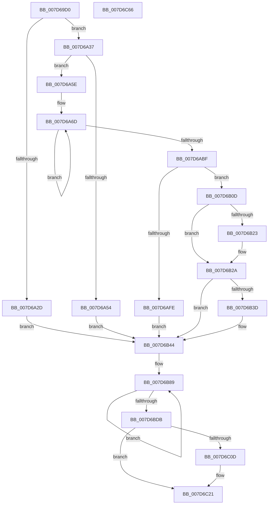

# WheaAddErrorSource

- RVA: `0x007D69D0`–`0x007D6C67` (길이 `663` bytes)
- VA: `0x00000001407D69D0`
- 실행 섹션: `PAGE`
- PDB 이름 있음: `예`; PDB Function 태그: `아니요`
- unwind 정보 RVA: `0x000D5E1C`
- 디코드: `160`개 명령, `663/663` bytes 표시
- 미해석 바이트: `0` (있으면 어셈블리에 `.byte`로 보존)

> 이 문서는 커널 이미지의 기계어와 PDB 기호를 분석해 생성했습니다. 4번과 5번은 함수 원형과 자료형을 바이너리 사용 방식에서 추정한 C 해석이며 원본 소스 복구 결과는 아닙니다.

## 1. Dependencies

- 직접 호출 지점: **9**; 고유 호출 대상: **9**
- 직접 호출자로 확인된 함수: **2**
- RIP 상대 이미지 참조: **2**

### Outgoing calls
- `0x007D6A16` → [memset](../../text/6C/memset_function_006C6C40.md) (function, `0x006C6C40`)
- `0x007D6A1E` → [WheapIsErrorSourceTypeAddable](../../text/65/WheapIsErrorSourceTypeAddable_function_0065E358.md) (function, `0x0065E358`)
- `0x007D6A47` → [ExAllocatePool2](../../poolcode/B8/ExAllocatePool2_function_00B820F0.md) (function, `0x00B820F0`)
- `0x007D6AF3` → [WheapInitializeErrorSource](WheapInitializeErrorSource_function_007D68E0.md) (function, `0x007D68E0`)
- `0x007D6B06` → [ExFreePoolWithTag](../../poolcode/B8/ExFreePoolWithTag_function_00B82870.md) (function, `0x00B82870`)
- `0x007D6B14` → [WheapAddErrorSource](../../text/65/WheapAddErrorSource_function_0065E178.md) (function, `0x0065E178`)
- `0x007D6B32` → [WheapCallErrorSourceInitialize](../../text/65/WheapCallErrorSourceInitialize_function_0065FC14.md) (function, `0x0065FC14`)
- `0x007D6C33` → [WheaLogInternalEvent](../../text/66/WheaLogInternalEvent_function_006605B0.md) (function, `0x006605B0`)
- `0x007D6C44` → [_security_check_cookie](../../text/6A/_security_check_cookie_function_006AC640.md) (function, `0x006AC640`)

### Direct callers
- [WheaRegisterErrorSourceOverride](../../text/66/WheaRegisterErrorSourceOverride_function_00660EE0.md) at `0x00661049`
- [WheaAddErrorSourceDeviceDriver](WheaAddErrorSourceDeviceDriver_function_007D6E70.md) at `0x007D6FF2`

### Static image references
- `0x007D69F2` → RVA `0x00E0A740` (`.data`; read)
- `0x007D6B19` → RVA `0x00EEF000` (`.data`; read)

## 2. Other-region calls and transfers

- 다른 실행 섹션으로 향하는 call: **8**
  - `0x007D6A16` → [memset](../../text/6C/memset_function_006C6C40.md) (`PAGE` → `.text`)
  - `0x007D6A1E` → [WheapIsErrorSourceTypeAddable](../../text/65/WheapIsErrorSourceTypeAddable_function_0065E358.md) (`PAGE` → `.text`)
  - `0x007D6A47` → [ExAllocatePool2](../../poolcode/B8/ExAllocatePool2_function_00B820F0.md) (`PAGE` → `POOLCODE`)
  - `0x007D6B06` → [ExFreePoolWithTag](../../poolcode/B8/ExFreePoolWithTag_function_00B82870.md) (`PAGE` → `POOLCODE`)
  - `0x007D6B14` → [WheapAddErrorSource](../../text/65/WheapAddErrorSource_function_0065E178.md) (`PAGE` → `.text`)
  - `0x007D6B32` → [WheapCallErrorSourceInitialize](../../text/65/WheapCallErrorSourceInitialize_function_0065FC14.md) (`PAGE` → `.text`)
  - `0x007D6C33` → [WheaLogInternalEvent](../../text/66/WheaLogInternalEvent_function_006605B0.md) (`PAGE` → `.text`)
  - `0x007D6C44` → [_security_check_cookie](../../text/6A/_security_check_cookie_function_006AC640.md) (`PAGE` → `.text`)
- 별도 외부 분기/꼬리 이동을 확인하지 못했습니다.

## 3. Assembly (complete function range)

```asm
007D69D0  48 8B C4                        mov rax, rsp
007D69D3  48 89 58 10                     mov qword ptr [rax + 0x10], rbx
007D69D7  48 89 70 18                     mov qword ptr [rax + 0x18], rsi
007D69DB  48 89 78 20                     mov qword ptr [rax + 0x20], rdi
007D69DF  55                              push rbp
007D69E0  41 56                           push r14
007D69E2  41 57                           push r15
007D69E4  48 8D A8 B8 FC FF FF            lea rbp, [rax - 0x348]
007D69EB  48 81 EC 30 04 00 00            sub rsp, 0x430
007D69F2  48 8B 05 47 3D 63 00            mov rax, qword ptr [rip + 0x633d47]
007D69F9  48 33 C4                        xor rax, rsp
007D69FC  48 89 85 20 03 00 00            mov qword ptr [rbp + 0x320], rax
007D6A03  4C 8B FA                        mov r15, rdx
007D6A06  48 8B F1                        mov rsi, rcx
007D6A09  33 D2                           xor edx, edx
007D6A0B  48 8D 4C 24 40                  lea rcx, [rsp + 0x40]
007D6A10  41 B8 CC 03 00 00               mov r8d, 0x3cc
007D6A16  E8 25 02 EF FF                  call 0x1406c6c40
007D6A1B  48 8B CE                        mov rcx, rsi
007D6A1E  E8 35 79 E8 FF                  call 0x14065e358
007D6A23  41 BE 07 00 00 00               mov r14d, 7
007D6A29  84 C0                           test al, al
007D6A2B  75 0A                           jne 0x1407d6a37
007D6A2D  BF BB 00 00 C0                  mov edi, 0xc00000bb
007D6A32  E9 0D 01 00 00                  jmp 0x1407d6b44
007D6A37  BA 30 04 00 00                  mov edx, 0x430
007D6A3C  B9 40 00 00 00                  mov ecx, 0x40
007D6A41  41 B8 57 68 65 61               mov r8d, 0x61656857
007D6A47  E8 A4 B6 3A 00                  call 0x140b820f0
007D6A4C  48 8B D8                        mov rbx, rax
007D6A4F  48 85 C0                        test rax, rax
007D6A52  75 0A                           jne 0x1407d6a5e
007D6A54  BF 9A 00 00 C0                  mov edi, 0xc000009a
007D6A59  E9 E6 00 00 00                  jmp 0x1407d6b44
007D6A5E  48 8D 48 60                     lea rcx, [rax + 0x60]
007D6A62  4C 8B C6                        mov r8, rsi
007D6A65  49 8B C6                        mov rax, r14
007D6A68  BA 80 00 00 00                  mov edx, 0x80
007D6A6D  41 0F 10 00                     movups xmm0, xmmword ptr [r8]
007D6A71  0F 11 01                        movups xmmword ptr [rcx], xmm0
007D6A74  41 0F 10 48 10                  movups xmm1, xmmword ptr [r8 + 0x10]
007D6A79  0F 11 49 10                     movups xmmword ptr [rcx + 0x10], xmm1
007D6A7D  41 0F 10 40 20                  movups xmm0, xmmword ptr [r8 + 0x20]
007D6A82  0F 11 41 20                     movups xmmword ptr [rcx + 0x20], xmm0
007D6A86  41 0F 10 48 30                  movups xmm1, xmmword ptr [r8 + 0x30]
007D6A8B  0F 11 49 30                     movups xmmword ptr [rcx + 0x30], xmm1
007D6A8F  41 0F 10 40 40                  movups xmm0, xmmword ptr [r8 + 0x40]
007D6A94  0F 11 41 40                     movups xmmword ptr [rcx + 0x40], xmm0
007D6A98  41 0F 10 48 50                  movups xmm1, xmmword ptr [r8 + 0x50]
007D6A9D  0F 11 49 50                     movups xmmword ptr [rcx + 0x50], xmm1
007D6AA1  41 0F 10 40 60                  movups xmm0, xmmword ptr [r8 + 0x60]
007D6AA6  0F 11 41 60                     movups xmmword ptr [rcx + 0x60], xmm0
007D6AAA  48 03 CA                        add rcx, rdx
007D6AAD  41 0F 10 48 70                  movups xmm1, xmmword ptr [r8 + 0x70]
007D6AB2  4C 03 C2                        add r8, rdx
007D6AB5  0F 11 49 F0                     movups xmmword ptr [rcx - 0x10], xmm1
007D6AB9  48 83 E8 01                     sub rax, 1
007D6ABD  75 AE                           jne 0x1407d6a6d
007D6ABF  41 0F 10 00                     movups xmm0, xmmword ptr [r8]
007D6AC3  0F 11 01                        movups xmmword ptr [rcx], xmm0
007D6AC6  41 0F 10 48 10                  movups xmm1, xmmword ptr [r8 + 0x10]
007D6ACB  0F 11 49 10                     movups xmmword ptr [rcx + 0x10], xmm1
007D6ACF  41 0F 10 40 20                  movups xmm0, xmmword ptr [r8 + 0x20]
007D6AD4  0F 11 41 20                     movups xmmword ptr [rcx + 0x20], xmm0
007D6AD8  41 0F 10 48 30                  movups xmm1, xmmword ptr [r8 + 0x30]
007D6ADD  0F 11 49 30                     movups xmmword ptr [rcx + 0x30], xmm1
007D6AE1  49 8B 40 40                     mov rax, qword ptr [r8 + 0x40]
007D6AE5  48 89 41 40                     mov qword ptr [rcx + 0x40], rax
007D6AE9  41 8B 40 48                     mov eax, dword ptr [r8 + 0x48]
007D6AED  89 41 48                        mov dword ptr [rcx + 0x48], eax
007D6AF0  48 8B CB                        mov rcx, rbx
007D6AF3  E8 E8 FD FF FF                  call 0x1407d68e0
007D6AF8  8B F8                           mov edi, eax
007D6AFA  85 C0                           test eax, eax
007D6AFC  74 0F                           je 0x1407d6b0d
007D6AFE  BA 57 68 65 61                  mov edx, 0x61656857
007D6B03  48 8B CB                        mov rcx, rbx
007D6B06  E8 65 BD 3A 00                  call 0x140b82870
007D6B0B  EB 37                           jmp 0x1407d6b44
007D6B0D  48 8B D3                        mov rdx, rbx
007D6B10  4C 89 7B 38                     mov qword ptr [rbx + 0x38], r15
007D6B14  E8 5F 76 E8 FF                  call 0x14065e178
007D6B19  8A 05 E1 84 71 00               mov al, byte ptr [rip + 0x7184e1]
007D6B1F  84 C0                           test al, al
007D6B21  74 07                           je 0x1407d6b2a
007D6B23  C7 43 6C 02 00 00 00            mov dword ptr [rbx + 0x6c], 2
007D6B2A  BA 01 00 00 00                  mov edx, 1
007D6B2F  48 8B CB                        mov rcx, rbx
007D6B32  E8 DD 90 E8 FF                  call 0x14065fc14
007D6B37  8B F8                           mov edi, eax
007D6B39  85 C0                           test eax, eax
007D6B3B  79 07                           jns 0x1407d6b44
007D6B3D  C7 43 6C 01 00 00 00            mov dword ptr [rbx + 0x6c], 1
007D6B44  83 64 24 2C 00                  and dword ptr [rsp + 0x2c], 0
007D6B49  48 8D 54 24 40                  lea rdx, [rsp + 0x40]
007D6B4E  C7 44 24 20 57 68 4C 67         mov dword ptr [rsp + 0x20], 0x674c6857
007D6B56  48 8B CE                        mov rcx, rsi
007D6B59  C7 44 24 24 01 00 00 00         mov dword ptr [rsp + 0x24], 1
007D6B61  C7 44 24 28 F1 03 00 00         mov dword ptr [rsp + 0x28], 0x3f1
007D6B69  C7 44 24 34 0C 00 00 80         mov dword ptr [rsp + 0x34], 0x8000000c
007D6B71  C7 44 24 30 4B 52 4E 4C         mov dword ptr [rsp + 0x30], 0x4c4e524b
007D6B79  C7 44 24 38 02 00 00 00         mov dword ptr [rsp + 0x38], 2
007D6B81  C7 44 24 3C D1 03 00 00         mov dword ptr [rsp + 0x3c], 0x3d1
007D6B89  0F 10 01                        movups xmm0, xmmword ptr [rcx]
007D6B8C  0F 10 49 10                     movups xmm1, xmmword ptr [rcx + 0x10]
007D6B90  48 8D 89 80 00 00 00            lea rcx, [rcx + 0x80]
007D6B97  0F 11 02                        movups xmmword ptr [rdx], xmm0
007D6B9A  0F 10 41 A0                     movups xmm0, xmmword ptr [rcx - 0x60]
007D6B9E  0F 11 4A 10                     movups xmmword ptr [rdx + 0x10], xmm1
007D6BA2  0F 10 49 B0                     movups xmm1, xmmword ptr [rcx - 0x50]
007D6BA6  0F 11 42 20                     movups xmmword ptr [rdx + 0x20], xmm0
007D6BAA  0F 10 41 C0                     movups xmm0, xmmword ptr [rcx - 0x40]
007D6BAE  0F 11 4A 30                     movups xmmword ptr [rdx + 0x30], xmm1
007D6BB2  0F 10 49 D0                     movups xmm1, xmmword ptr [rcx - 0x30]
007D6BB6  0F 11 42 40                     movups xmmword ptr [rdx + 0x40], xmm0
007D6BBA  0F 10 41 E0                     movups xmm0, xmmword ptr [rcx - 0x20]
007D6BBE  0F 11 4A 50                     movups xmmword ptr [rdx + 0x50], xmm1
007D6BC2  0F 10 49 F0                     movups xmm1, xmmword ptr [rcx - 0x10]
007D6BC6  0F 11 42 60                     movups xmmword ptr [rdx + 0x60], xmm0
007D6BCA  48 8D 92 80 00 00 00            lea rdx, [rdx + 0x80]
007D6BD1  0F 11 4A F0                     movups xmmword ptr [rdx - 0x10], xmm1
007D6BD5  49 83 EE 01                     sub r14, 1
007D6BD9  75 AE                           jne 0x1407d6b89
007D6BDB  83 7E 08 10                     cmp dword ptr [rsi + 8], 0x10
007D6BDF  0F 10 01                        movups xmm0, xmmword ptr [rcx]
007D6BE2  48 8B 41 40                     mov rax, qword ptr [rcx + 0x40]
007D6BE6  0F 10 49 10                     movups xmm1, xmmword ptr [rcx + 0x10]
007D6BEA  0F 11 02                        movups xmmword ptr [rdx], xmm0
007D6BED  0F 10 41 20                     movups xmm0, xmmword ptr [rcx + 0x20]
007D6BF1  0F 11 4A 10                     movups xmmword ptr [rdx + 0x10], xmm1
007D6BF5  0F 10 49 30                     movups xmm1, xmmword ptr [rcx + 0x30]
007D6BF9  0F 11 42 20                     movups xmmword ptr [rdx + 0x20], xmm0
007D6BFD  0F 11 4A 30                     movups xmmword ptr [rdx + 0x30], xmm1
007D6C01  48 89 42 40                     mov qword ptr [rdx + 0x40], rax
007D6C05  8B 41 48                        mov eax, dword ptr [rcx + 0x48]
007D6C08  89 42 48                        mov dword ptr [rdx + 0x48], eax
007D6C0B  75 14                           jne 0x1407d6c21
007D6C0D  4C 21 75 90                     and qword ptr [rbp - 0x70], r14
007D6C11  4C 21 75 98                     and qword ptr [rbp - 0x68], r14
007D6C15  4C 21 75 A0                     and qword ptr [rbp - 0x60], r14
007D6C19  4C 21 75 88                     and qword ptr [rbp - 0x78], r14
007D6C1D  4C 21 75 D0                     and qword ptr [rbp - 0x30], r14
007D6C21  48 8D 4C 24 20                  lea rcx, [rsp + 0x20]
007D6C26  89 BD 0C 03 00 00               mov dword ptr [rbp + 0x30c], edi
007D6C2C  C6 85 10 03 00 00 00            mov byte ptr [rbp + 0x310], 0
007D6C33  E8 78 99 E8 FF                  call 0x1406605b0
007D6C38  8B C7                           mov eax, edi
007D6C3A  48 8B 8D 20 03 00 00            mov rcx, qword ptr [rbp + 0x320]
007D6C41  48 33 CC                        xor rcx, rsp
007D6C44  E8 F7 59 ED FF                  call 0x1406ac640
007D6C49  4C 8D 9C 24 30 04 00 00         lea r11, [rsp + 0x430]
007D6C51  49 8B 5B 28                     mov rbx, qword ptr [r11 + 0x28]
007D6C55  49 8B 73 30                     mov rsi, qword ptr [r11 + 0x30]
007D6C59  49 8B 7B 38                     mov rdi, qword ptr [r11 + 0x38]
007D6C5D  49 8B E3                        mov rsp, r11
007D6C60  41 5F                           pop r15
007D6C62  41 5E                           pop r14
007D6C64  5D                              pop rbp
007D6C65  C3                              ret
007D6C66  CC                              int3
```

## 4. C-style interpretation (structured pseudocode)

```c
__int64 __fastcall WheaAddErrorSource(__int64 a1, __int64 a2)
{
    __int64 result;
    __int64 v_r14;
    __int64 v_rsp;
    unsigned __int64 v_stack_m18;
    unsigned __int64 v_stack_m408;
    unsigned int v_stack_m40C;
    unsigned int v_stack_m410;
    unsigned int v_stack_m414;
    unsigned int v_stack_m418;
    unsigned int v_stack_m41C;
    unsigned int v_stack_m420;
    unsigned int v_stack_m424;
    unsigned int v_stack_m428;

    *(unsigned __int64 *)(v_rsp + 16) = v_rbx;
    *(unsigned __int64 *)(v_rsp + 24) = v_rsi;
    *(unsigned __int64 *)(v_rsp + 32) = v_rdi;
    v_rsp = (v_rsp) - (0x430ULL);
    result = (*(unsigned __int64 *)(v_rip + 6503751)) ^ (v_rsp);
    *(unsigned __int64 *)(v_rsp - 840 + 800) = result;
    a2 = 0;
    result = memset(v_stack_m408, a2, 972, a4);
    result = WheapIsErrorSourceTypeAddable(a1, a2, 972, a4);
    if ((unsigned __int8)(result) != 0) goto loc_007D6A37;
    goto loc_007D6B44;
loc_007D6A37:
    result = ExAllocatePool2(64, (unsigned int)(0x430ULL), (unsigned int)(0x61656857ULL), a4);
    if (result != 0) goto loc_007D6A5E;
    goto loc_007D6B44;
loc_007D6A5E:
loc_007D6A6D:
    *(unsigned __int64 *)(result + 96) = v_xmm0;
    *(unsigned __int64 *)(result + 96 + 16) = v_xmm1;
    *(unsigned __int64 *)(result + 96 + 32) = v_xmm0;
    *(unsigned __int64 *)(result + 96 + 48) = v_xmm1;
    *(unsigned __int64 *)(result + 96 + 64) = v_xmm0;
    *(unsigned __int64 *)(result + 96 + 80) = v_xmm1;
    *(unsigned __int64 *)(result + 96 + 96) = v_xmm0;
    a1 = (result + 96) + (128);
    a3 = (a1) + (128);
    *(unsigned __int64 *)(a1 - 16) = v_xmm1;
    result = (7) - (1);
    if (condition_is_not_equal) goto loc_007D6A6D;
    *(unsigned __int64 *)(a1) = v_xmm0;
    *(unsigned __int64 *)(a1 + 16) = v_xmm1;
    *(unsigned __int64 *)(a1 + 32) = v_xmm0;
    *(unsigned __int64 *)(a1 + 48) = v_xmm1;
    *(unsigned __int64 *)(a1 + 64) = *(unsigned __int64 *)(a3 + 64);
    *(unsigned int *)(a1 + 72) = (unsigned int)((unsigned int)(*(unsigned int *)(a3 + 72)));
    result = WheapInitializeErrorSource(result, 128, a3, a4);
    if ((unsigned int)(result) == 0) goto loc_007D6B0D;
    result = ExFreePoolWithTag(result, (unsigned int)(0x61656857ULL), a3, a4);
    goto loc_007D6B44;
loc_007D6B0D:
    *(unsigned __int64 *)(result + 56) = 0;
    result = WheapAddErrorSource(result, result, a3, a4);
    if ((unsigned __int8)(*(unsigned __int8 *)(v_rip + 7439585)) != 0) {
        *(unsigned int *)(result + 108) = 2;
    }
    result = WheapCallErrorSourceInitialize(result, 1, a3, a4);
    if (sign_flag) {
        *(unsigned int *)(result + 108) = 1;
    }
    v_stack_m428 = 0x674C6857ULL;
    v_stack_m424 = 1;
    v_stack_m420 = 0x3F1ULL;
    v_stack_m414 = 0x8000000CULL;
    v_stack_m418 = 0x4C4E524BULL;
    v_stack_m410 = 2;
    v_stack_m40C = 977;
loc_007D6B89:
    *(unsigned __int64 *)(v_stack_m408) = v_xmm0;
    *(unsigned __int64 *)(v_stack_m408 + 16) = v_xmm1;
    *(unsigned __int64 *)(v_stack_m408 + 32) = v_xmm0;
    *(unsigned __int64 *)(v_stack_m408 + 48) = v_xmm1;
    *(unsigned __int64 *)(v_stack_m408 + 64) = v_xmm0;
    *(unsigned __int64 *)(v_stack_m408 + 80) = v_xmm1;
    *(unsigned __int64 *)(v_stack_m408 + 96) = v_xmm0;
    *(unsigned __int64 *)(v_stack_m408 + 128 - 16) = v_xmm1;
    v_r14 = (7) - (1);
    if (condition_is_not_equal) goto loc_007D6B89;
    *(unsigned __int64 *)(v_stack_m408 + 128) = v_xmm0;
    *(unsigned __int64 *)(v_stack_m408 + 128 + 16) = v_xmm1;
    *(unsigned __int64 *)(v_stack_m408 + 128 + 32) = v_xmm0;
    *(unsigned __int64 *)(v_stack_m408 + 128 + 48) = v_xmm1;
    *(unsigned __int64 *)(v_stack_m408 + 128 + 64) = *(unsigned __int64 *)(a1 + 128 + 64);
    *(unsigned int *)(v_stack_m408 + 128 + 72) = (unsigned int)((unsigned int)(*(unsigned int *)(a1 + 128 + 72)));
    if ((*(unsigned int *)(a1 + 8)) == 16) {
    }
    *(unsigned int *)(v_rsp - 840 + 780) = (unsigned int)((unsigned int)((unsigned int)(result)));
    *(unsigned __int8 *)(v_rsp - 840 + 784) = 0;
    result = WheaLogInternalEvent(v_stack_m428, v_stack_m408 + 128, a3, a4);
    a1 = (*(unsigned __int64 *)(v_rsp - 840 + 800)) ^ (v_rsp);
    result = _security_check_cookie(a1, v_stack_m408 + 128, a3, a4);
    return result;
}
```

## 5. (Beta) C Style

```c
int64_t WheaAddErrorSource(void *Arg1, int64_t Arg2)
{
    uint8_t *arg1 = (uint8_t *)Arg1;

    int64_t result;
    int64_t local_r14;
    int64_t local_rsp;
    uint64_t v_stack_m18;
    uint64_t v_stack_m408;
    uint32_t v_stack_m40C;
    uint32_t v_stack_m410;
    uint32_t v_stack_m414;
    uint32_t v_stack_m418;
    uint32_t v_stack_m41C;
    uint32_t v_stack_m420;
    uint32_t v_stack_m424;
    uint32_t v_stack_m428;

    *(uint64_t *)(local_rsp + 0x10) = local_rbx;
    *(uint64_t *)(local_rsp + 0x18) = local_rsi;
    *(uint64_t *)(local_rsp + 0x20) = local_rdi;
    local_rsp = (local_rsp) - (0x430ULL);
    result = (*(uint64_t *)(v_rip + 0x633D47)) ^ (local_rsp);
    *(uint64_t *)(local_rsp - 0x348 + 0x320) = result;
    Arg2 = 0;
    result = memset(v_stack_m408, Arg2, 972, a4);
    result = WheapIsErrorSourceTypeAddable(Arg1, Arg2, 972, a4);
    if ((uint8_t)(result) != 0) goto loc_007D6A37;
    goto loc_007D6B44;
loc_007D6A37:
    result = ExAllocatePool2(64, (uint32_t)(0x430ULL), (uint32_t)(0x61656857ULL), a4);
    if (result != 0) goto loc_007D6A5E;
    goto loc_007D6B44;
loc_007D6A5E:
loc_007D6A6D:
    *(uint64_t *)(result + 0x60) = v_xmm0;
    *(uint64_t *)(result + 0x60 + 0x10) = v_xmm1;
    *(uint64_t *)(result + 0x60 + 0x20) = v_xmm0;
    *(uint64_t *)(result + 0x60 + 0x30) = v_xmm1;
    *(uint64_t *)(result + 0x60 + 0x40) = v_xmm0;
    *(uint64_t *)(result + 0x60 + 0x50) = v_xmm1;
    *(uint64_t *)(result + 0x60 + 0x60) = v_xmm0;
    Arg1 = (result + 96) + (128);
    a3 = (Arg1) + (128);
    *(uint64_t *)(arg1 - 0x10) = v_xmm1;
    result = (7) - (1);
    if (condition_is_not_equal) goto loc_007D6A6D;
    *(uint64_t *)(arg1) = v_xmm0;
    *(uint64_t *)(arg1 + 0x10) = v_xmm1;
    *(uint64_t *)(arg1 + 0x20) = v_xmm0;
    *(uint64_t *)(arg1 + 0x30) = v_xmm1;
    *(uint64_t *)(arg1 + 0x40) = *(uint64_t *)(a3 + 0x40);
    *(uint32_t *)(arg1 + 0x48) = (uint32_t)((uint32_t)(*(uint32_t *)(a3 + 0x48)));
    result = WheapInitializeErrorSource(result, 128, a3, a4);
    if ((uint32_t)(result) == 0) goto loc_007D6B0D;
    result = ExFreePoolWithTag(result, (uint32_t)(0x61656857ULL), a3, a4);
    goto loc_007D6B44;
loc_007D6B0D:
    *(uint64_t *)(result + 0x38) = 0;
    result = WheapAddErrorSource(result, result, a3, a4);
    if ((uint8_t)(*(uint8_t *)(v_rip + 0x7184E1)) != 0) {
        *(uint32_t *)(result + 0x6C) = 2;
    }
    result = WheapCallErrorSourceInitialize(result, 1, a3, a4);
    if (sign_flag) {
        *(uint32_t *)(result + 0x6C) = 1;
    }
    v_stack_m428 = 0x674C6857ULL;
    v_stack_m424 = 1;
    v_stack_m420 = 0x3F1ULL;
    v_stack_m414 = 0x8000000CULL;
    v_stack_m418 = 0x4C4E524BULL;
    v_stack_m410 = 2;
    v_stack_m40C = 977;
loc_007D6B89:
    *(uint64_t *)(v_stack_m408) = v_xmm0;
    *(uint64_t *)(v_stack_m408 + 0x10) = v_xmm1;
    *(uint64_t *)(v_stack_m408 + 0x20) = v_xmm0;
    *(uint64_t *)(v_stack_m408 + 0x30) = v_xmm1;
    *(uint64_t *)(v_stack_m408 + 0x40) = v_xmm0;
    *(uint64_t *)(v_stack_m408 + 0x50) = v_xmm1;
    *(uint64_t *)(v_stack_m408 + 0x60) = v_xmm0;
    *(uint64_t *)(v_stack_m408 + 0x80 - 0x10) = v_xmm1;
    local_r14 = (7) - (1);
    if (condition_is_not_equal) goto loc_007D6B89;
    *(uint64_t *)(v_stack_m408 + 0x80) = v_xmm0;
    *(uint64_t *)(v_stack_m408 + 0x80 + 0x10) = v_xmm1;
    *(uint64_t *)(v_stack_m408 + 0x80 + 0x20) = v_xmm0;
    *(uint64_t *)(v_stack_m408 + 0x80 + 0x30) = v_xmm1;
    *(uint64_t *)(v_stack_m408 + 0x80 + 0x40) = *(uint64_t *)(arg1 + 0x80 + 0x40);
    *(uint32_t *)(v_stack_m408 + 0x80 + 0x48) = (uint32_t)((uint32_t)(*(uint32_t *)(arg1 + 0x80 + 0x48)));
    if ((*(uint32_t *)(arg1 + 0x8)) == 16) {
    }
    *(uint32_t *)(local_rsp - 0x348 + 0x30C) = (uint32_t)((uint32_t)((uint32_t)(result)));
    *(uint8_t *)(local_rsp - 0x348 + 0x310) = 0;
    result = WheaLogInternalEvent(v_stack_m428, v_stack_m408 + 128, a3, a4);
    Arg1 = (*(uint64_t *)(local_rsp - 0x348 + 0x320)) ^ (local_rsp);
    result = _security_check_cookie(Arg1, v_stack_m408 + 128, a3, a4);
    return result;
}
```

### 관측된 메모리 오프셋

구조체 형식이 확인되지 않은 접근은 인자 기준의 오프셋으로만 기록했습니다.

| 기준 인자 | 오프셋 표현 | 폭 (bit) | 접근 |
|---|---:|---:|---|
| `Arg1` | `- 0x60` | `128` | `R` |
| `Arg1` | `- 0x50` | `128` | `R` |
| `Arg1` | `- 0x40` | `128` | `R` |
| `Arg1` | `- 0x30` | `128` | `R` |
| `Arg1` | `- 0x20` | `128` | `R` |
| `Arg1` | `- 0x10` | `128` | `R` |
| `Arg1` | `+ 0x0` | `128` | `R` |
| `Arg1` | `+ 0x8` | `32` | `R` |
| `Arg1` | `+ 0x10` | `128` | `R` |
| `Arg1` | `+ 0x20` | `128` | `R` |
| `Arg1` | `+ 0x30` | `128` | `R` |
| `Arg1` | `+ 0x40` | `64` | `R` |
| `Arg1` | `+ 0x40` | `128` | `R` |
| `Arg1` | `+ 0x48` | `32` | `R` |
| `Arg1` | `+ 0x50` | `128` | `R` |
| `Arg1` | `+ 0x60` | `128` | `R` |
| `Arg1` | `+ 0x70` | `128` | `R` |
| `Arg1` | `+ 0x80` | `64` | `R` |

## 6. Execution-region graph

[열기: 2D/3D 그래프와 함수 탐색 컨트롤 패널](../../../control-panel.html?section=page&rva=0x007D69D0&view=graph)

- 2D 그래프는 위에서 아래로 흐르고, 3D 그래프는 빈 공간을 드래그해 회전합니다. Shift+드래그는 이동, 휠은 확대·축소, 함수 노드 선택은 대상 보고서 이동입니다.

### Static fallback


