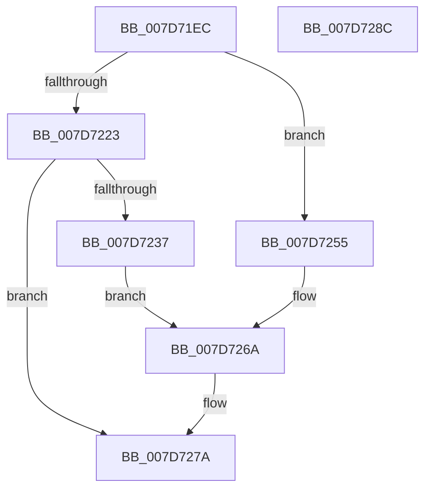

# WheaAddressTranslateAndAddToDefectList

- RVA: `0x007D71EC`–`0x007D728D` (길이 `161` bytes)
- VA: `0x00000001407D71EC`
- 실행 섹션: `PAGE`
- PDB 이름 있음: `예`; PDB Function 태그: `아니요`
- unwind 정보 RVA: `0x000CBCE8`
- 디코드: `45`개 명령, `161/161` bytes 표시
- 미해석 바이트: `0` (있으면 어셈블리에 `.byte`로 보존)

> 이 문서는 커널 이미지의 기계어와 PDB 기호를 분석해 생성했습니다. 4번과 5번은 함수 원형과 자료형을 바이너리 사용 방식에서 추정한 C 해석이며 원본 소스 복구 결과는 아닙니다.

## 1. Dependencies

- 직접 호출 지점: **3**; 고유 호출 대상: **3**
- 직접 호출자로 확인된 함수: **2**
- RIP 상대 이미지 참조: **3**

### Outgoing calls
- `0x007D7227` → `PSHED.dll!PshedTranslatePhysicalAddress` (import, 간접 대상; import `PSHED.dll!PshedTranslatePhysicalAddress`)
- `0x007D726E` → `PSHED.dll!PshedAddToDefectList` (import, 간접 대상; import `PSHED.dll!PshedAddToDefectList`)
- `0x007D7281` → [_security_check_cookie](../../text/6A/_security_check_cookie_function_006AC640.md) (function, `0x006AC640`)

### Direct callers
- [WheaAttemptRowOffline](../../text/65/WheaAttemptRowOffline_function_0065F050.md) at `0x0065F1F0`
- [WheapAttemptPhysicalPageOffline](WheapAttemptPhysicalPageOffline_function_007D79AC.md) at `0x007D7B69`

### Static image references
- `0x007D71F5` → RVA `0x00E0A740` (`.data`; read)
- `0x007D7227` → RVA `0x001510C8` (`PSHED.dll!PshedTranslatePhysicalAddress (IAT)`; read)
- `0x007D726E` → RVA `0x00151158` (`PSHED.dll!PshedAddToDefectList (IAT)`; read)

## 2. Other-region calls and transfers

- 다른 실행 섹션으로 향하는 call: **1**
  - `0x007D7281` → [_security_check_cookie](../../text/6A/_security_check_cookie_function_006AC640.md) (`PAGE` → `.text`)
- 별도 외부 분기/꼬리 이동을 확인하지 못했습니다.

## 3. Assembly (complete function range)

```asm
007D71EC  40 55                           push rbp
007D71EE  48 8B EC                        mov rbp, rsp
007D71F1  48 83 EC 70                     sub rsp, 0x70
007D71F5  48 8B 05 44 35 63 00            mov rax, qword ptr [rip + 0x633544]
007D71FC  48 33 C4                        xor rax, rsp
007D71FF  48 89 45 F8                     mov qword ptr [rbp - 8], rax
007D7203  33 C0                           xor eax, eax
007D7205  0F 57 C0                        xorps xmm0, xmm0
007D7208  48 89 45 E8                     mov qword ptr [rbp - 0x18], rax
007D720C  89 45 F0                        mov dword ptr [rbp - 0x10], eax
007D720F  89 45 D0                        mov dword ptr [rbp - 0x30], eax
007D7212  0F 11 45 D8                     movups xmmword ptr [rbp - 0x28], xmm0
007D7216  0F 11 45 B0                     movups xmmword ptr [rbp - 0x50], xmm0
007D721A  0F 11 45 C0                     movups xmmword ptr [rbp - 0x40], xmm0
007D721E  48 85 D2                        test rdx, rdx
007D7221  75 32                           jne 0x1407d7255
007D7223  48 8D 55 D8                     lea rdx, [rbp - 0x28]
007D7227  48 FF 15 9A 9E 97 FF            call qword ptr [rip - 0x686166]
007D722E  0F 1F 44 00 00                  nop dword ptr [rax + rax]
007D7233  85 C0                           test eax, eax
007D7235  78 43                           js 0x1407d727a
007D7237  0F 10 45 D8                     movups xmm0, xmmword ptr [rbp - 0x28]
007D723B  8B 45 F0                        mov eax, dword ptr [rbp - 0x10]
007D723E  F2 0F 10 4D E8                  movsd xmm1, qword ptr [rbp - 0x18]
007D7243  83 65 D0 00                     and dword ptr [rbp - 0x30], 0
007D7247  0F 11 45 B4                     movups xmmword ptr [rbp - 0x4c], xmm0
007D724B  89 45 CC                        mov dword ptr [rbp - 0x34], eax
007D724E  F2 0F 11 4D C4                  movsd qword ptr [rbp - 0x3c], xmm1
007D7253  EB 15                           jmp 0x1407d726a
007D7255  0F 10 02                        movups xmm0, xmmword ptr [rdx]
007D7258  8B 42 20                        mov eax, dword ptr [rdx + 0x20]
007D725B  0F 10 4A 10                     movups xmm1, xmmword ptr [rdx + 0x10]
007D725F  89 45 D0                        mov dword ptr [rbp - 0x30], eax
007D7262  0F 11 45 B0                     movups xmmword ptr [rbp - 0x50], xmm0
007D7266  0F 11 4D C0                     movups xmmword ptr [rbp - 0x40], xmm1
007D726A  48 8D 4D B0                     lea rcx, [rbp - 0x50]
007D726E  48 FF 15 E3 9E 97 FF            call qword ptr [rip - 0x68611d]
007D7275  0F 1F 44 00 00                  nop dword ptr [rax + rax]
007D727A  48 8B 4D F8                     mov rcx, qword ptr [rbp - 8]
007D727E  48 33 CC                        xor rcx, rsp
007D7281  E8 BA 53 ED FF                  call 0x1406ac640
007D7286  48 83 C4 70                     add rsp, 0x70
007D728A  5D                              pop rbp
007D728B  C3                              ret
007D728C  CC                              int3
```

## 4. C-style interpretation (structured pseudocode)

```c
__int64 __fastcall WheaAddressTranslateAndAddToDefectList(__int64 a1, __int64 a2)
{
    __int64 result;
    __int64 v_rsp;
    unsigned __int64 v_stack_m10;
    unsigned int v_stack_m18;
    unsigned __int64 v_stack_m20;
    unsigned __int64 v_stack_m30;
    unsigned int v_stack_m38;
    unsigned int v_stack_m3C;
    unsigned __int64 v_stack_m44;
    unsigned __int64 v_stack_m48;
    unsigned __int64 v_stack_m54;
    unsigned __int64 v_stack_m58;

    v_rsp = (v_rsp) - (112);
    result = (*(unsigned __int64 *)(v_rip + 6501700)) ^ (v_rsp);
    v_stack_m10 = result;
    result = 0;
    v_stack_m20 = 0;
    v_stack_m18 = 0;
    v_stack_m38 = 0;
    v_stack_m30 = v_xmm0;
    v_stack_m58 = v_xmm0;
    v_stack_m48 = v_xmm0;
    if (a2 != 0) goto loc_007D7255;
    result = PSHED_dll_PshedTranslatePhysicalAddress(a1, v_stack_m30, a3, a4);
    if (sign_flag) goto loc_007D727A;
    v_stack_m54 = v_xmm0;
    v_stack_m3C = (unsigned int)((unsigned int)(v_stack_m18));
    v_stack_m44 = v_xmm1;
    goto loc_007D726A;
loc_007D7255:
    v_stack_m38 = (unsigned int)((unsigned int)(*(unsigned int *)(v_stack_m30 + 32)));
    v_stack_m58 = v_xmm0;
    v_stack_m48 = v_xmm1;
loc_007D726A:
    result = PSHED_dll_PshedAddToDefectList(v_stack_m58, v_stack_m30, a3, a4);
loc_007D727A:
    a1 = (v_stack_m10) ^ (v_rsp);
    result = _security_check_cookie(a1, v_stack_m30, a3, a4);
    v_rsp = (v_rsp) + (112);
    return result;
}
```

## 5. (Beta) C Style

```c
int64_t WheaAddressTranslateAndAddToDefectList(int64_t Arg1, int64_t Arg2)
{
    int64_t result;
    int64_t local_rsp;
    uint64_t v_stack_m10;
    uint32_t v_stack_m18;
    uint64_t v_stack_m20;
    uint64_t v_stack_m30;
    uint32_t v_stack_m38;
    uint32_t v_stack_m3C;
    uint64_t v_stack_m44;
    uint64_t v_stack_m48;
    uint64_t v_stack_m54;
    uint64_t v_stack_m58;

    local_rsp = (local_rsp) - (112);
    result = (*(uint64_t *)(v_rip + 0x633544)) ^ (local_rsp);
    v_stack_m10 = result;
    result = 0;
    v_stack_m20 = 0;
    v_stack_m18 = 0;
    v_stack_m38 = 0;
    v_stack_m30 = v_xmm0;
    v_stack_m58 = v_xmm0;
    v_stack_m48 = v_xmm0;
    if (Arg2 != 0) goto loc_007D7255;
    result = kernel_indirect_call(Arg1, v_stack_m30, a3, a4);
    if (sign_flag) goto loc_007D727A;
    v_stack_m54 = v_xmm0;
    v_stack_m3C = (uint32_t)((uint32_t)(v_stack_m18));
    v_stack_m44 = v_xmm1;
    goto loc_007D726A;
loc_007D7255:
    v_stack_m38 = (uint32_t)((uint32_t)(*(uint32_t *)(v_stack_m30 + 0x20)));
    v_stack_m58 = v_xmm0;
    v_stack_m48 = v_xmm1;
loc_007D726A:
    result = kernel_indirect_call(v_stack_m58, v_stack_m30, a3, a4);
loc_007D727A:
    Arg1 = (v_stack_m10) ^ (local_rsp);
    result = _security_check_cookie(Arg1, v_stack_m30, a3, a4);
    local_rsp = (local_rsp) + (112);
    return result;
}
```

## 6. Execution-region graph

[열기: 2D/3D 그래프와 함수 탐색 컨트롤 패널](../../../control-panel.html?section=page&rva=0x007D71EC&view=graph)

- 2D 그래프는 위에서 아래로 흐르고, 3D 그래프는 빈 공간을 드래그해 회전합니다. Shift+드래그는 이동, 휠은 확대·축소, 함수 노드 선택은 대상 보고서 이동입니다.

### Static fallback


