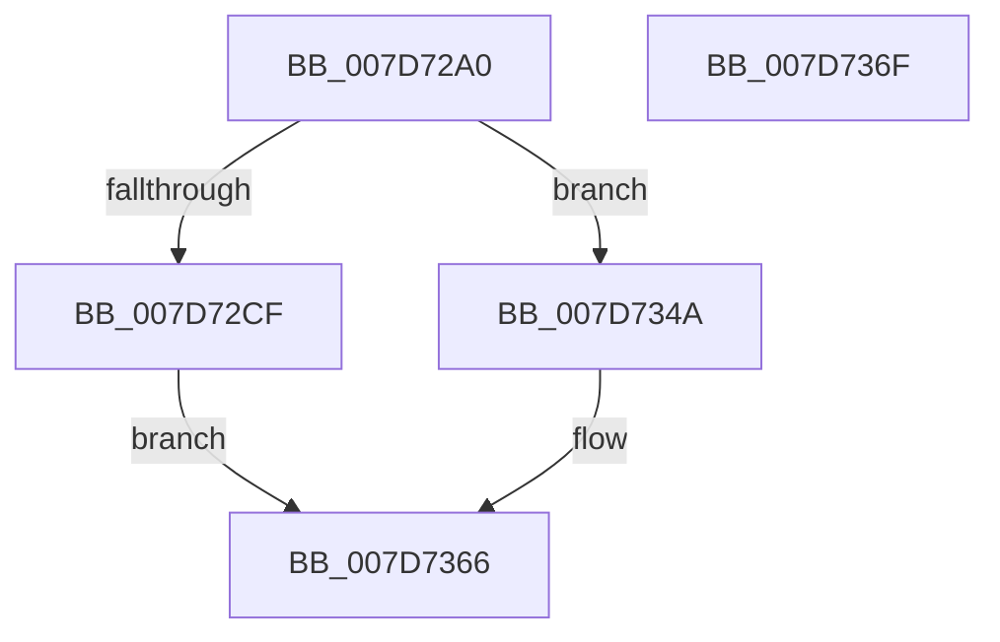

# WheaAttemptClearPoison

- RVA: `0x007D72A0`–`0x007D7370` (길이 `208` bytes)
- VA: `0x00000001407D72A0`
- 실행 섹션: `PAGE`
- PDB 이름 있음: `예`; PDB Function 태그: `아니요`
- unwind 정보 RVA: `0x000D5F40`
- 디코드: `50`개 명령, `208/208` bytes 표시
- 미해석 바이트: `0` (있으면 어셈블리에 `.byte`로 보존)

> 이 문서는 커널 이미지의 기계어와 PDB 기호를 분석해 생성했습니다. 4번과 5번은 함수 원형과 자료형을 바이너리 사용 방식에서 추정한 C 해석이며 원본 소스 복구 결과는 아닙니다.

## 1. Dependencies

- 직접 호출 지점: **4**; 고유 호출 대상: **4**
- 직접 호출자로 확인된 함수: **1**
- RIP 상대 이미지 참조: **1**

### Outgoing calls
- `0x007D7303` → [KeInitializeEvent](../../text/40/KeInitializeEvent_function_0040DD10.md) (function, `0x0040DD10`)
- `0x007D7329` → [ExQueueWorkItem](../../text/2F/ExQueueWorkItem_function_002F9520.md) (function, `0x002F9520`)
- `0x007D7340` → [KeWaitForSingleObject](../../text/20/KeWaitForSingleObject_function_0020E6B0.md) (function, `0x0020E6B0`)
- `0x007D7361` → [WheapAttemptPhysicalPageOffline](WheapAttemptPhysicalPageOffline_function_007D79AC.md) (function, `0x007D79AC`)

### Direct callers
- [HalpMemoryErrorDeferredHandler](../../text/55/HalpMemoryErrorDeferredHandler_function_0055686C.md) at `0x00556886`

### Static image references
- `0x007D730D` → RVA `0x007D7BD0` (`WheapAttemptPhysicalPageOfflineWorker`; read)

## 2. Other-region calls and transfers

- 다른 실행 섹션으로 향하는 call: **3**
  - `0x007D7303` → [KeInitializeEvent](../../text/40/KeInitializeEvent_function_0040DD10.md) (`PAGE` → `.text`)
  - `0x007D7329` → [ExQueueWorkItem](../../text/2F/ExQueueWorkItem_function_002F9520.md) (`PAGE` → `.text`)
  - `0x007D7340` → [KeWaitForSingleObject](../../text/20/KeWaitForSingleObject_function_0020E6B0.md) (`PAGE` → `.text`)
- 별도 외부 분기/꼬리 이동을 확인하지 못했습니다.

## 3. Assembly (complete function range)

```asm
007D72A0  40 55                           push rbp
007D72A2  48 8D 6C 24 A9                  lea rbp, [rsp - 0x57]
007D72A7  48 81 EC A0 00 00 00            sub rsp, 0xa0
007D72AE  48 83 65 FF 00                  and qword ptr [rbp - 1], 0
007D72B3  44 8A CA                        mov r9b, dl
007D72B6  65 48 8B 04 25 88 01 00 00      mov rax, qword ptr gs:[0x188]
007D72BF  48 8B D1                        mov rdx, rcx
007D72C2  48 C1 FA 0C                     sar rdx, 0xc
007D72C6  80 B8 32 02 00 00 01            cmp byte ptr [rax + 0x232], 1
007D72CD  75 7B                           jne 0x1407d734a
007D72CF  48 83 65 3B 00                  and qword ptr [rbp + 0x3b], 0
007D72D4  0F 57 C0                        xorps xmm0, xmm0
007D72D7  83 65 43 00                     and dword ptr [rbp + 0x43], 0
007D72DB  48 89 4D 17                     mov qword ptr [rbp + 0x17], rcx
007D72DF  48 8D 4D 2F                     lea rcx, [rbp + 0x2f]
007D72E3  48 89 55 1F                     mov qword ptr [rbp + 0x1f], rdx
007D72E7  33 D2                           xor edx, edx
007D72E9  4C 89 45 47                     mov qword ptr [rbp + 0x47], r8
007D72ED  45 33 C0                        xor r8d, r8d
007D72F0  F3 0F 7F 45 2B                  movdqu xmmword ptr [rbp + 0x2b], xmm0
007D72F5  44 88 4D 27                     mov byte ptr [rbp + 0x27], r9b
007D72F9  66 C7 45 28 01 01               mov word ptr [rbp + 0x28], 0x101
007D72FF  C6 45 2A 00                     mov byte ptr [rbp + 0x2a], 0
007D7303  E8 08 6A C3 FF                  call 0x14040dd10
007D7308  48 83 65 F7 00                  and qword ptr [rbp - 9], 0
007D730D  48 8D 05 BC 08 00 00            lea rax, [rip + 0x8bc]
007D7314  48 89 45 07                     mov qword ptr [rbp + 7], rax
007D7318  48 8D 4D F7                     lea rcx, [rbp - 9]
007D731C  48 8D 45 17                     lea rax, [rbp + 0x17]
007D7320  BA 01 00 00 00                  mov edx, 1
007D7325  48 89 45 0F                     mov qword ptr [rbp + 0xf], rax
007D7329  E8 F2 21 B2 FF                  call 0x1402f9520
007D732E  48 83 64 24 20 00               and qword ptr [rsp + 0x20], 0
007D7334  48 8D 4D 2F                     lea rcx, [rbp + 0x2f]
007D7338  45 33 C9                        xor r9d, r9d
007D733B  45 33 C0                        xor r8d, r8d
007D733E  33 D2                           xor edx, edx
007D7340  E8 6B 73 A3 FF                  call 0x14020e6b0
007D7345  8B 45 2B                        mov eax, dword ptr [rbp + 0x2b]
007D7348  EB 1C                           jmp 0x1407d7366
007D734A  4C 89 44 24 38                  mov qword ptr [rsp + 0x38], r8
007D734F  45 33 C0                        xor r8d, r8d
007D7352  C6 44 24 30 00                  mov byte ptr [rsp + 0x30], 0
007D7357  C6 44 24 28 01                  mov byte ptr [rsp + 0x28], 1
007D735C  C6 44 24 20 01                  mov byte ptr [rsp + 0x20], 1
007D7361  E8 46 06 00 00                  call 0x1407d79ac
007D7366  48 81 C4 A0 00 00 00            add rsp, 0xa0
007D736D  5D                              pop rbp
007D736E  C3                              ret
007D736F  CC                              int3
```

## 4. C-style interpretation (structured pseudocode)

```c
__int64 __fastcall WheaAttemptClearPoison(__int64 a1, unsigned __int8 a2, __int64 a3)
{
    __int64 result;
    __int64 v_rsp;
    unsigned __int64 v_stack_m18;
    unsigned int v_stack_m1C;
    unsigned __int64 v_stack_m24;
    unsigned __int64 v_stack_m30;
    unsigned __int64 v_stack_m34;
    unsigned __int8 v_stack_m35;
    unsigned __int16 v_stack_m37;
    unsigned __int8 v_stack_m38;
    unsigned __int64 v_stack_m40;
    unsigned __int64 v_stack_m48;
    unsigned __int64 v_stack_m50;
    unsigned __int64 v_stack_m58;
    unsigned __int64 v_stack_m5F;
    unsigned __int64 v_stack_m60;
    unsigned __int64 v_stack_m68;
    unsigned __int64 v_stack_m70;
    unsigned __int8 v_stack_m78;
    unsigned __int8 v_stack_m80;
    unsigned __int64 v_stack_m88;

    v_rsp = (v_rsp) - (160);
    a2 = (a1) >> (12);
    if ((*(unsigned __int8 *)(*(unsigned __int64 *)(gs_base + (0 + 392)) + 562)) != 1) goto loc_007D734A;
    v_stack_m48 = a1;
    v_stack_m40 = a2;
    a2 = 0;
    v_stack_m18 = a3;
    a3 = 0;
    v_stack_m34 = v_xmm0;
    v_stack_m38 = 0;
    v_stack_m37 = 257;
    v_stack_m35 = 0;
    result = KeInitializeEvent(v_stack_m30, a2, a3, a2);
    v_stack_m58 = v_rip + 2236;
    v_stack_m50 = v_stack_m48;
    result = ExQueueWorkItem(v_stack_m68, 1, a3, a2);
    a4 = 0;
    a3 = 0;
    a2 = 0;
    result = KeWaitForSingleObject(v_stack_m30, a2, a3, a4);
    goto loc_007D7366;
loc_007D734A:
    v_stack_m70 = 0;
    a3 = 0;
    v_stack_m78 = 0;
    v_stack_m80 = 1;
    v_stack_m88 = 1;
    result = WheapAttemptPhysicalPageOffline(v_stack_m30, a2, a3, a4);
loc_007D7366:
    v_rsp = (v_rsp) + (160);
    return result;
}
```

## 5. (Beta) C Style

```c
int64_t WheaAttemptClearPoison(int64_t Arg1, uint8_t Arg2, int64_t Arg3)
{
    int64_t result;
    int64_t local_rsp;
    uint64_t v_stack_m18;
    uint32_t v_stack_m1C;
    uint64_t v_stack_m24;
    uint64_t v_stack_m30;
    uint64_t v_stack_m34;
    uint8_t v_stack_m35;
    uint16_t v_stack_m37;
    uint8_t v_stack_m38;
    uint64_t v_stack_m40;
    uint64_t v_stack_m48;
    uint64_t v_stack_m50;
    uint64_t v_stack_m58;
    uint64_t v_stack_m5F;
    uint64_t v_stack_m60;
    uint64_t v_stack_m68;
    uint64_t v_stack_m70;
    uint8_t v_stack_m78;
    uint8_t v_stack_m80;
    uint64_t v_stack_m88;

    local_rsp = (local_rsp) - (160);
    Arg2 = (Arg1) >> (12);
    if ((*(uint8_t *)(*(uint64_t *)(gs_base + (0 + 0x188)) + 0x232)) != 1) goto loc_007D734A;
    v_stack_m48 = Arg1;
    v_stack_m40 = Arg2;
    Arg2 = 0;
    v_stack_m18 = Arg3;
    Arg3 = 0;
    v_stack_m34 = v_xmm0;
    v_stack_m38 = 0;
    v_stack_m37 = 257;
    v_stack_m35 = 0;
    result = KeInitializeEvent(v_stack_m30, Arg2, Arg3, Arg2);
    v_stack_m58 = v_rip + 2236;
    v_stack_m50 = v_stack_m48;
    result = ExQueueWorkItem(v_stack_m68, 1, Arg3, Arg2);
    a4 = 0;
    Arg3 = 0;
    Arg2 = 0;
    result = KeWaitForSingleObject(v_stack_m30, Arg2, Arg3, a4);
    goto loc_007D7366;
loc_007D734A:
    v_stack_m70 = 0;
    Arg3 = 0;
    v_stack_m78 = 0;
    v_stack_m80 = 1;
    v_stack_m88 = 1;
    result = WheapAttemptPhysicalPageOffline(v_stack_m30, Arg2, Arg3, a4);
loc_007D7366:
    local_rsp = (local_rsp) + (160);
    return result;
}
```

## 6. Execution-region graph

[열기: 2D/3D 그래프와 함수 탐색 컨트롤 패널](../../../control-panel.html?section=page&rva=0x007D72A0&view=graph)

- 2D 그래프는 위에서 아래로 흐르고, 3D 그래프는 빈 공간을 드래그해 회전합니다. Shift+드래그는 이동, 휠은 확대·축소, 함수 노드 선택은 대상 보고서 이동입니다.

### Static fallback


