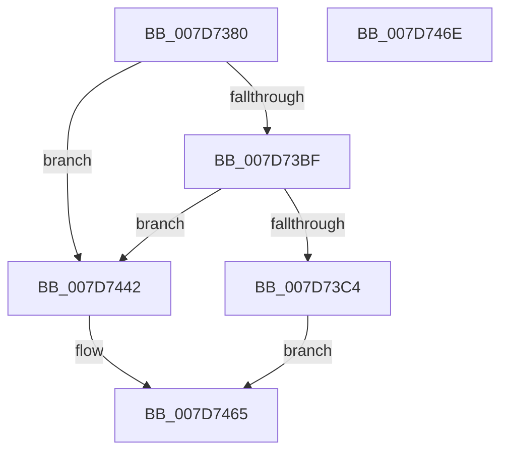

# WheaAttemptPhysicalPageOffline

- RVA: `0x007D7380`–`0x007D746F` (길이 `239` bytes)
- VA: `0x00000001407D7380`
- 실행 섹션: `PAGE`
- PDB 이름 있음: `예`; PDB Function 태그: `아니요`
- unwind 정보 RVA: `0x000D5F40`
- 디코드: `58`개 명령, `239/239` bytes 표시
- 미해석 바이트: `0` (있으면 어셈블리에 `.byte`로 보존)

> 이 문서는 커널 이미지의 기계어와 PDB 기호를 분석해 생성했습니다. 4번과 5번은 함수 원형과 자료형을 바이너리 사용 방식에서 추정한 C 해석이며 원본 소스 복구 결과는 아닙니다.

## 1. Dependencies

- 직접 호출 지점: **4**; 고유 호출 대상: **4**
- 직접 호출자로 확인된 함수: **7**
- RIP 상대 이미지 참조: **1**

### Outgoing calls
- `0x007D73FB` → [KeInitializeEvent](../../text/40/KeInitializeEvent_function_0040DD10.md) (function, `0x0040DD10`)
- `0x007D7421` → [ExQueueWorkItem](../../text/2F/ExQueueWorkItem_function_002F9520.md) (function, `0x002F9520`)
- `0x007D7438` → [KeWaitForSingleObject](../../text/20/KeWaitForSingleObject_function_0020E6B0.md) (function, `0x0020E6B0`)
- `0x007D7460` → [WheapAttemptPhysicalPageOffline](WheapAttemptPhysicalPageOffline_function_007D79AC.md) (function, `0x007D79AC`)

### Direct callers
- [HalpMemoryErrorDeferredHandler](../../text/55/HalpMemoryErrorDeferredHandler_function_0055686C.md) at `0x0055689C`
- [HalpPmemErrorDeferredHandler](../../text/55/HalpPmemErrorDeferredHandler_function_00556A30.md) at `0x00556AB3`
- [KiAltContextProcessMcheckAltReturn](../../text/5C/KiAltContextProcessMcheckAltReturn_function_005CAF50.md) at `0x005CAFEE`
- [KiMcheckAlternateReturn](../../text/5C/KiMcheckAlternateReturn_function_005CB180.md) at `0x005CB3A6`
- [WheapExecuteRowFailureCheck](WheapExecuteRowFailureCheck_function_007D8ED8.md) at `0x007D912B`
- [WheapPfaMemoryCheck](WheapPfaMemoryCheck_function_007D9214.md) at `0x007D93CE`
- [WheapPredictiveFailureAnalysis](../A5/WheapPredictiveFailureAnalysis_function_00A564AC.md) at `0x00A565D7`

### Static image references
- `0x007D7405` → RVA `0x007D7BD0` (`WheapAttemptPhysicalPageOfflineWorker`; read)

## 2. Other-region calls and transfers

- 다른 실행 섹션으로 향하는 call: **3**
  - `0x007D73FB` → [KeInitializeEvent](../../text/40/KeInitializeEvent_function_0040DD10.md) (`PAGE` → `.text`)
  - `0x007D7421` → [ExQueueWorkItem](../../text/2F/ExQueueWorkItem_function_002F9520.md) (`PAGE` → `.text`)
  - `0x007D7438` → [KeWaitForSingleObject](../../text/20/KeWaitForSingleObject_function_0020E6B0.md) (`PAGE` → `.text`)
- 별도 외부 분기/꼬리 이동을 확인하지 못했습니다.

## 3. Assembly (complete function range)

```asm
007D7380  40 55                           push rbp
007D7382  48 8D 6C 24 B1                  lea rbp, [rsp - 0x4f]
007D7387  48 81 EC A0 00 00 00            sub rsp, 0xa0
007D738E  48 83 65 5F 00                  and qword ptr [rbp + 0x5f], 0
007D7393  44 8A D2                        mov r10b, dl
007D7396  48 83 65 F7 00                  and qword ptr [rbp - 9], 0
007D739B  48 8B D1                        mov rdx, rcx
007D739E  65 48 8B 04 25 88 01 00 00      mov rax, qword ptr gs:[0x188]
007D73A7  89 55 5F                        mov dword ptr [rbp + 0x5f], edx
007D73AA  48 8B 4D 5F                     mov rcx, qword ptr [rbp + 0x5f]
007D73AE  48 C1 E1 0C                     shl rcx, 0xc
007D73B2  80 B8 32 02 00 00 01            cmp byte ptr [rax + 0x232], 1
007D73B9  0F 85 83 00 00 00               jne 0x1407d7442
007D73BF  45 84 C9                        test r9b, r9b
007D73C2  75 7E                           jne 0x1407d7442
007D73C4  48 8B 45 7F                     mov rax, qword ptr [rbp + 0x7f]
007D73C8  0F 57 C0                        xorps xmm0, xmm0
007D73CB  48 83 65 33 00                  and qword ptr [rbp + 0x33], 0
007D73D0  83 65 3B 00                     and dword ptr [rbp + 0x3b], 0
007D73D4  66 83 65 21 00                  and word ptr [rbp + 0x21], 0
007D73D9  48 89 4D 0F                     mov qword ptr [rbp + 0xf], rcx
007D73DD  48 8D 4D 27                     lea rcx, [rbp + 0x27]
007D73E1  48 89 55 17                     mov qword ptr [rbp + 0x17], rdx
007D73E5  33 D2                           xor edx, edx
007D73E7  44 88 45 20                     mov byte ptr [rbp + 0x20], r8b
007D73EB  45 33 C0                        xor r8d, r8d
007D73EE  F3 0F 7F 45 23                  movdqu xmmword ptr [rbp + 0x23], xmm0
007D73F3  48 89 45 3F                     mov qword ptr [rbp + 0x3f], rax
007D73F7  44 88 55 1F                     mov byte ptr [rbp + 0x1f], r10b
007D73FB  E8 10 69 C3 FF                  call 0x14040dd10
007D7400  48 83 65 EF 00                  and qword ptr [rbp - 0x11], 0
007D7405  48 8D 05 C4 07 00 00            lea rax, [rip + 0x7c4]
007D740C  48 89 45 FF                     mov qword ptr [rbp - 1], rax
007D7410  48 8D 4D EF                     lea rcx, [rbp - 0x11]
007D7414  48 8D 45 0F                     lea rax, [rbp + 0xf]
007D7418  BA 01 00 00 00                  mov edx, 1
007D741D  48 89 45 07                     mov qword ptr [rbp + 7], rax
007D7421  E8 FA 20 B2 FF                  call 0x1402f9520
007D7426  48 83 64 24 20 00               and qword ptr [rsp + 0x20], 0
007D742C  48 8D 4D 27                     lea rcx, [rbp + 0x27]
007D7430  45 33 C9                        xor r9d, r9d
007D7433  45 33 C0                        xor r8d, r8d
007D7436  33 D2                           xor edx, edx
007D7438  E8 73 72 A3 FF                  call 0x14020e6b0
007D743D  8B 45 23                        mov eax, dword ptr [rbp + 0x23]
007D7440  EB 23                           jmp 0x1407d7465
007D7442  48 8B 45 7F                     mov rax, qword ptr [rbp + 0x7f]
007D7446  48 89 44 24 38                  mov qword ptr [rsp + 0x38], rax
007D744B  44 88 4C 24 30                  mov byte ptr [rsp + 0x30], r9b
007D7450  45 8A CA                        mov r9b, r10b
007D7453  C6 44 24 28 00                  mov byte ptr [rsp + 0x28], 0
007D7458  44 88 44 24 20                  mov byte ptr [rsp + 0x20], r8b
007D745D  45 33 C0                        xor r8d, r8d
007D7460  E8 47 05 00 00                  call 0x1407d79ac
007D7465  48 81 C4 A0 00 00 00            add rsp, 0xa0
007D746C  5D                              pop rbp
007D746D  C3                              ret
007D746E  CC                              int3
```

## 4. C-style interpretation (structured pseudocode)

```c
__int64 __fastcall WheaAttemptPhysicalPageOffline(__int64 a1, unsigned __int8 a2, int a3, int a4, __int64 a5)
{
    __int64 result;
    __int64 v_rsp;
    unsigned __int64 v_stack_m18;
    unsigned int v_stack_m1C;
    unsigned __int64 v_stack_m24;
    unsigned __int64 v_stack_m30;
    unsigned __int64 v_stack_m34;
    unsigned __int16 v_stack_m36;
    unsigned __int8 v_stack_m37;
    unsigned __int8 v_stack_m38;
    unsigned __int64 v_stack_m40;
    unsigned __int64 v_stack_m48;
    unsigned __int64 v_stack_m50;
    unsigned __int64 v_stack_m57;
    unsigned __int64 v_stack_m58;
    unsigned __int64 v_stack_m60;
    unsigned __int64 v_stack_m68;
    unsigned __int64 v_stack_m70;
    unsigned __int8 v_stack_m78;
    unsigned __int8 v_stack_m80;
    unsigned __int64 v_stack_m88;
    unsigned __int64 v_stack_p8;

    v_rsp = (v_rsp) - (160);
    v_stack_p8 = (unsigned int)(a1);
    a1 = (v_stack_p8) << (12);
    if ((*(unsigned __int8 *)(*(unsigned __int64 *)(gs_base + (0 + 392)) + 562)) != 1) goto loc_007D7442;
    if ((unsigned __int8)(a4) != 0) goto loc_007D7442;
    v_stack_m48 = a1;
    v_stack_m40 = a1;
    a2 = 0;
    v_stack_m37 = (unsigned __int8)(a3);
    a3 = 0;
    v_stack_m34 = v_xmm0;
    v_stack_m18 = a5;
    v_stack_m38 = 0;
    result = KeInitializeEvent(v_stack_m30, a2, a3, a4);
    v_stack_m58 = v_rip + 1988;
    v_stack_m50 = v_stack_m48;
    result = ExQueueWorkItem(v_stack_m68, 1, a3, a4);
    a4 = 0;
    a3 = 0;
    a2 = 0;
    result = KeWaitForSingleObject(v_stack_m30, a2, a3, a4);
    goto loc_007D7465;
loc_007D7442:
    v_stack_m70 = a5;
    v_stack_m78 = 0;
    v_stack_m80 = 0;
    v_stack_m88 = 0;
    a3 = 0;
    result = WheapAttemptPhysicalPageOffline(v_stack_m30, a2, a3, 0);
loc_007D7465:
    v_rsp = (v_rsp) + (160);
    return result;
}
```

## 5. (Beta) C Style

```c
int64_t WheaAttemptPhysicalPageOffline(int64_t Arg1, uint8_t Arg2, int32_t Arg3, int32_t Arg4, int64_t Arg5)
{
    int64_t result;
    int64_t local_rsp;
    uint64_t v_stack_m18;
    uint32_t v_stack_m1C;
    uint64_t v_stack_m24;
    uint64_t v_stack_m30;
    uint64_t v_stack_m34;
    uint16_t v_stack_m36;
    uint8_t v_stack_m37;
    uint8_t v_stack_m38;
    uint64_t v_stack_m40;
    uint64_t v_stack_m48;
    uint64_t v_stack_m50;
    uint64_t v_stack_m57;
    uint64_t v_stack_m58;
    uint64_t v_stack_m60;
    uint64_t v_stack_m68;
    uint64_t v_stack_m70;
    uint8_t v_stack_m78;
    uint8_t v_stack_m80;
    uint64_t v_stack_m88;
    uint64_t v_stack_p8;

    local_rsp = (local_rsp) - (160);
    v_stack_p8 = (uint32_t)(Arg1);
    Arg1 = (v_stack_p8) << (12);
    if ((*(uint8_t *)(*(uint64_t *)(gs_base + (0 + 0x188)) + 0x232)) != 1) goto loc_007D7442;
    if ((uint8_t)(Arg4) != 0) goto loc_007D7442;
    v_stack_m48 = Arg1;
    v_stack_m40 = Arg1;
    Arg2 = 0;
    v_stack_m37 = (uint8_t)(Arg3);
    Arg3 = 0;
    v_stack_m34 = v_xmm0;
    v_stack_m18 = Arg5;
    v_stack_m38 = 0;
    result = KeInitializeEvent(v_stack_m30, Arg2, Arg3, Arg4);
    v_stack_m58 = v_rip + 1988;
    v_stack_m50 = v_stack_m48;
    result = ExQueueWorkItem(v_stack_m68, 1, Arg3, Arg4);
    Arg4 = 0;
    Arg3 = 0;
    Arg2 = 0;
    result = KeWaitForSingleObject(v_stack_m30, Arg2, Arg3, Arg4);
    goto loc_007D7465;
loc_007D7442:
    v_stack_m70 = Arg5;
    v_stack_m78 = 0;
    v_stack_m80 = 0;
    v_stack_m88 = 0;
    Arg3 = 0;
    result = WheapAttemptPhysicalPageOffline(v_stack_m30, Arg2, Arg3, 0);
loc_007D7465:
    local_rsp = (local_rsp) + (160);
    return result;
}
```

## 6. Execution-region graph

[열기: 2D/3D 그래프와 함수 탐색 컨트롤 패널](../../../control-panel.html?section=page&rva=0x007D7380&view=graph)

- 2D 그래프는 위에서 아래로 흐르고, 3D 그래프는 빈 공간을 드래그해 회전합니다. Shift+드래그는 이동, 휠은 확대·축소, 함수 노드 선택은 대상 보고서 이동입니다.

### Static fallback


