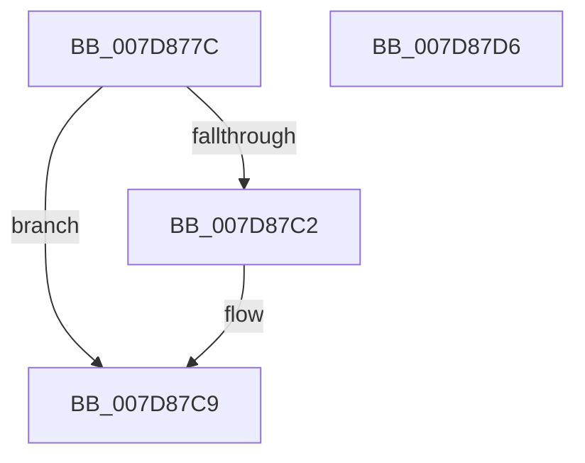

# WheaCrashDumpInitializationComplete

- RVA: `0x007D877C`–`0x007D87D7` (길이 `91` bytes)
- VA: `0x00000001407D877C`
- 실행 섹션: `PAGE`
- PDB 이름 있음: `예`; PDB Function 태그: `아니요`
- unwind 정보 RVA: `0x0005CAAC`
- 디코드: `24`개 명령, `91/91` bytes 표시
- 미해석 바이트: `0` (있으면 어셈블리에 `.byte`로 보존)

> 이 문서는 커널 이미지의 기계어와 PDB 기호를 분석해 생성했습니다. 4번과 5번은 함수 원형과 자료형을 바이너리 사용 방식에서 추정한 C 해석이며 원본 소스 복구 결과는 아닙니다.

## 1. Dependencies

- 직접 호출 지점: **3**; 고유 호출 대상: **3**
- 직접 호출자로 확인된 함수: **1**
- RIP 상대 이미지 참조: **3**

### Outgoing calls
- `0x007D878F` → [ExAcquireFastMutex](../../text/20/ExAcquireFastMutex_function_0020E5A0.md) (function, `0x0020E5A0`)
- `0x007D87B9` → [ExReleaseFastMutex](../../text/25/ExReleaseFastMutex_function_002519C0.md) (function, `0x002519C0`)
- `0x007D87C2` → [WheapReportDeferredLiveDumps](WheapReportDeferredLiveDumps_function_007D87E0.md) (function, `0x007D87E0`)

### Direct callers
- [NtSetSystemInformation](../AF/NtSetSystemInformation_function_00AF4A60.md) at `0x00AF510B`

### Static image references
- `0x007D8786` → RVA `0x00EF7DA0` (`.data`; read)
- `0x007D879B` → RVA `0x00EF7DE0` (`.data`; read)
- `0x007D87A2` → RVA `0x00EEFAEC` (`.data`; write)

## 2. Other-region calls and transfers

- 다른 실행 섹션으로 향하는 call: **2**
  - `0x007D878F` → [ExAcquireFastMutex](../../text/20/ExAcquireFastMutex_function_0020E5A0.md) (`PAGE` → `.text`)
  - `0x007D87B9` → [ExReleaseFastMutex](../../text/25/ExReleaseFastMutex_function_002519C0.md) (`PAGE` → `.text`)
- 별도 외부 분기/꼬리 이동을 확인하지 못했습니다.

## 3. Assembly (complete function range)

```asm
007D877C  48 89 5C 24 08                  mov qword ptr [rsp + 8], rbx
007D8781  57                              push rdi
007D8782  48 83 EC 20                     sub rsp, 0x20
007D8786  48 8D 0D 13 F6 71 00            lea rcx, [rip + 0x71f613]
007D878D  33 FF                           xor edi, edi
007D878F  E8 0C 5E A3 FF                  call 0x14020e5a0
007D8794  8D 57 01                        lea edx, [rdi + 1]
007D8797  40 0F B6 DF                     movzx ebx, dil
007D879B  48 8D 05 3E F6 71 00            lea rax, [rip + 0x71f63e]
007D87A2  88 15 44 73 71 00               mov byte ptr [rip + 0x717344], dl
007D87A8  48 39 05 31 F6 71 00            cmp qword ptr [rip + 0x71f631], rax
007D87AF  48 8D 0D EA F5 71 00            lea rcx, [rip + 0x71f5ea]
007D87B6  0F 45 DA                        cmovne ebx, edx
007D87B9  E8 02 92 A7 FF                  call 0x1402519c0
007D87BE  84 DB                           test bl, bl
007D87C0  74 07                           je 0x1407d87c9
007D87C2  E8 19 00 00 00                  call 0x1407d87e0
007D87C7  8B F8                           mov edi, eax
007D87C9  48 8B 5C 24 30                  mov rbx, qword ptr [rsp + 0x30]
007D87CE  8B C7                           mov eax, edi
007D87D0  48 83 C4 20                     add rsp, 0x20
007D87D4  5F                              pop rdi
007D87D5  C3                              ret
007D87D6  CC                              int3
```

## 4. C-style interpretation (structured pseudocode)

```c
__int64 __fastcall WheaCrashDumpInitializationComplete(void)
{
    __int64 result;
    __int64 v_rbx;
    __int64 v_rdi;
    __int64 v_rsp;
    unsigned __int64 v_stack_p8;

    v_stack_p8 = v_rbx;
    v_rsp = (v_rsp) - (32);
    v_rdi = 0;
    result = ExAcquireFastMutex(v_rip + 7468563, a2, a3, a4);
    *(unsigned __int8 *)(v_rip + 7435076) = (unsigned __int8)(v_rdi + 1);
    v_rbx = 0;
    if ((*(unsigned __int64 *)(v_rip + 7468593)) != (v_rip + 7468606)) { v_rbx = (unsigned int)(v_rdi + 1); }
    result = ExReleaseFastMutex(v_rip + 7468522, v_rdi + 1, a3, a4);
    if ((unsigned __int8)(v_rbx) != 0) {
        result = WheapReportDeferredLiveDumps(v_rip + 7468522, v_rdi + 1, a3, a4);
        v_rdi = (unsigned int)(result);
    }
    v_rsp = (v_rsp) + (32);
    return (unsigned int)((unsigned int)(v_rdi));
}
```

## 5. (Beta) C Style

```c
void WheaCrashDumpInitializationComplete(void)
{
    int64_t result;
    int64_t local_rbx;
    int64_t local_rdi;
    int64_t local_rsp;
    uint64_t v_stack_p8;

    v_stack_p8 = local_rbx;
    local_rsp = (local_rsp) - (32);
    local_rdi = 0;
    result = ExAcquireFastMutex(v_rip + 7468563, a2, a3, a4);
    *(uint8_t *)(v_rip + 0x717344) = (uint8_t)(local_rdi + 1);
    local_rbx = 0;
    if ((*(uint64_t *)(v_rip + 0x71F631)) != (v_rip + 7468606)) { local_rbx = (uint32_t)(local_rdi + 1); }
    result = ExReleaseFastMutex(v_rip + 7468522, local_rdi + 1, a3, a4);
    if ((uint8_t)(local_rbx) != 0) {
        result = WheapReportDeferredLiveDumps(v_rip + 7468522, local_rdi + 1, a3, a4);
        local_rdi = (uint32_t)(result);
    }
    local_rsp = (local_rsp) + (32);
    return (uint32_t)((uint32_t)(local_rdi));
}
```

## 6. Execution-region graph

[열기: 2D/3D 그래프와 함수 탐색 컨트롤 패널](../../../control-panel.html?section=page&rva=0x007D877C&view=graph)

- 2D 그래프는 위에서 아래로 흐르고, 3D 그래프는 빈 공간을 드래그해 회전합니다. Shift+드래그는 이동, 휠은 확대·축소, 함수 노드 선택은 대상 보고서 이동입니다.

### Static fallback


