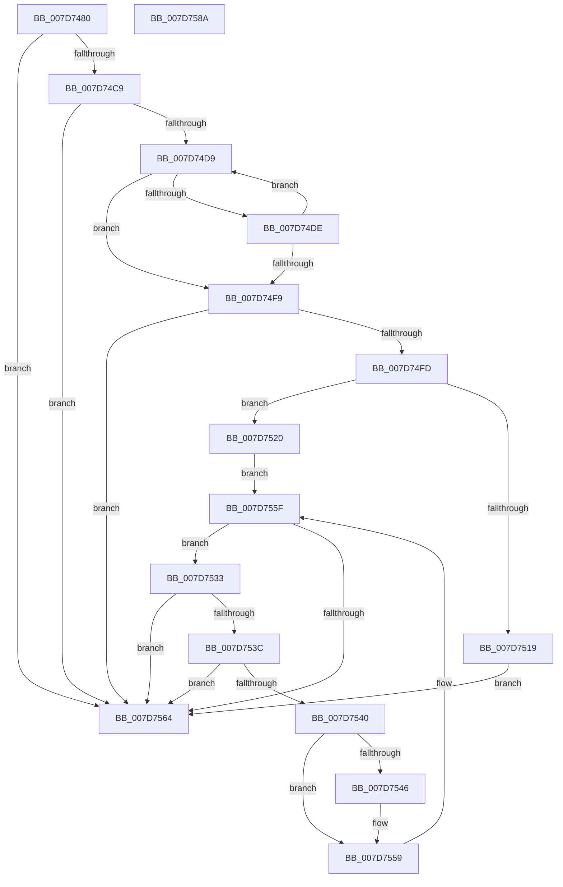

# WheaGetErrorSourceInfo

- RVA: `0x007D7480`–`0x007D758B` (길이 `267` bytes)
- VA: `0x00000001407D7480`
- 실행 섹션: `PAGE`
- PDB 이름 있음: `예`; PDB Function 태그: `아니요`
- unwind 정보 RVA: `0x00075C18`
- 디코드: `82`개 명령, `267/267` bytes 표시
- 미해석 바이트: `0` (있으면 어셈블리에 `.byte`로 보존)

> 이 문서는 커널 이미지의 기계어와 PDB 기호를 분석해 생성했습니다. 4번과 5번은 함수 원형과 자료형을 바이너리 사용 방식에서 추정한 C 해석이며 원본 소스 복구 결과는 아닙니다.

## 1. Dependencies

- 직접 호출 지점: **1**; 고유 호출 대상: **1**
- 직접 호출자로 확인된 함수: **1**
- RIP 상대 이미지 참조: **2**

### Outgoing calls
- `0x007D750C` → [ExAllocatePool2](../../poolcode/B8/ExAllocatePool2_function_00B820F0.md) (function, `0x00B820F0`)

### Direct callers
- [PopReadWheaBootErrorCount](../../init/C3/PopReadWheaBootErrorCount_function_00C3E1CC.md) at `0x00C3E204`

### Static image references
- `0x007D749C` → RVA `0x00EEF028` (`.data`; read)
- `0x007D74AA` → RVA `0x00EEF01C` (`.data`; read)

## 2. Other-region calls and transfers

- 다른 실행 섹션으로 향하는 call: **1**
  - `0x007D750C` → [ExAllocatePool2](../../poolcode/B8/ExAllocatePool2_function_00B820F0.md) (`PAGE` → `POOLCODE`)
- 별도 외부 분기/꼬리 이동을 확인하지 못했습니다.

## 3. Assembly (complete function range)

```asm
007D7480  48 89 5C 24 08                  mov qword ptr [rsp + 8], rbx
007D7485  48 89 6C 24 10                  mov qword ptr [rsp + 0x10], rbp
007D748A  48 89 74 24 18                  mov qword ptr [rsp + 0x18], rsi
007D748F  57                              push rdi
007D7490  41 54                           push r12
007D7492  41 55                           push r13
007D7494  41 56                           push r14
007D7496  41 57                           push r15
007D7498  48 83 EC 20                     sub rsp, 0x20
007D749C  4C 8B 1D 85 7B 71 00            mov r11, qword ptr [rip + 0x717b85]
007D74A3  33 DB                           xor ebx, ebx
007D74A5  89 1A                           mov dword ptr [rdx], ebx
007D74A7  4D 8B E8                        mov r13, r8
007D74AA  44 8B 35 6B 7B 71 00            mov r14d, dword ptr [rip + 0x717b6b]
007D74B1  4C 8B FA                        mov r15, rdx
007D74B4  44 8B E1                        mov r12d, ecx
007D74B7  44 8B D3                        mov r10d, ebx
007D74BA  8B EB                           mov ebp, ebx
007D74BC  8B FB                           mov edi, ebx
007D74BE  8B F3                           mov esi, ebx
007D74C0  45 85 F6                        test r14d, r14d
007D74C3  0F 84 9B 00 00 00               je 0x1407d7564
007D74C9  48 8D 15 58 7B 71 00            lea rdx, [rip + 0x717b58]
007D74D0  4C 3B DA                        cmp r11, rdx
007D74D3  0F 84 8B 00 00 00               je 0x1407d7564
007D74D9  41 3B EE                        cmp ebp, r14d
007D74DC  73 1B                           jae 0x1407d74f9
007D74DE  49 8D 43 28                     lea rax, [r11 + 0x28]
007D74E2  FF C5                           inc ebp
007D74E4  8B 08                           mov ecx, dword ptr [rax]
007D74E6  8D 47 01                        lea eax, [rdi + 1]
007D74E9  4D 8B 1B                        mov r11, qword ptr [r11]
007D74EC  41 3B CC                        cmp ecx, r12d
007D74EF  0F 45 C7                        cmovne eax, edi
007D74F2  8B F8                           mov edi, eax
007D74F4  4C 3B DA                        cmp r11, rdx
007D74F7  75 E0                           jne 0x1407d74d9
007D74F9  85 FF                           test edi, edi
007D74FB  74 67                           je 0x1407d7564
007D74FD  8D 14 FD 00 00 00 00            lea edx, [rdi*8]
007D7504  45 8B C1                        mov r8d, r9d
007D7507  B9 00 01 00 00                  mov ecx, 0x100
007D750C  E8 DF AB 3A 00                  call 0x140b820f0
007D7511  4C 8B D0                        mov r10, rax
007D7514  48 85 C0                        test rax, rax
007D7517  75 07                           jne 0x1407d7520
007D7519  BE 17 00 00 C0                  mov esi, 0xc0000017
007D751E  EB 44                           jmp 0x1407d7564
007D7520  48 8B 15 01 7B 71 00            mov rdx, qword ptr [rip + 0x717b01]
007D7527  4C 8D 0D FA 7A 71 00            lea r9, [rip + 0x717afa]
007D752E  44 8B C3                        mov r8d, ebx
007D7531  EB 2C                           jmp 0x1407d755f
007D7533  44 3B 05 E2 7A 71 00            cmp r8d, dword ptr [rip + 0x717ae2]
007D753A  73 28                           jae 0x1407d7564
007D753C  3B DF                           cmp ebx, edi
007D753E  73 24                           jae 0x1407d7564
007D7540  44 39 62 28                     cmp dword ptr [rdx + 0x28], r12d
007D7544  75 13                           jne 0x1407d7559
007D7546  8B 42 7C                        mov eax, dword ptr [rdx + 0x7c]
007D7549  8B CB                           mov ecx, ebx
007D754B  FF C3                           inc ebx
007D754D  41 89 44 CA 04                  mov dword ptr [r10 + rcx*8 + 4], eax
007D7552  8B 42 18                        mov eax, dword ptr [rdx + 0x18]
007D7555  41 89 04 CA                     mov dword ptr [r10 + rcx*8], eax
007D7559  48 8B 12                        mov rdx, qword ptr [rdx]
007D755C  41 FF C0                        inc r8d
007D755F  49 3B D1                        cmp rdx, r9
007D7562  75 CF                           jne 0x1407d7533
007D7564  48 8B 5C 24 50                  mov rbx, qword ptr [rsp + 0x50]
007D7569  8B C6                           mov eax, esi
007D756B  48 8B 74 24 60                  mov rsi, qword ptr [rsp + 0x60]
007D7570  48 8B 6C 24 58                  mov rbp, qword ptr [rsp + 0x58]
007D7575  41 89 3F                        mov dword ptr [r15], edi
007D7578  4D 89 55 00                     mov qword ptr [r13], r10
007D757C  48 83 C4 20                     add rsp, 0x20
007D7580  41 5F                           pop r15
007D7582  41 5E                           pop r14
007D7584  41 5D                           pop r13
007D7586  41 5C                           pop r12
007D7588  5F                              pop rdi
007D7589  C3                              ret
007D758A  CC                              int3
```

## 4. C-style interpretation (structured pseudocode)

```c
__int64 __fastcall WheaGetErrorSourceInfo(int a1, __int64 a2, __int64 a3, int a4)
{
    __int64 result;
    __int64 v_rbp;
    __int64 v_rbx;
    __int64 v_rsp;
    unsigned __int64 v_stack_p10;
    unsigned __int64 v_stack_p18;
    unsigned __int64 v_stack_p8;

    v_stack_p8 = v_rbx;
    v_stack_p10 = v_rbp;
    v_stack_p18 = v_rsi;
    v_rsp = (v_rsp) - (32);
    v_rbx = 0;
    *(unsigned int *)(a2) = 0;
    if ((unsigned int)((unsigned int)(*(unsigned int *)(v_rip + 7437163))) == 0) goto loc_007D7564;
    if ((*(unsigned __int64 *)(v_rip + 7437189)) == (v_rip + 7437144)) goto loc_007D7564;
loc_007D74D9:
    if (0 >= ((unsigned int)((unsigned int)(*(unsigned int *)(v_rip + 7437163))))) goto loc_007D74F9;
    v_rbp = (unsigned int)((0) + 1);
    result = 0 + 1;
    if (((unsigned int)((unsigned int)(*(unsigned int *)(*(unsigned __int64 *)(v_rip + 7437189) + 40)))) != ((unsigned int)((unsigned int)(a1)))) { result = 0; }
    if ((*(unsigned __int64 *)(*(unsigned __int64 *)(v_rip + 7437189))) != (v_rip + 7437144)) goto loc_007D74D9;
loc_007D74F9:
    if ((unsigned int)((unsigned int)((unsigned int)(result))) == 0) goto loc_007D7564;
    result = ExAllocatePool2(256, (unsigned int)((unsigned int)(result)) * 8, (unsigned int)(a4), a4);
    if (result != 0) goto loc_007D7520;
    goto loc_007D7564;
loc_007D7520:
    goto loc_007D755F;
loc_007D7533:
    if (0 >= (*(unsigned int *)(v_rip + 7437026))) goto loc_007D7564;
    if (0 >= ((unsigned int)((unsigned int)((unsigned int)(result))))) goto loc_007D7564;
    if ((*(unsigned int *)(*(unsigned __int64 *)(v_rip + 7437057) + 40)) == ((unsigned int)((unsigned int)(a1)))) {
        result = *(unsigned int *)(*(unsigned __int64 *)(v_rip + 7437057) + 124);
        a1 = 0;
        v_rbx = (unsigned int)((v_rbx) + 1);
        *(unsigned int *)(result + a1 * 8 + 4) = (unsigned int)(result);
        result = *(unsigned int *)(*(unsigned __int64 *)(v_rip + 7437057) + 24);
        *(unsigned int *)(result + a1 * 8) = (unsigned int)(result);
    }
    a3 = (unsigned int)((0) + 1);
loc_007D755F:
    if ((*(unsigned __int64 *)(*(unsigned __int64 *)(v_rip + 7437057))) != (v_rip + 7437050)) goto loc_007D7533;
loc_007D7564:
    *(unsigned int *)(a2) = (unsigned int)((unsigned int)((unsigned int)(result)));
    *(unsigned __int64 *)(a3) = result;
    v_rsp = (v_rsp) + (32);
    return (unsigned int)((unsigned int)((unsigned int)(0xC0000017ULL)));
}
```

## 5. (Beta) C Style

```c
int64_t WheaGetErrorSourceInfo(int32_t Arg1, void *Arg2, void *Arg3, int32_t Arg4)
{
    uint8_t *arg2 = (uint8_t *)Arg2;
    uint8_t *arg3 = (uint8_t *)Arg3;

    int64_t result;
    int64_t local_rbp;
    int64_t local_rbx;
    int64_t local_rsp;
    uint64_t v_stack_p10;
    uint64_t v_stack_p18;
    uint64_t v_stack_p8;

    v_stack_p8 = local_rbx;
    v_stack_p10 = local_rbp;
    v_stack_p18 = local_rsi;
    local_rsp = (local_rsp) - (32);
    local_rbx = 0;
    *(uint32_t *)(arg2) = 0;
    if ((uint32_t)((uint32_t)(*(uint32_t *)(v_rip + 0x717B6B))) == 0) goto loc_007D7564;
    if ((*(uint64_t *)(v_rip + 0x717B85)) == (v_rip + 7437144)) goto loc_007D7564;
loc_007D74D9:
    if (0 >= ((uint32_t)((uint32_t)(*(uint32_t *)(v_rip + 0x717B6B))))) goto loc_007D74F9;
    local_rbp = (uint32_t)((0) + 1);
    result = 0 + 1;
    if (((uint32_t)((uint32_t)(*(uint32_t *)(*(uint64_t *)(v_rip + 0x717B85) + 0x28)))) != ((uint32_t)((uint32_t)(Arg1)))) { result = 0; }
    if ((*(uint64_t *)(*(uint64_t *)(v_rip + 0x717B85))) != (v_rip + 7437144)) goto loc_007D74D9;
loc_007D74F9:
    if ((uint32_t)((uint32_t)((uint32_t)(result))) == 0) goto loc_007D7564;
    result = ExAllocatePool2(256, (uint32_t)((uint32_t)(result)) * 8, (uint32_t)(Arg4), Arg4);
    if (result != 0) goto loc_007D7520;
    goto loc_007D7564;
loc_007D7520:
    goto loc_007D755F;
loc_007D7533:
    if (0 >= (*(uint32_t *)(v_rip + 0x717AE2))) goto loc_007D7564;
    if (0 >= ((uint32_t)((uint32_t)((uint32_t)(result))))) goto loc_007D7564;
    if ((*(uint32_t *)(*(uint64_t *)(v_rip + 0x717B01) + 0x28)) == ((uint32_t)((uint32_t)(Arg1)))) {
        result = *(uint32_t *)(*(uint64_t *)(v_rip + 0x717B01) + 0x7C);
        Arg1 = 0;
        local_rbx = (uint32_t)((local_rbx) + 1);
        *(uint32_t *)(result + Arg1 * 8 + 0x4) = (uint32_t)(result);
        result = *(uint32_t *)(*(uint64_t *)(v_rip + 0x717B01) + 0x18);
        *(uint32_t *)(result + Arg1 * 8) = (uint32_t)(result);
    }
    Arg3 = (uint32_t)((0) + 1);
loc_007D755F:
    if ((*(uint64_t *)(*(uint64_t *)(v_rip + 0x717B01))) != (v_rip + 7437050)) goto loc_007D7533;
loc_007D7564:
    *(uint32_t *)(arg2) = (uint32_t)((uint32_t)((uint32_t)(result)));
    *(uint64_t *)(arg3) = result;
    local_rsp = (local_rsp) + (32);
    return (uint32_t)((uint32_t)((uint32_t)(0xC0000017ULL)));
}
```

### 관측된 메모리 오프셋

구조체 형식이 확인되지 않은 접근은 인자 기준의 오프셋으로만 기록했습니다.

| 기준 인자 | 오프셋 표현 | 폭 (bit) | 접근 |
|---|---:|---:|---|
| `Arg2` | `+ 0x0` | `32` | `W` |
| `Arg3` | `+ 0x0` | `64` | `W` |

## 6. Execution-region graph

[열기: 2D/3D 그래프와 함수 탐색 컨트롤 패널](../../../control-panel.html?section=page&rva=0x007D7480&view=graph)

- 2D 그래프는 위에서 아래로 흐르고, 3D 그래프는 빈 공간을 드래그해 회전합니다. Shift+드래그는 이동, 휠은 확대·축소, 함수 노드 선택은 대상 보고서 이동입니다.

### Static fallback


