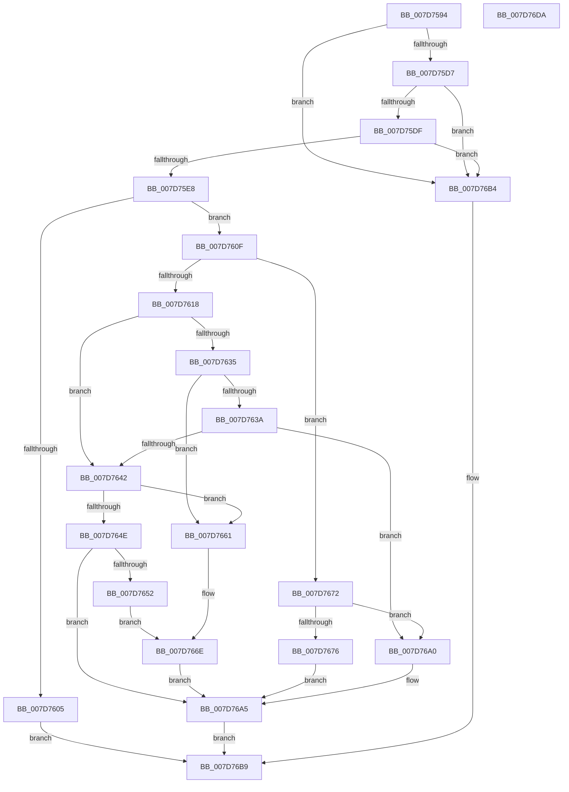

# WheaPageOfflineAndPersist

- RVA: `0x007D7594`–`0x007D76DB` (길이 `327` bytes)
- VA: `0x00000001407D7594`
- 실행 섹션: `PAGE`
- PDB 이름 있음: `예`; PDB Function 태그: `아니요`
- unwind 정보 RVA: `0x000D5EB0`
- 디코드: `93`개 명령, `327/327` bytes 표시
- 미해석 바이트: `0` (있으면 어셈블리에 `.byte`로 보존)

> 이 문서는 커널 이미지의 기계어와 PDB 기호를 분석해 생성했습니다. 4번과 5번은 함수 원형과 자료형을 바이너리 사용 방식에서 추정한 C 해석이며 원본 소스 복구 결과는 아닙니다.

## 1. Dependencies

- 직접 호출 지점: **6**; 고유 호출 대상: **6**
- 직접 호출자로 확인된 함수: **1**
- RIP 상대 이미지 참조: **1**

### Outgoing calls
- `0x007D75F8` → [ExAllocatePool2](../../poolcode/B8/ExAllocatePool2_function_00B820F0.md) (function, `0x00B820F0`)
- `0x007D765A` → [WheapOfflinePage](WheapOfflinePage_function_007D7FB0.md) (function, `0x007D7FB0`)
- `0x007D7669` → [WheapOfflineRow](WheapOfflineRow_function_007D8108.md) (function, `0x007D8108`)
- `0x007D7699` → [WheapAttemptPhysicalPageOffline](WheapAttemptPhysicalPageOffline_function_007D79AC.md) (function, `0x007D79AC`)
- `0x007D76AD` → [ExFreePoolWithTag](../../poolcode/B8/ExFreePoolWithTag_function_00B82870.md) (function, `0x00B82870`)
- `0x007D76C3` → [_security_check_cookie](../../text/6A/_security_check_cookie_function_006AC640.md) (function, `0x006AC640`)

### Direct callers
- [WheapWmiExecuteMethod](../../text/66/WheapWmiExecuteMethod_function_00661888.md) at `0x006619F6`

### Static image references
- `0x007D75A3` → RVA `0x00E0A740` (`.data`; read)

## 2. Other-region calls and transfers

- 다른 실행 섹션으로 향하는 call: **3**
  - `0x007D75F8` → [ExAllocatePool2](../../poolcode/B8/ExAllocatePool2_function_00B820F0.md) (`PAGE` → `POOLCODE`)
  - `0x007D76AD` → [ExFreePoolWithTag](../../poolcode/B8/ExFreePoolWithTag_function_00B82870.md) (`PAGE` → `POOLCODE`)
  - `0x007D76C3` → [_security_check_cookie](../../text/6A/_security_check_cookie_function_006AC640.md) (`PAGE` → `.text`)
- 별도 외부 분기/꼬리 이동을 확인하지 못했습니다.

## 3. Assembly (complete function range)

```asm
007D7594  48 89 5C 24 10                  mov qword ptr [rsp + 0x10], rbx
007D7599  48 89 74 24 18                  mov qword ptr [rsp + 0x18], rsi
007D759E  57                              push rdi
007D759F  48 83 EC 70                     sub rsp, 0x70
007D75A3  48 8B 05 96 31 63 00            mov rax, qword ptr [rip + 0x633196]
007D75AA  48 33 C4                        xor rax, rsp
007D75AD  48 89 44 24 68                  mov qword ptr [rsp + 0x68], rax
007D75B2  33 C0                           xor eax, eax
007D75B4  0F 57 C0                        xorps xmm0, xmm0
007D75B7  89 44 24 60                     mov dword ptr [rsp + 0x60], eax
007D75BB  48 8B F1                        mov rsi, rcx
007D75BE  8A 49 34                        mov cl, byte ptr [rcx + 0x34]
007D75C1  33 DB                           xor ebx, ebx
007D75C3  8A C1                           mov al, cl
007D75C5  0F 11 44 24 40                  movups xmmword ptr [rsp + 0x40], xmm0
007D75CA  0F 11 44 24 50                  movups xmmword ptr [rsp + 0x50], xmm0
007D75CF  24 03                           and al, 3
007D75D1  0F 84 DD 00 00 00               je 0x1407d76b4
007D75D7  3C 03                           cmp al, 3
007D75D9  0F 84 D5 00 00 00               je 0x1407d76b4
007D75DF  80 F9 04                        cmp cl, 4
007D75E2  0F 83 CC 00 00 00               jae 0x1407d76b4
007D75E8  BA 28 18 00 00                  mov edx, 0x1828
007D75ED  B9 00 01 00 00                  mov ecx, 0x100
007D75F2  41 B8 57 68 65 61               mov r8d, 0x61656857
007D75F8  E8 F3 AA 3A 00                  call 0x140b820f0
007D75FD  48 8B F8                        mov rdi, rax
007D7600  48 85 C0                        test rax, rax
007D7603  75 0A                           jne 0x1407d760f
007D7605  BB 9A 00 00 C0                  mov ebx, 0xc000009a
007D760A  E9 AA 00 00 00                  jmp 0x1407d76b9
007D760F  8A 46 34                        mov al, byte ptr [rsi + 0x34]
007D7612  24 03                           and al, 3
007D7614  3C 02                           cmp al, 2
007D7616  75 5A                           jne 0x1407d7672
007D7618  8B 4E 30                        mov ecx, dword ptr [rsi + 0x30]
007D761B  89 4C 24 60                     mov dword ptr [rsp + 0x60], ecx
007D761F  0F 10 46 10                     movups xmm0, xmmword ptr [rsi + 0x10]
007D7623  0F 10 4E 20                     movups xmm1, xmmword ptr [rsi + 0x20]
007D7627  0F 11 44 24 40                  movups xmmword ptr [rsp + 0x40], xmm0
007D762C  0F 11 4C 24 50                  movups xmmword ptr [rsp + 0x50], xmm1
007D7631  85 C9                           test ecx, ecx
007D7633  74 0D                           je 0x1407d7642
007D7635  83 F9 01                        cmp ecx, 1
007D7638  74 27                           je 0x1407d7661
007D763A  8D 41 FE                        lea eax, [rcx - 2]
007D763D  83 F8 01                        cmp eax, 1
007D7640  77 5E                           ja 0x1407d76a0
007D7642  8D 41 FF                        lea eax, [rcx - 1]
007D7645  BA FD FF FF FF                  mov edx, 0xfffffffd
007D764A  85 C2                           test edx, eax
007D764C  74 13                           je 0x1407d7661
007D764E  85 CA                           test edx, ecx
007D7650  75 53                           jne 0x1407d76a5
007D7652  48 8B D7                        mov rdx, rdi
007D7655  48 8D 4C 24 40                  lea rcx, [rsp + 0x40]
007D765A  E8 51 09 00 00                  call 0x1407d7fb0
007D765F  EB 0D                           jmp 0x1407d766e
007D7661  48 8B D7                        mov rdx, rdi
007D7664  48 8D 4C 24 40                  lea rcx, [rsp + 0x40]
007D7669  E8 9A 0A 00 00                  call 0x1407d8108
007D766E  8B D8                           mov ebx, eax
007D7670  EB 33                           jmp 0x1407d76a5
007D7672  3C 01                           cmp al, 1
007D7674  75 2A                           jne 0x1407d76a0
007D7676  48 8B 56 08                     mov rdx, qword ptr [rsi + 8]
007D767A  44 8A C8                        mov r9b, al
007D767D  48 8B 4E 08                     mov rcx, qword ptr [rsi + 8]
007D7681  45 33 C0                        xor r8d, r8d
007D7684  48 89 7C 24 38                  mov qword ptr [rsp + 0x38], rdi
007D7689  88 5C 24 30                     mov byte ptr [rsp + 0x30], bl
007D768D  48 C1 FA 0C                     sar rdx, 0xc
007D7691  88 5C 24 28                     mov byte ptr [rsp + 0x28], bl
007D7695  88 5C 24 20                     mov byte ptr [rsp + 0x20], bl
007D7699  E8 0E 03 00 00                  call 0x1407d79ac
007D769E  EB 05                           jmp 0x1407d76a5
007D76A0  BB 0D 00 00 C0                  mov ebx, 0xc000000d
007D76A5  BA 57 68 65 61                  mov edx, 0x61656857
007D76AA  48 8B CF                        mov rcx, rdi
007D76AD  E8 BE B1 3A 00                  call 0x140b82870
007D76B2  EB 05                           jmp 0x1407d76b9
007D76B4  BB 0D 00 00 C0                  mov ebx, 0xc000000d
007D76B9  8B C3                           mov eax, ebx
007D76BB  48 8B 4C 24 68                  mov rcx, qword ptr [rsp + 0x68]
007D76C0  48 33 CC                        xor rcx, rsp
007D76C3  E8 78 4F ED FF                  call 0x1406ac640
007D76C8  4C 8D 5C 24 70                  lea r11, [rsp + 0x70]
007D76CD  49 8B 5B 18                     mov rbx, qword ptr [r11 + 0x18]
007D76D1  49 8B 73 20                     mov rsi, qword ptr [r11 + 0x20]
007D76D5  49 8B E3                        mov rsp, r11
007D76D8  5F                              pop rdi
007D76D9  C3                              ret
007D76DA  CC                              int3
```

## 4. C-style interpretation (structured pseudocode)

```c
__int64 __fastcall WheaPageOfflineAndPersist(__int64 a1)
{
    __int64 result;
    __int64 v_rbx;
    __int64 v_rsp;
    unsigned __int64 v_stack_m10;
    unsigned int v_stack_m18;
    unsigned __int64 v_stack_m28;
    unsigned __int64 v_stack_m38;
    unsigned __int64 v_stack_m40;
    unsigned __int8 v_stack_m48;
    unsigned __int8 v_stack_m50;
    unsigned __int8 v_stack_m58;
    unsigned __int64 v_stack_m8;
    unsigned __int64 v_stack_p10;
    unsigned __int64 v_stack_p18;

    v_stack_p10 = v_rbx;
    v_stack_p18 = v_rsi;
    v_rsp = (v_rsp) - (112);
    result = (*(unsigned __int64 *)(v_rip + 6500758)) ^ (v_rsp);
    v_stack_m10 = result;
    result = 0;
    v_stack_m18 = 0;
    v_rbx = 0;
    v_stack_m38 = v_xmm0;
    v_stack_m28 = v_xmm0;
    result = (unsigned __int8)(((unsigned __int8)(*(unsigned __int8 *)(a1 + 52))) & (3));
    if (condition_is_equal) goto loc_007D76B4;
    if (((unsigned __int8)(result)) == 3) goto loc_007D76B4;
    if (((unsigned __int8)(*(unsigned __int8 *)(a1 + 52))) >= 4) goto loc_007D76B4;
    result = ExAllocatePool2(256, (unsigned int)(0x1828ULL), (unsigned int)(0x61656857ULL), a4);
    if (result != 0) goto loc_007D760F;
    goto loc_007D76B9;
loc_007D760F:
    result = (unsigned __int8)((*(unsigned __int8 *)(a1 + 52)) & (3));
    if (((unsigned __int8)(result)) != 2) goto loc_007D7672;
    v_stack_m18 = (unsigned int)((unsigned int)(*(unsigned int *)(a1 + 48)));
    v_stack_m38 = v_xmm0;
    v_stack_m28 = v_xmm1;
    if ((unsigned int)((unsigned int)(*(unsigned int *)(a1 + 48))) == 0) goto loc_007D7642;
    if (((unsigned int)((unsigned int)(*(unsigned int *)(a1 + 48)))) == 1) goto loc_007D7661;
    if (((unsigned int)((unsigned int)(*(unsigned int *)(a1 + 48)) - 2)) > 1) goto loc_007D76A0;
loc_007D7642:
    if ((((unsigned int)((unsigned int)(0xFFFFFFFDULL))) & ((unsigned int)((unsigned int)(*(unsigned int *)(a1 + 48)) - 1))) == 0) goto loc_007D7661;
    if ((((unsigned int)((unsigned int)(0xFFFFFFFDULL))) & ((unsigned int)((unsigned int)(*(unsigned int *)(a1 + 48))))) != 0) goto loc_007D76A5;
    result = WheapOfflinePage(v_stack_m38, result, (unsigned int)(0x61656857ULL), a4);
    goto loc_007D766E;
loc_007D7661:
    result = WheapOfflineRow(v_stack_m38, result, (unsigned int)(0x61656857ULL), a4);
loc_007D766E:
    goto loc_007D76A5;
loc_007D7672:
    if (((unsigned __int8)(result)) != 1) goto loc_007D76A0;
    a3 = 0;
    v_stack_m40 = result;
    v_stack_m48 = (unsigned __int8)((unsigned int)((unsigned int)(result)));
    a2 = (*(unsigned __int64 *)(a1 + 8)) >> (12);
    v_stack_m50 = (unsigned __int8)((unsigned int)((unsigned int)(result)));
    v_stack_m58 = (unsigned __int8)((unsigned int)((unsigned int)(result)));
    result = WheapAttemptPhysicalPageOffline(*(unsigned __int64 *)(a1 + 8), a2, a3, (unsigned __int8)(result));
    goto loc_007D76A5;
loc_007D76A0:
loc_007D76A5:
    result = ExFreePoolWithTag(result, (unsigned int)(0x61656857ULL), a3, (unsigned __int8)(result));
    goto loc_007D76B9;
loc_007D76B4:
loc_007D76B9:
    a1 = (v_stack_m10) ^ (v_rsp);
    result = _security_check_cookie(a1, (unsigned int)(0x61656857ULL), a3, (unsigned __int8)(result));
    return result;
}
```

## 5. (Beta) C Style

```c
int64_t WheaPageOfflineAndPersist(void *Arg1)
{
    uint8_t *arg1 = (uint8_t *)Arg1;

    int64_t result;
    int64_t local_rbx;
    int64_t local_rsp;
    uint64_t v_stack_m10;
    uint32_t v_stack_m18;
    uint64_t v_stack_m28;
    uint64_t v_stack_m38;
    uint64_t v_stack_m40;
    uint8_t v_stack_m48;
    uint8_t v_stack_m50;
    uint8_t v_stack_m58;
    uint64_t v_stack_m8;
    uint64_t v_stack_p10;
    uint64_t v_stack_p18;

    v_stack_p10 = local_rbx;
    v_stack_p18 = local_rsi;
    local_rsp = (local_rsp) - (112);
    result = (*(uint64_t *)(v_rip + 0x633196)) ^ (local_rsp);
    v_stack_m10 = result;
    result = 0;
    v_stack_m18 = 0;
    local_rbx = 0;
    v_stack_m38 = v_xmm0;
    v_stack_m28 = v_xmm0;
    result = (uint8_t)(((uint8_t)(*(uint8_t *)(arg1 + 0x34))) & (3));
    if (condition_is_equal) goto loc_007D76B4;
    if (((uint8_t)(result)) == 3) goto loc_007D76B4;
    if (((uint8_t)(*(uint8_t *)(arg1 + 0x34))) >= 4) goto loc_007D76B4;
    result = ExAllocatePool2(256, (uint32_t)(0x1828ULL), (uint32_t)(0x61656857ULL), a4);
    if (result != 0) goto loc_007D760F;
    goto loc_007D76B9;
loc_007D760F:
    result = (uint8_t)((*(uint8_t *)(arg1 + 0x34)) & (3));
    if (((uint8_t)(result)) != 2) goto loc_007D7672;
    v_stack_m18 = (uint32_t)((uint32_t)(*(uint32_t *)(arg1 + 0x30)));
    v_stack_m38 = v_xmm0;
    v_stack_m28 = v_xmm1;
    if ((uint32_t)((uint32_t)(*(uint32_t *)(arg1 + 0x30))) == 0) goto loc_007D7642;
    if (((uint32_t)((uint32_t)(*(uint32_t *)(arg1 + 0x30)))) == 1) goto loc_007D7661;
    if (((uint32_t)((uint32_t)(*(uint32_t *)(arg1 + 0x30)) - 2)) > 1) goto loc_007D76A0;
loc_007D7642:
    if ((((uint32_t)((uint32_t)(0xFFFFFFFDULL))) & ((uint32_t)((uint32_t)(*(uint32_t *)(arg1 + 0x30)) - 1))) == 0) goto loc_007D7661;
    if ((((uint32_t)((uint32_t)(0xFFFFFFFDULL))) & ((uint32_t)((uint32_t)(*(uint32_t *)(arg1 + 0x30))))) != 0) goto loc_007D76A5;
    result = WheapOfflinePage(v_stack_m38, result, (uint32_t)(0x61656857ULL), a4);
    goto loc_007D766E;
loc_007D7661:
    result = WheapOfflineRow(v_stack_m38, result, (uint32_t)(0x61656857ULL), a4);
loc_007D766E:
    goto loc_007D76A5;
loc_007D7672:
    if (((uint8_t)(result)) != 1) goto loc_007D76A0;
    a3 = 0;
    v_stack_m40 = result;
    v_stack_m48 = (uint8_t)((uint32_t)((uint32_t)(result)));
    a2 = (*(uint64_t *)(arg1 + 0x8)) >> (12);
    v_stack_m50 = (uint8_t)((uint32_t)((uint32_t)(result)));
    v_stack_m58 = (uint8_t)((uint32_t)((uint32_t)(result)));
    result = WheapAttemptPhysicalPageOffline(*(uint64_t *)(arg1 + 0x8), a2, a3, (uint8_t)(result));
    goto loc_007D76A5;
loc_007D76A0:
loc_007D76A5:
    result = ExFreePoolWithTag(result, (uint32_t)(0x61656857ULL), a3, (uint8_t)(result));
    goto loc_007D76B9;
loc_007D76B4:
loc_007D76B9:
    Arg1 = (v_stack_m10) ^ (local_rsp);
    result = _security_check_cookie(Arg1, (uint32_t)(0x61656857ULL), a3, (uint8_t)(result));
    return result;
}
```

### 관측된 메모리 오프셋

구조체 형식이 확인되지 않은 접근은 인자 기준의 오프셋으로만 기록했습니다.

| 기준 인자 | 오프셋 표현 | 폭 (bit) | 접근 |
|---|---:|---:|---|
| `Arg1` | `+ 0x8` | `64` | `R` |
| `Arg1` | `+ 0x10` | `128` | `R` |
| `Arg1` | `+ 0x20` | `128` | `R` |
| `Arg1` | `+ 0x30` | `32` | `R` |
| `Arg1` | `+ 0x34` | `8` | `R` |

## 6. Execution-region graph

[열기: 2D/3D 그래프와 함수 탐색 컨트롤 패널](../../../control-panel.html?section=page&rva=0x007D7594&view=graph)

- 2D 그래프는 위에서 아래로 흐르고, 3D 그래프는 빈 공간을 드래그해 회전합니다. Shift+드래그는 이동, 휠은 확대·축소, 함수 노드 선택은 대상 보고서 이동입니다.

### Static fallback


