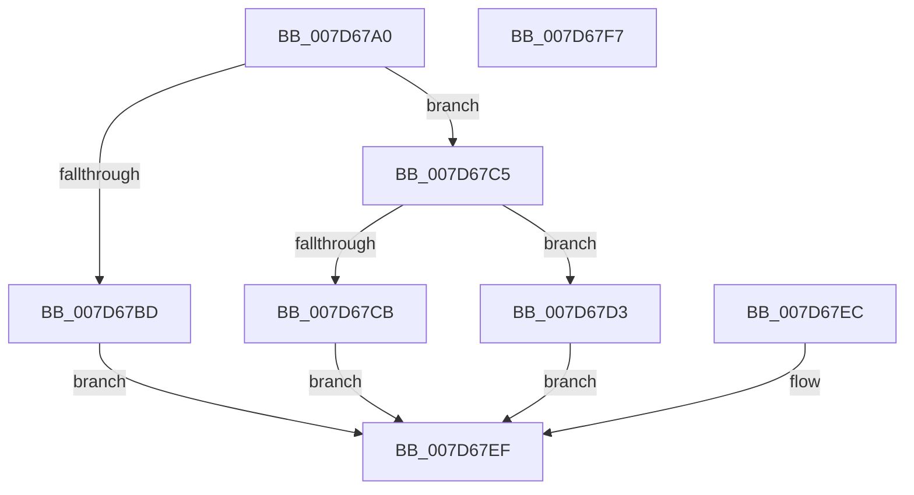

# WheaQuerySystemInformation

- RVA: `0x007D67A0`–`0x007D67F8` (길이 `88` bytes)
- VA: `0x00000001407D67A0`
- 실행 섹션: `PAGE`
- PDB 이름 있음: `예`; PDB Function 태그: `아니요`
- unwind 정보 RVA: `0x000D5DAC`
- 디코드: `24`개 명령, `88/88` bytes 표시
- 미해석 바이트: `0` (있으면 어셈블리에 `.byte`로 보존)

> 이 문서는 커널 이미지의 기계어와 PDB 기호를 분석해 생성했습니다. 4번과 5번은 함수 원형과 자료형을 바이너리 사용 방식에서 추정한 C 해석이며 원본 소스 복구 결과는 아닙니다.

## 1. Dependencies

- 직접 호출 지점: **1**; 고유 호출 대상: **1**
- 직접 호출자로 확인된 함수: **1**
- RIP 상대 이미지 참조: **2**

### Outgoing calls
- `0x007D67B1` → [IpmiHwContextInitialized](../../text/6A/IpmiHwContextInitialized_function_006A64DC.md) (function, `0x006A64DC`)

### Direct callers
- [ExpQuerySystemInformation](../A5/ExpQuerySystemInformation_function_00A57858.md) at `0x00A5B1A6`

### Static image references
- `0x007D67AA` → RVA `0x00EFA080` (`.data`; read)
- `0x007D67DE` → RVA `0x00EFA090` (`.data`; read)

## 2. Other-region calls and transfers

- 다른 실행 섹션으로 향하는 call: **1**
  - `0x007D67B1` → [IpmiHwContextInitialized](../../text/6A/IpmiHwContextInitialized_function_006A64DC.md) (`PAGE` → `.text`)
- 별도 외부 분기/꼬리 이동을 확인하지 못했습니다.

## 3. Assembly (complete function range)

```asm
007D67A0  48 83 EC 38                     sub rsp, 0x38
007D67A4  44 8B D2                        mov r10d, edx
007D67A7  4C 8B C9                        mov r9, rcx
007D67AA  48 8D 0D CF 38 72 00            lea rcx, [rip + 0x7238cf]
007D67B1  E8 26 FD EC FF                  call 0x1406a64dc
007D67B6  45 33 C0                        xor r8d, r8d
007D67B9  84 C0                           test al, al
007D67BB  75 08                           jne 0x1407d67c5
007D67BD  41 B8 01 00 00 C0               mov r8d, 0xc0000001
007D67C3  EB 2A                           jmp 0x1407d67ef
007D67C5  41 83 FA 20                     cmp r10d, 0x20
007D67C9  73 08                           jae 0x1407d67d3
007D67CB  41 B8 23 00 00 C0               mov r8d, 0xc0000023
007D67D1  EB 1C                           jmp 0x1407d67ef
007D67D3  0F 10 05 A6 38 72 00            movups xmm0, xmmword ptr [rip + 0x7238a6]
007D67DA  41 0F 11 01                     movups xmmword ptr [r9], xmm0
007D67DE  0F 10 0D AB 38 72 00            movups xmm1, xmmword ptr [rip + 0x7238ab]
007D67E5  41 0F 11 49 10                  movups xmmword ptr [r9 + 0x10], xmm1
007D67EA  EB 03                           jmp 0x1407d67ef
007D67EC  44 8B C0                        mov r8d, eax
007D67EF  41 8B C0                        mov eax, r8d
007D67F2  48 83 C4 38                     add rsp, 0x38
007D67F6  C3                              ret
007D67F7  CC                              int3
```

## 4. C-style interpretation (structured pseudocode)

```c
__int64 __fastcall WheaQuerySystemInformation(__int64 a1, int a2, int a3)
{
    __int64 result;
    __int64 v_rsp;

    v_rsp = (v_rsp) - (56);
    result = IpmiHwContextInitialized(v_rip + 7485647, a2, a3, a1);
    a3 = 0;
    if ((unsigned __int8)(result) != 0) goto loc_007D67C5;
    goto loc_007D67EF;
loc_007D67C5:
    if (((unsigned int)((unsigned int)(a2))) >= 32) goto loc_007D67D3;
    goto loc_007D67EF;
loc_007D67D3:
    *(unsigned __int64 *)(a1) = v_xmm0;
    *(unsigned __int64 *)(a1 + 16) = v_xmm1;
    goto loc_007D67EF;
loc_007D67EF:
    v_rsp = (v_rsp) + (56);
    return (unsigned int)((unsigned int)((unsigned int)(0xC0000023ULL)));
}
```

## 5. (Beta) C Style

```c
int64_t WheaQuerySystemInformation(int64_t Arg1, int32_t Arg2, int32_t Arg3)
{
    int64_t result;
    int64_t local_rsp;

    local_rsp = (local_rsp) - (56);
    result = IpmiHwContextInitialized(v_rip + 7485647, Arg2, Arg3, Arg1);
    Arg3 = 0;
    if ((uint8_t)(result) != 0) goto loc_007D67C5;
    goto loc_007D67EF;
loc_007D67C5:
    if (((uint32_t)((uint32_t)(Arg2))) >= 32) goto loc_007D67D3;
    goto loc_007D67EF;
loc_007D67D3:
    *(uint64_t *)(Arg1) = v_xmm0;
    *(uint64_t *)(Arg1 + 0x10) = v_xmm1;
    goto loc_007D67EF;
loc_007D67EF:
    local_rsp = (local_rsp) + (56);
    return (uint32_t)((uint32_t)((uint32_t)(0xC0000023ULL)));
}
```

## 6. Execution-region graph

[열기: 2D/3D 그래프와 함수 탐색 컨트롤 패널](../../../control-panel.html?section=page&rva=0x007D67A0&view=graph)

- 2D 그래프는 위에서 아래로 흐르고, 3D 그래프는 빈 공간을 드래그해 회전합니다. Shift+드래그는 이동, 휠은 확대·축소, 함수 노드 선택은 대상 보고서 이동입니다.

### Static fallback


