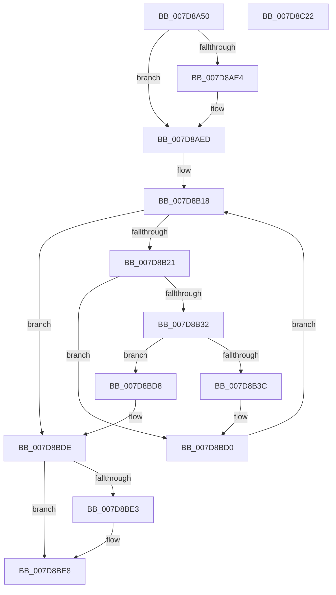

# WheaRegChangeNotifyCallback

- RVA: `0x007D8A50`–`0x007D8C23` (길이 `467` bytes)
- VA: `0x00000001407D8A50`
- 실행 섹션: `PAGE`
- PDB 이름 있음: `예`; PDB Function 태그: `아니요`
- unwind 정보 RVA: `0x000D6000`
- 디코드: `107`개 명령, `467/467` bytes 표시
- 미해석 바이트: `0` (있으면 어셈블리에 `.byte`로 보존)

> 이 문서는 커널 이미지의 기계어와 PDB 기호를 분석해 생성했습니다. 4번과 5번은 함수 원형과 자료형을 바이너리 사용 방식에서 추정한 C 해석이며 원본 소스 복구 결과는 아닙니다.

## 1. Dependencies

- 직접 호출 지점: **11**; 고유 호출 대상: **11**
- 직접 호출자로 확인된 함수: **0**
- RIP 상대 이미지 참조: **7**

### Outgoing calls
- `0x007D8A87` → [memset](../../text/6C/memset_function_006C6C40.md) (function, `0x006C6C40`)
- `0x007D8ADB` → [NtNotifyChangeMultipleKeys](../9D/NtNotifyChangeMultipleKeys_function_009DC6B0.md) (function, `0x009DC6B0`)
- `0x007D8B02` → [KeWaitForSingleObject](../../text/20/KeWaitForSingleObject_function_0020E6B0.md) (function, `0x0020E6B0`)
- `0x007D8B07` → [WheapScanRegistryForPolicyChanges](WheapScanRegistryForPolicyChanges_function_007D8D58.md) (function, `0x007D8D58`)
- `0x007D8B55` → [WheapPropagatePolicyToHal](../AC/WheapPropagatePolicyToHal_function_00AC1B2C.md) (function, `0x00AC1B2C`)
- `0x007D8BC2` → [wcstombs](../../text/50/wcstombs_function_005021A0.md) (function, `0x005021A0`)
- `0x007D8BCB` → [WheaLogInternalEvent](../../text/66/WheaLogInternalEvent_function_006605B0.md) (function, `0x006605B0`)
- `0x007D8BD8` → [_report_rangecheckfailure](../../text/4F/_report_rangecheckfailure_function_004F5FDC.md) (function, `0x004F5FDC`)
- `0x007D8BE3` → [WheapPfaReset](WheapPfaReset_function_007D93F4.md) (function, `0x007D93F4`)
- `0x007D8BF4` → [KeSetEvent](../../text/33/KeSetEvent_function_0033F310.md) (function, `0x0033F310`)
- `0x007D8C00` → [_security_check_cookie](../../text/6A/_security_check_cookie_function_006AC640.md) (function, `0x006AC640`)

### Direct callers
- 이 함수 시작 RVA로 연결되는 직접 call은 확인되지 않았습니다. 간접 호출은 완전히 역산할 수 없습니다.

### Static image references
- `0x007D8A6F` → RVA `0x00E0A740` (`.data`; read)
- `0x007D8A8C` → RVA `0x00EF7D38` (`.data`; read)
- `0x007D8A93` → RVA `0x00EF7D60` (`.data`; read)
- `0x007D8ACA` → RVA `0x00EF7D40` (`.data`; read)
- `0x007D8AE7` → RVA `0x00EF7D30` (`.data`; read/write)
- `0x007D8AF3` → RVA `0x00EF7D80` (`.data`; read)
- `0x007D8B0F` → RVA `0x00000000` (`image boundary/outside`; read)

## 2. Other-region calls and transfers

- 다른 실행 섹션으로 향하는 call: **7**
  - `0x007D8A87` → [memset](../../text/6C/memset_function_006C6C40.md) (`PAGE` → `.text`)
  - `0x007D8B02` → [KeWaitForSingleObject](../../text/20/KeWaitForSingleObject_function_0020E6B0.md) (`PAGE` → `.text`)
  - `0x007D8BC2` → [wcstombs](../../text/50/wcstombs_function_005021A0.md) (`PAGE` → `.text`)
  - `0x007D8BCB` → [WheaLogInternalEvent](../../text/66/WheaLogInternalEvent_function_006605B0.md) (`PAGE` → `.text`)
  - `0x007D8BD8` → [_report_rangecheckfailure](../../text/4F/_report_rangecheckfailure_function_004F5FDC.md) (`PAGE` → `.text`)
  - `0x007D8BF4` → [KeSetEvent](../../text/33/KeSetEvent_function_0033F310.md) (`PAGE` → `.text`)
  - `0x007D8C00` → [_security_check_cookie](../../text/6A/_security_check_cookie_function_006AC640.md) (`PAGE` → `.text`)
- 별도 외부 분기/꼬리 이동을 확인하지 못했습니다.

## 3. Assembly (complete function range)

```asm
007D8A50  48 8B C4                        mov rax, rsp
007D8A53  48 89 58 08                     mov qword ptr [rax + 8], rbx
007D8A57  48 89 70 10                     mov qword ptr [rax + 0x10], rsi
007D8A5B  48 89 78 18                     mov qword ptr [rax + 0x18], rdi
007D8A5F  55                              push rbp
007D8A60  41 54                           push r12
007D8A62  41 57                           push r15
007D8A64  48 8D 68 A1                     lea rbp, [rax - 0x5f]
007D8A68  48 81 EC C0 00 00 00            sub rsp, 0xc0
007D8A6F  48 8B 05 CA 1C 63 00            mov rax, qword ptr [rip + 0x631cca]
007D8A76  48 33 C4                        xor rax, rsp
007D8A79  48 89 45 37                     mov qword ptr [rbp + 0x37], rax
007D8A7D  33 D2                           xor edx, edx
007D8A7F  48 8D 4D E7                     lea rcx, [rbp - 0x19]
007D8A83  44 8D 42 48                     lea r8d, [rdx + 0x48]
007D8A87  E8 B4 E1 EE FF                  call 0x1406c6c40
007D8A8C  48 8B 0D A5 F2 71 00            mov rcx, qword ptr [rip + 0x71f2a5]
007D8A93  48 8D 05 C6 F2 71 00            lea rax, [rip + 0x71f2c6]
007D8A9A  41 BF 01 00 00 00               mov r15d, 1
007D8AA0  45 33 C9                        xor r9d, r9d
007D8AA3  44 88 7C 24 58                  mov byte ptr [rsp + 0x58], r15b
007D8AA8  45 33 C0                        xor r8d, r8d
007D8AAB  83 64 24 50 00                  and dword ptr [rsp + 0x50], 0
007D8AB0  33 D2                           xor edx, edx
007D8AB2  48 83 64 24 48 00               and qword ptr [rsp + 0x48], 0
007D8AB8  C6 44 24 40 00                  mov byte ptr [rsp + 0x40], 0
007D8ABD  C7 44 24 38 04 00 00 00         mov dword ptr [rsp + 0x38], 4
007D8AC5  48 89 44 24 30                  mov qword ptr [rsp + 0x30], rax
007D8ACA  48 8D 05 6F F2 71 00            lea rax, [rip + 0x71f26f]
007D8AD1  4C 89 7C 24 28                  mov qword ptr [rsp + 0x28], r15
007D8AD6  48 89 44 24 20                  mov qword ptr [rsp + 0x20], rax
007D8ADB  E8 D0 3B 20 00                  call 0x1409dc6b0
007D8AE0  85 C0                           test eax, eax
007D8AE2  79 09                           jns 0x1407d8aed
007D8AE4  41 8B C7                        mov eax, r15d
007D8AE7  87 05 43 F2 71 00               xchg dword ptr [rip + 0x71f243], eax
007D8AED  48 83 64 24 20 00               and qword ptr [rsp + 0x20], 0
007D8AF3  48 8D 0D 86 F2 71 00            lea rcx, [rip + 0x71f286]
007D8AFA  45 33 C9                        xor r9d, r9d
007D8AFD  45 33 C0                        xor r8d, r8d
007D8B00  33 D2                           xor edx, edx
007D8B02  E8 A9 5B A3 FF                  call 0x14020e6b0
007D8B07  E8 4C 02 00 00                  call 0x1407d8d58
007D8B0C  40 32 F6                        xor sil, sil
007D8B0F  4C 8D 25 EA 74 82 FF            lea r12, [rip - 0x7d8b16]
007D8B16  33 DB                           xor ebx, ebx
007D8B18  83 FB 16                        cmp ebx, 0x16
007D8B1B  0F 83 BD 00 00 00               jae 0x1407d8bde
007D8B21  42 80 BC 23 00 FB EE 00 00      cmp byte ptr [rbx + r12 + 0xeefb00], 0
007D8B2A  8B FB                           mov edi, ebx
007D8B2C  0F 84 9E 00 00 00               je 0x1407d8bd0
007D8B32  48 83 FF 16                     cmp rdi, 0x16
007D8B36  0F 83 9C 00 00 00               jae 0x1407d8bd8
007D8B3C  8D 43 FE                        lea eax, [rbx - 2]
007D8B3F  40 0F B6 F6                     movzx esi, sil
007D8B43  83 F8 03                        cmp eax, 3
007D8B46  42 C6 84 23 00 FB EE 00 00      mov byte ptr [rbx + r12 + 0xeefb00], 0
007D8B4F  8B CB                           mov ecx, ebx
007D8B51  41 0F 46 F7                     cmovbe esi, r15d
007D8B55  E8 D2 8F 2E 00                  call 0x140ac1b2c
007D8B5A  83 65 F3 00                     and dword ptr [rbp - 0xd], 0
007D8B5E  0F 57 C0                        xorps xmm0, xmm0
007D8B61  48 C1 E7 05                     shl rdi, 5
007D8B65  0F 57 C9                        xorps xmm1, xmm1
007D8B68  66 0F 7F 45 07                  movdqa xmmword ptr [rbp + 7], xmm0
007D8B6D  41 B8 1F 00 00 00               mov r8d, 0x1f
007D8B73  66 0F 7F 4D 17                  movdqa xmmword ptr [rbp + 0x17], xmm1
007D8B78  C7 45 E7 57 68 4C 67            mov dword ptr [rbp - 0x19], 0x674c6857
007D8B7F  4A 8B 84 27 A8 95 E0 00         mov rax, qword ptr [rdi + r12 + 0xe095a8]
007D8B87  4A 8B 94 27 A0 95 E0 00         mov rdx, qword ptr [rdi + r12 + 0xe095a0]
007D8B8F  44 89 7D EB                     mov dword ptr [rbp - 0x15], r15d
007D8B93  C7 45 EF 48 00 00 00            mov dword ptr [rbp - 0x11], 0x48
007D8B9A  C7 45 FB 62 00 00 80            mov dword ptr [rbp - 5], 0x80000062
007D8BA1  C7 45 F7 4B 52 4E 4C            mov dword ptr [rbp - 9], 0x4c4e524b
007D8BA8  C7 45 FF 02 00 00 00            mov dword ptr [rbp - 1], 2
007D8BAF  C7 45 03 28 00 00 00            mov dword ptr [rbp + 3], 0x28
007D8BB6  89 5D 27                        mov dword ptr [rbp + 0x27], ebx
007D8BB9  8B 08                           mov ecx, dword ptr [rax]
007D8BBB  89 4D 2B                        mov dword ptr [rbp + 0x2b], ecx
007D8BBE  48 8D 4D 07                     lea rcx, [rbp + 7]
007D8BC2  E8 D9 95 D2 FF                  call 0x1405021a0
007D8BC7  48 8D 4D E7                     lea rcx, [rbp - 0x19]
007D8BCB  E8 E0 79 E8 FF                  call 0x1406605b0
007D8BD0  41 03 DF                        add ebx, r15d
007D8BD3  E9 40 FF FF FF                  jmp 0x1407d8b18
007D8BD8  E8 FF D3 D1 FF                  call 0x1404f5fdc
007D8BDD  CC                              int3
007D8BDE  40 84 F6                        test sil, sil
007D8BE1  74 05                           je 0x1407d8be8
007D8BE3  E8 0C 08 00 00                  call 0x1407d93f4
007D8BE8  45 33 C0                        xor r8d, r8d
007D8BEB  48 8D 0D 8E F1 71 00            lea rcx, [rip + 0x71f18e]
007D8BF2  33 D2                           xor edx, edx
007D8BF4  E8 17 67 B6 FF                  call 0x14033f310
007D8BF9  48 8B 4D 37                     mov rcx, qword ptr [rbp + 0x37]
007D8BFD  48 33 CC                        xor rcx, rsp
007D8C00  E8 3B 3A ED FF                  call 0x1406ac640
007D8C05  4C 8D 9C 24 C0 00 00 00         lea r11, [rsp + 0xc0]
007D8C0D  49 8B 5B 20                     mov rbx, qword ptr [r11 + 0x20]
007D8C11  49 8B 73 28                     mov rsi, qword ptr [r11 + 0x28]
007D8C15  49 8B 7B 30                     mov rdi, qword ptr [r11 + 0x30]
007D8C19  49 8B E3                        mov rsp, r11
007D8C1C  41 5F                           pop r15
007D8C1E  41 5C                           pop r12
007D8C20  5D                              pop rbp
007D8C21  C3                              ret
007D8C22  CC                              int3
```

## 4. C-style interpretation (structured pseudocode)

```c
__int64 __fastcall WheaRegChangeNotifyCallback(__int64 a1, int a2, __int64 a3, int a4)
{
    __int64 result;
    __int64 v_rbx;
    __int64 v_rdi;
    __int64 v_rsi;
    __int64 v_rsp;
    unsigned __int64 v_stack_m18;
    unsigned __int8 v_stack_m80;
    unsigned int v_stack_m88;
    unsigned __int64 v_stack_m90;
    unsigned __int8 v_stack_m98;
    unsigned int v_stack_mA0;
    unsigned __int64 v_stack_mA8;
    unsigned __int64 v_stack_mB0;
    unsigned __int64 v_stack_mB8;

    *(unsigned __int64 *)(v_rsp + 8) = v_rbx;
    *(unsigned __int64 *)(v_rsp + 16) = v_rsi;
    *(unsigned __int64 *)(v_rsp + 24) = v_rdi;
    v_rsp = (v_rsp) - (192);
    result = (*(unsigned __int64 *)(v_rip + 6495434)) ^ (v_rsp);
    *(unsigned __int64 *)(v_rsp - 95 + 55) = result;
    a2 = 0;
    result = memset(v_rsp - 95 - 25, a2, a2 + 72, a4);
    a4 = 0;
    v_stack_m80 = 1;
    a3 = 0;
    a2 = 0;
    v_stack_m98 = 0;
    v_stack_mA0 = 4;
    v_stack_mA8 = v_rip + 7467718;
    v_stack_mB0 = 1;
    v_stack_mB8 = v_rip + 7467631;
    result = NtNotifyChangeMultipleKeys(*(unsigned __int64 *)(v_rip + 7467685), a2, a3, a4);
    if (sign_flag) {
        result = 1;
    }
    a4 = 0;
    a3 = 0;
    a2 = 0;
    result = KeWaitForSingleObject(v_rip + 7467654, a2, a3, a4);
    result = WheapScanRegistryForPolicyChanges(v_rip + 7467654, a2, a3, a4);
    v_rsi = 0;
    v_rbx = 0;
loc_007D8B18:
    if (0 >= 22) goto loc_007D8BDE;
    if ((*(unsigned __int8 *)(v_rbx + v_rip - 8227606 * 1 + 15661824)) == 0) goto loc_007D8BD0;
    if (0 >= 22) goto loc_007D8BD8;
    *(unsigned __int8 *)(v_rbx + v_rip - 8227606 * 1 + 15661824) = 0;
    v_rsi = 0;
    if (((unsigned int)(v_rbx - 2)) <= 3) { v_rsi = 1; }
    result = WheapPropagatePolicyToHal(0, a2, a3, a4);
    v_rdi = (0) << (5);
    *(unsigned __int64 *)(v_rsp - 95 + 7) = v_xmm0;
    *(unsigned __int64 *)(v_rsp - 95 + 23) = v_xmm1;
    *(unsigned int *)(v_rsp - 95 - 25) = 0x674C6857ULL;
    *(unsigned int *)(v_rsp - 95 - 21) = 1;
    *(unsigned int *)(v_rsp - 95 - 17) = 72;
    *(unsigned int *)(v_rsp - 95 - 5) = 0x80000062ULL;
    *(unsigned int *)(v_rsp - 95 - 9) = 0x4C4E524BULL;
    *(unsigned int *)(v_rsp - 95 - 1) = 2;
    *(unsigned int *)(v_rsp - 95 + 3) = 40;
    *(unsigned int *)(v_rsp - 95 + 39) = 0;
    *(unsigned int *)(v_rsp - 95 + 43) = (unsigned int)((unsigned int)(*(unsigned int *)(*(unsigned __int64 *)(v_rdi + v_rip - 8227606 * 1 + 14718376))));
    result = wcstombs(v_rsp - 95 + 7, *(unsigned __int64 *)(v_rdi + v_rip - 8227606 * 1 + 14718368), 31, a4);
    result = WheaLogInternalEvent(v_rsp - 95 - 25, *(unsigned __int64 *)(v_rdi + v_rip - 8227606 * 1 + 14718368), 31, a4);
loc_007D8BD0:
    v_rbx = (unsigned int)((v_rbx) + (1));
    goto loc_007D8B18;
loc_007D8BD8:
    result = _report_rangecheckfailure(v_rsp - 95 - 25, *(unsigned __int64 *)(v_rdi + v_rip - 8227606 * 1 + 14718368), 31, a4);
loc_007D8BDE:
    if ((unsigned __int8)(v_rsi) != 0) {
        result = WheapPfaReset(v_rsp - 95 - 25, *(unsigned __int64 *)(v_rdi + v_rip - 8227606 * 1 + 14718368), 31, a4);
    }
    a3 = 0;
    a2 = 0;
    result = KeSetEvent(v_rip + 7467406, a2, a3, a4);
    a1 = (*(unsigned __int64 *)(v_rsp - 95 + 55)) ^ (v_rsp);
    result = _security_check_cookie(a1, a2, a3, a4);
    return result;
}
```

## 5. (Beta) C Style

```c
int64_t WheaRegChangeNotifyCallback(int64_t Arg1, int32_t Arg2, int64_t Arg3, int32_t Arg4)
{
    int64_t result;
    int64_t local_rbx;
    int64_t local_rdi;
    int64_t local_rsi;
    int64_t local_rsp;
    uint64_t v_stack_m18;
    uint8_t v_stack_m80;
    uint32_t v_stack_m88;
    uint64_t v_stack_m90;
    uint8_t v_stack_m98;
    uint32_t v_stack_mA0;
    uint64_t v_stack_mA8;
    uint64_t v_stack_mB0;
    uint64_t v_stack_mB8;

    *(uint64_t *)(local_rsp + 0x8) = local_rbx;
    *(uint64_t *)(local_rsp + 0x10) = local_rsi;
    *(uint64_t *)(local_rsp + 0x18) = local_rdi;
    local_rsp = (local_rsp) - (192);
    result = (*(uint64_t *)(v_rip + 0x631CCA)) ^ (local_rsp);
    *(uint64_t *)(local_rsp - 0x5F + 0x37) = result;
    Arg2 = 0;
    result = memset(local_rsp - 95 - 25, Arg2, Arg2 + 72, Arg4);
    Arg4 = 0;
    v_stack_m80 = 1;
    Arg3 = 0;
    Arg2 = 0;
    v_stack_m98 = 0;
    v_stack_mA0 = 4;
    v_stack_mA8 = v_rip + 7467718;
    v_stack_mB0 = 1;
    v_stack_mB8 = v_rip + 7467631;
    result = NtNotifyChangeMultipleKeys(*(uint64_t *)(v_rip + 0x71F2A5), Arg2, Arg3, Arg4);
    if (sign_flag) {
        result = 1;
    }
    Arg4 = 0;
    Arg3 = 0;
    Arg2 = 0;
    result = KeWaitForSingleObject(v_rip + 7467654, Arg2, Arg3, Arg4);
    result = WheapScanRegistryForPolicyChanges(v_rip + 7467654, Arg2, Arg3, Arg4);
    local_rsi = 0;
    local_rbx = 0;
loc_007D8B18:
    if (0 >= 22) goto loc_007D8BDE;
    if ((*(uint8_t *)(local_rbx + v_rip - 0x7D8B16 * 1 + 0xEEFB00)) == 0) goto loc_007D8BD0;
    if (0 >= 22) goto loc_007D8BD8;
    *(uint8_t *)(local_rbx + v_rip - 0x7D8B16 * 1 + 0xEEFB00) = 0;
    local_rsi = 0;
    if (((uint32_t)(local_rbx - 2)) <= 3) { local_rsi = 1; }
    result = WheapPropagatePolicyToHal(0, Arg2, Arg3, Arg4);
    local_rdi = (0) << (5);
    *(uint64_t *)(local_rsp - 0x5F + 0x7) = v_xmm0;
    *(uint64_t *)(local_rsp - 0x5F + 0x17) = v_xmm1;
    *(uint32_t *)(local_rsp - 0x5F - 0x19) = 0x674C6857ULL;
    *(uint32_t *)(local_rsp - 0x5F - 0x15) = 1;
    *(uint32_t *)(local_rsp - 0x5F - 0x11) = 72;
    *(uint32_t *)(local_rsp - 0x5F - 0x5) = 0x80000062ULL;
    *(uint32_t *)(local_rsp - 0x5F - 0x9) = 0x4C4E524BULL;
    *(uint32_t *)(local_rsp - 0x5F - 0x1) = 2;
    *(uint32_t *)(local_rsp - 0x5F + 0x3) = 40;
    *(uint32_t *)(local_rsp - 0x5F + 0x27) = 0;
    *(uint32_t *)(local_rsp - 0x5F + 0x2B) = (uint32_t)((uint32_t)(*(uint32_t *)(*(uint64_t *)(local_rdi + v_rip - 0x7D8B16 * 1 + 0xE095A8))));
    result = wcstombs(local_rsp - 95 + 7, *(uint64_t *)(local_rdi + v_rip - 0x7D8B16 * 1 + 0xE095A0), 31, Arg4);
    result = WheaLogInternalEvent(local_rsp - 95 - 25, *(uint64_t *)(local_rdi + v_rip - 0x7D8B16 * 1 + 0xE095A0), 31, Arg4);
loc_007D8BD0:
    local_rbx = (uint32_t)((local_rbx) + (1));
    goto loc_007D8B18;
loc_007D8BD8:
    result = _report_rangecheckfailure(local_rsp - 95 - 25, *(uint64_t *)(local_rdi + v_rip - 0x7D8B16 * 1 + 0xE095A0), 31, Arg4);
loc_007D8BDE:
    if ((uint8_t)(local_rsi) != 0) {
        result = WheapPfaReset(local_rsp - 95 - 25, *(uint64_t *)(local_rdi + v_rip - 0x7D8B16 * 1 + 0xE095A0), 31, Arg4);
    }
    Arg3 = 0;
    Arg2 = 0;
    result = KeSetEvent(v_rip + 7467406, Arg2, Arg3, Arg4);
    Arg1 = (*(uint64_t *)(local_rsp - 0x5F + 0x37)) ^ (local_rsp);
    result = _security_check_cookie(Arg1, Arg2, Arg3, Arg4);
    return result;
}
```

## 6. Execution-region graph

[열기: 2D/3D 그래프와 함수 탐색 컨트롤 패널](../../../control-panel.html?section=page&rva=0x007D8A50&view=graph)

- 2D 그래프는 위에서 아래로 흐르고, 3D 그래프는 빈 공간을 드래그해 회전합니다. Shift+드래그는 이동, 휠은 확대·축소, 함수 노드 선택은 대상 보고서 이동입니다.

### Static fallback


