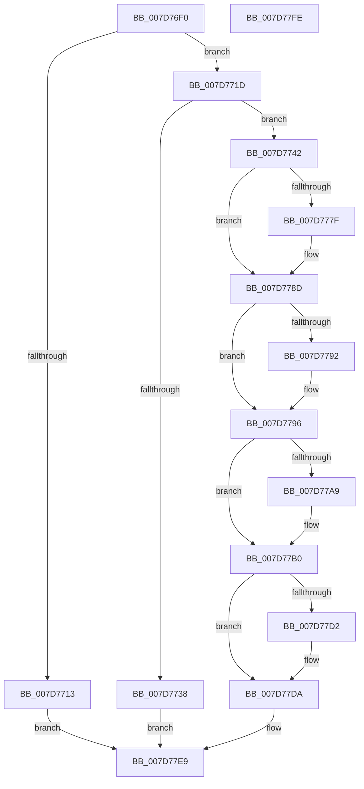

# WheaRegisterInUsePageOfflineNotification

- RVA: `0x007D76F0`–`0x007D77FF` (길이 `271` bytes)
- VA: `0x00000001407D76F0`
- 실행 섹션: `PAGE`
- PDB 이름 있음: `예`; PDB Function 태그: `아니요`
- unwind 정보 RVA: `0x0005C954`
- 디코드: `68`개 명령, `271/271` bytes 표시
- 미해석 바이트: `0` (있으면 어셈블리에 `.byte`로 보존)

> 이 문서는 커널 이미지의 기계어와 PDB 기호를 분석해 생성했습니다. 4번과 5번은 함수 원형과 자료형을 바이너리 사용 방식에서 추정한 C 해석이며 원본 소스 복구 결과는 아닙니다.

## 1. Dependencies

- 직접 호출 지점: **6**; 고유 호출 대상: **6**
- 직접 호출자로 확인된 함수: **1**
- RIP 상대 이미지 참조: **6**

### Outgoing calls
- `0x007D772B` → [ExAllocatePool2](../../poolcode/B8/ExAllocatePool2_function_00B820F0.md) (function, `0x00B820F0`)
- `0x007D776E` → [KeAbPreAcquire](../../text/21/KeAbPreAcquire_function_00210230.md) (function, `0x00210230`)
- `0x007D7788` → [ExfAcquirePushLockExclusiveEx](../../text/20/ExfAcquirePushLockExclusiveEx_function_0020FC90.md) (function, `0x0020FC90`)
- `0x007D77D5` → [ExfTryToWakePushLock](../../text/26/ExfTryToWakePushLock_function_00265DD0.md) (function, `0x00265DD0`)
- `0x007D77DD` → [KeAbPostRelease](../../text/2E/KeAbPostRelease_function_002E1600.md) (function, `0x002E1600`)
- `0x007D77E2` → [KeLeaveCriticalRegion](../../text/25/KeLeaveCriticalRegion_function_0025D8B0.md) (function, `0x0025D8B0`)

### Direct callers
- [HvlRegisterWheaErrorNotification](../71/HvlRegisterWheaErrorNotification_function_00717F20.md) at `0x00717F52`

### Static image references
- `0x007D7704` → RVA `0x00EEF058` (`.data`; read)
- `0x007D7746` → RVA `0x00EEF060` (`.data`; read)
- `0x007D7796` → RVA `0x00EEF070` (`.data`; read)
- `0x007D779D` → RVA `0x00EEF068` (`.data`; read)
- `0x007D77BA` → RVA `0x00EEF070` (`.data`; write)
- `0x007D77C1` → RVA `0x00EEF060` (`.data`; read/write)

## 2. Other-region calls and transfers

- 다른 실행 섹션으로 향하는 call: **6**
  - `0x007D772B` → [ExAllocatePool2](../../poolcode/B8/ExAllocatePool2_function_00B820F0.md) (`PAGE` → `POOLCODE`)
  - `0x007D776E` → [KeAbPreAcquire](../../text/21/KeAbPreAcquire_function_00210230.md) (`PAGE` → `.text`)
  - `0x007D7788` → [ExfAcquirePushLockExclusiveEx](../../text/20/ExfAcquirePushLockExclusiveEx_function_0020FC90.md) (`PAGE` → `.text`)
  - `0x007D77D5` → [ExfTryToWakePushLock](../../text/26/ExfTryToWakePushLock_function_00265DD0.md) (`PAGE` → `.text`)
  - `0x007D77DD` → [KeAbPostRelease](../../text/2E/KeAbPostRelease_function_002E1600.md) (`PAGE` → `.text`)
  - `0x007D77E2` → [KeLeaveCriticalRegion](../../text/25/KeLeaveCriticalRegion_function_0025D8B0.md) (`PAGE` → `.text`)
- 별도 외부 분기/꼬리 이동을 확인하지 못했습니다.

## 3. Assembly (complete function range)

```asm
007D76F0  48 89 5C 24 08                  mov qword ptr [rsp + 8], rbx
007D76F5  48 89 6C 24 10                  mov qword ptr [rsp + 0x10], rbp
007D76FA  48 89 74 24 18                  mov qword ptr [rsp + 0x18], rsi
007D76FF  57                              push rdi
007D7700  48 83 EC 20                     sub rsp, 0x20
007D7704  80 3D 4D 79 71 00 00            cmp byte ptr [rip + 0x71794d], 0
007D770B  48 8B DA                        mov rbx, rdx
007D770E  48 8B F1                        mov rsi, rcx
007D7711  75 0A                           jne 0x1407d771d
007D7713  B8 01 00 00 C0                  mov eax, 0xc0000001
007D7718  E9 CC 00 00 00                  jmp 0x1407d77e9
007D771D  BA 20 00 00 00                  mov edx, 0x20
007D7722  41 B8 57 68 65 61               mov r8d, 0x61656857
007D7728  8D 4A 20                        lea ecx, [rdx + 0x20]
007D772B  E8 C0 A9 3A 00                  call 0x140b820f0
007D7730  48 8B F8                        mov rdi, rax
007D7733  48 85 C0                        test rax, rax
007D7736  75 0A                           jne 0x1407d7742
007D7738  B8 17 00 00 C0                  mov eax, 0xc0000017
007D773D  E9 A7 00 00 00                  jmp 0x1407d77e9
007D7742  48 89 58 18                     mov qword ptr [rax + 0x18], rbx
007D7746  48 8D 2D 13 79 71 00            lea rbp, [rip + 0x717913]
007D774D  48 89 70 10                     mov qword ptr [rax + 0x10], rsi
007D7751  48 83 CB FF                     or rbx, 0xffffffffffffffff
007D7755  65 48 8B 04 25 88 01 00 00      mov rax, qword ptr gs:[0x188]
007D775E  45 33 C0                        xor r8d, r8d
007D7761  33 D2                           xor edx, edx
007D7763  48 8B CD                        mov rcx, rbp
007D7766  66 01 98 E4 01 00 00            add word ptr [rax + 0x1e4], bx
007D776D  90                              nop
007D776E  E8 BD 8A A3 FF                  call 0x140210230
007D7773  F0 48 0F BA 6D 00 00            lock bts qword ptr [rbp], 0
007D777A  48 8B F0                        mov rsi, rax
007D777D  73 0E                           jae 0x1407d778d
007D777F  4C 8B C5                        mov r8, rbp
007D7782  48 8B D0                        mov rdx, rax
007D7785  48 8B CD                        mov rcx, rbp
007D7788  E8 03 85 A3 FF                  call 0x14020fc90
007D778D  48 85 F6                        test rsi, rsi
007D7790  74 04                           je 0x1407d7796
007D7792  C6 46 0A 01                     mov byte ptr [rsi + 0xa], 1
007D7796  48 8B 05 D3 78 71 00            mov rax, qword ptr [rip + 0x7178d3]
007D779D  48 8D 0D C4 78 71 00            lea rcx, [rip + 0x7178c4]
007D77A4  48 39 08                        cmp qword ptr [rax], rcx
007D77A7  74 07                           je 0x1407d77b0
007D77A9  B9 03 00 00 00                  mov ecx, 3
007D77AE  CD 29                           int 0x29
007D77B0  48 89 0F                        mov qword ptr [rdi], rcx
007D77B3  48 89 47 08                     mov qword ptr [rdi + 8], rax
007D77B7  48 89 38                        mov qword ptr [rax], rdi
007D77BA  48 89 3D AF 78 71 00            mov qword ptr [rip + 0x7178af], rdi
007D77C1  F0 48 0F C1 1D 96 78 71 00      lock xadd qword ptr [rip + 0x717896], rbx
007D77CA  80 E3 06                        and bl, 6
007D77CD  80 FB 02                        cmp bl, 2
007D77D0  75 08                           jne 0x1407d77da
007D77D2  48 8B CD                        mov rcx, rbp
007D77D5  E8 F6 E5 A8 FF                  call 0x140265dd0
007D77DA  48 8B CD                        mov rcx, rbp
007D77DD  E8 1E 9E B0 FF                  call 0x1402e1600
007D77E2  E8 C9 60 A8 FF                  call 0x14025d8b0
007D77E7  33 C0                           xor eax, eax
007D77E9  48 8B 5C 24 30                  mov rbx, qword ptr [rsp + 0x30]
007D77EE  48 8B 6C 24 38                  mov rbp, qword ptr [rsp + 0x38]
007D77F3  48 8B 74 24 40                  mov rsi, qword ptr [rsp + 0x40]
007D77F8  48 83 C4 20                     add rsp, 0x20
007D77FC  5F                              pop rdi
007D77FD  C3                              ret
007D77FE  CC                              int3
```

## 4. C-style interpretation (structured pseudocode)

```c
__int64 __fastcall WheaRegisterInUsePageOfflineNotification(__int64 a1, __int64 a2)
{
    __int64 result;
    __int64 v_rbx;
    __int64 v_rsp;
    unsigned __int64 v_stack_p10;
    unsigned __int64 v_stack_p18;
    unsigned __int64 v_stack_p8;

    v_stack_p8 = v_rbx;
    v_stack_p10 = v_rbp;
    v_stack_p18 = v_rsi;
    v_rsp = (v_rsp) - (32);
    if ((*(unsigned __int8 *)(v_rip + 7436621)) != 0) goto loc_007D771D;
    goto loc_007D77E9;
loc_007D771D:
    result = ExAllocatePool2(32 + 32, 32, (unsigned int)(0x61656857ULL), a4);
    if (result != 0) goto loc_007D7742;
    goto loc_007D77E9;
loc_007D7742:
    *(unsigned __int64 *)((unsigned int)(0xC0000017ULL) + 24) = a2;
    *(unsigned __int64 *)((unsigned int)(0xC0000017ULL) + 16) = a1;
    v_rbx = (a2) | (-1);
    a3 = 0;
    a2 = 0;
    result = KeAbPreAcquire(v_rip + 7436563, a2, a3, a4);
    if (!(condition_is_above_or_equal)) {
        a3 = v_rip + 7436563;
        a2 = result;
        a1 = v_rip + 7436563;
        result = ExfAcquirePushLockExclusiveEx(a1, a2, a3, a4);
    }
    if (result != 0) {
        *(unsigned __int8 *)(result + 10) = 1;
    }
    if ((*(unsigned __int64 *)(*(unsigned __int64 *)(v_rip + 7436499))) != (v_rip + 7436484)) {
        a1 = 3;
    }
    *(unsigned __int64 *)(result) = a1;
    *(unsigned __int64 *)(result + 8) = *(unsigned __int64 *)(v_rip + 7436499);
    *(unsigned __int64 *)(*(unsigned __int64 *)(v_rip + 7436499)) = result;
    *(unsigned __int64 *)(v_rip + 7436463) = result;
    v_rbx = (unsigned __int8)((v_rbx) & (6));
    result = *(unsigned __int64 *)(v_rip + 7436499);
    if (((unsigned __int8)(v_rbx)) == 2) {
        a1 = v_rip + 7436563;
        result = ExfTryToWakePushLock(a1, a2, a3, a4);
    }
    result = KeAbPostRelease(v_rip + 7436563, a2, a3, a4);
    result = KeLeaveCriticalRegion(v_rip + 7436563, a2, a3, a4);
    result = 0;
loc_007D77E9:
    v_rsp = (v_rsp) + (32);
    return result;
}
```

## 5. (Beta) C Style

```c
int64_t WheaRegisterInUsePageOfflineNotification(int64_t Arg1, int64_t Arg2)
{
    int64_t result;
    int64_t local_rbx;
    int64_t local_rsp;
    uint64_t v_stack_p10;
    uint64_t v_stack_p18;
    uint64_t v_stack_p8;

    v_stack_p8 = local_rbx;
    v_stack_p10 = local_rbp;
    v_stack_p18 = local_rsi;
    local_rsp = (local_rsp) - (32);
    if ((*(uint8_t *)(v_rip + 0x71794D)) != 0) goto loc_007D771D;
    goto loc_007D77E9;
loc_007D771D:
    result = ExAllocatePool2(32 + 32, 32, (uint32_t)(0x61656857ULL), a4);
    if (result != 0) goto loc_007D7742;
    goto loc_007D77E9;
loc_007D7742:
    *(uint64_t *)((uint32_t)(0xC0000017ULL) + 0x18) = Arg2;
    *(uint64_t *)((uint32_t)(0xC0000017ULL) + 0x10) = Arg1;
    local_rbx = (Arg2) | (-1);
    a3 = 0;
    Arg2 = 0;
    result = KeAbPreAcquire(v_rip + 7436563, Arg2, a3, a4);
    if (!(condition_is_above_or_equal)) {
        a3 = v_rip + 7436563;
        Arg2 = result;
        Arg1 = v_rip + 7436563;
        result = ExfAcquirePushLockExclusiveEx(Arg1, Arg2, a3, a4);
    }
    if (result != 0) {
        *(uint8_t *)(result + 0xA) = 1;
    }
    if ((*(uint64_t *)(*(uint64_t *)(v_rip + 0x7178D3))) != (v_rip + 7436484)) {
        Arg1 = 3;
    }
    *(uint64_t *)(result) = Arg1;
    *(uint64_t *)(result + 0x8) = *(uint64_t *)(v_rip + 0x7178D3);
    *(uint64_t *)(*(uint64_t *)(v_rip + 0x7178D3)) = result;
    *(uint64_t *)(v_rip + 0x7178AF) = result;
    local_rbx = (uint8_t)((local_rbx) & (6));
    result = *(uint64_t *)(v_rip + 0x7178D3);
    if (((uint8_t)(local_rbx)) == 2) {
        Arg1 = v_rip + 7436563;
        result = ExfTryToWakePushLock(Arg1, Arg2, a3, a4);
    }
    result = KeAbPostRelease(v_rip + 7436563, Arg2, a3, a4);
    result = KeLeaveCriticalRegion(v_rip + 7436563, Arg2, a3, a4);
    result = 0;
loc_007D77E9:
    local_rsp = (local_rsp) + (32);
    return result;
}
```

## 6. Execution-region graph

[열기: 2D/3D 그래프와 함수 탐색 컨트롤 패널](../../../control-panel.html?section=page&rva=0x007D76F0&view=graph)

- 2D 그래프는 위에서 아래로 흐르고, 3D 그래프는 빈 공간을 드래그해 회전합니다. Shift+드래그는 이동, 휠은 확대·축소, 함수 노드 선택은 대상 보고서 이동입니다.

### Static fallback


