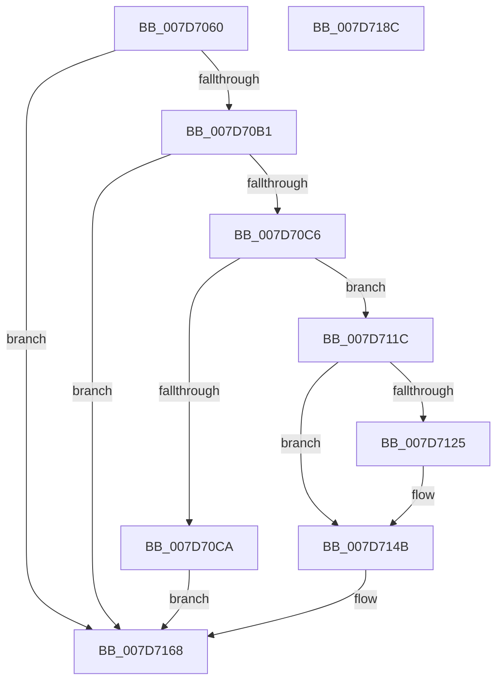

# WheaRemoveErrorSourceDeviceDriver

- RVA: `0x007D7060`–`0x007D718D` (길이 `301` bytes)
- VA: `0x00000001407D7060`
- 실행 섹션: `PAGE`
- PDB 이름 있음: `예`; PDB Function 태그: `아니요`
- unwind 정보 RVA: `0x000601BC`
- 디코드: `73`개 명령, `301/301` bytes 표시
- 미해석 바이트: `0` (있으면 어셈블리에 `.byte`로 보존)

> 이 문서는 커널 이미지의 기계어와 PDB 기호를 분석해 생성했습니다. 4번과 5번은 함수 원형과 자료형을 바이너리 사용 방식에서 추정한 C 해석이며 원본 소스 복구 결과는 아닙니다.

## 1. Dependencies

- 직접 호출 지점: **8**; 고유 호출 대상: **7**
- 직접 호출자로 확인된 함수: **0**
- RIP 상대 이미지 참조: **4**

### Outgoing calls
- `0x007D7099` → [WheaGetErrorSource](../../text/49/WheaGetErrorSource_function_00495520.md) (function, `0x00495520`)
- `0x007D70A4` → [WheapErrDescIsDeviceDriver](../../text/65/WheapErrDescIsDeviceDriver_function_0065EC24.md) (function, `0x0065EC24`)
- `0x007D7107` → [RtlStringCchCopyA](../../text/46/RtlStringCchCopyA_function_00460628.md) (function, `0x00460628`)
- `0x007D7110` → [WheaLogInternalEvent](../../text/66/WheaLogInternalEvent_function_006605B0.md) (function, `0x006605B0`)
- `0x007D712A` → [ExFreePoolWithTag](../../poolcode/B8/ExFreePoolWithTag_function_00B82870.md) (function, `0x00B82870`)
- `0x007D713B` → [ExFreePoolWithTag](../../poolcode/B8/ExFreePoolWithTag_function_00B82870.md) (function, `0x00B82870`)
- `0x007D714D` → [WheaRemoveErrorSource](WheaRemoveErrorSource_function_007D6C70.md) (function, `0x007D6C70`)
- `0x007D7171` → [_security_check_cookie](../../text/6A/_security_check_cookie_function_006AC640.md) (function, `0x006AC640`)

### Direct callers
- 이 함수 시작 RVA로 연결되는 직접 call은 확인되지 않았습니다. 간접 호출은 완전히 역산할 수 없습니다.

### Static image references
- `0x007D7077` → RVA `0x00E0A740` (`.data`; read)
- `0x007D70DA` → RVA `0x00B08EB0` (` ?? ::NNGAKEGL::`string'`; read)
- `0x007D7152` → RVA `0x0048FDC0` (`HalAdjustResourceList`; read)
- `0x007D715D` → RVA `0x0049E550` (`EmpCheckErrataList`; read)

## 2. Other-region calls and transfers

- 다른 실행 섹션으로 향하는 call: **7**
  - `0x007D7099` → [WheaGetErrorSource](../../text/49/WheaGetErrorSource_function_00495520.md) (`PAGE` → `.text`)
  - `0x007D70A4` → [WheapErrDescIsDeviceDriver](../../text/65/WheapErrDescIsDeviceDriver_function_0065EC24.md) (`PAGE` → `.text`)
  - `0x007D7107` → [RtlStringCchCopyA](../../text/46/RtlStringCchCopyA_function_00460628.md) (`PAGE` → `.text`)
  - `0x007D7110` → [WheaLogInternalEvent](../../text/66/WheaLogInternalEvent_function_006605B0.md) (`PAGE` → `.text`)
  - `0x007D712A` → [ExFreePoolWithTag](../../poolcode/B8/ExFreePoolWithTag_function_00B82870.md) (`PAGE` → `POOLCODE`)
  - `0x007D713B` → [ExFreePoolWithTag](../../poolcode/B8/ExFreePoolWithTag_function_00B82870.md) (`PAGE` → `POOLCODE`)
  - `0x007D7171` → [_security_check_cookie](../../text/6A/_security_check_cookie_function_006AC640.md) (`PAGE` → `.text`)
- 별도 외부 분기/꼬리 이동을 확인하지 못했습니다.

## 3. Assembly (complete function range)

```asm
007D7060  48 89 5C 24 10                  mov qword ptr [rsp + 0x10], rbx
007D7065  48 89 74 24 18                  mov qword ptr [rsp + 0x18], rsi
007D706A  48 89 7C 24 20                  mov qword ptr [rsp + 0x20], rdi
007D706F  55                              push rbp
007D7070  48 8B EC                        mov rbp, rsp
007D7073  48 83 EC 70                     sub rsp, 0x70
007D7077  48 8B 05 C2 36 63 00            mov rax, qword ptr [rip + 0x6336c2]
007D707E  48 33 C4                        xor rax, rsp
007D7081  48 89 45 F0                     mov qword ptr [rbp - 0x10], rax
007D7085  0F 57 C0                        xorps xmm0, xmm0
007D7088  0F 57 C9                        xorps xmm1, xmm1
007D708B  66 0F 7F 45 D0                  movdqa xmmword ptr [rbp - 0x30], xmm0
007D7090  8B F1                           mov esi, ecx
007D7092  66 0F 7F 4D E0                  movdqa xmmword ptr [rbp - 0x20], xmm1
007D7097  33 DB                           xor ebx, ebx
007D7099  E8 82 E4 CB FF                  call 0x140495520
007D709E  48 8B C8                        mov rcx, rax
007D70A1  48 8B F8                        mov rdi, rax
007D70A4  E8 7B 7B E8 FF                  call 0x14065ec24
007D70A9  84 C0                           test al, al
007D70AB  0F 84 B7 00 00 00               je 0x1407d7168
007D70B1  83 C9 FF                        or ecx, 0xffffffff
007D70B4  33 C0                           xor eax, eax
007D70B6  F0 0F B1 8F 98 00 00 00         lock cmpxchg dword ptr [rdi + 0x98], ecx
007D70BE  3B C1                           cmp eax, ecx
007D70C0  0F 84 A2 00 00 00               je 0x1407d7168
007D70C6  85 C0                           test eax, eax
007D70C8  74 52                           je 0x1407d711c
007D70CA  8D 43 01                        lea eax, [rbx + 1]
007D70CD  C7 45 B0 57 68 4C 67            mov dword ptr [rbp - 0x50], 0x674c6857
007D70D4  8D 53 20                        lea edx, [rbx + 0x20]
007D70D7  89 45 B4                        mov dword ptr [rbp - 0x4c], eax
007D70DA  4C 8D 05 CF 1D 33 00            lea r8, [rip + 0x331dcf]
007D70E1  89 45 BC                        mov dword ptr [rbp - 0x44], eax
007D70E4  48 8D 4D D0                     lea rcx, [rbp - 0x30]
007D70E8  89 55 CC                        mov dword ptr [rbp - 0x34], edx
007D70EB  C7 45 B8 40 00 00 00            mov dword ptr [rbp - 0x48], 0x40
007D70F2  C7 45 C4 2C 00 00 80            mov dword ptr [rbp - 0x3c], 0x8000002c
007D70F9  C7 45 C0 4B 52 4E 4C            mov dword ptr [rbp - 0x40], 0x4c4e524b
007D7100  C7 45 C8 02 00 00 00            mov dword ptr [rbp - 0x38], 2
007D7107  E8 1C 95 C8 FF                  call 0x140460628
007D710C  48 8D 4D B0                     lea rcx, [rbp - 0x50]
007D7110  E8 9B 94 E8 FF                  call 0x1406605b0
007D7115  BB 08 07 00 C0                  mov ebx, 0xc0000708
007D711A  EB 4C                           jmp 0x1407d7168
007D711C  48 8B 4F 48                     mov rcx, qword ptr [rdi + 0x48]
007D7120  48 85 C9                        test rcx, rcx
007D7123  74 26                           je 0x1407d714b
007D7125  BA 57 48 45 41                  mov edx, 0x41454857
007D712A  E8 41 B7 3A 00                  call 0x140b82870
007D712F  48 8B 8F 90 00 00 00            mov rcx, qword ptr [rdi + 0x90]
007D7136  BA 57 48 45 41                  mov edx, 0x41454857
007D713B  E8 30 B7 3A 00                  call 0x140b82870
007D7140  48 89 5F 48                     mov qword ptr [rdi + 0x48], rbx
007D7144  48 89 9F 90 00 00 00            mov qword ptr [rdi + 0x90], rbx
007D714B  8B CE                           mov ecx, esi
007D714D  E8 1E FB FF FF                  call 0x1407d6c70
007D7152  48 8D 05 67 8C CB FF            lea rax, [rip - 0x347399]
007D7159  48 89 47 50                     mov qword ptr [rdi + 0x50], rax
007D715D  48 8D 05 EC 73 CC FF            lea rax, [rip - 0x338c14]
007D7164  48 89 47 58                     mov qword ptr [rdi + 0x58], rax
007D7168  8B C3                           mov eax, ebx
007D716A  48 8B 4D F0                     mov rcx, qword ptr [rbp - 0x10]
007D716E  48 33 CC                        xor rcx, rsp
007D7171  E8 CA 54 ED FF                  call 0x1406ac640
007D7176  4C 8D 5C 24 70                  lea r11, [rsp + 0x70]
007D717B  49 8B 5B 18                     mov rbx, qword ptr [r11 + 0x18]
007D717F  49 8B 73 20                     mov rsi, qword ptr [r11 + 0x20]
007D7183  49 8B 7B 28                     mov rdi, qword ptr [r11 + 0x28]
007D7187  49 8B E3                        mov rsp, r11
007D718A  5D                              pop rbp
007D718B  C3                              ret
007D718C  CC                              int3
```

## 4. C-style interpretation (structured pseudocode)

```c
__int64 __fastcall WheaRemoveErrorSourceDeviceDriver(int a1)
{
    __int64 result;
    __int64 v_rbx;
    __int64 v_rsp;
    unsigned __int64 v_stack_m18;
    unsigned __int64 v_stack_m28;
    unsigned __int64 v_stack_m38;
    unsigned int v_stack_m3C;
    unsigned int v_stack_m40;
    unsigned int v_stack_m44;
    unsigned int v_stack_m48;
    unsigned int v_stack_m4C;
    unsigned int v_stack_m50;
    unsigned int v_stack_m54;
    unsigned int v_stack_m58;
    unsigned __int64 v_stack_m8;
    unsigned __int64 v_stack_p10;
    unsigned __int64 v_stack_p18;
    unsigned __int64 v_stack_p20;

    v_stack_p10 = v_rbx;
    v_stack_p18 = v_rsi;
    v_stack_p20 = v_rdi;
    v_rsp = (v_rsp) - (112);
    result = (*(unsigned __int64 *)(v_rip + 6502082)) ^ (v_rsp);
    v_stack_m18 = result;
    v_stack_m38 = v_xmm0;
    v_stack_m28 = v_xmm1;
    v_rbx = 0;
    result = WheaGetErrorSource(a1, a2, a3, a4);
    result = WheapErrDescIsDeviceDriver(result, a2, a3, a4);
    if ((unsigned __int8)(result) == 0) goto loc_007D7168;
    a1 = (unsigned int)((result) | (0xFFFFFFFFULL));
    result = 0;
    if (0 == a1) goto loc_007D7168;
    if (0 == 0) goto loc_007D711C;
    v_stack_m58 = 0x674C6857ULL;
    v_stack_m54 = (unsigned int)(v_rbx + 1);
    v_stack_m4C = (unsigned int)(v_rbx + 1);
    v_stack_m3C = (unsigned int)(v_rbx + 32);
    v_stack_m50 = 64;
    v_stack_m44 = 0x8000002CULL;
    v_stack_m48 = 0x4C4E524BULL;
    v_stack_m40 = 2;
    result = RtlStringCchCopyA(v_stack_m38, v_rbx + 32, v_rip + 3349967, a4);
    result = WheaLogInternalEvent(v_stack_m58, v_rbx + 32, v_rip + 3349967, a4);
    goto loc_007D7168;
loc_007D711C:
    if (*(unsigned __int64 *)(result + 72) != 0) {
        a2 = 0x41454857ULL;
        result = ExFreePoolWithTag(*(unsigned __int64 *)(result + 72), a2, v_rip + 3349967, a4);
        a1 = *(unsigned __int64 *)(result + 144);
        a2 = 0x41454857ULL;
        result = ExFreePoolWithTag(a1, a2, v_rip + 3349967, a4);
        *(unsigned __int64 *)(result + 72) = (unsigned int)(0xC0000708ULL);
        *(unsigned __int64 *)(result + 144) = (unsigned int)(0xC0000708ULL);
    }
    result = WheaRemoveErrorSource((unsigned int)((unsigned int)((unsigned int)(a1))), a2, v_rip + 3349967, a4);
    *(unsigned __int64 *)(result + 80) = v_rip - 3437465;
    *(unsigned __int64 *)(result + 88) = v_rip - 3378196;
loc_007D7168:
    a1 = (v_stack_m18) ^ (v_rsp);
    result = _security_check_cookie(a1, a2, v_rip + 3349967, a4);
    return result;
}
```

## 5. (Beta) C Style

```c
int64_t WheaRemoveErrorSourceDeviceDriver(int32_t Arg1)
{
    int64_t result;
    int64_t local_rbx;
    int64_t local_rsp;
    uint64_t v_stack_m18;
    uint64_t v_stack_m28;
    uint64_t v_stack_m38;
    uint32_t v_stack_m3C;
    uint32_t v_stack_m40;
    uint32_t v_stack_m44;
    uint32_t v_stack_m48;
    uint32_t v_stack_m4C;
    uint32_t v_stack_m50;
    uint32_t v_stack_m54;
    uint32_t v_stack_m58;
    uint64_t v_stack_m8;
    uint64_t v_stack_p10;
    uint64_t v_stack_p18;
    uint64_t v_stack_p20;

    v_stack_p10 = local_rbx;
    v_stack_p18 = local_rsi;
    v_stack_p20 = local_rdi;
    local_rsp = (local_rsp) - (112);
    result = (*(uint64_t *)(v_rip + 0x6336C2)) ^ (local_rsp);
    v_stack_m18 = result;
    v_stack_m38 = v_xmm0;
    v_stack_m28 = v_xmm1;
    local_rbx = 0;
    result = WheaGetErrorSource(Arg1, a2, a3, a4);
    result = WheapErrDescIsDeviceDriver(result, a2, a3, a4);
    if ((uint8_t)(result) == 0) goto loc_007D7168;
    Arg1 = (uint32_t)((result) | (0xFFFFFFFFULL));
    result = 0;
    if (0 == Arg1) goto loc_007D7168;
    if (0 == 0) goto loc_007D711C;
    v_stack_m58 = 0x674C6857ULL;
    v_stack_m54 = (uint32_t)(local_rbx + 1);
    v_stack_m4C = (uint32_t)(local_rbx + 1);
    v_stack_m3C = (uint32_t)(local_rbx + 32);
    v_stack_m50 = 64;
    v_stack_m44 = 0x8000002CULL;
    v_stack_m48 = 0x4C4E524BULL;
    v_stack_m40 = 2;
    result = RtlStringCchCopyA(v_stack_m38, local_rbx + 32, v_rip + 3349967, a4);
    result = WheaLogInternalEvent(v_stack_m58, local_rbx + 32, v_rip + 3349967, a4);
    goto loc_007D7168;
loc_007D711C:
    if (*(uint64_t *)(result + 0x48) != 0) {
        a2 = 0x41454857ULL;
        result = ExFreePoolWithTag(*(uint64_t *)(result + 0x48), a2, v_rip + 3349967, a4);
        Arg1 = *(uint64_t *)(result + 0x90);
        a2 = 0x41454857ULL;
        result = ExFreePoolWithTag(Arg1, a2, v_rip + 3349967, a4);
        *(uint64_t *)(result + 0x48) = (uint32_t)(0xC0000708ULL);
        *(uint64_t *)(result + 0x90) = (uint32_t)(0xC0000708ULL);
    }
    result = WheaRemoveErrorSource((uint32_t)((uint32_t)((uint32_t)(Arg1))), a2, v_rip + 3349967, a4);
    *(uint64_t *)(result + 0x50) = v_rip - 3437465;
    *(uint64_t *)(result + 0x58) = v_rip - 3378196;
loc_007D7168:
    Arg1 = (v_stack_m18) ^ (local_rsp);
    result = _security_check_cookie(Arg1, a2, v_rip + 3349967, a4);
    return result;
}
```

## 6. Execution-region graph

[열기: 2D/3D 그래프와 함수 탐색 컨트롤 패널](../../../control-panel.html?section=page&rva=0x007D7060&view=graph)

- 2D 그래프는 위에서 아래로 흐르고, 3D 그래프는 빈 공간을 드래그해 회전합니다. Shift+드래그는 이동, 휠은 확대·축소, 함수 노드 선택은 대상 보고서 이동입니다.

### Static fallback


