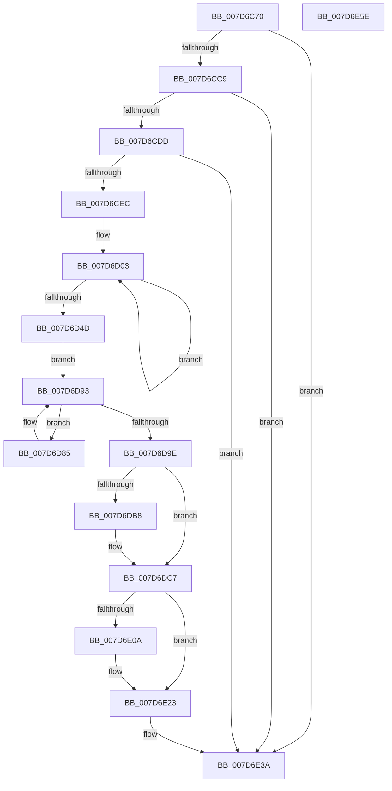

# WheaRemoveErrorSource

- RVA: `0x007D6C70`–`0x007D6E5F` (길이 `495` bytes)
- VA: `0x00000001407D6C70`
- 실행 섹션: `PAGE`
- PDB 이름 있음: `예`; PDB Function 태그: `아니요`
- unwind 정보 RVA: `0x000D5DFC`
- 디코드: `114`개 명령, `495/495` bytes 표시
- 미해석 바이트: `0` (있으면 어셈블리에 `.byte`로 보존)

> 이 문서는 커널 이미지의 기계어와 PDB 기호를 분석해 생성했습니다. 4번과 5번은 함수 원형과 자료형을 바이너리 사용 방식에서 추정한 C 해석이며 원본 소스 복구 결과는 아닙니다.

## 1. Dependencies

- 직접 호출 지점: **8**; 고유 호출 대상: **8**
- 직접 호출자로 확인된 함수: **2**
- RIP 상대 이미지 참조: **2**

### Outgoing calls
- `0x007D6CAA` → [memset](../../text/6C/memset_function_006C6C40.md) (function, `0x006C6C40`)
- `0x007D6CB8` → [WheapGetErrorSource](../../text/49/WheapGetErrorSource_function_0049554C.md) (function, `0x0049554C`)
- `0x007D6CD0` → [WheapIsErrorSourceTypeAddable](../../text/65/WheapIsErrorSourceTypeAddable_function_0065E358.md) (function, `0x0065E358`)
- `0x007D6D8E` → [KeDelayExecutionThread](../../text/20/KeDelayExecutionThread_function_00209550.md) (function, `0x00209550`)
- `0x007D6DA1` → [WheapCallErrorSourceUninitialize](../../text/65/WheapCallErrorSourceUninitialize_function_0065FC8C.md) (function, `0x0065FC8C`)
- `0x007D6DBD` → [ExFreePoolWithTag](../../poolcode/B8/ExFreePoolWithTag_function_00B82870.md) (function, `0x00B82870`)
- `0x007D6E35` → [WheaLogInternalEvent](../../text/66/WheaLogInternalEvent_function_006605B0.md) (function, `0x006605B0`)
- `0x007D6E44` → [_security_check_cookie](../../text/6A/_security_check_cookie_function_006AC640.md) (function, `0x006AC640`)

### Direct callers
- [WheaUnregisterErrorSourceOverride](../../text/66/WheaUnregisterErrorSourceOverride_function_00661140.md) at `0x006611D1`
- [WheaRemoveErrorSourceDeviceDriver](WheaRemoveErrorSourceDeviceDriver_function_007D7060.md) at `0x007D714D`

### Static image references
- `0x007D6C8A` → RVA `0x00E0A740` (`.data`; read)
- `0x007D6CB1` → RVA `0x00EEF018` (`.data`; read)

## 2. Other-region calls and transfers

- 다른 실행 섹션으로 향하는 call: **8**
  - `0x007D6CAA` → [memset](../../text/6C/memset_function_006C6C40.md) (`PAGE` → `.text`)
  - `0x007D6CB8` → [WheapGetErrorSource](../../text/49/WheapGetErrorSource_function_0049554C.md) (`PAGE` → `.text`)
  - `0x007D6CD0` → [WheapIsErrorSourceTypeAddable](../../text/65/WheapIsErrorSourceTypeAddable_function_0065E358.md) (`PAGE` → `.text`)
  - `0x007D6D8E` → [KeDelayExecutionThread](../../text/20/KeDelayExecutionThread_function_00209550.md) (`PAGE` → `.text`)
  - `0x007D6DA1` → [WheapCallErrorSourceUninitialize](../../text/65/WheapCallErrorSourceUninitialize_function_0065FC8C.md) (`PAGE` → `.text`)
  - `0x007D6DBD` → [ExFreePoolWithTag](../../poolcode/B8/ExFreePoolWithTag_function_00B82870.md) (`PAGE` → `POOLCODE`)
  - `0x007D6E35` → [WheaLogInternalEvent](../../text/66/WheaLogInternalEvent_function_006605B0.md) (`PAGE` → `.text`)
  - `0x007D6E44` → [_security_check_cookie](../../text/6A/_security_check_cookie_function_006AC640.md) (`PAGE` → `.text`)
- 별도 외부 분기/꼬리 이동을 확인하지 못했습니다.

## 3. Assembly (complete function range)

```asm
007D6C70  48 89 5C 24 10                  mov qword ptr [rsp + 0x10], rbx
007D6C75  48 89 7C 24 18                  mov qword ptr [rsp + 0x18], rdi
007D6C7A  55                              push rbp
007D6C7B  48 8D AC 24 C0 FC FF FF         lea rbp, [rsp - 0x340]
007D6C83  48 81 EC 40 04 00 00            sub rsp, 0x440
007D6C8A  48 8B 05 AF 3A 63 00            mov rax, qword ptr [rip + 0x633aaf]
007D6C91  48 33 C4                        xor rax, rsp
007D6C94  48 89 85 30 03 00 00            mov qword ptr [rbp + 0x330], rax
007D6C9B  8B D9                           mov ebx, ecx
007D6C9D  33 D2                           xor edx, edx
007D6C9F  48 8D 4C 24 50                  lea rcx, [rsp + 0x50]
007D6CA4  41 B8 CC 03 00 00               mov r8d, 0x3cc
007D6CAA  E8 91 FF EE FF                  call 0x1406c6c40
007D6CAF  8B D3                           mov edx, ebx
007D6CB1  48 8D 0D 60 83 71 00            lea rcx, [rip + 0x718360]
007D6CB8  E8 8F E8 CB FF                  call 0x14049554c
007D6CBD  48 8B D8                        mov rbx, rax
007D6CC0  48 85 C0                        test rax, rax
007D6CC3  0F 84 71 01 00 00               je 0x1407d6e3a
007D6CC9  48 8D 50 60                     lea rdx, [rax + 0x60]
007D6CCD  48 8B CA                        mov rcx, rdx
007D6CD0  E8 83 76 E8 FF                  call 0x14065e358
007D6CD5  84 C0                           test al, al
007D6CD7  0F 84 5D 01 00 00               je 0x1407d6e3a
007D6CDD  8B 43 6C                        mov eax, dword ptr [rbx + 0x6c]
007D6CE0  83 E8 03                        sub eax, 3
007D6CE3  83 F8 01                        cmp eax, 1
007D6CE6  0F 86 4E 01 00 00               jbe 0x1407d6e3a
007D6CEC  B8 07 00 00 00                  mov eax, 7
007D6CF1  48 C7 44 24 20 18 FC FF FF      mov qword ptr [rsp + 0x20], 0xfffffffffffffc18
007D6CFA  48 8D 4C 24 50                  lea rcx, [rsp + 0x50]
007D6CFF  44 8D 40 79                     lea r8d, [rax + 0x79]
007D6D03  0F 10 02                        movups xmm0, xmmword ptr [rdx]
007D6D06  0F 11 01                        movups xmmword ptr [rcx], xmm0
007D6D09  0F 10 4A 10                     movups xmm1, xmmword ptr [rdx + 0x10]
007D6D0D  0F 11 49 10                     movups xmmword ptr [rcx + 0x10], xmm1
007D6D11  0F 10 42 20                     movups xmm0, xmmword ptr [rdx + 0x20]
007D6D15  0F 11 41 20                     movups xmmword ptr [rcx + 0x20], xmm0
007D6D19  0F 10 4A 30                     movups xmm1, xmmword ptr [rdx + 0x30]
007D6D1D  0F 11 49 30                     movups xmmword ptr [rcx + 0x30], xmm1
007D6D21  0F 10 42 40                     movups xmm0, xmmword ptr [rdx + 0x40]
007D6D25  0F 11 41 40                     movups xmmword ptr [rcx + 0x40], xmm0
007D6D29  0F 10 4A 50                     movups xmm1, xmmword ptr [rdx + 0x50]
007D6D2D  0F 11 49 50                     movups xmmword ptr [rcx + 0x50], xmm1
007D6D31  0F 10 42 60                     movups xmm0, xmmword ptr [rdx + 0x60]
007D6D35  0F 11 41 60                     movups xmmword ptr [rcx + 0x60], xmm0
007D6D39  49 03 C8                        add rcx, r8
007D6D3C  0F 10 4A 70                     movups xmm1, xmmword ptr [rdx + 0x70]
007D6D40  49 03 D0                        add rdx, r8
007D6D43  0F 11 49 F0                     movups xmmword ptr [rcx - 0x10], xmm1
007D6D47  48 83 E8 01                     sub rax, 1
007D6D4B  75 B6                           jne 0x1407d6d03
007D6D4D  0F 10 02                        movups xmm0, xmmword ptr [rdx]
007D6D50  83 CF FF                        or edi, 0xffffffff
007D6D53  0F 11 01                        movups xmmword ptr [rcx], xmm0
007D6D56  0F 10 4A 10                     movups xmm1, xmmword ptr [rdx + 0x10]
007D6D5A  0F 11 49 10                     movups xmmword ptr [rcx + 0x10], xmm1
007D6D5E  0F 10 42 20                     movups xmm0, xmmword ptr [rdx + 0x20]
007D6D62  0F 11 41 20                     movups xmmword ptr [rcx + 0x20], xmm0
007D6D66  0F 10 4A 30                     movups xmm1, xmmword ptr [rdx + 0x30]
007D6D6A  0F 11 49 30                     movups xmmword ptr [rcx + 0x30], xmm1
007D6D6E  48 8B 42 40                     mov rax, qword ptr [rdx + 0x40]
007D6D72  48 89 41 40                     mov qword ptr [rcx + 0x40], rax
007D6D76  8B 42 48                        mov eax, dword ptr [rdx + 0x48]
007D6D79  89 41 48                        mov dword ptr [rcx + 0x48], eax
007D6D7C  C7 43 6C 04 00 00 00            mov dword ptr [rbx + 0x6c], 4
007D6D83  EB 0E                           jmp 0x1407d6d93
007D6D85  4C 8D 44 24 20                  lea r8, [rsp + 0x20]
007D6D8A  33 D2                           xor edx, edx
007D6D8C  33 C9                           xor ecx, ecx
007D6D8E  E8 BD 27 A3 FF                  call 0x140209550
007D6D93  33 C0                           xor eax, eax
007D6D95  F0 0F B1 7B 5C                  lock cmpxchg dword ptr [rbx + 0x5c], edi
007D6D9A  85 C0                           test eax, eax
007D6D9C  7F E7                           jg 0x1407d6d85
007D6D9E  48 8B CB                        mov rcx, rbx
007D6DA1  E8 E6 8E E8 FF                  call 0x14065fc8c
007D6DA6  48 8B 4B 30                     mov rcx, qword ptr [rbx + 0x30]
007D6DAA  8B F8                           mov edi, eax
007D6DAC  C7 43 6C 03 00 00 00            mov dword ptr [rbx + 0x6c], 3
007D6DB3  48 85 C9                        test rcx, rcx
007D6DB6  74 0F                           je 0x1407d6dc7
007D6DB8  BA 57 68 65 61                  mov edx, 0x61656857
007D6DBD  E8 AE BA 3A 00                  call 0x140b82870
007D6DC2  48 83 63 30 00                  and qword ptr [rbx + 0x30], 0
007D6DC7  83 64 24 3C 00                  and dword ptr [rsp + 0x3c], 0
007D6DCC  C7 44 24 30 57 68 4C 67         mov dword ptr [rsp + 0x30], 0x674c6857
007D6DD4  C7 44 24 34 01 00 00 00         mov dword ptr [rsp + 0x34], 1
007D6DDC  C7 44 24 38 F1 03 00 00         mov dword ptr [rsp + 0x38], 0x3f1
007D6DE4  C7 44 24 44 0C 00 00 80         mov dword ptr [rsp + 0x44], 0x8000000c
007D6DEC  C7 44 24 40 4B 52 4E 4C         mov dword ptr [rsp + 0x40], 0x4c4e524b
007D6DF4  C7 44 24 48 02 00 00 00         mov dword ptr [rsp + 0x48], 2
007D6DFC  C7 44 24 4C D1 03 00 00         mov dword ptr [rsp + 0x4c], 0x3d1
007D6E04  83 7B 68 10                     cmp dword ptr [rbx + 0x68], 0x10
007D6E08  75 19                           jne 0x1407d6e23
007D6E0A  48 83 65 A0 00                  and qword ptr [rbp - 0x60], 0
007D6E0F  48 83 65 A8 00                  and qword ptr [rbp - 0x58], 0
007D6E14  48 83 65 B0 00                  and qword ptr [rbp - 0x50], 0
007D6E19  48 83 65 98 00                  and qword ptr [rbp - 0x68], 0
007D6E1E  48 83 65 E0 00                  and qword ptr [rbp - 0x20], 0
007D6E23  48 8D 4C 24 30                  lea rcx, [rsp + 0x30]
007D6E28  89 BD 1C 03 00 00               mov dword ptr [rbp + 0x31c], edi
007D6E2E  C6 85 20 03 00 00 01            mov byte ptr [rbp + 0x320], 1
007D6E35  E8 76 97 E8 FF                  call 0x1406605b0
007D6E3A  48 8B 8D 30 03 00 00            mov rcx, qword ptr [rbp + 0x330]
007D6E41  48 33 CC                        xor rcx, rsp
007D6E44  E8 F7 57 ED FF                  call 0x1406ac640
007D6E49  4C 8D 9C 24 40 04 00 00         lea r11, [rsp + 0x440]
007D6E51  49 8B 5B 18                     mov rbx, qword ptr [r11 + 0x18]
007D6E55  49 8B 7B 20                     mov rdi, qword ptr [r11 + 0x20]
007D6E59  49 8B E3                        mov rsp, r11
007D6E5C  5D                              pop rbp
007D6E5D  C3                              ret
007D6E5E  CC                              int3
```

## 4. C-style interpretation (structured pseudocode)

```c
__int64 __fastcall WheaRemoveErrorSource(int a1, int a2)
{
    __int64 result;
    __int64 v_rdi;
    __int64 v_rsp;
    unsigned __int64 v_stack_m18;
    unsigned __int8 v_stack_m28;
    unsigned int v_stack_m2C;
    unsigned __int64 v_stack_m348;
    unsigned __int64 v_stack_m368;
    unsigned __int64 v_stack_m398;
    unsigned __int64 v_stack_m3A0;
    unsigned __int64 v_stack_m3A8;
    unsigned __int64 v_stack_m3B0;
    unsigned __int64 v_stack_m3F8;
    unsigned int v_stack_m3FC;
    unsigned int v_stack_m400;
    unsigned int v_stack_m404;
    unsigned int v_stack_m408;
    unsigned int v_stack_m40C;
    unsigned int v_stack_m410;
    unsigned int v_stack_m414;
    unsigned int v_stack_m418;
    unsigned __int64 v_stack_m428;
    unsigned __int64 v_stack_m8;
    unsigned __int64 v_stack_p10;
    unsigned __int64 v_stack_p18;

    v_stack_p10 = v_rbx;
    v_stack_p18 = v_rdi;
    v_rsp = (v_rsp) - (0x440ULL);
    result = (*(unsigned __int64 *)(v_rip + 6503087)) ^ (v_rsp);
    v_stack_m18 = result;
    a2 = 0;
    result = memset(v_stack_m3F8, a2, 972, a4);
    result = WheapGetErrorSource(v_rip + 7439200, (unsigned int)((unsigned int)((unsigned int)(a1))), 972, a4);
    if (result == 0) goto loc_007D6E3A;
    result = WheapIsErrorSourceTypeAddable(result + 96, result + 96, 972, a4);
    if ((unsigned __int8)(result) == 0) goto loc_007D6E3A;
    result = (unsigned int)(((unsigned int)(*(unsigned int *)(result + 108))) - (3));
    if (((unsigned int)(result)) <= 1) goto loc_007D6E3A;
    v_stack_m428 = -1000;
loc_007D6D03:
    *(unsigned __int64 *)(v_stack_m3F8) = v_xmm0;
    *(unsigned __int64 *)(v_stack_m3F8 + 16) = v_xmm1;
    *(unsigned __int64 *)(v_stack_m3F8 + 32) = v_xmm0;
    *(unsigned __int64 *)(v_stack_m3F8 + 48) = v_xmm1;
    *(unsigned __int64 *)(v_stack_m3F8 + 64) = v_xmm0;
    *(unsigned __int64 *)(v_stack_m3F8 + 80) = v_xmm1;
    *(unsigned __int64 *)(v_stack_m3F8 + 96) = v_xmm0;
    a1 = (v_stack_m3F8) + (7 + 121);
    a2 = (result + 96) + (7 + 121);
    *(unsigned __int64 *)(a1 - 16) = v_xmm1;
    result = (7) - (1);
    if (condition_is_not_equal) goto loc_007D6D03;
    v_rdi = (unsigned int)((v_rdi) | (0xFFFFFFFFULL));
    *(unsigned __int64 *)(a1) = v_xmm0;
    *(unsigned __int64 *)(a1 + 16) = v_xmm1;
    *(unsigned __int64 *)(a1 + 32) = v_xmm0;
    *(unsigned __int64 *)(a1 + 48) = v_xmm1;
    *(unsigned __int64 *)(a1 + 64) = *(unsigned __int64 *)(a2 + 64);
    *(unsigned int *)(a1 + 72) = (unsigned int)((unsigned int)(*(unsigned int *)(a2 + 72)));
    *(unsigned int *)(result + 108) = 4;
    goto loc_007D6D93;
loc_007D6D85:
    a2 = 0;
    a1 = 0;
    result = KeDelayExecutionThread(a1, a2, v_stack_m428, a4);
loc_007D6D93:
    result = 0;
    if (condition_is_greater) goto loc_007D6D85;
    result = WheapCallErrorSourceUninitialize(0, a2, v_stack_m428, a4);
    *(unsigned int *)(result + 108) = 3;
    if (*(unsigned __int64 *)(result + 48) != 0) {
        a2 = 0x61656857ULL;
        result = ExFreePoolWithTag(*(unsigned __int64 *)(result + 48), a2, v_stack_m428, a4);
    }
    v_stack_m418 = 0x674C6857ULL;
    v_stack_m414 = 1;
    v_stack_m410 = 0x3F1ULL;
    v_stack_m404 = 0x8000000CULL;
    v_stack_m408 = 0x4C4E524BULL;
    v_stack_m400 = 2;
    v_stack_m3FC = 977;
    if ((*(unsigned int *)(result + 104)) == 16) {
    }
    v_stack_m2C = (unsigned int)((unsigned int)((unsigned int)(result)));
    v_stack_m28 = 1;
    result = WheaLogInternalEvent(v_stack_m418, a2, v_stack_m428, a4);
loc_007D6E3A:
    a1 = (v_stack_m18) ^ (v_rsp);
    result = _security_check_cookie(a1, a2, v_stack_m428, a4);
    return result;
}
```

## 5. (Beta) C Style

```c
int64_t WheaRemoveErrorSource(int32_t Arg1, int32_t Arg2)
{
    int64_t result;
    int64_t local_rdi;
    int64_t local_rsp;
    uint64_t v_stack_m18;
    uint8_t v_stack_m28;
    uint32_t v_stack_m2C;
    uint64_t v_stack_m348;
    uint64_t v_stack_m368;
    uint64_t v_stack_m398;
    uint64_t v_stack_m3A0;
    uint64_t v_stack_m3A8;
    uint64_t v_stack_m3B0;
    uint64_t v_stack_m3F8;
    uint32_t v_stack_m3FC;
    uint32_t v_stack_m400;
    uint32_t v_stack_m404;
    uint32_t v_stack_m408;
    uint32_t v_stack_m40C;
    uint32_t v_stack_m410;
    uint32_t v_stack_m414;
    uint32_t v_stack_m418;
    uint64_t v_stack_m428;
    uint64_t v_stack_m8;
    uint64_t v_stack_p10;
    uint64_t v_stack_p18;

    v_stack_p10 = local_rbx;
    v_stack_p18 = local_rdi;
    local_rsp = (local_rsp) - (0x440ULL);
    result = (*(uint64_t *)(v_rip + 0x633AAF)) ^ (local_rsp);
    v_stack_m18 = result;
    Arg2 = 0;
    result = memset(v_stack_m3F8, Arg2, 972, a4);
    result = WheapGetErrorSource(v_rip + 7439200, (uint32_t)((uint32_t)((uint32_t)(Arg1))), 972, a4);
    if (result == 0) goto loc_007D6E3A;
    result = WheapIsErrorSourceTypeAddable(result + 96, result + 96, 972, a4);
    if ((uint8_t)(result) == 0) goto loc_007D6E3A;
    result = (uint32_t)(((uint32_t)(*(uint32_t *)(result + 0x6C))) - (3));
    if (((uint32_t)(result)) <= 1) goto loc_007D6E3A;
    v_stack_m428 = -1000;
loc_007D6D03:
    *(uint64_t *)(v_stack_m3F8) = v_xmm0;
    *(uint64_t *)(v_stack_m3F8 + 0x10) = v_xmm1;
    *(uint64_t *)(v_stack_m3F8 + 0x20) = v_xmm0;
    *(uint64_t *)(v_stack_m3F8 + 0x30) = v_xmm1;
    *(uint64_t *)(v_stack_m3F8 + 0x40) = v_xmm0;
    *(uint64_t *)(v_stack_m3F8 + 0x50) = v_xmm1;
    *(uint64_t *)(v_stack_m3F8 + 0x60) = v_xmm0;
    Arg1 = (v_stack_m3F8) + (7 + 121);
    Arg2 = (result + 96) + (7 + 121);
    *(uint64_t *)(Arg1 - 0x10) = v_xmm1;
    result = (7) - (1);
    if (condition_is_not_equal) goto loc_007D6D03;
    local_rdi = (uint32_t)((local_rdi) | (0xFFFFFFFFULL));
    *(uint64_t *)(Arg1) = v_xmm0;
    *(uint64_t *)(Arg1 + 0x10) = v_xmm1;
    *(uint64_t *)(Arg1 + 0x20) = v_xmm0;
    *(uint64_t *)(Arg1 + 0x30) = v_xmm1;
    *(uint64_t *)(Arg1 + 0x40) = *(uint64_t *)(Arg2 + 0x40);
    *(uint32_t *)(Arg1 + 0x48) = (uint32_t)((uint32_t)(*(uint32_t *)(Arg2 + 0x48)));
    *(uint32_t *)(result + 0x6C) = 4;
    goto loc_007D6D93;
loc_007D6D85:
    Arg2 = 0;
    Arg1 = 0;
    result = KeDelayExecutionThread(Arg1, Arg2, v_stack_m428, a4);
loc_007D6D93:
    result = 0;
    if (condition_is_greater) goto loc_007D6D85;
    result = WheapCallErrorSourceUninitialize(0, Arg2, v_stack_m428, a4);
    *(uint32_t *)(result + 0x6C) = 3;
    if (*(uint64_t *)(result + 0x30) != 0) {
        Arg2 = 0x61656857ULL;
        result = ExFreePoolWithTag(*(uint64_t *)(result + 0x30), Arg2, v_stack_m428, a4);
    }
    v_stack_m418 = 0x674C6857ULL;
    v_stack_m414 = 1;
    v_stack_m410 = 0x3F1ULL;
    v_stack_m404 = 0x8000000CULL;
    v_stack_m408 = 0x4C4E524BULL;
    v_stack_m400 = 2;
    v_stack_m3FC = 977;
    if ((*(uint32_t *)(result + 0x68)) == 16) {
    }
    v_stack_m2C = (uint32_t)((uint32_t)((uint32_t)(result)));
    v_stack_m28 = 1;
    result = WheaLogInternalEvent(v_stack_m418, Arg2, v_stack_m428, a4);
loc_007D6E3A:
    Arg1 = (v_stack_m18) ^ (local_rsp);
    result = _security_check_cookie(Arg1, Arg2, v_stack_m428, a4);
    return result;
}
```

## 6. Execution-region graph

[열기: 2D/3D 그래프와 함수 탐색 컨트롤 패널](../../../control-panel.html?section=page&rva=0x007D6C70&view=graph)

- 2D 그래프는 위에서 아래로 흐르고, 3D 그래프는 빈 공간을 드래그해 회전합니다. Shift+드래그는 이동, 휠은 확대·축소, 함수 노드 선택은 대상 보고서 이동입니다.

### Static fallback


