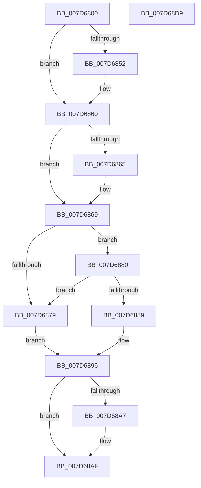

# WheaSelLogCheckPoint

- RVA: `0x007D6800`–`0x007D68DA` (길이 `218` bytes)
- VA: `0x00000001407D6800`
- 실행 섹션: `PAGE`
- PDB 이름 있음: `예`; PDB Function 태그: `아니요`
- unwind 정보 RVA: `0x0005E6B4`
- 디코드: `58`개 명령, `218/218` bytes 표시
- 미해석 바이트: `0` (있으면 어셈블리에 `.byte`로 보존)

> 이 문서는 커널 이미지의 기계어와 PDB 기호를 분석해 생성했습니다. 4번과 5번은 함수 원형과 자료형을 바이너리 사용 방식에서 추정한 C 해석이며 원본 소스 복구 결과는 아닙니다.

## 1. Dependencies

- 직접 호출 지점: **7**; 고유 호출 대상: **7**
- 직접 호출자로 확인된 함수: **3**
- RIP 상대 이미지 참조: **4**

### Outgoing calls
- `0x007D6842` → [KeAbPreAcquire](../../text/21/KeAbPreAcquire_function_00210230.md) (function, `0x00210230`)
- `0x007D685B` → [ExfAcquirePushLockExclusiveEx](../../text/20/ExfAcquirePushLockExclusiveEx_function_0020FC90.md) (function, `0x0020FC90`)
- `0x007D6870` → [IpmiHwContextInitialized](../../text/6A/IpmiHwContextInitialized_function_006A64DC.md) (function, `0x006A64DC`)
- `0x007D688F` → [IpmiLibAddSelCheckpointRecord](../../text/6A/IpmiLibAddSelCheckpointRecord_function_006A6B7C.md) (function, `0x006A6B7C`)
- `0x007D68AA` → [ExfTryToWakePushLock](../../text/26/ExfTryToWakePushLock_function_00265DD0.md) (function, `0x00265DD0`)
- `0x007D68B2` → [KeAbPostRelease](../../text/2E/KeAbPostRelease_function_002E1600.md) (function, `0x002E1600`)
- `0x007D68B7` → [KeLeaveCriticalRegion](../../text/25/KeLeaveCriticalRegion_function_0025D8B0.md) (function, `0x0025D8B0`)

### Direct callers
- [IopWheaSelLogCheckPoint](../../text/59/IopWheaSelLogCheckPoint_function_00596720.md) at `0x0059672F`
- [IopWheaSelLogCheckPoint](../../text/59/IopWheaSelLogCheckPoint_function_00596720.md) at `0x0059673F`
- [InitBootProcessor](../../init/C1/InitBootProcessor_function_00C1B1C8.md) at `0x00C1B6F0`
- [IoInitSystemPreDrivers](../../init/C2/IoInitSystemPreDrivers_function_00C2AC3C.md) at `0x00C2B4C0`
- [IoInitSystemPreDrivers](../../init/C2/IoInitSystemPreDrivers_function_00C2AC3C.md) at `0x00C2B549`
- [IoInitSystemPreDrivers](../../init/C2/IoInitSystemPreDrivers_function_00C2AC3C.md) at `0x00C2B794`
- [IoInitSystemPreDrivers](../../init/C2/IoInitSystemPreDrivers_function_00C2AC3C.md) at `0x00C2B7F0`
- [IoInitSystemPreDrivers](../../init/C2/IoInitSystemPreDrivers_function_00C2AC3C.md) at `0x00C2B929`
- [IoInitSystemPreDrivers](../../init/C2/IoInitSystemPreDrivers_function_00C2AC3C.md) at `0x00C2B95B`
- [IoInitSystemPreDrivers](../../init/C2/IoInitSystemPreDrivers_function_00C2AC3C.md) at `0x00C2BA50`
- [IoInitSystemPreDrivers](../../init/C2/IoInitSystemPreDrivers_function_00C2AC3C.md) at `0x00C2BB12`
- [IoInitSystemPreDrivers](../../init/C2/IoInitSystemPreDrivers_function_00C2AC3C.md) at `0x00C2BBB5`
- [IoInitSystemPreDrivers](../../init/C2/IoInitSystemPreDrivers_function_00C2AC3C.md) at `0x00C2BC3A`
- [IoInitSystemPreDrivers](../../init/C2/IoInitSystemPreDrivers_function_00C2AC3C.md) at `0x00C2BCB7`
- [IoInitSystemPreDrivers](../../init/C2/IoInitSystemPreDrivers_function_00C2AC3C.md) at `0x00C2BCF3`
- [IoInitSystemPreDrivers](../../init/C2/IoInitSystemPreDrivers_function_00C2AC3C.md) at `0x00C2BE86`
- [IoInitSystemPreDrivers](../../init/C2/IoInitSystemPreDrivers_function_00C2AC3C.md) at `0x00C2BEDE`

### Static image references
- `0x007D6822` → RVA `0x00EFA0F0` (`.data`; read)
- `0x007D6869` → RVA `0x00EFA080` (`.data`; read)
- `0x007D6880` → RVA `0x00EFA0F8` (`.data`; read)
- `0x007D6896` → RVA `0x00EFA0F0` (`.data`; read/write)

## 2. Other-region calls and transfers

- 다른 실행 섹션으로 향하는 call: **7**
  - `0x007D6842` → [KeAbPreAcquire](../../text/21/KeAbPreAcquire_function_00210230.md) (`PAGE` → `.text`)
  - `0x007D685B` → [ExfAcquirePushLockExclusiveEx](../../text/20/ExfAcquirePushLockExclusiveEx_function_0020FC90.md) (`PAGE` → `.text`)
  - `0x007D6870` → [IpmiHwContextInitialized](../../text/6A/IpmiHwContextInitialized_function_006A64DC.md) (`PAGE` → `.text`)
  - `0x007D688F` → [IpmiLibAddSelCheckpointRecord](../../text/6A/IpmiLibAddSelCheckpointRecord_function_006A6B7C.md) (`PAGE` → `.text`)
  - `0x007D68AA` → [ExfTryToWakePushLock](../../text/26/ExfTryToWakePushLock_function_00265DD0.md) (`PAGE` → `.text`)
  - `0x007D68B2` → [KeAbPostRelease](../../text/2E/KeAbPostRelease_function_002E1600.md) (`PAGE` → `.text`)
  - `0x007D68B7` → [KeLeaveCriticalRegion](../../text/25/KeLeaveCriticalRegion_function_0025D8B0.md) (`PAGE` → `.text`)
- 별도 외부 분기/꼬리 이동을 확인하지 못했습니다.

## 3. Assembly (complete function range)

```asm
007D6800  48 8B C4                        mov rax, rsp
007D6803  48 89 58 08                     mov qword ptr [rax + 8], rbx
007D6807  48 89 68 10                     mov qword ptr [rax + 0x10], rbp
007D680B  48 89 70 18                     mov qword ptr [rax + 0x18], rsi
007D680F  48 89 78 20                     mov qword ptr [rax + 0x20], rdi
007D6813  41 56                           push r14
007D6815  48 83 EC 20                     sub rsp, 0x20
007D6819  65 48 8B 04 25 88 01 00 00      mov rax, qword ptr gs:[0x188]
007D6822  4C 8D 35 C7 38 72 00            lea r14, [rip + 0x7238c7]
007D6829  8B F2                           mov esi, edx
007D682B  0F B7 E9                        movzx ebp, cx
007D682E  48 83 CB FF                     or rbx, 0xffffffffffffffff
007D6832  45 33 C0                        xor r8d, r8d
007D6835  33 D2                           xor edx, edx
007D6837  49 8B CE                        mov rcx, r14
007D683A  66 01 98 E4 01 00 00            add word ptr [rax + 0x1e4], bx
007D6841  90                              nop
007D6842  E8 E9 99 A3 FF                  call 0x140210230
007D6847  F0 49 0F BA 2E 00               lock bts qword ptr [r14], 0
007D684D  48 8B F8                        mov rdi, rax
007D6850  73 0E                           jae 0x1407d6860
007D6852  4D 8B C6                        mov r8, r14
007D6855  48 8B D0                        mov rdx, rax
007D6858  49 8B CE                        mov rcx, r14
007D685B  E8 30 94 A3 FF                  call 0x14020fc90
007D6860  48 85 FF                        test rdi, rdi
007D6863  74 04                           je 0x1407d6869
007D6865  C6 47 0A 01                     mov byte ptr [rdi + 0xa], 1
007D6869  48 8D 0D 10 38 72 00            lea rcx, [rip + 0x723810]
007D6870  E8 67 FC EC FF                  call 0x1406a64dc
007D6875  84 C0                           test al, al
007D6877  75 07                           jne 0x1407d6880
007D6879  BF 01 00 00 C0                  mov edi, 0xc0000001
007D687E  EB 16                           jmp 0x1407d6896
007D6880  80 3D 71 38 72 00 00            cmp byte ptr [rip + 0x723871], 0
007D6887  75 F0                           jne 0x1407d6879
007D6889  44 8B C6                        mov r8d, esi
007D688C  0F B7 D5                        movzx edx, bp
007D688F  E8 E8 02 ED FF                  call 0x1406a6b7c
007D6894  8B F8                           mov edi, eax
007D6896  F0 48 0F C1 1D 51 38 72 00      lock xadd qword ptr [rip + 0x723851], rbx
007D689F  80 E3 06                        and bl, 6
007D68A2  80 FB 02                        cmp bl, 2
007D68A5  75 08                           jne 0x1407d68af
007D68A7  49 8B CE                        mov rcx, r14
007D68AA  E8 21 F5 A8 FF                  call 0x140265dd0
007D68AF  49 8B CE                        mov rcx, r14
007D68B2  E8 49 AD B0 FF                  call 0x1402e1600
007D68B7  E8 F4 6F A8 FF                  call 0x14025d8b0
007D68BC  48 8B 5C 24 30                  mov rbx, qword ptr [rsp + 0x30]
007D68C1  8B C7                           mov eax, edi
007D68C3  48 8B 7C 24 48                  mov rdi, qword ptr [rsp + 0x48]
007D68C8  48 8B 6C 24 38                  mov rbp, qword ptr [rsp + 0x38]
007D68CD  48 8B 74 24 40                  mov rsi, qword ptr [rsp + 0x40]
007D68D2  48 83 C4 20                     add rsp, 0x20
007D68D6  41 5E                           pop r14
007D68D8  C3                              ret
007D68D9  CC                              int3
```

## 4. C-style interpretation (structured pseudocode)

```c
__int64 __fastcall WheaSelLogCheckPoint(unsigned __int16 a1, int a2, int a3)
{
    __int64 result;
    __int64 v_rbx;
    __int64 v_rsp;
    unsigned __int64 v_stack_p10;
    unsigned __int64 v_stack_p18;
    unsigned __int64 v_stack_p20;
    unsigned __int64 v_stack_p8;

    *(unsigned __int64 *)(v_rsp + 8) = v_rbx;
    *(unsigned __int64 *)(v_rsp + 16) = v_rbp;
    *(unsigned __int64 *)(v_rsp + 24) = v_rsi;
    *(unsigned __int64 *)(v_rsp + 32) = v_rdi;
    v_rsp = (v_rsp) - (32);
    v_rbx = (v_rbx) | (-1);
    a3 = 0;
    a2 = 0;
    result = KeAbPreAcquire(v_rip + 7485639, a2, a3, a4);
    if (!(condition_is_above_or_equal)) {
        a3 = v_rip + 7485639;
        a2 = result;
        a1 = v_rip + 7485639;
        result = ExfAcquirePushLockExclusiveEx(a1, a2, a3, a4);
    }
    if (result != 0) {
        *(unsigned __int8 *)(result + 10) = 1;
    }
    result = IpmiHwContextInitialized(v_rip + 7485456, a2, a3, a4);
    if ((unsigned __int8)(result) != 0) goto loc_007D6880;
loc_007D6879:
    goto loc_007D6896;
loc_007D6880:
    if ((*(unsigned __int8 *)(v_rip + 7485553)) != 0) goto loc_007D6879;
    result = IpmiLibAddSelCheckpointRecord(v_rip + 7485456, a1, (unsigned int)((unsigned int)((unsigned int)(a2))), a4);
loc_007D6896:
    v_rbx = (unsigned __int8)((v_rbx) & (6));
    if (((unsigned __int8)(v_rbx)) == 2) {
        a1 = v_rip + 7485639;
        result = ExfTryToWakePushLock(a1, a1, (unsigned int)((unsigned int)((unsigned int)(a2))), a4);
    }
    result = KeAbPostRelease(v_rip + 7485639, a1, (unsigned int)((unsigned int)((unsigned int)(a2))), a4);
    result = KeLeaveCriticalRegion(v_rip + 7485639, a1, (unsigned int)((unsigned int)((unsigned int)(a2))), a4);
    v_rsp = (v_rsp) + (32);
    return (unsigned int)((unsigned int)((unsigned int)((unsigned int)(result))));
}
```

## 5. (Beta) C Style

```c
int64_t WheaSelLogCheckPoint(uint16_t Arg1, int32_t Arg2, int32_t Arg3)
{
    int64_t result;
    int64_t local_rbx;
    int64_t local_rsp;
    uint64_t v_stack_p10;
    uint64_t v_stack_p18;
    uint64_t v_stack_p20;
    uint64_t v_stack_p8;

    *(uint64_t *)(local_rsp + 0x8) = local_rbx;
    *(uint64_t *)(local_rsp + 0x10) = local_rbp;
    *(uint64_t *)(local_rsp + 0x18) = local_rsi;
    *(uint64_t *)(local_rsp + 0x20) = local_rdi;
    local_rsp = (local_rsp) - (32);
    local_rbx = (local_rbx) | (-1);
    Arg3 = 0;
    Arg2 = 0;
    result = KeAbPreAcquire(v_rip + 7485639, Arg2, Arg3, a4);
    if (!(condition_is_above_or_equal)) {
        Arg3 = v_rip + 7485639;
        Arg2 = result;
        Arg1 = v_rip + 7485639;
        result = ExfAcquirePushLockExclusiveEx(Arg1, Arg2, Arg3, a4);
    }
    if (result != 0) {
        *(uint8_t *)(result + 0xA) = 1;
    }
    result = IpmiHwContextInitialized(v_rip + 7485456, Arg2, Arg3, a4);
    if ((uint8_t)(result) != 0) goto loc_007D6880;
loc_007D6879:
    goto loc_007D6896;
loc_007D6880:
    if ((*(uint8_t *)(v_rip + 0x723871)) != 0) goto loc_007D6879;
    result = IpmiLibAddSelCheckpointRecord(v_rip + 7485456, Arg1, (uint32_t)((uint32_t)((uint32_t)(Arg2))), a4);
loc_007D6896:
    local_rbx = (uint8_t)((local_rbx) & (6));
    if (((uint8_t)(local_rbx)) == 2) {
        Arg1 = v_rip + 7485639;
        result = ExfTryToWakePushLock(Arg1, Arg1, (uint32_t)((uint32_t)((uint32_t)(Arg2))), a4);
    }
    result = KeAbPostRelease(v_rip + 7485639, Arg1, (uint32_t)((uint32_t)((uint32_t)(Arg2))), a4);
    result = KeLeaveCriticalRegion(v_rip + 7485639, Arg1, (uint32_t)((uint32_t)((uint32_t)(Arg2))), a4);
    local_rsp = (local_rsp) + (32);
    return (uint32_t)((uint32_t)((uint32_t)((uint32_t)(result))));
}
```

## 6. Execution-region graph

[열기: 2D/3D 그래프와 함수 탐색 컨트롤 패널](../../../control-panel.html?section=page&rva=0x007D6800&view=graph)

- 2D 그래프는 위에서 아래로 흐르고, 3D 그래프는 빈 공간을 드래그해 회전합니다. Shift+드래그는 이동, 휠은 확대·축소, 함수 노드 선택은 대상 보고서 이동입니다.

### Static fallback


