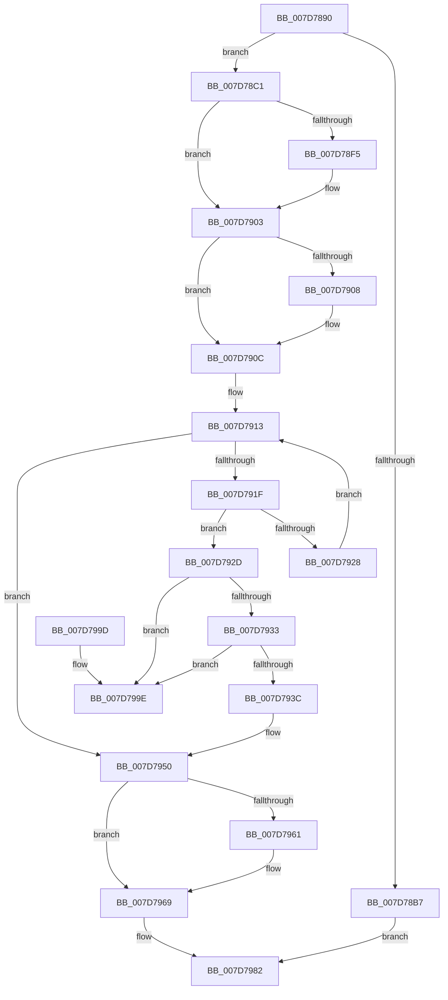

# WheaUnregisterInUsePageOfflineNotification

- RVA: `0x007D7890`–`0x007D79A5` (길이 `277` bytes)
- VA: `0x00000001407D7890`
- 실행 섹션: `PAGE`
- PDB 이름 있음: `예`; PDB Function 태그: `아니요`
- unwind 정보 RVA: `0x0006B020`
- 디코드: `74`개 명령, `277/277` bytes 표시
- 미해석 바이트: `0` (있으면 어셈블리에 `.byte`로 보존)

> 이 문서는 커널 이미지의 기계어와 PDB 기호를 분석해 생성했습니다. 4번과 5번은 함수 원형과 자료형을 바이너리 사용 방식에서 추정한 C 해석이며 원본 소스 복구 결과는 아닙니다.

## 1. Dependencies

- 직접 호출 지점: **6**; 고유 호출 대상: **6**
- 직접 호출자로 확인된 함수: **1**
- RIP 상대 이미지 참조: **4**

### Outgoing calls
- `0x007D78E5` → [KeAbPreAcquire](../../text/21/KeAbPreAcquire_function_00210230.md) (function, `0x00210230`)
- `0x007D78FE` → [ExfAcquirePushLockExclusiveEx](../../text/20/ExfAcquirePushLockExclusiveEx_function_0020FC90.md) (function, `0x0020FC90`)
- `0x007D7948` → [ExFreePoolWithTag](../../poolcode/B8/ExFreePoolWithTag_function_00B82870.md) (function, `0x00B82870`)
- `0x007D7964` → [ExfTryToWakePushLock](../../text/26/ExfTryToWakePushLock_function_00265DD0.md) (function, `0x00265DD0`)
- `0x007D796C` → [KeAbPostRelease](../../text/2E/KeAbPostRelease_function_002E1600.md) (function, `0x002E1600`)
- `0x007D7971` → [KeLeaveCriticalRegion](../../text/25/KeLeaveCriticalRegion_function_0025D8B0.md) (function, `0x0025D8B0`)

### Direct callers
- [HvlUnregisterWheaErrorNotification](../71/HvlUnregisterWheaErrorNotification_function_00717F70.md) at `0x00717F92`

### Static image references
- `0x007D78AE` → RVA `0x00EEF058` (`.data`; read)
- `0x007D78CA` → RVA `0x00EEF060` (`.data`; read)
- `0x007D790C` → RVA `0x00EEF068` (`.data`; read)
- `0x007D7950` → RVA `0x00EEF060` (`.data`; read/write)

## 2. Other-region calls and transfers

- 다른 실행 섹션으로 향하는 call: **6**
  - `0x007D78E5` → [KeAbPreAcquire](../../text/21/KeAbPreAcquire_function_00210230.md) (`PAGE` → `.text`)
  - `0x007D78FE` → [ExfAcquirePushLockExclusiveEx](../../text/20/ExfAcquirePushLockExclusiveEx_function_0020FC90.md) (`PAGE` → `.text`)
  - `0x007D7948` → [ExFreePoolWithTag](../../poolcode/B8/ExFreePoolWithTag_function_00B82870.md) (`PAGE` → `POOLCODE`)
  - `0x007D7964` → [ExfTryToWakePushLock](../../text/26/ExfTryToWakePushLock_function_00265DD0.md) (`PAGE` → `.text`)
  - `0x007D796C` → [KeAbPostRelease](../../text/2E/KeAbPostRelease_function_002E1600.md) (`PAGE` → `.text`)
  - `0x007D7971` → [KeLeaveCriticalRegion](../../text/25/KeLeaveCriticalRegion_function_0025D8B0.md) (`PAGE` → `.text`)
- 별도 외부 분기/꼬리 이동을 확인하지 못했습니다.

## 3. Assembly (complete function range)

```asm
007D7890  48 8B C4                        mov rax, rsp
007D7893  48 89 58 08                     mov qword ptr [rax + 8], rbx
007D7897  48 89 68 10                     mov qword ptr [rax + 0x10], rbp
007D789B  48 89 70 18                     mov qword ptr [rax + 0x18], rsi
007D789F  48 89 78 20                     mov qword ptr [rax + 0x20], rdi
007D78A3  41 56                           push r14
007D78A5  48 83 EC 20                     sub rsp, 0x20
007D78A9  33 FF                           xor edi, edi
007D78AB  48 8B E9                        mov rbp, rcx
007D78AE  80 3D A3 77 71 00 01            cmp byte ptr [rip + 0x7177a3], 1
007D78B5  74 0A                           je 0x1407d78c1
007D78B7  B8 01 00 00 C0                  mov eax, 0xc0000001
007D78BC  E9 C1 00 00 00                  jmp 0x1407d7982
007D78C1  65 48 8B 04 25 88 01 00 00      mov rax, qword ptr gs:[0x188]
007D78CA  4C 8D 35 8F 77 71 00            lea r14, [rip + 0x71778f]
007D78D1  48 83 CB FF                     or rbx, 0xffffffffffffffff
007D78D5  45 33 C0                        xor r8d, r8d
007D78D8  33 D2                           xor edx, edx
007D78DA  49 8B CE                        mov rcx, r14
007D78DD  66 01 98 E4 01 00 00            add word ptr [rax + 0x1e4], bx
007D78E4  90                              nop
007D78E5  E8 46 89 A3 FF                  call 0x140210230
007D78EA  F0 49 0F BA 2E 00               lock bts qword ptr [r14], 0
007D78F0  48 8B F0                        mov rsi, rax
007D78F3  73 0E                           jae 0x1407d7903
007D78F5  4D 8B C6                        mov r8, r14
007D78F8  48 8B D0                        mov rdx, rax
007D78FB  49 8B CE                        mov rcx, r14
007D78FE  E8 8D 83 A3 FF                  call 0x14020fc90
007D7903  48 85 F6                        test rsi, rsi
007D7906  74 04                           je 0x1407d790c
007D7908  C6 46 0A 01                     mov byte ptr [rsi + 0xa], 1
007D790C  48 8B 0D 55 77 71 00            mov rcx, qword ptr [rip + 0x717755]
007D7913  48 8D 05 4E 77 71 00            lea rax, [rip + 0x71774e]
007D791A  48 3B C8                        cmp rcx, rax
007D791D  74 31                           je 0x1407d7950
007D791F  48 8B 01                        mov rax, qword ptr [rcx]
007D7922  48 3B 69 10                     cmp rbp, qword ptr [rcx + 0x10]
007D7926  74 05                           je 0x1407d792d
007D7928  48 8B C8                        mov rcx, rax
007D792B  EB E6                           jmp 0x1407d7913
007D792D  48 39 48 08                     cmp qword ptr [rax + 8], rcx
007D7931  75 6B                           jne 0x1407d799e
007D7933  48 8B 51 08                     mov rdx, qword ptr [rcx + 8]
007D7937  48 39 0A                        cmp qword ptr [rdx], rcx
007D793A  75 62                           jne 0x1407d799e
007D793C  48 89 02                        mov qword ptr [rdx], rax
007D793F  48 89 50 08                     mov qword ptr [rax + 8], rdx
007D7943  BA 57 68 65 61                  mov edx, 0x61656857
007D7948  E8 23 AF 3A 00                  call 0x140b82870
007D794D  40 B7 01                        mov dil, 1
007D7950  F0 48 0F C1 1D 07 77 71 00      lock xadd qword ptr [rip + 0x717707], rbx
007D7959  80 E3 06                        and bl, 6
007D795C  80 FB 02                        cmp bl, 2
007D795F  75 08                           jne 0x1407d7969
007D7961  49 8B CE                        mov rcx, r14
007D7964  E8 67 E4 A8 FF                  call 0x140265dd0
007D7969  49 8B CE                        mov rcx, r14
007D796C  E8 8F 9C B0 FF                  call 0x1402e1600
007D7971  E8 3A 5F A8 FF                  call 0x14025d8b0
007D7976  40 F6 DF                        neg dil
007D7979  1B C0                           sbb eax, eax
007D797B  F7 D0                           not eax
007D797D  25 08 00 00 C0                  and eax, 0xc0000008
007D7982  48 8B 5C 24 30                  mov rbx, qword ptr [rsp + 0x30]
007D7987  48 8B 6C 24 38                  mov rbp, qword ptr [rsp + 0x38]
007D798C  48 8B 74 24 40                  mov rsi, qword ptr [rsp + 0x40]
007D7991  48 8B 7C 24 48                  mov rdi, qword ptr [rsp + 0x48]
007D7996  48 83 C4 20                     add rsp, 0x20
007D799A  41 5E                           pop r14
007D799C  C3                              ret
007D799D  CC                              int3
007D799E  B9 03 00 00 00                  mov ecx, 3
007D79A3  CD 29                           int 0x29
```

## 4. C-style interpretation (structured pseudocode)

```c
__int64 __fastcall WheaUnregisterInUsePageOfflineNotification(__int64 a1, int a2, int a3)
{
    __int64 result;
    __int64 v_rbx;
    __int64 v_rdi;
    __int64 v_rsp;
    unsigned __int64 v_stack_p10;
    unsigned __int64 v_stack_p18;
    unsigned __int64 v_stack_p20;
    unsigned __int64 v_stack_p8;

    *(unsigned __int64 *)(v_rsp + 8) = v_rbx;
    *(unsigned __int64 *)(v_rsp + 16) = v_rbp;
    *(unsigned __int64 *)(v_rsp + 24) = v_rsi;
    *(unsigned __int64 *)(v_rsp + 32) = v_rdi;
    v_rsp = (v_rsp) - (32);
    v_rdi = 0;
    if ((*(unsigned __int8 *)(v_rip + 7436195)) == 1) goto loc_007D78C1;
    goto loc_007D7982;
loc_007D78C1:
    v_rbx = (v_rbx) | (-1);
    a3 = 0;
    a2 = 0;
    result = KeAbPreAcquire(v_rip + 7436175, a2, a3, a4);
    if (!(condition_is_above_or_equal)) {
        a3 = v_rip + 7436175;
        a2 = result;
        a1 = v_rip + 7436175;
        result = ExfAcquirePushLockExclusiveEx(a1, a2, a3, a4);
    }
    if (result != 0) {
        *(unsigned __int8 *)(result + 10) = 1;
    }
loc_007D7913:
    if ((*(unsigned __int64 *)(v_rip + 7436117)) == (v_rip + 7436110)) goto loc_007D7950;
    if (a1 == (*(unsigned __int64 *)(*(unsigned __int64 *)(v_rip + 7436117) + 16))) goto loc_007D792D;
    goto loc_007D7913;
loc_007D792D:
    if ((*(unsigned __int64 *)(*(unsigned __int64 *)(*(unsigned __int64 *)(v_rip + 7436117)) + 8)) != (*(unsigned __int64 *)(*(unsigned __int64 *)(v_rip + 7436117)))) goto loc_007D799E;
    if ((*(unsigned __int64 *)(*(unsigned __int64 *)(*(unsigned __int64 *)(*(unsigned __int64 *)(v_rip + 7436117)) + 8))) != (*(unsigned __int64 *)(*(unsigned __int64 *)(v_rip + 7436117)))) goto loc_007D799E;
    *(unsigned __int64 *)(*(unsigned __int64 *)(*(unsigned __int64 *)(*(unsigned __int64 *)(v_rip + 7436117)) + 8)) = *(unsigned __int64 *)(*(unsigned __int64 *)(v_rip + 7436117));
    *(unsigned __int64 *)(*(unsigned __int64 *)(*(unsigned __int64 *)(v_rip + 7436117)) + 8) = *(unsigned __int64 *)(*(unsigned __int64 *)(*(unsigned __int64 *)(v_rip + 7436117)) + 8);
    result = ExFreePoolWithTag(*(unsigned __int64 *)(*(unsigned __int64 *)(v_rip + 7436117)), (unsigned int)(0x61656857ULL), a3, a4);
loc_007D7950:
    v_rbx = (unsigned __int8)((v_rbx) & (6));
    if (((unsigned __int8)(v_rbx)) == 2) {
        a1 = v_rip + 7436175;
        result = ExfTryToWakePushLock(a1, (unsigned int)(0x61656857ULL), a3, a4);
    }
    result = KeAbPostRelease(v_rip + 7436175, (unsigned int)(0x61656857ULL), a3, a4);
    result = KeLeaveCriticalRegion(v_rip + 7436175, (unsigned int)(0x61656857ULL), a3, a4);
    v_rdi = (unsigned __int8)(-(1));
    result = (unsigned int)(~(result));
    result = (unsigned int)((result) & (0xC0000008ULL));
loc_007D7982:
    v_rsp = (v_rsp) + (32);
    return result;
loc_007D799E:
    return result;
}
```

## 5. (Beta) C Style

```c
int64_t WheaUnregisterInUsePageOfflineNotification(int64_t Arg1, int32_t Arg2, int32_t Arg3)
{
    int64_t result;
    int64_t local_rbx;
    int64_t local_rdi;
    int64_t local_rsp;
    uint64_t v_stack_p10;
    uint64_t v_stack_p18;
    uint64_t v_stack_p20;
    uint64_t v_stack_p8;

    *(uint64_t *)(local_rsp + 0x8) = local_rbx;
    *(uint64_t *)(local_rsp + 0x10) = local_rbp;
    *(uint64_t *)(local_rsp + 0x18) = local_rsi;
    *(uint64_t *)(local_rsp + 0x20) = local_rdi;
    local_rsp = (local_rsp) - (32);
    local_rdi = 0;
    if ((*(uint8_t *)(v_rip + 0x7177A3)) == 1) goto loc_007D78C1;
    goto loc_007D7982;
loc_007D78C1:
    local_rbx = (local_rbx) | (-1);
    Arg3 = 0;
    Arg2 = 0;
    result = KeAbPreAcquire(v_rip + 7436175, Arg2, Arg3, a4);
    if (!(condition_is_above_or_equal)) {
        Arg3 = v_rip + 7436175;
        Arg2 = result;
        Arg1 = v_rip + 7436175;
        result = ExfAcquirePushLockExclusiveEx(Arg1, Arg2, Arg3, a4);
    }
    if (result != 0) {
        *(uint8_t *)(result + 0xA) = 1;
    }
loc_007D7913:
    if ((*(uint64_t *)(v_rip + 0x717755)) == (v_rip + 7436110)) goto loc_007D7950;
    if (Arg1 == (*(uint64_t *)(*(uint64_t *)(v_rip + 0x717755) + 0x10))) goto loc_007D792D;
    goto loc_007D7913;
loc_007D792D:
    if ((*(uint64_t *)(*(uint64_t *)(*(uint64_t *)(v_rip + 0x717755)) + 0x8)) != (*(uint64_t *)(*(uint64_t *)(v_rip + 0x717755)))) goto loc_007D799E;
    if ((*(uint64_t *)(*(uint64_t *)(*(uint64_t *)(*(uint64_t *)(v_rip + 0x717755)) + 0x8))) != (*(uint64_t *)(*(uint64_t *)(v_rip + 0x717755)))) goto loc_007D799E;
    *(uint64_t *)(*(uint64_t *)(*(uint64_t *)(*(uint64_t *)(v_rip + 0x717755)) + 0x8)) = *(uint64_t *)(*(uint64_t *)(v_rip + 0x717755));
    *(uint64_t *)(*(uint64_t *)(*(uint64_t *)(v_rip + 0x717755)) + 0x8) = *(uint64_t *)(*(uint64_t *)(*(uint64_t *)(v_rip + 0x717755)) + 0x8);
    result = ExFreePoolWithTag(*(uint64_t *)(*(uint64_t *)(v_rip + 0x717755)), (uint32_t)(0x61656857ULL), Arg3, a4);
loc_007D7950:
    local_rbx = (uint8_t)((local_rbx) & (6));
    if (((uint8_t)(local_rbx)) == 2) {
        Arg1 = v_rip + 7436175;
        result = ExfTryToWakePushLock(Arg1, (uint32_t)(0x61656857ULL), Arg3, a4);
    }
    result = KeAbPostRelease(v_rip + 7436175, (uint32_t)(0x61656857ULL), Arg3, a4);
    result = KeLeaveCriticalRegion(v_rip + 7436175, (uint32_t)(0x61656857ULL), Arg3, a4);
    local_rdi = (uint8_t)(-(1));
    result = (uint32_t)(~(result));
    result = (uint32_t)((result) & (0xC0000008ULL));
loc_007D7982:
    local_rsp = (local_rsp) + (32);
    return result;
loc_007D799E:
    return result;
}
```

## 6. Execution-region graph

[열기: 2D/3D 그래프와 함수 탐색 컨트롤 패널](../../../control-panel.html?section=page&rva=0x007D7890&view=graph)

- 2D 그래프는 위에서 아래로 흐르고, 3D 그래프는 빈 공간을 드래그해 회전합니다. Shift+드래그는 이동, 휠은 확대·축소, 함수 노드 선택은 대상 보고서 이동입니다.

### Static fallback


