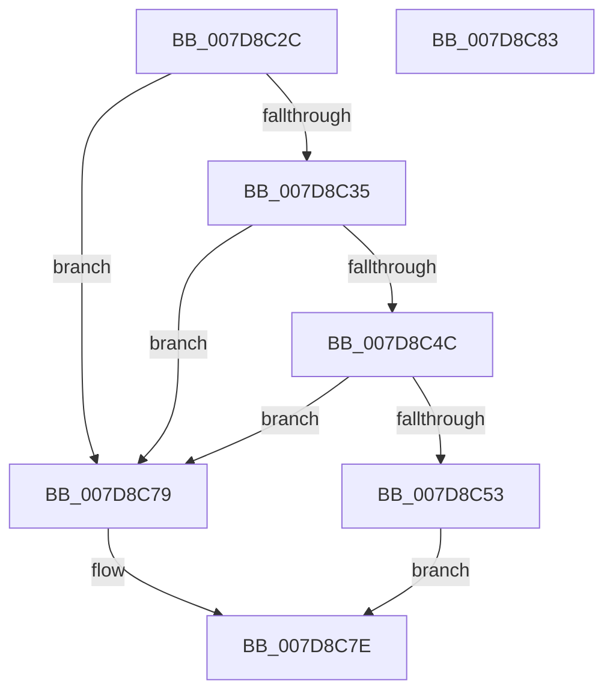

# WheaWritePolicyValueToRegistry

- RVA: `0x007D8C2C`–`0x007D8C84` (길이 `88` bytes)
- VA: `0x00000001407D8C2C`
- 실행 섹션: `PAGE`
- PDB 이름 있음: `예`; PDB Function 태그: `아니요`
- unwind 정보 RVA: `0x0005D2F4`
- 디코드: `23`개 명령, `88/88` bytes 표시
- 미해석 바이트: `0` (있으면 어셈블리에 `.byte`로 보존)

> 이 문서는 커널 이미지의 기계어와 PDB 기호를 분석해 생성했습니다. 4번과 5번은 함수 원형과 자료형을 바이너리 사용 방식에서 추정한 C 해석이며 원본 소스 복구 결과는 아닙니다.

## 1. Dependencies

- 직접 호출 지점: **1**; 고유 호출 대상: **1**
- 직접 호출자로 확인된 함수: **1**
- RIP 상대 이미지 참조: **2**

### Outgoing calls
- `0x007D8C72` → [RtlWriteRegistryValue](../A6/RtlWriteRegistryValue_function_00A6C620.md) (function, `0x00A6C620`)

### Direct callers
- [WheapWmiExecutePolicyManagementMethod](../../text/66/WheapWmiExecutePolicyManagementMethod_function_00661B8C.md) at `0x00661C12`

### Static image references
- `0x007D8C3A` → RVA `0x00E095A0` (`.data`; read)
- `0x007D8C67` → RVA `0x00B08EE0` (` ?? ::NNGAKEGL::`string'`; read)

## 2. Other-region calls and transfers

- 다른 실행 섹션으로 향하는 call: **0**
- 별도 외부 분기/꼬리 이동을 확인하지 못했습니다.

## 3. Assembly (complete function range)

```asm
007D8C2C  48 83 EC 38                     sub rsp, 0x38
007D8C30  83 F9 16                        cmp ecx, 0x16
007D8C33  73 44                           jae 0x1407d8c79
007D8C35  8B 02                           mov eax, dword ptr [rdx]
007D8C37  44 8B C1                        mov r8d, ecx
007D8C3A  48 8D 0D 5F 09 63 00            lea rcx, [rip + 0x63095f]
007D8C41  49 C1 E0 05                     shl r8, 5
007D8C45  41 3B 44 08 10                  cmp eax, dword ptr [r8 + rcx + 0x10]
007D8C4A  72 2D                           jb 0x1407d8c79
007D8C4C  41 3B 44 08 14                  cmp eax, dword ptr [r8 + rcx + 0x14]
007D8C51  77 26                           ja 0x1407d8c79
007D8C53  4D 8B 04 08                     mov r8, qword ptr [r8 + rcx]
007D8C57  41 B9 04 00 00 00               mov r9d, 4
007D8C5D  44 89 4C 24 28                  mov dword ptr [rsp + 0x28], r9d
007D8C62  48 89 54 24 20                  mov qword ptr [rsp + 0x20], rdx
007D8C67  48 8D 15 72 02 33 00            lea rdx, [rip + 0x330272]
007D8C6E  41 8D 49 FE                     lea ecx, [r9 - 2]
007D8C72  E8 A9 39 29 00                  call 0x140a6c620
007D8C77  EB 05                           jmp 0x1407d8c7e
007D8C79  B8 0D 00 00 C0                  mov eax, 0xc000000d
007D8C7E  48 83 C4 38                     add rsp, 0x38
007D8C82  C3                              ret
007D8C83  CC                              int3
```

## 4. C-style interpretation (structured pseudocode)

```c
__int64 __fastcall WheaWritePolicyValueToRegistry(int a1, __int64 a2)
{
    __int64 result;
    __int64 v_rsp;
    unsigned int v_stack_m10;
    unsigned __int64 v_stack_m18;

    v_rsp = (v_rsp) - (56);
    if (a1 >= 22) goto loc_007D8C79;
    a3 = ((unsigned int)(a1)) << (5);
    if (((unsigned int)((unsigned int)(*(unsigned int *)(a2)))) < (*(unsigned int *)(a3 + v_rip + 6490463 * 1 + 16))) goto loc_007D8C79;
    if (((unsigned int)((unsigned int)(*(unsigned int *)(a2)))) > (*(unsigned int *)(a3 + v_rip + 6490463 * 1 + 20))) goto loc_007D8C79;
    v_stack_m10 = 4;
    v_stack_m18 = a2;
    result = RtlWriteRegistryValue(4 - 2, v_rip + 3342962, *(unsigned __int64 *)(a3 + v_rip + 6490463 * 1), 4);
    goto loc_007D8C7E;
loc_007D8C79:
loc_007D8C7E:
    v_rsp = (v_rsp) + (56);
    return (unsigned int)(0xC000000DULL);
}
```

## 5. (Beta) C Style

```c
int64_t WheaWritePolicyValueToRegistry(int32_t Arg1, void *Arg2)
{
    uint8_t *arg2 = (uint8_t *)Arg2;

    int64_t result;
    int64_t local_rsp;
    uint32_t v_stack_m10;
    uint64_t v_stack_m18;

    local_rsp = (local_rsp) - (56);
    if (Arg1 >= 22) goto loc_007D8C79;
    a3 = ((uint32_t)(Arg1)) << (5);
    if (((uint32_t)((uint32_t)(*(uint32_t *)(arg2)))) < (*(uint32_t *)(a3 + v_rip + 0x63095F * 1 + 0x10))) goto loc_007D8C79;
    if (((uint32_t)((uint32_t)(*(uint32_t *)(arg2)))) > (*(uint32_t *)(a3 + v_rip + 0x63095F * 1 + 0x14))) goto loc_007D8C79;
    v_stack_m10 = 4;
    v_stack_m18 = Arg2;
    result = RtlWriteRegistryValue(4 - 2, v_rip + 3342962, *(uint64_t *)(a3 + v_rip + 0x63095F * 1), 4);
    goto loc_007D8C7E;
loc_007D8C79:
loc_007D8C7E:
    local_rsp = (local_rsp) + (56);
    return (uint32_t)(0xC000000DULL);
}
```

### 관측된 메모리 오프셋

구조체 형식이 확인되지 않은 접근은 인자 기준의 오프셋으로만 기록했습니다.

| 기준 인자 | 오프셋 표현 | 폭 (bit) | 접근 |
|---|---:|---:|---|
| `Arg2` | `+ 0x0` | `32` | `R` |

## 6. Execution-region graph

[열기: 2D/3D 그래프와 함수 탐색 컨트롤 패널](../../../control-panel.html?section=page&rva=0x007D8C2C&view=graph)

- 2D 그래프는 위에서 아래로 흐르고, 3D 그래프는 빈 공간을 드래그해 회전합니다. Shift+드래그는 이동, 휠은 확대·축소, 함수 노드 선택은 대상 보고서 이동입니다.

### Static fallback


