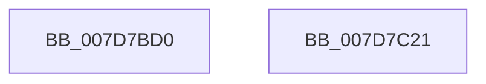

# WheapAttemptPhysicalPageOfflineWorker

- RVA: `0x007D7BD0`–`0x007D7C22` (길이 `82` bytes)
- VA: `0x00000001407D7BD0`
- 실행 섹션: `PAGE`
- PDB 이름 있음: `예`; PDB Function 태그: `아니요`
- unwind 정보 RVA: `0x000697A4`
- 디코드: `25`개 명령, `82/82` bytes 표시
- 미해석 바이트: `0` (있으면 어셈블리에 `.byte`로 보존)

> 이 문서는 커널 이미지의 기계어와 PDB 기호를 분석해 생성했습니다. 4번과 5번은 함수 원형과 자료형을 바이너리 사용 방식에서 추정한 C 해석이며 원본 소스 복구 결과는 아닙니다.

## 1. Dependencies

- 직접 호출 지점: **2**; 고유 호출 대상: **2**
- 직접 호출자로 확인된 함수: **0**
- RIP 상대 이미지 참조: **0**

### Outgoing calls
- `0x007D7C05` → [WheapAttemptPhysicalPageOffline](WheapAttemptPhysicalPageOffline_function_007D79AC.md) (function, `0x007D79AC`)
- `0x007D7C16` → [KeSetEvent](../../text/33/KeSetEvent_function_0033F310.md) (function, `0x0033F310`)

### Direct callers
- 이 함수 시작 RVA로 연결되는 직접 call은 확인되지 않았습니다. 간접 호출은 완전히 역산할 수 없습니다.

### Static image references
- 디코드된 RIP-relative 메모리 참조가 없습니다.

## 2. Other-region calls and transfers

- 다른 실행 섹션으로 향하는 call: **1**
  - `0x007D7C16` → [KeSetEvent](../../text/33/KeSetEvent_function_0033F310.md) (`PAGE` → `.text`)
- 별도 외부 분기/꼬리 이동을 확인하지 못했습니다.

## 3. Assembly (complete function range)

```asm
007D7BD0  40 53                           push rbx
007D7BD2  48 83 EC 40                     sub rsp, 0x40
007D7BD6  48 8B 41 30                     mov rax, qword ptr [rcx + 0x30]
007D7BDA  48 8B D9                        mov rbx, rcx
007D7BDD  44 8A 49 10                     mov r9b, byte ptr [rcx + 0x10]
007D7BE1  45 33 C0                        xor r8d, r8d
007D7BE4  48 8B 51 08                     mov rdx, qword ptr [rcx + 8]
007D7BE8  48 89 44 24 38                  mov qword ptr [rsp + 0x38], rax
007D7BED  8A 41 13                        mov al, byte ptr [rcx + 0x13]
007D7BF0  88 44 24 30                     mov byte ptr [rsp + 0x30], al
007D7BF4  8A 41 12                        mov al, byte ptr [rcx + 0x12]
007D7BF7  88 44 24 28                     mov byte ptr [rsp + 0x28], al
007D7BFB  8A 41 11                        mov al, byte ptr [rcx + 0x11]
007D7BFE  48 8B 09                        mov rcx, qword ptr [rcx]
007D7C01  88 44 24 20                     mov byte ptr [rsp + 0x20], al
007D7C05  E8 A2 FD FF FF                  call 0x1407d79ac
007D7C0A  48 8D 4B 18                     lea rcx, [rbx + 0x18]
007D7C0E  89 43 14                        mov dword ptr [rbx + 0x14], eax
007D7C11  45 33 C0                        xor r8d, r8d
007D7C14  33 D2                           xor edx, edx
007D7C16  E8 F5 76 B6 FF                  call 0x14033f310
007D7C1B  48 83 C4 40                     add rsp, 0x40
007D7C1F  5B                              pop rbx
007D7C20  C3                              ret
007D7C21  CC                              int3
```

## 4. C-style interpretation (structured pseudocode)

```c
__int64 __fastcall WheapAttemptPhysicalPageOfflineWorker(__int64 a1, __int64 a2, int a3)
{
    __int64 result;
    __int64 v_rsp;
    unsigned __int64 v_stack_m10;
    unsigned __int8 v_stack_m18;
    unsigned __int8 v_stack_m20;
    unsigned __int8 v_stack_m28;

    v_rsp = (v_rsp) - (64);
    a3 = 0;
    v_stack_m10 = *(unsigned __int64 *)(a1 + 48);
    v_stack_m18 = (unsigned __int8)(*(unsigned __int8 *)(a1 + 19));
    v_stack_m20 = (unsigned __int8)(*(unsigned __int8 *)(a1 + 18));
    v_stack_m28 = (unsigned __int8)(*(unsigned __int8 *)(a1 + 17));
    result = WheapAttemptPhysicalPageOffline(*(unsigned __int64 *)(a1), *(unsigned __int64 *)(a1 + 8), a3, *(unsigned __int8 *)(a1 + 16));
    *(unsigned int *)(a1 + 20) = (unsigned int)(result);
    a3 = 0;
    a2 = 0;
    result = KeSetEvent(a1 + 24, a2, a3, *(unsigned __int8 *)(a1 + 16));
    v_rsp = (v_rsp) + (64);
    return result;
}
```

## 5. (Beta) C Style

```c
int64_t WheapAttemptPhysicalPageOfflineWorker(void *Arg1, int64_t Arg2, int32_t Arg3)
{
    uint8_t *arg1 = (uint8_t *)Arg1;

    int64_t result;
    int64_t local_rsp;
    uint64_t v_stack_m10;
    uint8_t v_stack_m18;
    uint8_t v_stack_m20;
    uint8_t v_stack_m28;

    local_rsp = (local_rsp) - (64);
    Arg3 = 0;
    v_stack_m10 = *(uint64_t *)(arg1 + 0x30);
    v_stack_m18 = (uint8_t)(*(uint8_t *)(arg1 + 0x13));
    v_stack_m20 = (uint8_t)(*(uint8_t *)(arg1 + 0x12));
    v_stack_m28 = (uint8_t)(*(uint8_t *)(arg1 + 0x11));
    result = WheapAttemptPhysicalPageOffline(*(uint64_t *)(arg1), *(uint64_t *)(arg1 + 0x8), Arg3, *(uint8_t *)(arg1 + 0x10));
    *(uint32_t *)(arg1 + 0x14) = (uint32_t)(result);
    Arg3 = 0;
    Arg2 = 0;
    result = KeSetEvent(Arg1 + 24, Arg2, Arg3, *(uint8_t *)(arg1 + 0x10));
    local_rsp = (local_rsp) + (64);
    return result;
}
```

### 관측된 메모리 오프셋

구조체 형식이 확인되지 않은 접근은 인자 기준의 오프셋으로만 기록했습니다.

| 기준 인자 | 오프셋 표현 | 폭 (bit) | 접근 |
|---|---:|---:|---|
| `Arg1` | `+ 0x0` | `64` | `R` |
| `Arg1` | `+ 0x8` | `64` | `R` |
| `Arg1` | `+ 0x10` | `8` | `R` |
| `Arg1` | `+ 0x11` | `8` | `R` |
| `Arg1` | `+ 0x12` | `8` | `R` |
| `Arg1` | `+ 0x13` | `8` | `R` |
| `Arg1` | `+ 0x14` | `32` | `W` |
| `Arg1` | `+ 0x18` | `64` | `R` |
| `Arg1` | `+ 0x30` | `64` | `R` |

## 6. Execution-region graph

[열기: 2D/3D 그래프와 함수 탐색 컨트롤 패널](../../../control-panel.html?section=page&rva=0x007D7BD0&view=graph)

- 2D 그래프는 위에서 아래로 흐르고, 3D 그래프는 빈 공간을 드래그해 회전합니다. Shift+드래그는 이동, 휠은 확대·축소, 함수 노드 선택은 대상 보고서 이동입니다.

### Static fallback


