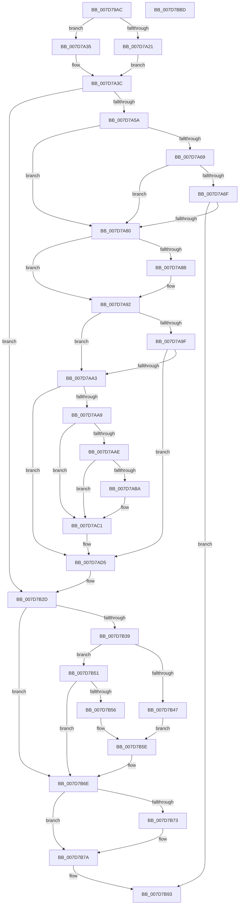

# WheapAttemptPhysicalPageOffline

- RVA: `0x007D79AC`–`0x007D7BBE` (길이 `530` bytes)
- VA: `0x00000001407D79AC`
- 실행 섹션: `PAGE`
- PDB 이름 있음: `예`; PDB Function 태그: `아니요`
- unwind 정보 RVA: `0x000AB7D4`
- 디코드: `145`개 명령, `530/530` bytes 표시
- 미해석 바이트: `0` (있으면 어셈블리에 `.byte`로 보존)

> 이 문서는 커널 이미지의 기계어와 PDB 기호를 분석해 생성했습니다. 4번과 5번은 함수 원형과 자료형을 바이너리 사용 방식에서 추정한 C 해석이며 원본 소스 복구 결과는 아닙니다.

## 1. Dependencies

- 직접 호출 지점: **10**; 고유 호출 대상: **10**
- 직접 호출자로 확인된 함수: **6**
- RIP 상대 이미지 참조: **4**

### Outgoing calls
- `0x007D7A4A` → [MmMarkPhysicalMemoryAsBad](../../text/67/MmMarkPhysicalMemoryAsBad_function_0067AA50.md) (function, `0x0067AA50`)
- `0x007D7A73` → [WheapClearPoison](WheapClearPoison_function_007D7DFC.md) (function, `0x007D7DFC`)
- `0x007D7A92` → [WheaGetNotifyAllOfflinesPolicy](../../text/65/WheaGetNotifyAllOfflinesPolicy_function_0065F300.md) (function, `0x0065F300`)
- `0x007D7AD0` → [WheapCallInUsePageNotificationCallbacks](WheapCallInUsePageNotificationCallbacks_function_007D7C28.md) (function, `0x007D7C28`)
- `0x007D7B20` → [WheaLogInternalEvent](../../text/66/WheaLogInternalEvent_function_006605B0.md) (function, `0x006605B0`)
- `0x007D7B4A` → [WheaPersistBadPageToBcd](../../text/65/WheaPersistBadPageToBcd_function_0065F3D0.md) (function, `0x0065F3D0`)
- `0x007D7B59` → [WheaPersistBadPageToRegistry](../../text/65/WheaPersistBadPageToRegistry_function_0065F58C.md) (function, `0x0065F58C`)
- `0x007D7B69` → [WheaAddressTranslateAndAddToDefectList](WheaAddressTranslateAndAddToDefectList_function_007D71EC.md) (function, `0x007D71EC`)
- `0x007D7B8E` → [WheapLogPageOfflineAttemptEvent](WheapLogPageOfflineAttemptEvent_function_007D857C.md) (function, `0x007D857C`)
- `0x007D7B9D` → [_security_check_cookie](../../text/6A/_security_check_cookie_function_006AC640.md) (function, `0x006AC640`)

### Direct callers
- [WheaAttemptClearPoison](WheaAttemptClearPoison_function_007D72A0.md) at `0x007D7361`
- [WheaAttemptPhysicalPageOffline](WheaAttemptPhysicalPageOffline_function_007D7380.md) at `0x007D7460`
- [WheaPageOfflineAndPersist](WheaPageOfflineAndPersist_function_007D7594.md) at `0x007D7699`
- [WheapAttemptPhysicalPageOfflineWorker](WheapAttemptPhysicalPageOfflineWorker_function_007D7BD0.md) at `0x007D7C05`
- [WheapOfflinePage](WheapOfflinePage_function_007D7FB0.md) at `0x007D8086`
- [WheapOfflineRow](WheapOfflineRow_function_007D8108.md) at `0x007D8322`

### Static image references
- `0x007D79C8` → RVA `0x00E0A740` (`.data`; read)
- `0x007D7A60` → RVA `0x00EEEFF1` (`.data`; read)
- `0x007D7B2D` → RVA `0x00E095C8` (`.data`; read)
- `0x007D7B39` → RVA `0x00E09788` (`.data`; read)

## 2. Other-region calls and transfers

- 다른 실행 섹션으로 향하는 call: **6**
  - `0x007D7A4A` → [MmMarkPhysicalMemoryAsBad](../../text/67/MmMarkPhysicalMemoryAsBad_function_0067AA50.md) (`PAGE` → `.text`)
  - `0x007D7A92` → [WheaGetNotifyAllOfflinesPolicy](../../text/65/WheaGetNotifyAllOfflinesPolicy_function_0065F300.md) (`PAGE` → `.text`)
  - `0x007D7B20` → [WheaLogInternalEvent](../../text/66/WheaLogInternalEvent_function_006605B0.md) (`PAGE` → `.text`)
  - `0x007D7B4A` → [WheaPersistBadPageToBcd](../../text/65/WheaPersistBadPageToBcd_function_0065F3D0.md) (`PAGE` → `.text`)
  - `0x007D7B59` → [WheaPersistBadPageToRegistry](../../text/65/WheaPersistBadPageToRegistry_function_0065F58C.md) (`PAGE` → `.text`)
  - `0x007D7B9D` → [_security_check_cookie](../../text/6A/_security_check_cookie_function_006AC640.md) (`PAGE` → `.text`)
- 별도 외부 분기/꼬리 이동을 확인하지 못했습니다.

## 3. Assembly (complete function range)

```asm
007D79AC  48 89 5C 24 20                  mov qword ptr [rsp + 0x20], rbx
007D79B1  55                              push rbp
007D79B2  56                              push rsi
007D79B3  57                              push rdi
007D79B4  41 54                           push r12
007D79B6  41 55                           push r13
007D79B8  41 56                           push r14
007D79BA  41 57                           push r15
007D79BC  48 8D 6C 24 F9                  lea rbp, [rsp - 7]
007D79C1  48 81 EC A0 00 00 00            sub rsp, 0xa0
007D79C8  48 8B 05 71 2D 63 00            mov rax, qword ptr [rip + 0x632d71]
007D79CF  48 33 C4                        xor rax, rsp
007D79D2  48 89 45 F7                     mov qword ptr [rbp - 9], rax
007D79D6  4C 8B 6D 7F                     mov r13, qword ptr [rbp + 0x7f]
007D79DA  33 C0                           xor eax, eax
007D79DC  45 32 FF                        xor r15b, r15b
007D79DF  44 88 4D 97                     mov byte ptr [rbp - 0x69], r9b
007D79E3  0F 57 C0                        xorps xmm0, xmm0
007D79E6  4C 89 45 BF                     mov qword ptr [rbp - 0x41], r8
007D79EA  48 8B DA                        mov rbx, rdx
007D79ED  48 89 4D AF                     mov qword ptr [rbp - 0x51], rcx
007D79F1  48 C1 E3 0C                     shl rbx, 0xc
007D79F5  4C 8B E2                        mov r12, rdx
007D79F8  0F 11 45 C7                     movups xmmword ptr [rbp - 0x39], xmm0
007D79FC  48 89 45 E7                     mov qword ptr [rbp - 0x19], rax
007D7A00  0F 11 45 D7                     movups xmmword ptr [rbp - 0x29], xmm0
007D7A04  66 89 45 EF                     mov word ptr [rbp - 0x11], ax
007D7A08  44 88 7D 98                     mov byte ptr [rbp - 0x68], r15b
007D7A0C  48 89 5D B7                     mov qword ptr [rbp - 0x49], rbx
007D7A10  48 89 5D 9F                     mov qword ptr [rbp - 0x61], rbx
007D7A14  48 C7 45 A7 00 10 00 00         mov qword ptr [rbp - 0x59], 0x1000
007D7A1C  38 45 67                        cmp byte ptr [rbp + 0x67], al
007D7A1F  75 14                           jne 0x1407d7a35
007D7A21  48 8B C3                        mov rax, rbx
007D7A24  C7 45 9B 01 00 00 00            mov dword ptr [rbp - 0x65], 1
007D7A2B  48 83 C8 01                     or rax, 1
007D7A2F  48 89 45 9F                     mov qword ptr [rbp - 0x61], rax
007D7A33  EB 07                           jmp 0x1407d7a3c
007D7A35  C7 45 9B 02 00 00 00            mov dword ptr [rbp - 0x65], 2
007D7A3C  40 B6 FF                        mov sil, 0xff
007D7A3F  48 8D 55 A7                     lea rdx, [rbp - 0x59]
007D7A43  48 8D 4D 9F                     lea rcx, [rbp - 0x61]
007D7A47  40 8A FE                        mov dil, sil
007D7A4A  E8 01 30 EA FF                  call 0x14067aa50
007D7A4F  44 8B F0                        mov r14d, eax
007D7A52  85 C0                           test eax, eax
007D7A54  0F 88 D3 00 00 00               js 0x1407d7b2d
007D7A5A  85 C0                           test eax, eax
007D7A5C  40 0F 94 C7                     sete dil
007D7A60  44 38 3D 8A 75 71 00            cmp byte ptr [rip + 0x71758a], r15b
007D7A67  74 17                           je 0x1407d7a80
007D7A69  44 38 7D 6F                     cmp byte ptr [rbp + 0x6f], r15b
007D7A6D  74 11                           je 0x1407d7a80
007D7A6F  48 8D 4D AF                     lea rcx, [rbp - 0x51]
007D7A73  E8 84 03 00 00                  call 0x1407d7dfc
007D7A78  85 C0                           test eax, eax
007D7A7A  0F 89 13 01 00 00               jns 0x1407d7b93
007D7A80  32 DB                           xor bl, bl
007D7A82  45 88 7D 30                     mov byte ptr [r13 + 0x30], r15b
007D7A86  38 5D 97                        cmp byte ptr [rbp - 0x69], bl
007D7A89  74 07                           je 0x1407d7a92
007D7A8B  41 C6 45 30 01                  mov byte ptr [r13 + 0x30], 1
007D7A90  B3 01                           mov bl, 1
007D7A92  E8 69 78 E8 FF                  call 0x14065f300
007D7A97  44 8A F8                        mov r15b, al
007D7A9A  45 85 F6                        test r14d, r14d
007D7A9D  75 04                           jne 0x1407d7aa3
007D7A9F  84 C0                           test al, al
007D7AA1  74 32                           je 0x1407d7ad5
007D7AA3  80 7D 77 00                     cmp byte ptr [rbp + 0x77], 0
007D7AA7  75 2C                           jne 0x1407d7ad5
007D7AA9  45 84 FF                        test r15b, r15b
007D7AAC  74 13                           je 0x1407d7ac1
007D7AAE  80 CB 40                        or bl, 0x40
007D7AB1  41 88 5D 30                     mov byte ptr [r13 + 0x30], bl
007D7AB5  45 85 F6                        test r14d, r14d
007D7AB8  75 07                           jne 0x1407d7ac1
007D7ABA  80 CB 80                        or bl, 0x80
007D7ABD  41 88 5D 30                     mov byte ptr [r13 + 0x30], bl
007D7AC1  8A 55 67                        mov dl, byte ptr [rbp + 0x67]
007D7AC4  4D 8B CD                        mov r9, r13
007D7AC7  41 B8 01 00 00 00               mov r8d, 1
007D7ACD  49 8B CC                        mov rcx, r12
007D7AD0  E8 53 01 00 00                  call 0x1407d7c28
007D7AD5  8B 45 9B                        mov eax, dword ptr [rbp - 0x65]
007D7AD8  48 8D 4D C7                     lea rcx, [rbp - 0x39]
007D7ADC  83 65 D3 00                     and dword ptr [rbp - 0x2d], 0
007D7AE0  89 45 E7                        mov dword ptr [rbp - 0x19], eax
007D7AE3  C7 45 C7 57 68 4C 67            mov dword ptr [rbp - 0x39], 0x674c6857
007D7AEA  C7 45 CB 01 00 00 00            mov dword ptr [rbp - 0x35], 1
007D7AF1  C7 45 CF 2A 00 00 00            mov dword ptr [rbp - 0x31], 0x2a
007D7AF8  C7 45 DB 06 00 00 80            mov dword ptr [rbp - 0x25], 0x80000006
007D7AFF  C7 45 D7 4B 52 4E 4C            mov dword ptr [rbp - 0x29], 0x4c4e524b
007D7B06  C7 45 DF 02 00 00 00            mov dword ptr [rbp - 0x21], 2
007D7B0D  C7 45 E3 0A 00 00 00            mov dword ptr [rbp - 0x1d], 0xa
007D7B14  40 88 7D EB                     mov byte ptr [rbp - 0x15], dil
007D7B18  44 89 65 EC                     mov dword ptr [rbp - 0x14], r12d
007D7B1C  44 88 7D F0                     mov byte ptr [rbp - 0x10], r15b
007D7B20  E8 8B 8A E8 FF                  call 0x1406605b0
007D7B25  48 8B 5D B7                     mov rbx, qword ptr [rbp - 0x49]
007D7B29  44 8A 7D 98                     mov r15b, byte ptr [rbp - 0x68]
007D7B2D  48 8B 05 94 1A 63 00            mov rax, qword ptr [rip + 0x631a94]
007D7B34  80 38 00                        cmp byte ptr [rax], 0
007D7B37  74 35                           je 0x1407d7b6e
007D7B39  48 8B 05 48 1C 63 00            mov rax, qword ptr [rip + 0x631c48]
007D7B40  8B 10                           mov edx, dword ptr [rax]
007D7B42  83 FA 01                        cmp edx, 1
007D7B45  75 0A                           jne 0x1407d7b51
007D7B47  49 8B CC                        mov rcx, r12
007D7B4A  E8 81 78 E8 FF                  call 0x14065f3d0
007D7B4F  EB 0D                           jmp 0x1407d7b5e
007D7B51  83 FA 02                        cmp edx, 2
007D7B54  75 18                           jne 0x1407d7b6e
007D7B56  49 8B CC                        mov rcx, r12
007D7B59  E8 2E 7A E8 FF                  call 0x14065f58c
007D7B5E  48 8B 55 BF                     mov rdx, qword ptr [rbp - 0x41]
007D7B62  48 8D 4D 9F                     lea rcx, [rbp - 0x61]
007D7B66  41 B7 01                        mov r15b, 1
007D7B69  E8 7E F6 FF FF                  call 0x1407d71ec
007D7B6E  40 3A FE                        cmp dil, sil
007D7B71  74 07                           je 0x1407d7b7a
007D7B73  40 84 FF                        test dil, dil
007D7B76  40 0F 94 C6                     sete sil
007D7B7A  8A 45 97                        mov al, byte ptr [rbp - 0x69]
007D7B7D  45 8A CF                        mov r9b, r15b
007D7B80  44 8A 45 67                     mov r8b, byte ptr [rbp + 0x67]
007D7B84  40 8A D6                        mov dl, sil
007D7B87  48 8B CB                        mov rcx, rbx
007D7B8A  88 44 24 20                     mov byte ptr [rsp + 0x20], al
007D7B8E  E8 E9 09 00 00                  call 0x1407d857c
007D7B93  41 8B C6                        mov eax, r14d
007D7B96  48 8B 4D F7                     mov rcx, qword ptr [rbp - 9]
007D7B9A  48 33 CC                        xor rcx, rsp
007D7B9D  E8 9E 4A ED FF                  call 0x1406ac640
007D7BA2  48 8B 9C 24 F8 00 00 00         mov rbx, qword ptr [rsp + 0xf8]
007D7BAA  48 81 C4 A0 00 00 00            add rsp, 0xa0
007D7BB1  41 5F                           pop r15
007D7BB3  41 5E                           pop r14
007D7BB5  41 5D                           pop r13
007D7BB7  41 5C                           pop r12
007D7BB9  5F                              pop rdi
007D7BBA  5E                              pop rsi
007D7BBB  5D                              pop rbp
007D7BBC  C3                              ret
007D7BBD  CC                              int3
```

## 4. C-style interpretation (structured pseudocode)

```c
__int64 __fastcall WheapAttemptPhysicalPageOffline(__int64 a1, __int64 a2, __int64 a3, unsigned __int8 a4, unsigned __int8 a5, unsigned __int8 a6, unsigned __int8 a7, __int64 a8)
{
    __int64 result;
    __int64 v_r15;
    __int64 v_rbx;
    __int64 v_rdi;
    __int64 v_rsi;
    __int64 v_rsp;
    unsigned __int64 v_stack_m3F;
    unsigned __int64 v_stack_m48;
    unsigned __int8 v_stack_m4F;
    unsigned __int16 v_stack_m50;
    unsigned int v_stack_m53;
    unsigned __int8 v_stack_m54;
    unsigned __int64 v_stack_m58;
    unsigned int v_stack_m5C;
    unsigned int v_stack_m60;
    unsigned int v_stack_m64;
    unsigned __int64 v_stack_m68;
    unsigned int v_stack_m6C;
    unsigned int v_stack_m70;
    unsigned int v_stack_m74;
    unsigned __int64 v_stack_m78;
    unsigned __int64 v_stack_m80;
    unsigned __int64 v_stack_m88;
    unsigned __int64 v_stack_m90;
    unsigned __int64 v_stack_m98;
    unsigned __int64 v_stack_mA0;
    unsigned int v_stack_mA4;
    unsigned __int8 v_stack_mA7;
    unsigned __int8 v_stack_mA8;
    unsigned __int8 v_stack_mB8;
    unsigned __int64 v_stack_p20;

    v_stack_p20 = v_rbx;
    v_rsp = (v_rsp) - (160);
    result = (*(unsigned __int64 *)(v_rip + 6499697)) ^ (v_rsp);
    v_stack_m48 = result;
    result = 0;
    v_r15 = 0;
    v_stack_mA8 = a4;
    v_stack_m80 = a3;
    v_stack_m90 = a1;
    v_rbx = (a2) << (12);
    v_stack_m78 = v_xmm0;
    v_stack_m58 = 0;
    v_stack_m68 = v_xmm0;
    v_stack_m50 = 0;
    v_stack_mA7 = 0;
    v_stack_m88 = v_rbx;
    v_stack_mA0 = v_rbx;
    v_stack_m98 = 0x1000ULL;
    if (a5 != 0) goto loc_007D7A35;
    v_stack_mA4 = 1;
    result = (v_rbx) | (1);
    v_stack_mA0 = result;
    goto loc_007D7A3C;
loc_007D7A35:
    v_stack_mA4 = 2;
loc_007D7A3C:
    result = MmMarkPhysicalMemoryAsBad(v_stack_mA0, v_stack_m98, a3, a4);
    if (sign_flag) goto loc_007D7B2D;
    v_rdi = ((unsigned int)(result) == 0) ? 1 : 0;
    if ((*(unsigned __int8 *)(v_rip + 7435658)) == 0) goto loc_007D7A80;
    if (a6 == 0) goto loc_007D7A80;
    result = WheapClearPoison(v_stack_m90, v_stack_m98, a3, a4);
    if (!sign_flag) goto loc_007D7B93;
loc_007D7A80:
    v_rbx = 0;
    *(unsigned __int8 *)(a8 + 48) = 0;
    if (v_stack_mA8 != 0) {
        *(unsigned __int8 *)(a8 + 48) = 1;
        v_rbx = 1;
    }
    result = WheaGetNotifyAllOfflinesPolicy(v_stack_m90, v_stack_m98, a3, a4);
    if ((unsigned int)((unsigned int)((unsigned int)(result))) != 0) goto loc_007D7AA3;
    if ((unsigned __int8)(result) == 0) goto loc_007D7AD5;
loc_007D7AA3:
    if (a7 != 0) goto loc_007D7AD5;
    if ((unsigned __int8)((unsigned __int8)(result)) == 0) goto loc_007D7AC1;
    v_rbx = (unsigned __int8)((v_rbx) | (64));
    *(unsigned __int8 *)(a8 + 48) = (unsigned __int8)(v_rbx);
    if ((unsigned int)((unsigned int)((unsigned int)(result))) == 0) {
        v_rbx = (unsigned __int8)((v_rbx) | (128));
        *(unsigned __int8 *)(a8 + 48) = (unsigned __int8)(v_rbx);
    }
    result = WheapCallInUsePageNotificationCallbacks(a2, a5, 1, a8);
loc_007D7AD5:
    v_stack_m58 = (unsigned int)((unsigned int)(v_stack_mA4));
    v_stack_m78 = 0x674C6857ULL;
    v_stack_m74 = 1;
    v_stack_m70 = 42;
    v_stack_m64 = 0x80000006ULL;
    v_stack_m68 = 0x4C4E524BULL;
    v_stack_m60 = 2;
    v_stack_m5C = 10;
    v_stack_m54 = (unsigned __int8)(v_rdi);
    v_stack_m53 = (unsigned int)(a2);
    v_stack_m4F = (unsigned __int8)((unsigned __int8)(result));
    result = WheaLogInternalEvent(v_stack_m78, a5, 1, a8);
loc_007D7B2D:
    if ((*(unsigned __int8 *)(*(unsigned __int64 *)(v_rip + 6494868))) == 0) goto loc_007D7B6E;
    if (((unsigned int)((unsigned int)(*(unsigned int *)(*(unsigned __int64 *)(v_rip + 6495304))))) != 1) goto loc_007D7B51;
    result = WheaPersistBadPageToBcd(a2, (unsigned int)(*(unsigned int *)(*(unsigned __int64 *)(v_rip + 6495304))), 1, a8);
    goto loc_007D7B5E;
loc_007D7B51:
    if (((unsigned int)((unsigned int)(*(unsigned int *)(*(unsigned __int64 *)(v_rip + 6495304))))) != 2) goto loc_007D7B6E;
    result = WheaPersistBadPageToRegistry(a2, (unsigned int)(*(unsigned int *)(*(unsigned __int64 *)(v_rip + 6495304))), 1, a8);
loc_007D7B5E:
    result = WheaAddressTranslateAndAddToDefectList(v_stack_mA0, v_stack_m80, 1, a8);
loc_007D7B6E:
    v_rsi = 255;
    if (((unsigned __int8)(v_rdi)) != 255) {
        v_rsi = ((unsigned __int8)(v_rdi) == 0) ? 1 : 0;
    }
    v_stack_mB8 = (unsigned __int8)(v_stack_mA8);
    result = WheapLogPageOfflineAttemptEvent(v_stack_m88, (unsigned __int8)(v_rsi), a5, 1);
loc_007D7B93:
    a1 = (v_stack_m48) ^ (v_rsp);
    result = _security_check_cookie(a1, (unsigned __int8)(v_rsi), a5, 1);
    v_rsp = (v_rsp) + (160);
    return result;
}
```

## 5. (Beta) C Style

```c
int64_t WheapAttemptPhysicalPageOffline(int64_t Arg1, int64_t Arg2, int64_t Arg3, uint8_t Arg4, uint8_t Arg5, uint8_t Arg6, uint8_t Arg7, void *Arg8)
{
    uint8_t *arg8 = (uint8_t *)Arg8;

    int64_t result;
    int64_t local_r15;
    int64_t local_rbx;
    int64_t local_rdi;
    int64_t local_rsi;
    int64_t local_rsp;
    uint64_t v_stack_m3F;
    uint64_t v_stack_m48;
    uint8_t v_stack_m4F;
    uint16_t v_stack_m50;
    uint32_t v_stack_m53;
    uint8_t v_stack_m54;
    uint64_t v_stack_m58;
    uint32_t v_stack_m5C;
    uint32_t v_stack_m60;
    uint32_t v_stack_m64;
    uint64_t v_stack_m68;
    uint32_t v_stack_m6C;
    uint32_t v_stack_m70;
    uint32_t v_stack_m74;
    uint64_t v_stack_m78;
    uint64_t v_stack_m80;
    uint64_t v_stack_m88;
    uint64_t v_stack_m90;
    uint64_t v_stack_m98;
    uint64_t v_stack_mA0;
    uint32_t v_stack_mA4;
    uint8_t v_stack_mA7;
    uint8_t v_stack_mA8;
    uint8_t v_stack_mB8;
    uint64_t v_stack_p20;

    v_stack_p20 = local_rbx;
    local_rsp = (local_rsp) - (160);
    result = (*(uint64_t *)(v_rip + 0x632D71)) ^ (local_rsp);
    v_stack_m48 = result;
    result = 0;
    local_r15 = 0;
    v_stack_mA8 = Arg4;
    v_stack_m80 = Arg3;
    v_stack_m90 = Arg1;
    local_rbx = (Arg2) << (12);
    v_stack_m78 = v_xmm0;
    v_stack_m58 = 0;
    v_stack_m68 = v_xmm0;
    v_stack_m50 = 0;
    v_stack_mA7 = 0;
    v_stack_m88 = local_rbx;
    v_stack_mA0 = local_rbx;
    v_stack_m98 = 0x1000ULL;
    if (Arg5 != 0) goto loc_007D7A35;
    v_stack_mA4 = 1;
    result = (local_rbx) | (1);
    v_stack_mA0 = result;
    goto loc_007D7A3C;
loc_007D7A35:
    v_stack_mA4 = 2;
loc_007D7A3C:
    result = MmMarkPhysicalMemoryAsBad(v_stack_mA0, v_stack_m98, Arg3, Arg4);
    if (sign_flag) goto loc_007D7B2D;
    local_rdi = ((uint32_t)(result) == 0) ? 1 : 0;
    if ((*(uint8_t *)(v_rip + 0x71758A)) == 0) goto loc_007D7A80;
    if (Arg6 == 0) goto loc_007D7A80;
    result = WheapClearPoison(v_stack_m90, v_stack_m98, Arg3, Arg4);
    if (!sign_flag) goto loc_007D7B93;
loc_007D7A80:
    local_rbx = 0;
    *(uint8_t *)(arg8 + 0x30) = 0;
    if (v_stack_mA8 != 0) {
        *(uint8_t *)(arg8 + 0x30) = 1;
        local_rbx = 1;
    }
    result = WheaGetNotifyAllOfflinesPolicy(v_stack_m90, v_stack_m98, Arg3, Arg4);
    if ((uint32_t)((uint32_t)((uint32_t)(result))) != 0) goto loc_007D7AA3;
    if ((uint8_t)(result) == 0) goto loc_007D7AD5;
loc_007D7AA3:
    if (Arg7 != 0) goto loc_007D7AD5;
    if ((uint8_t)((uint8_t)(result)) == 0) goto loc_007D7AC1;
    local_rbx = (uint8_t)((local_rbx) | (64));
    *(uint8_t *)(arg8 + 0x30) = (uint8_t)(local_rbx);
    if ((uint32_t)((uint32_t)((uint32_t)(result))) == 0) {
        local_rbx = (uint8_t)((local_rbx) | (128));
        *(uint8_t *)(arg8 + 0x30) = (uint8_t)(local_rbx);
    }
    result = WheapCallInUsePageNotificationCallbacks(Arg2, Arg5, 1, Arg8);
loc_007D7AD5:
    v_stack_m58 = (uint32_t)((uint32_t)(v_stack_mA4));
    v_stack_m78 = 0x674C6857ULL;
    v_stack_m74 = 1;
    v_stack_m70 = 42;
    v_stack_m64 = 0x80000006ULL;
    v_stack_m68 = 0x4C4E524BULL;
    v_stack_m60 = 2;
    v_stack_m5C = 10;
    v_stack_m54 = (uint8_t)(local_rdi);
    v_stack_m53 = (uint32_t)(Arg2);
    v_stack_m4F = (uint8_t)((uint8_t)(result));
    result = WheaLogInternalEvent(v_stack_m78, Arg5, 1, Arg8);
loc_007D7B2D:
    if ((*(uint8_t *)(*(uint64_t *)(v_rip + 0x631A94))) == 0) goto loc_007D7B6E;
    if (((uint32_t)((uint32_t)(*(uint32_t *)(*(uint64_t *)(v_rip + 0x631C48))))) != 1) goto loc_007D7B51;
    result = WheaPersistBadPageToBcd(Arg2, (uint32_t)(*(uint32_t *)(*(uint64_t *)(v_rip + 0x631C48))), 1, Arg8);
    goto loc_007D7B5E;
loc_007D7B51:
    if (((uint32_t)((uint32_t)(*(uint32_t *)(*(uint64_t *)(v_rip + 0x631C48))))) != 2) goto loc_007D7B6E;
    result = WheaPersistBadPageToRegistry(Arg2, (uint32_t)(*(uint32_t *)(*(uint64_t *)(v_rip + 0x631C48))), 1, Arg8);
loc_007D7B5E:
    result = WheaAddressTranslateAndAddToDefectList(v_stack_mA0, v_stack_m80, 1, Arg8);
loc_007D7B6E:
    local_rsi = 255;
    if (((uint8_t)(local_rdi)) != 255) {
        local_rsi = ((uint8_t)(local_rdi) == 0) ? 1 : 0;
    }
    v_stack_mB8 = (uint8_t)(v_stack_mA8);
    result = WheapLogPageOfflineAttemptEvent(v_stack_m88, (uint8_t)(local_rsi), Arg5, 1);
loc_007D7B93:
    Arg1 = (v_stack_m48) ^ (local_rsp);
    result = _security_check_cookie(Arg1, (uint8_t)(local_rsi), Arg5, 1);
    local_rsp = (local_rsp) + (160);
    return result;
}
```

### 관측된 메모리 오프셋

구조체 형식이 확인되지 않은 접근은 인자 기준의 오프셋으로만 기록했습니다.

| 기준 인자 | 오프셋 표현 | 폭 (bit) | 접근 |
|---|---:|---:|---|
| `Arg8` | `+ 0x30` | `8` | `W` |

## 6. Execution-region graph

[열기: 2D/3D 그래프와 함수 탐색 컨트롤 패널](../../../control-panel.html?section=page&rva=0x007D79AC&view=graph)

- 2D 그래프는 위에서 아래로 흐르고, 3D 그래프는 빈 공간을 드래그해 회전합니다. Shift+드래그는 이동, 휠은 확대·축소, 함수 노드 선택은 대상 보고서 이동입니다.

### Static fallback


