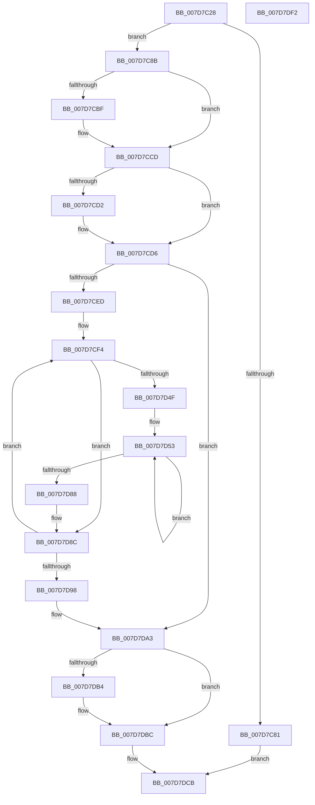

# WheapCallInUsePageNotificationCallbacks

- RVA: `0x007D7C28`–`0x007D7DF3` (길이 `459` bytes)
- VA: `0x00000001407D7C28`
- 실행 섹션: `PAGE`
- PDB 이름 있음: `예`; PDB Function 태그: `아니요`
- unwind 정보 RVA: `0x000B8D94`
- 디코드: `119`개 명령, `459/459` bytes 표시
- 미해석 바이트: `0` (있으면 어셈블리에 `.byte`로 보존)

> 이 문서는 커널 이미지의 기계어와 PDB 기호를 분석해 생성했습니다. 4번과 5번은 함수 원형과 자료형을 바이너리 사용 방식에서 추정한 C 해석이며 원본 소스 복구 결과는 아닙니다.

## 1. Dependencies

- 직접 호출 지점: **8**; 고유 호출 대상: **8**
- 직접 호출자로 확인된 함수: **2**
- RIP 상대 이미지 참조: **5**

### Outgoing calls
- `0x007D7CAF` → [KeAbPreAcquire](../../text/21/KeAbPreAcquire_function_00210230.md) (function, `0x00210230`)
- `0x007D7CC8` → [ExfAcquirePushLockExclusiveEx](../../text/20/ExfAcquirePushLockExclusiveEx_function_0020FC90.md) (function, `0x0020FC90`)
- `0x007D7D0D` → [guard_dispatch_icall](../../text/6B/guard_dispatch_icall_function_006BAAD0.md) (function, `0x006BAAD0`)
- `0x007D7D77` → [WheaLogInternalEvent](../../text/66/WheaLogInternalEvent_function_006605B0.md) (function, `0x006605B0`)
- `0x007D7DB7` → [ExfTryToWakePushLock](../../text/26/ExfTryToWakePushLock_function_00265DD0.md) (function, `0x00265DD0`)
- `0x007D7DBF` → [KeAbPostRelease](../../text/2E/KeAbPostRelease_function_002E1600.md) (function, `0x002E1600`)
- `0x007D7DC4` → [KeLeaveCriticalRegion](../../text/25/KeLeaveCriticalRegion_function_0025D8B0.md) (function, `0x0025D8B0`)
- `0x007D7DD2` → [_security_check_cookie](../../text/6A/_security_check_cookie_function_006AC640.md) (function, `0x006AC640`)

### Direct callers
- [WheaAttemptRowOffline](../../text/65/WheaAttemptRowOffline_function_0065F050.md) at `0x0065F134`
- [WheapAttemptPhysicalPageOffline](WheapAttemptPhysicalPageOffline_function_007D79AC.md) at `0x007D7AD0`

### Static image references
- `0x007D7C42` → RVA `0x00E0A740` (`.data`; read)
- `0x007D7C5C` → RVA `0x00EEF058` (`.data`; read)
- `0x007D7C94` → RVA `0x00EEF060` (`.data`; read)
- `0x007D7CD6` → RVA `0x00EEF068` (`.data`; read)
- `0x007D7DA3` → RVA `0x00EEF060` (`.data`; read/write)

## 2. Other-region calls and transfers

- 다른 실행 섹션으로 향하는 call: **8**
  - `0x007D7CAF` → [KeAbPreAcquire](../../text/21/KeAbPreAcquire_function_00210230.md) (`PAGE` → `.text`)
  - `0x007D7CC8` → [ExfAcquirePushLockExclusiveEx](../../text/20/ExfAcquirePushLockExclusiveEx_function_0020FC90.md) (`PAGE` → `.text`)
  - `0x007D7D0D` → [guard_dispatch_icall](../../text/6B/guard_dispatch_icall_function_006BAAD0.md) (`PAGE` → `.text`)
  - `0x007D7D77` → [WheaLogInternalEvent](../../text/66/WheaLogInternalEvent_function_006605B0.md) (`PAGE` → `.text`)
  - `0x007D7DB7` → [ExfTryToWakePushLock](../../text/26/ExfTryToWakePushLock_function_00265DD0.md) (`PAGE` → `.text`)
  - `0x007D7DBF` → [KeAbPostRelease](../../text/2E/KeAbPostRelease_function_002E1600.md) (`PAGE` → `.text`)
  - `0x007D7DC4` → [KeLeaveCriticalRegion](../../text/25/KeLeaveCriticalRegion_function_0025D8B0.md) (`PAGE` → `.text`)
  - `0x007D7DD2` → [_security_check_cookie](../../text/6A/_security_check_cookie_function_006AC640.md) (`PAGE` → `.text`)
- 별도 외부 분기/꼬리 이동을 확인하지 못했습니다.

## 3. Assembly (complete function range)

```asm
007D7C28  48 89 5C 24 18                  mov qword ptr [rsp + 0x18], rbx
007D7C2D  55                              push rbp
007D7C2E  56                              push rsi
007D7C2F  57                              push rdi
007D7C30  41 54                           push r12
007D7C32  41 55                           push r13
007D7C34  41 56                           push r14
007D7C36  41 57                           push r15
007D7C38  48 8B EC                        mov rbp, rsp
007D7C3B  48 81 EC 80 00 00 00            sub rsp, 0x80
007D7C42  48 8B 05 F7 2A 63 00            mov rax, qword ptr [rip + 0x632af7]
007D7C49  48 33 C4                        xor rax, rsp
007D7C4C  48 89 45 F0                     mov qword ptr [rbp - 0x10], rax
007D7C50  83 65 B4 00                     and dword ptr [rbp - 0x4c], 0
007D7C54  0F 57 C0                        xorps xmm0, xmm0
007D7C57  33 C0                           xor eax, eax
007D7C59  88 55 B0                        mov byte ptr [rbp - 0x50], dl
007D7C5C  80 3D F5 73 71 00 01            cmp byte ptr [rip + 0x7173f5], 1
007D7C63  4D 8B F9                        mov r15, r9
007D7C66  45 8B E0                        mov r12d, r8d
007D7C69  48 89 45 E8                     mov qword ptr [rbp - 0x18], rax
007D7C6D  40 8A F2                        mov sil, dl
007D7C70  4C 8B E9                        mov r13, rcx
007D7C73  0F 11 45 B8                     movups xmmword ptr [rbp - 0x48], xmm0
007D7C77  0F 11 45 C8                     movups xmmword ptr [rbp - 0x38], xmm0
007D7C7B  0F 11 45 D8                     movups xmmword ptr [rbp - 0x28], xmm0
007D7C7F  74 0A                           je 0x1407d7c8b
007D7C81  B8 01 00 00 C0                  mov eax, 0xc0000001
007D7C86  E9 40 01 00 00                  jmp 0x1407d7dcb
007D7C8B  65 48 8B 04 25 88 01 00 00      mov rax, qword ptr gs:[0x188]
007D7C94  4C 8D 35 C5 73 71 00            lea r14, [rip + 0x7173c5]
007D7C9B  48 83 CB FF                     or rbx, 0xffffffffffffffff
007D7C9F  45 33 C0                        xor r8d, r8d
007D7CA2  33 D2                           xor edx, edx
007D7CA4  49 8B CE                        mov rcx, r14
007D7CA7  66 01 98 E4 01 00 00            add word ptr [rax + 0x1e4], bx
007D7CAE  90                              nop
007D7CAF  E8 7C 85 A3 FF                  call 0x140210230
007D7CB4  F0 49 0F BA 2E 00               lock bts qword ptr [r14], 0
007D7CBA  48 8B F8                        mov rdi, rax
007D7CBD  73 0E                           jae 0x1407d7ccd
007D7CBF  4D 8B C6                        mov r8, r14
007D7CC2  48 8B D0                        mov rdx, rax
007D7CC5  49 8B CE                        mov rcx, r14
007D7CC8  E8 C3 7F A3 FF                  call 0x14020fc90
007D7CCD  48 85 FF                        test rdi, rdi
007D7CD0  74 04                           je 0x1407d7cd6
007D7CD2  C6 47 0A 01                     mov byte ptr [rdi + 0xa], 1
007D7CD6  48 8B 3D 8B 73 71 00            mov rdi, qword ptr [rip + 0x71738b]
007D7CDD  48 8D 05 84 73 71 00            lea rax, [rip + 0x717384]
007D7CE4  48 3B F8                        cmp rdi, rax
007D7CE7  0F 84 B6 00 00 00               je 0x1407d7da3
007D7CED  48 8D 1D 74 73 71 00            lea rbx, [rip + 0x717374]
007D7CF4  83 65 B4 00                     and dword ptr [rbp - 0x4c], 0
007D7CF8  4C 8D 4D B4                     lea r9, [rbp - 0x4c]
007D7CFC  45 89 67 20                     mov dword ptr [r15 + 0x20], r12d
007D7D00  4D 8B C7                        mov r8, r15
007D7D03  48 8B 47 10                     mov rax, qword ptr [rdi + 0x10]
007D7D07  40 8A D6                        mov dl, sil
007D7D0A  49 8B CD                        mov rcx, r13
007D7D0D  E8 BE 2D EE FF                  call 0x1406baad0
007D7D12  83 65 C4 00                     and dword ptr [rbp - 0x3c], 0
007D7D16  45 33 F6                        xor r14d, r14d
007D7D19  C7 45 B8 57 68 4C 67            mov dword ptr [rbp - 0x48], 0x674c6857
007D7D20  C7 45 BC 01 00 00 00            mov dword ptr [rbp - 0x44], 1
007D7D27  C7 45 C0 38 00 00 00            mov dword ptr [rbp - 0x40], 0x38
007D7D2E  C7 45 CC 58 00 00 80            mov dword ptr [rbp - 0x34], 0x80000058
007D7D35  C7 45 C8 4B 52 4E 4C            mov dword ptr [rbp - 0x38], 0x4c4e524b
007D7D3C  C7 45 D0 02 00 00 00            mov dword ptr [rbp - 0x30], 2
007D7D43  C7 45 D4 18 00 00 00            mov dword ptr [rbp - 0x2c], 0x18
007D7D4A  45 85 E4                        test r12d, r12d
007D7D4D  74 3D                           je 0x1407d7d8c
007D7D4F  49 8D 77 2C                     lea rsi, [r15 + 0x2c]
007D7D53  43 8D 04 2E                     lea eax, [r14 + r13]
007D7D57  89 45 D8                        mov dword ptr [rbp - 0x28], eax
007D7D5A  48 8D 4D B8                     lea rcx, [rbp - 0x48]
007D7D5E  8B 46 F8                        mov eax, dword ptr [rsi - 8]
007D7D61  89 45 DC                        mov dword ptr [rbp - 0x24], eax
007D7D64  8B 45 B4                        mov eax, dword ptr [rbp - 0x4c]
007D7D67  89 45 E0                        mov dword ptr [rbp - 0x20], eax
007D7D6A  8B 06                           mov eax, dword ptr [rsi]
007D7D6C  89 45 E4                        mov dword ptr [rbp - 0x1c], eax
007D7D6F  48 8B 46 08                     mov rax, qword ptr [rsi + 8]
007D7D73  48 89 45 E8                     mov qword ptr [rbp - 0x18], rax
007D7D77  E8 34 88 E8 FF                  call 0x1406605b0
007D7D7C  41 FF C6                        inc r14d
007D7D7F  48 8D 76 18                     lea rsi, [rsi + 0x18]
007D7D83  45 3B F4                        cmp r14d, r12d
007D7D86  72 CB                           jb 0x1407d7d53
007D7D88  40 8A 75 B0                     mov sil, byte ptr [rbp - 0x50]
007D7D8C  48 8B 3F                        mov rdi, qword ptr [rdi]
007D7D8F  48 3B FB                        cmp rdi, rbx
007D7D92  0F 85 5C FF FF FF               jne 0x1407d7cf4
007D7D98  48 83 CB FF                     or rbx, 0xffffffffffffffff
007D7D9C  4C 8D 35 BD 72 71 00            lea r14, [rip + 0x7172bd]
007D7DA3  F0 48 0F C1 1D B4 72 71 00      lock xadd qword ptr [rip + 0x7172b4], rbx
007D7DAC  80 E3 06                        and bl, 6
007D7DAF  80 FB 02                        cmp bl, 2
007D7DB2  75 08                           jne 0x1407d7dbc
007D7DB4  49 8B CE                        mov rcx, r14
007D7DB7  E8 14 E0 A8 FF                  call 0x140265dd0
007D7DBC  49 8B CE                        mov rcx, r14
007D7DBF  E8 3C 98 B0 FF                  call 0x1402e1600
007D7DC4  E8 E7 5A A8 FF                  call 0x14025d8b0
007D7DC9  33 C0                           xor eax, eax
007D7DCB  48 8B 4D F0                     mov rcx, qword ptr [rbp - 0x10]
007D7DCF  48 33 CC                        xor rcx, rsp
007D7DD2  E8 69 48 ED FF                  call 0x1406ac640
007D7DD7  48 8B 9C 24 D0 00 00 00         mov rbx, qword ptr [rsp + 0xd0]
007D7DDF  48 81 C4 80 00 00 00            add rsp, 0x80
007D7DE6  41 5F                           pop r15
007D7DE8  41 5E                           pop r14
007D7DEA  41 5D                           pop r13
007D7DEC  41 5C                           pop r12
007D7DEE  5F                              pop rdi
007D7DEF  5E                              pop rsi
007D7DF0  5D                              pop rbp
007D7DF1  C3                              ret
007D7DF2  CC                              int3
```

## 4. C-style interpretation (structured pseudocode)

```c
__int64 __fastcall WheapCallInUsePageNotificationCallbacks(__int64 a1, int a2, int a3, __int64 a4)
{
    __int64 result;
    __int64 v_r14;
    __int64 v_rbx;
    __int64 v_rsp;
    unsigned __int64 v_stack_m48;
    unsigned __int64 v_stack_m50;
    unsigned int v_stack_m54;
    unsigned int v_stack_m58;
    unsigned int v_stack_m5C;
    unsigned __int64 v_stack_m60;
    unsigned int v_stack_m64;
    unsigned int v_stack_m68;
    unsigned int v_stack_m6C;
    unsigned __int64 v_stack_m70;
    unsigned int v_stack_m74;
    unsigned int v_stack_m78;
    unsigned int v_stack_m7C;
    unsigned __int64 v_stack_m80;
    unsigned int v_stack_m84;
    unsigned __int8 v_stack_m88;
    unsigned __int64 v_stack_p18;

    v_stack_p18 = v_rbx;
    v_rsp = (v_rsp) - (128);
    result = (*(unsigned __int64 *)(v_rip + 6499063)) ^ (v_rsp);
    v_stack_m48 = result;
    result = 0;
    v_stack_m88 = (unsigned __int8)(a2);
    v_stack_m50 = 0;
    v_stack_m80 = v_xmm0;
    v_stack_m70 = v_xmm0;
    v_stack_m60 = v_xmm0;
    if ((*(unsigned __int8 *)(v_rip + 7435253)) == 1) goto loc_007D7C8B;
    goto loc_007D7DCB;
loc_007D7C8B:
    v_rbx = (v_rbx) | (-1);
    a3 = 0;
    a2 = 0;
    result = KeAbPreAcquire(v_rip + 7435205, a2, a3, a4);
    if (!(condition_is_above_or_equal)) {
        a3 = v_rip + 7435205;
        a2 = result;
        a1 = v_rip + 7435205;
        result = ExfAcquirePushLockExclusiveEx(a1, a2, a3, a4);
    }
    if (result != 0) {
        *(unsigned __int8 *)(result + 10) = 1;
    }
    if ((*(unsigned __int64 *)(v_rip + 7435147)) == (v_rip + 7435140)) goto loc_007D7DA3;
loc_007D7CF4:
    *(unsigned int *)(a4 + 32) = (unsigned int)((unsigned int)(a3));
    result = guard_dispatch_icall(a1, (unsigned __int8)((unsigned __int8)(a2)), a4, v_stack_m84);
    v_r14 = 0;
    v_stack_m80 = 0x674C6857ULL;
    v_stack_m7C = 1;
    v_stack_m78 = 56;
    v_stack_m6C = 0x80000058ULL;
    v_stack_m70 = 0x4C4E524BULL;
    v_stack_m68 = 2;
    v_stack_m64 = 24;
    if ((unsigned int)((unsigned int)(a3)) == 0) goto loc_007D7D8C;
loc_007D7D53:
    v_stack_m60 = (unsigned int)(v_r14 + a1 * 1);
    v_stack_m5C = (unsigned int)((unsigned int)(*(unsigned int *)(a4 + 44 - 8)));
    v_stack_m58 = (unsigned int)((unsigned int)(v_stack_m84));
    v_stack_m54 = (unsigned int)((unsigned int)(*(unsigned int *)(a4 + 44)));
    v_stack_m50 = *(unsigned __int64 *)(a4 + 44 + 8);
    result = WheaLogInternalEvent(v_stack_m80, (unsigned __int8)((unsigned __int8)(a2)), a4, v_stack_m84);
    v_r14 = (unsigned int)((v_r14) + 1);
    if (((unsigned int)(v_r14)) < ((unsigned int)((unsigned int)(a3)))) goto loc_007D7D53;
loc_007D7D8C:
    if ((*(unsigned __int64 *)(*(unsigned __int64 *)(v_rip + 7435147))) != (v_rip + 7435124)) goto loc_007D7CF4;
    v_rbx = (v_rip + 7435124) | (-1);
loc_007D7DA3:
    v_rbx = (unsigned __int8)((v_rbx) & (6));
    if (((unsigned __int8)(v_rbx)) == 2) {
        a1 = v_rip + 7434941;
        result = ExfTryToWakePushLock(a1, (unsigned __int8)((unsigned __int8)(a2)), a4, v_stack_m84);
    }
    result = KeAbPostRelease(v_rip + 7434941, (unsigned __int8)((unsigned __int8)(a2)), a4, v_stack_m84);
    result = KeLeaveCriticalRegion(v_rip + 7434941, (unsigned __int8)((unsigned __int8)(a2)), a4, v_stack_m84);
    result = 0;
loc_007D7DCB:
    a1 = (v_stack_m48) ^ (v_rsp);
    result = _security_check_cookie(a1, (unsigned __int8)((unsigned __int8)(a2)), a4, v_stack_m84);
    v_rsp = (v_rsp) + (128);
    return result;
}
```

## 5. (Beta) C Style

```c
int64_t WheapCallInUsePageNotificationCallbacks(int64_t Arg1, int32_t Arg2, int32_t Arg3, void *Arg4)
{
    uint8_t *arg4 = (uint8_t *)Arg4;

    int64_t result;
    int64_t local_r14;
    int64_t local_rbx;
    int64_t local_rsp;
    uint64_t v_stack_m48;
    uint64_t v_stack_m50;
    uint32_t v_stack_m54;
    uint32_t v_stack_m58;
    uint32_t v_stack_m5C;
    uint64_t v_stack_m60;
    uint32_t v_stack_m64;
    uint32_t v_stack_m68;
    uint32_t v_stack_m6C;
    uint64_t v_stack_m70;
    uint32_t v_stack_m74;
    uint32_t v_stack_m78;
    uint32_t v_stack_m7C;
    uint64_t v_stack_m80;
    uint32_t v_stack_m84;
    uint8_t v_stack_m88;
    uint64_t v_stack_p18;

    v_stack_p18 = local_rbx;
    local_rsp = (local_rsp) - (128);
    result = (*(uint64_t *)(v_rip + 0x632AF7)) ^ (local_rsp);
    v_stack_m48 = result;
    result = 0;
    v_stack_m88 = (uint8_t)(Arg2);
    v_stack_m50 = 0;
    v_stack_m80 = v_xmm0;
    v_stack_m70 = v_xmm0;
    v_stack_m60 = v_xmm0;
    if ((*(uint8_t *)(v_rip + 0x7173F5)) == 1) goto loc_007D7C8B;
    goto loc_007D7DCB;
loc_007D7C8B:
    local_rbx = (local_rbx) | (-1);
    Arg3 = 0;
    Arg2 = 0;
    result = KeAbPreAcquire(v_rip + 7435205, Arg2, Arg3, Arg4);
    if (!(condition_is_above_or_equal)) {
        Arg3 = v_rip + 7435205;
        Arg2 = result;
        Arg1 = v_rip + 7435205;
        result = ExfAcquirePushLockExclusiveEx(Arg1, Arg2, Arg3, Arg4);
    }
    if (result != 0) {
        *(uint8_t *)(result + 0xA) = 1;
    }
    if ((*(uint64_t *)(v_rip + 0x71738B)) == (v_rip + 7435140)) goto loc_007D7DA3;
loc_007D7CF4:
    *(uint32_t *)(arg4 + 0x20) = (uint32_t)((uint32_t)(Arg3));
    result = guard_dispatch_icall(Arg1, (uint8_t)((uint8_t)(Arg2)), Arg4, v_stack_m84);
    local_r14 = 0;
    v_stack_m80 = 0x674C6857ULL;
    v_stack_m7C = 1;
    v_stack_m78 = 56;
    v_stack_m6C = 0x80000058ULL;
    v_stack_m70 = 0x4C4E524BULL;
    v_stack_m68 = 2;
    v_stack_m64 = 24;
    if ((uint32_t)((uint32_t)(Arg3)) == 0) goto loc_007D7D8C;
loc_007D7D53:
    v_stack_m60 = (uint32_t)(local_r14 + Arg1 * 1);
    v_stack_m5C = (uint32_t)((uint32_t)(*(uint32_t *)(arg4 + 0x2C - 0x8)));
    v_stack_m58 = (uint32_t)((uint32_t)(v_stack_m84));
    v_stack_m54 = (uint32_t)((uint32_t)(*(uint32_t *)(arg4 + 0x2C)));
    v_stack_m50 = *(uint64_t *)(arg4 + 0x2C + 0x8);
    result = WheaLogInternalEvent(v_stack_m80, (uint8_t)((uint8_t)(Arg2)), Arg4, v_stack_m84);
    local_r14 = (uint32_t)((local_r14) + 1);
    if (((uint32_t)(local_r14)) < ((uint32_t)((uint32_t)(Arg3)))) goto loc_007D7D53;
loc_007D7D8C:
    if ((*(uint64_t *)(*(uint64_t *)(v_rip + 0x71738B))) != (v_rip + 7435124)) goto loc_007D7CF4;
    local_rbx = (v_rip + 7435124) | (-1);
loc_007D7DA3:
    local_rbx = (uint8_t)((local_rbx) & (6));
    if (((uint8_t)(local_rbx)) == 2) {
        Arg1 = v_rip + 7434941;
        result = ExfTryToWakePushLock(Arg1, (uint8_t)((uint8_t)(Arg2)), Arg4, v_stack_m84);
    }
    result = KeAbPostRelease(v_rip + 7434941, (uint8_t)((uint8_t)(Arg2)), Arg4, v_stack_m84);
    result = KeLeaveCriticalRegion(v_rip + 7434941, (uint8_t)((uint8_t)(Arg2)), Arg4, v_stack_m84);
    result = 0;
loc_007D7DCB:
    Arg1 = (v_stack_m48) ^ (local_rsp);
    result = _security_check_cookie(Arg1, (uint8_t)((uint8_t)(Arg2)), Arg4, v_stack_m84);
    local_rsp = (local_rsp) + (128);
    return result;
}
```

### 관측된 메모리 오프셋

구조체 형식이 확인되지 않은 접근은 인자 기준의 오프셋으로만 기록했습니다.

| 기준 인자 | 오프셋 표현 | 폭 (bit) | 접근 |
|---|---:|---:|---|
| `Arg4` | `- 0x8` | `32` | `R` |
| `Arg4` | `+ 0x0` | `32` | `R` |
| `Arg4` | `+ 0x8` | `64` | `R` |
| `Arg4` | `+ 0x18` | `64` | `R` |
| `Arg4` | `+ 0x20` | `32` | `W` |
| `Arg4` | `+ 0x2C` | `64` | `R` |

## 6. Execution-region graph

[열기: 2D/3D 그래프와 함수 탐색 컨트롤 패널](../../../control-panel.html?section=page&rva=0x007D7C28&view=graph)

- 2D 그래프는 위에서 아래로 흐르고, 3D 그래프는 빈 공간을 드래그해 회전합니다. Shift+드래그는 이동, 휠은 확대·축소, 함수 노드 선택은 대상 보고서 이동입니다.

### Static fallback


