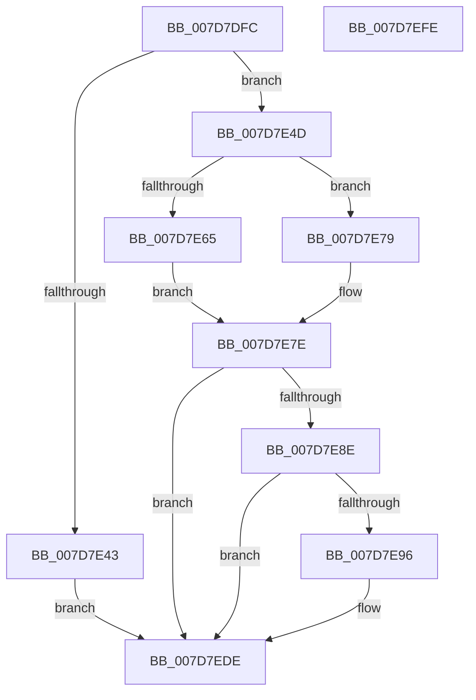

# WheapClearPoison

- RVA: `0x007D7DFC`–`0x007D7EFF` (길이 `259` bytes)
- VA: `0x00000001407D7DFC`
- 실행 섹션: `PAGE`
- PDB 이름 있음: `예`; PDB Function 태그: `아니요`
- unwind 정보 RVA: `0x000D5E94`
- 디코드: `66`개 명령, `259/259` bytes 표시
- 미해석 바이트: `0` (있으면 어셈블리에 `.byte`로 보존)

> 이 문서는 커널 이미지의 기계어와 PDB 기호를 분석해 생성했습니다. 4번과 5번은 함수 원형과 자료형을 바이너리 사용 방식에서 추정한 C 해석이며 원본 소스 복구 결과는 아닙니다.

## 1. Dependencies

- 직접 호출 지점: **6**; 고유 호출 대상: **6**
- 직접 호출자로 확인된 함수: **1**
- RIP 상대 이미지 참조: **1**

### Outgoing calls
- `0x007D7E3A` → [MmRemovePhysicalMemory](../7F/MmRemovePhysicalMemory_function_007FB560.md) (function, `0x007FB560`)
- `0x007D7E5B` → [MmMapIoSpaceEx](../../text/32/MmMapIoSpaceEx_function_00327830.md) (function, `0x00327830`)
- `0x007D7E70` → [MmUnmapIoSpace](../../text/3F/MmUnmapIoSpace_function_003F78F0.md) (function, `0x003F78F0`)
- `0x007D7E85` → [MmAddPhysicalMemory](../7F/MmAddPhysicalMemory_function_007FB460.md) (function, `0x007FB460`)
- `0x007D7ED9` → [WheaLogInternalEvent](../../text/66/WheaLogInternalEvent_function_006605B0.md) (function, `0x006605B0`)
- `0x007D7EE7` → [_security_check_cookie](../../text/6A/_security_check_cookie_function_006AC640.md) (function, `0x006AC640`)

### Direct callers
- [WheapAttemptPhysicalPageOffline](WheapAttemptPhysicalPageOffline_function_007D79AC.md) at `0x007D7A73`

### Static image references
- `0x007D7E0E` → RVA `0x00E0A740` (`.data`; read)

## 2. Other-region calls and transfers

- 다른 실행 섹션으로 향하는 call: **4**
  - `0x007D7E5B` → [MmMapIoSpaceEx](../../text/32/MmMapIoSpaceEx_function_00327830.md) (`PAGE` → `.text`)
  - `0x007D7E70` → [MmUnmapIoSpace](../../text/3F/MmUnmapIoSpace_function_003F78F0.md) (`PAGE` → `.text`)
  - `0x007D7ED9` → [WheaLogInternalEvent](../../text/66/WheaLogInternalEvent_function_006605B0.md) (`PAGE` → `.text`)
  - `0x007D7EE7` → [_security_check_cookie](../../text/6A/_security_check_cookie_function_006AC640.md) (`PAGE` → `.text`)
- 별도 외부 분기/꼬리 이동을 확인하지 못했습니다.

## 3. Assembly (complete function range)

```asm
007D7DFC  48 89 5C 24 10                  mov qword ptr [rsp + 0x10], rbx
007D7E01  48 89 7C 24 18                  mov qword ptr [rsp + 0x18], rdi
007D7E06  55                              push rbp
007D7E07  48 8B EC                        mov rbp, rsp
007D7E0A  48 83 EC 60                     sub rsp, 0x60
007D7E0E  48 8B 05 2B 29 63 00            mov rax, qword ptr [rip + 0x63292b]
007D7E15  48 33 C4                        xor rax, rsp
007D7E18  48 89 45 F8                     mov qword ptr [rbp - 8], rax
007D7E1C  48 8B 01                        mov rax, qword ptr [rcx]
007D7E1F  48 8D 55 C8                     lea rdx, [rbp - 0x38]
007D7E23  48 8B F9                        mov rdi, rcx
007D7E26  48 89 45 C0                     mov qword ptr [rbp - 0x40], rax
007D7E2A  83 4D C0 01                     or dword ptr [rbp - 0x40], 1
007D7E2E  48 8D 4D C0                     lea rcx, [rbp - 0x40]
007D7E32  48 C7 45 C8 00 10 00 00         mov qword ptr [rbp - 0x38], 0x1000
007D7E3A  E8 21 37 02 00                  call 0x1407fb560
007D7E3F  85 C0                           test eax, eax
007D7E41  79 0A                           jns 0x1407d7e4d
007D7E43  BB 01 00 00 C0                  mov ebx, 0xc0000001
007D7E48  E9 91 00 00 00                  jmp 0x1407d7ede
007D7E4D  48 8B 0F                        mov rcx, qword ptr [rdi]
007D7E50  BB 40 00 00 00                  mov ebx, 0x40
007D7E55  8B D3                           mov edx, ebx
007D7E57  44 8D 43 C4                     lea r8d, [rbx - 0x3c]
007D7E5B  E8 D0 F9 B4 FF                  call 0x140327830
007D7E60  48 85 C0                        test rax, rax
007D7E63  74 14                           je 0x1407d7e79
007D7E65  0F 01 FC                        clzero
007D7E68  0F AE F0                        mfence
007D7E6B  8B D3                           mov edx, ebx
007D7E6D  48 8B C8                        mov rcx, rax
007D7E70  E8 7B FA C1 FF                  call 0x1403f78f0
007D7E75  33 DB                           xor ebx, ebx
007D7E77  EB 05                           jmp 0x1407d7e7e
007D7E79  BB 01 00 00 C0                  mov ebx, 0xc0000001
007D7E7E  48 8D 55 C8                     lea rdx, [rbp - 0x38]
007D7E82  48 8B CF                        mov rcx, rdi
007D7E85  E8 D6 35 02 00                  call 0x1407fb460
007D7E8A  85 DB                           test ebx, ebx
007D7E8C  78 50                           js 0x1407d7ede
007D7E8E  44 0F 20 C0                     mov rax, cr8
007D7E92  3C 02                           cmp al, 2
007D7E94  77 48                           ja 0x1407d7ede
007D7E96  48 8B 0F                        mov rcx, qword ptr [rdi]
007D7E99  48 89 4D F0                     mov qword ptr [rbp - 0x10], rcx
007D7E9D  48 8D 4D D0                     lea rcx, [rbp - 0x30]
007D7EA1  C7 45 D0 57 68 4C 67            mov dword ptr [rbp - 0x30], 0x674c6857
007D7EA8  C7 45 D4 01 00 00 00            mov dword ptr [rbp - 0x2c], 1
007D7EAF  C7 45 D8 28 00 00 00            mov dword ptr [rbp - 0x28], 0x28
007D7EB6  C7 45 DC 01 00 00 00            mov dword ptr [rbp - 0x24], 1
007D7EBD  C7 45 E4 12 00 00 80            mov dword ptr [rbp - 0x1c], 0x80000012
007D7EC4  C7 45 E0 48 41 4C 20            mov dword ptr [rbp - 0x20], 0x204c4148
007D7ECB  C7 45 E8 02 00 00 00            mov dword ptr [rbp - 0x18], 2
007D7ED2  C7 45 EC 08 00 00 00            mov dword ptr [rbp - 0x14], 8
007D7ED9  E8 D2 86 E8 FF                  call 0x1406605b0
007D7EDE  8B C3                           mov eax, ebx
007D7EE0  48 8B 4D F8                     mov rcx, qword ptr [rbp - 8]
007D7EE4  48 33 CC                        xor rcx, rsp
007D7EE7  E8 54 47 ED FF                  call 0x1406ac640
007D7EEC  4C 8D 5C 24 60                  lea r11, [rsp + 0x60]
007D7EF1  49 8B 5B 18                     mov rbx, qword ptr [r11 + 0x18]
007D7EF5  49 8B 7B 20                     mov rdi, qword ptr [r11 + 0x20]
007D7EF9  49 8B E3                        mov rsp, r11
007D7EFC  5D                              pop rbp
007D7EFD  C3                              ret
007D7EFE  CC                              int3
```

## 4. C-style interpretation (structured pseudocode)

```c
__int64 __fastcall WheapClearPoison(__int64 a1)
{
    __int64 result;
    __int64 v_rbx;
    __int64 v_rsp;
    unsigned __int64 v_stack_m10;
    unsigned __int64 v_stack_m18;
    unsigned int v_stack_m1C;
    unsigned int v_stack_m20;
    unsigned int v_stack_m24;
    unsigned int v_stack_m28;
    unsigned int v_stack_m2C;
    unsigned int v_stack_m30;
    unsigned int v_stack_m34;
    unsigned __int64 v_stack_m38;
    unsigned __int64 v_stack_m40;
    unsigned __int64 v_stack_m48;
    unsigned __int64 v_stack_m8;
    unsigned __int64 v_stack_p10;
    unsigned __int64 v_stack_p18;

    v_stack_p10 = v_rbx;
    v_stack_p18 = v_rdi;
    v_rsp = (v_rsp) - (96);
    result = (*(unsigned __int64 *)(v_rip + 6498603)) ^ (v_rsp);
    v_stack_m10 = result;
    v_stack_m48 = *(unsigned __int64 *)(a1);
    v_stack_m40 = 0x1000ULL;
    result = MmRemovePhysicalMemory(v_stack_m48, v_stack_m40, a3, a4);
    if (!sign_flag) goto loc_007D7E4D;
    goto loc_007D7EDE;
loc_007D7E4D:
    result = MmMapIoSpaceEx(*(unsigned __int64 *)(a1), 64, 64 - 60, a4);
    if (result == 0) goto loc_007D7E79;
    result = MmUnmapIoSpace(result, 64, 64 - 60, a4);
    v_rbx = 0;
    goto loc_007D7E7E;
loc_007D7E79:
loc_007D7E7E:
    result = MmAddPhysicalMemory(a1, v_stack_m40, 64 - 60, a4);
    if (sign_flag) goto loc_007D7EDE;
    result = v_cr8;
    if (((unsigned __int8)(v_cr8)) <= 2) {
        a1 = *(unsigned __int64 *)(a1);
        v_stack_m18 = a1;
        a1 = v_stack_m38;
        v_stack_m38 = 0x674C6857ULL;
        v_stack_m34 = 1;
        v_stack_m30 = 40;
        v_stack_m2C = 1;
        v_stack_m24 = 0x80000012ULL;
        v_stack_m28 = 0x204C4148ULL;
        v_stack_m20 = 2;
        v_stack_m1C = 8;
        result = WheaLogInternalEvent(a1, v_stack_m40, 64 - 60, a4);
    }
    a1 = (v_stack_m10) ^ (v_rsp);
    result = _security_check_cookie(a1, v_stack_m40, 64 - 60, a4);
    return result;
}
```

## 5. (Beta) C Style

```c
int64_t WheapClearPoison(void *Arg1)
{
    uint8_t *arg1 = (uint8_t *)Arg1;

    int64_t result;
    int64_t local_rbx;
    int64_t local_rsp;
    uint64_t v_stack_m10;
    uint64_t v_stack_m18;
    uint32_t v_stack_m1C;
    uint32_t v_stack_m20;
    uint32_t v_stack_m24;
    uint32_t v_stack_m28;
    uint32_t v_stack_m2C;
    uint32_t v_stack_m30;
    uint32_t v_stack_m34;
    uint64_t v_stack_m38;
    uint64_t v_stack_m40;
    uint64_t v_stack_m48;
    uint64_t v_stack_m8;
    uint64_t v_stack_p10;
    uint64_t v_stack_p18;

    v_stack_p10 = local_rbx;
    v_stack_p18 = local_rdi;
    local_rsp = (local_rsp) - (96);
    result = (*(uint64_t *)(v_rip + 0x63292B)) ^ (local_rsp);
    v_stack_m10 = result;
    v_stack_m48 = *(uint64_t *)(arg1);
    v_stack_m40 = 0x1000ULL;
    result = MmRemovePhysicalMemory(v_stack_m48, v_stack_m40, a3, a4);
    if (!sign_flag) goto loc_007D7E4D;
    goto loc_007D7EDE;
loc_007D7E4D:
    result = MmMapIoSpaceEx(*(uint64_t *)(arg1), 64, 64 - 60, a4);
    if (result == 0) goto loc_007D7E79;
    result = MmUnmapIoSpace(result, 64, 64 - 60, a4);
    local_rbx = 0;
    goto loc_007D7E7E;
loc_007D7E79:
loc_007D7E7E:
    result = MmAddPhysicalMemory(Arg1, v_stack_m40, 64 - 60, a4);
    if (sign_flag) goto loc_007D7EDE;
    result = v_cr8;
    if (((uint8_t)(v_cr8)) <= 2) {
        Arg1 = *(uint64_t *)(arg1);
        v_stack_m18 = Arg1;
        Arg1 = v_stack_m38;
        v_stack_m38 = 0x674C6857ULL;
        v_stack_m34 = 1;
        v_stack_m30 = 40;
        v_stack_m2C = 1;
        v_stack_m24 = 0x80000012ULL;
        v_stack_m28 = 0x204C4148ULL;
        v_stack_m20 = 2;
        v_stack_m1C = 8;
        result = WheaLogInternalEvent(Arg1, v_stack_m40, 64 - 60, a4);
    }
    Arg1 = (v_stack_m10) ^ (local_rsp);
    result = _security_check_cookie(Arg1, v_stack_m40, 64 - 60, a4);
    return result;
}
```

### 관측된 메모리 오프셋

구조체 형식이 확인되지 않은 접근은 인자 기준의 오프셋으로만 기록했습니다.

| 기준 인자 | 오프셋 표현 | 폭 (bit) | 접근 |
|---|---:|---:|---|
| `Arg1` | `+ 0x0` | `64` | `R` |

## 6. Execution-region graph

[열기: 2D/3D 그래프와 함수 탐색 컨트롤 패널](../../../control-panel.html?section=page&rva=0x007D7DFC&view=graph)

- 2D 그래프는 위에서 아래로 흐르고, 3D 그래프는 빈 공간을 드래그해 회전합니다. Shift+드래그는 이동, 휠은 확대·축소, 함수 노드 선택은 대상 보고서 이동입니다.

### Static fallback


