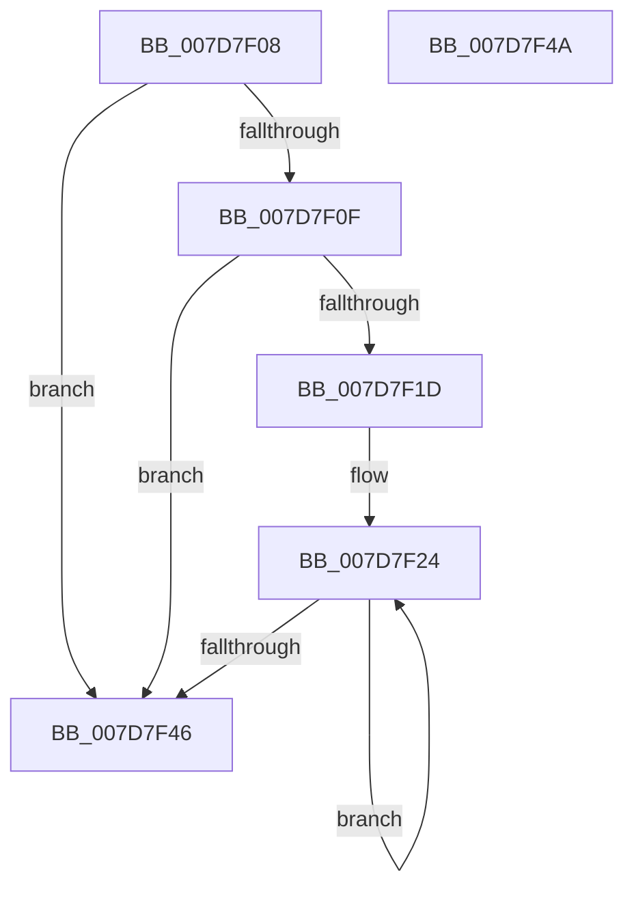

# WheapCountBadPageExtents

- RVA: `0x007D7F08`–`0x007D7F4B` (길이 `67` bytes)
- VA: `0x00000001407D7F08`
- 실행 섹션: `PAGE`
- PDB 이름 있음: `예`; PDB Function 태그: `아니요`
- unwind 정보 RVA: `0x000DB714`
- 디코드: `22`개 명령, `67/67` bytes 표시
- 미해석 바이트: `0` (있으면 어셈블리에 `.byte`로 보존)

> 이 문서는 커널 이미지의 기계어와 PDB 기호를 분석해 생성했습니다. 4번과 5번은 함수 원형과 자료형을 바이너리 사용 방식에서 추정한 C 해석이며 원본 소스 복구 결과는 아닙니다.

## 1. Dependencies

- 직접 호출 지점: **0**; 고유 호출 대상: **0**
- 직접 호출자로 확인된 함수: **1**
- RIP 상대 이미지 참조: **0**

### Outgoing calls
- 직접 디코드된 call 명령이 없습니다.

### Direct callers
- [WheaPersistBadPageToBcd](../../text/65/WheaPersistBadPageToBcd_function_0065F3D0.md) at `0x0065F517`

### Static image references
- 디코드된 RIP-relative 메모리 참조가 없습니다.

## 2. Other-region calls and transfers

- 다른 실행 섹션으로 향하는 call: **0**
- 별도 외부 분기/꼬리 이동을 확인하지 못했습니다.

## 3. Assembly (complete function range)

```asm
007D7F08  45 33 C9                        xor r9d, r9d
007D7F0B  85 D2                           test edx, edx
007D7F0D  74 37                           je 0x1407d7f46
007D7F0F  4C 8B 19                        mov r11, qword ptr [rcx]
007D7F12  41 B9 01 00 00 00               mov r9d, 1
007D7F18  41 3B D1                        cmp edx, r9d
007D7F1B  76 29                           jbe 0x1407d7f46
007D7F1D  4C 8D 51 08                     lea r10, [rcx + 8]
007D7F21  8D 42 FF                        lea eax, [rdx - 1]
007D7F24  4D 8B 02                        mov r8, qword ptr [r10]
007D7F27  49 8D 4B 01                     lea rcx, [r11 + 1]
007D7F2B  4C 3B C1                        cmp r8, rcx
007D7F2E  41 8D 51 01                     lea edx, [r9 + 1]
007D7F32  4D 8B D8                        mov r11, r8
007D7F35  4D 8D 52 08                     lea r10, [r10 + 8]
007D7F39  41 0F 46 D1                     cmovbe edx, r9d
007D7F3D  44 8B CA                        mov r9d, edx
007D7F40  48 83 E8 01                     sub rax, 1
007D7F44  75 DE                           jne 0x1407d7f24
007D7F46  41 8B C1                        mov eax, r9d
007D7F49  C3                              ret
007D7F4A  CC                              int3
```

## 4. C-style interpretation (structured pseudocode)

```c
__int64 __fastcall WheapCountBadPageExtents(__int64 a1, __int64 a2, __int64 a3, int a4)
{
    __int64 result;

    a4 = 0;
    if ((unsigned int)(a2) == 0) goto loc_007D7F46;
    if (((unsigned int)(a2)) <= 1) goto loc_007D7F46;
loc_007D7F24:
    a2 = 1 + 1;
    if ((*(unsigned __int64 *)(a1 + 8)) <= (*(unsigned __int64 *)(a1) + 1)) { a2 = 1; }
    result = (a2 - 1) - (1);
    if (condition_is_not_equal) goto loc_007D7F24;
loc_007D7F46:
    return (unsigned int)((unsigned int)((unsigned int)((unsigned int)(a2))));
}
```

## 5. (Beta) C Style

```c
int64_t WheapCountBadPageExtents(void *Arg1, int64_t Arg2, int64_t Arg3, int32_t Arg4)
{
    uint8_t *arg1 = (uint8_t *)Arg1;

    int64_t result;

    Arg4 = 0;
    if ((uint32_t)(Arg2) == 0) goto loc_007D7F46;
    if (((uint32_t)(Arg2)) <= 1) goto loc_007D7F46;
loc_007D7F24:
    Arg2 = 1 + 1;
    if ((*(uint64_t *)(arg1 + 0x8)) <= (*(uint64_t *)(arg1) + 1)) { Arg2 = 1; }
    result = (Arg2 - 1) - (1);
    if (condition_is_not_equal) goto loc_007D7F24;
loc_007D7F46:
    return (uint32_t)((uint32_t)((uint32_t)((uint32_t)(Arg2))));
}
```

### 관측된 메모리 오프셋

구조체 형식이 확인되지 않은 접근은 인자 기준의 오프셋으로만 기록했습니다.

| 기준 인자 | 오프셋 표현 | 폭 (bit) | 접근 |
|---|---:|---:|---|
| `Arg1` | `+ 0x0` | `64` | `R` |
| `Arg1` | `+ 0x8` | `64` | `R` |

## 6. Execution-region graph

[열기: 2D/3D 그래프와 함수 탐색 컨트롤 패널](../../../control-panel.html?section=page&rva=0x007D7F08&view=graph)

- 2D 그래프는 위에서 아래로 흐르고, 3D 그래프는 빈 공간을 드래그해 회전합니다. Shift+드래그는 이동, 휠은 확대·축소, 함수 노드 선택은 대상 보고서 이동입니다.

### Static fallback


